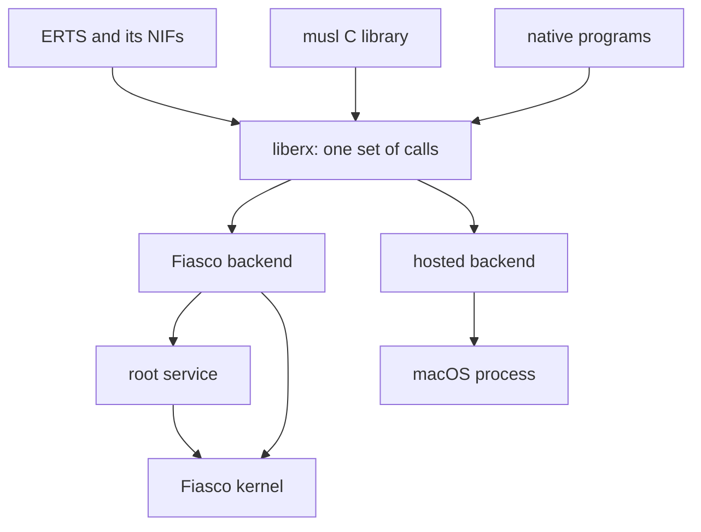
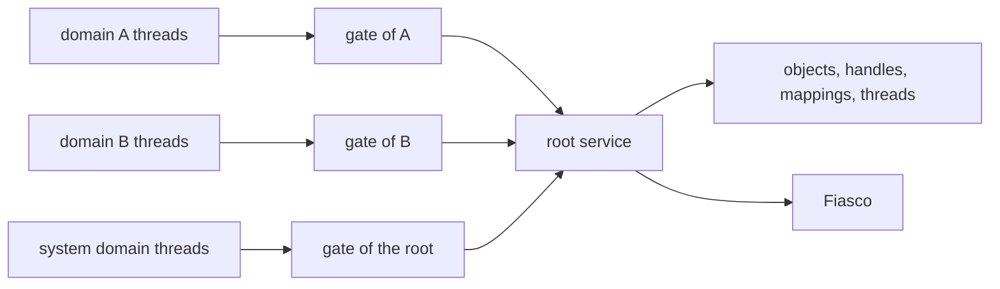
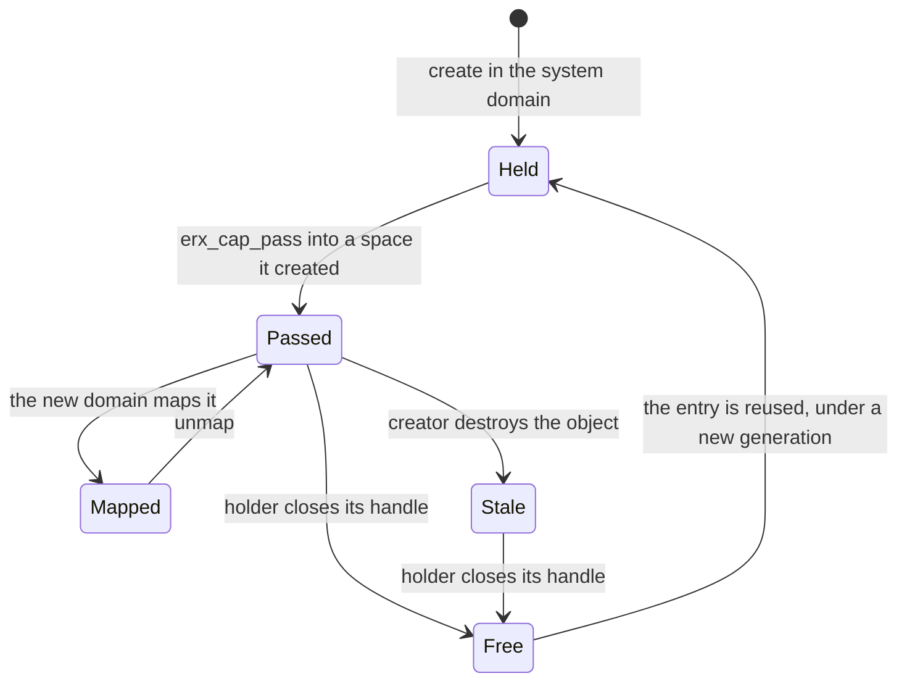

# Chapter 8. The Kernel Interface and Fiasco

> **Status.** **Built:** `liberx` with its Fiasco backend and its
> hosted backend, held to one test set; the root service, its request
> decoder and its tables; handles as entries of the root's per-task
> tables, each carrying its object's generation and its own in the
> handle's value, with the rights it holds; memory objects of
> seven kinds, mappings and the root's page pool; doorbells and device
> lines, rung and acknowledged straight through Fiasco on a capability
> the root places at each handle's slot; thread creation, umtx waits and parking; fault gates and exit
> records; the machine's end on a fault of the root task; budgets as
> records that end what is charged to them; each task's threads at
> its band's priority. **Designed:** priority bands as a base and a
> ceiling, and per-domain CPU sets; signals through vCPU upcalls; DMA
> spaces behind an IOMMU; rights narrowed per creation kind and checked
> on every use; and the system-call fuzz campaign.

**Background needed.** [Chapter 1](01-operating-systems.md) for system
calls, address spaces and page tables; [chapter 2](02-microkernels.md)
for capabilities, IPC gates, labels, the UTCB and the root task
(section 2.5 traces one call through Fiasco); [chapter
3](03-erlang.md) for ERTS and NIFs. Chapters 5 to 7 help but are not
required.

ERTS, the Erlang runtime, needs memory for every process heap it
allocates, and it asks for it with `mmap`. On erXos the runtime is an
ordinary program in user mode, on a kernel that knows nothing of
`mmap`, files or Erlang. Somebody has
to turn "give me 2 MiB" into pages, page-table entries and a record of
who pays for them. Memory is this chapter's running example, but
threads, waits and faults raise the same question.

The answer cannot be "each runtime talks to Fiasco directly". A
runtime that calls Fiasco by name is tied to Fiasco's data structures,
capability numbers and error codes. Worse, if every domain could write
its own page tables, nothing would keep one domain out of another's
memory. Two things are needed: an interface that keeps programs from
naming kernel structures, and a trusted party in user mode that
decides what each program may have.

erXos gets both from one library and one thread. Every kernel call
goes through **`liberx`**, erXos's own kernel interface. Behind
`liberx`, a call either runs in the caller's own thread or becomes a
request to the root service, one thread of the system domain that
alone creates kernel objects and writes page tables. Fiasco checks
every use of what the root made; the root decides what each domain
may make.

> **Background: a capability table, recalled.** A program names a
> kernel object by a slot number in a table the kernel keeps for its
> address space, and the number means nothing in any other table, so
> it cannot be forged into authority. A generation, a counter
> bumped when an object or slot is reused, tells an old reference from
> a new one
> ([section 2.3.5](02-microkernels.md#235-delegation-shrinking-rights-and-revocation)).

> **Background: Fiasco and L4Re.** Chapter 2 introduced Fiasco, L4Re
> and their root task, Moe, which builds the system from the
> capabilities it receives at boot
> ([section 2.5](02-microkernels.md#25-the-l4-family-and-fiasco)).
> erXos uses Fiasco and Sigma0, the first pager, which holds all
> physical memory at boot, and puts its own root task, the system
> domain, in Moe's place.

## 8.1 What the kernel knows, and what it does not

A domain's runtime needs six things from below it, and none of them
mentions Erlang: threads to run on, a way to wait for work, memory, a
way to hand a reference to another domain, notice that a device or a
peer wants attention, and notice that something it started has failed.

### 8.1.1 The kernel's objects

The kernel interface names its objects in erXos's own terms. A domain
is one space with one runtime in it; a space can also hold a single
native program.

| Object | What it is | Example of use |
| --- | --- | --- |
| space | an address space, with its own handle table | a domain; a native program |
| thread | a stream of execution in a space | an ERTS scheduler thread |
| **group** | the set of threads one runtime treats as its pool of schedulers | every scheduler thread of one domain's ERTS |
| memory object | a set of pages that mappings place in spaces | a process heap; one side of a connection |
| **IRQ object** | something that fires to wake a waiting thread | a disk's interrupt line; a doorbell |
| **gate** | a queue that reports faults and exits to one thread | where a domain's crash is reported |
| budget | an account that the objects made for a domain are charged to | the domain's own memory |

A **doorbell** is an IRQ object with no device behind it: one domain
rings it to tell another that it has put work in their shared memory.

Each of these objects is Built, in the form the rest of the chapter
describes. The kernel knows threads and address spaces and moves
pages between them. It knows that an IRQ object fired. It does not
know what a pid is, that a process has a mailbox, or which Erlang
process a page holds. Those live in ERTS, one level up
([chapter 9](09-processes.md#912-two-levels-in-one-picture)).

### 8.1.2 Why the line falls there

The line falls where the hardware's protection falls. Only kernel-mode
code can write page tables and switch address spaces, so the objects
that need those powers belong to the kernel. Everything that needs
only ordinary instructions runs in user mode: ERTS and its scheduler,
the system services, the drivers and their device shims
([design.md, Trust placement](../design.md#trust-placement)).

This buys a small trusted base. A bug in the network stack, in a
driver or in a domain's runtime faults in that domain's address space
and ends that domain. It does not reach the kernel's memory, because
it has no mapping of it. erXos takes chapter 2's argument a step
further: even the runtime that runs the system's own services is a
user-mode program.

The cost is crossings. Each kernel call enters kernel mode and leaves
it, and each move of work between address spaces pays for a switch;
Singularity measured these crossings at about a third of a
message-heavy benchmark (Hunt and Larus 2007;
[section 4.3](04-history.md#43-the-lineage)). erXos's answer is to
cross rarely. Inside a domain, thousands of Erlang processes switch
without the kernel. Between domains, data moves through shared memory
that no kernel call touches while both sides are awake. The kernel is
entered to wait, to wake, and to set things up. The cost of one
request to the root service is not measured;
[design-fiasco.md, Measurements](../design-fiasco.md#measurements)
names the run that would price it.

## 8.2 `liberx`: the one issuer of kernel calls

No line of ERTS, of musl or of a native program calls Fiasco. They call
`liberx`, and `liberx` is the only code in the system that issues a
kernel call ([design-runtime.md, liberx](../design-runtime.md#liberx)).

### 8.2.1 One file for the numbers

Every call number of the kernel interface, every status code, and
every binary layout a call carries is defined once in
`abi/erx_abi.txt`. A Ruby generator turns that file into C headers and
into the tables other languages need, so no constant is copied by hand
([chapter 7](07-one-source.md) tells the general story). The functions
themselves are declared over those numbers in `liberx/backend/api.h`.
The one for creating a memory object is:

```c
int	erx_mem_create(uint64_t budget, uint64_t size, uint32_t flags, uint64_t *mem) ERX_WARN_UNUSED_RESULT;
```

The caller names the budget that pays, the size and flags, and gets
back a **handle**, a number that stands for the new object in the
caller's own table (section 8.4). The compiler warns when a caller
ignores the status, because every call can be refused.

The status codes are erXos's own. `ERX_ENOMEM` means the pages are not
there, `ERX_EINVAL` an argument out of shape, `ERX_ETYPE` a handle to
the wrong kind of object, `ERX_ERIGHTS` a caller not allowed to do
this, `ERX_ESTALE` a handle whose object is gone, `ERX_ELIMIT` a table
that is full, `ERX_ERANGE` an index or address out of range, and
`ERX_ENOTSUP` a call the system does not carry out. No Fiasco error
number reaches a caller.

### 8.2.2 Two backends behind one set of names

Behind the names sit two implementations, called **backends**, as
figure 8.1 shows.



*Figure 8.1. The kernel interface. Everything above `liberx` calls the
same names. The Fiasco backend runs a call in the caller's thread or
sends it to the root service; the hosted backend runs the same calls
inside one macOS process.*

The **Fiasco backend**, in `liberx/backend/fiasco/`, is what the
system runs on. Each call is one of two kinds. A **local** call runs
in the caller's own thread: waiting on its semaphore, parking, a umtx
wait, reading the clock. A **service** call becomes a request to the
root service, which runs the code that carries out the call and
replies: creating anything, mapping anything, passing a handle.

The **hosted backend**, in `liberx/backend/hosted/`, runs a runtime as
a macOS process, under memory-error checkers and a debugger. A space is
the process, a thread is a pthread, a memory object's pages are one
`mmap`ped area. It carries the calls one process can carry cheaply and
answers the rest `ERX_ENOTSUP`
([design-fiasco.md, The hosted backend](../design-fiasco.md#the-hosted-backend)).

One test set, `test/guest/function_api`, holds both backends to the
same results. No case reads which backend it is on, and a refusal is a
result like any other: where both carry a call and the Fiasco backend
answers `ERX_ERANGE`, the hosted one must too. The code that decides
those results, the handle table and the range table among it, lives
once, in `liberx/backend/core/`, and builds for the host. All of this
is Built.

### 8.2.3 Refusing, and never inventing

Fiasco has no notion of a CPU share, keeps no idle time worth
reporting, and gives no object a system-wide id, yet erXos's interface
asks for all three. The backend has two rules for such cases
([design-fiasco.md, Contract](../design-fiasco.md#contract)).

* A call the backend cannot carry out over Fiasco fails with
  `ERX_ENOTSUP`, and every caller checks for it.
* A value the backend cannot measure is reported as `unsupported`, or
  as `partial` with the part it does know and who reported it. It is
  never filled with a guess.

The inspector, erXos's tool for reading the live system as files
under `/proc` ([chapter 21](21-live-machine.md#2123-proc)),
shows the second rule. Each CPU's idle time reads unsupported, and so
does another domain's budget, because the Fiasco backend reports only
the system domain's own. It does not print zero: a zero would look
like a fact, and a reader would act on it.

### 8.2.4 The seam as a build check

The rule "only the Fiasco backend speaks Fiasco" is easy to break by
accident, with one stray `#include`. So build checks fail if a Fiasco
header or symbol, or a header of the Fiasco backend, appears in a file
outside `liberx/backend/fiasco/`
(`tools/lib/erx/chokepoint_rules/fiasco_seam.rb`). That is why ERTS and
the services build unchanged against the hosted backend, and why ERTS
runs against it as a macOS process. musl is the exception: its
system-call layer includes the Fiasco backend's headers, a site the
check permits by name.

## 8.3 The root service: who holds what

In the system as it runs, one thread decides what every domain may
have, and every other thread asks it.

### 8.3.1 One thread for every table

The system domain is the root task of section 2.5.3. Of its threads,
one is the root service: it alone creates kernel objects, holds the
tables that record them, and writes any space's page tables or
capability table. Every other thread, the system domain's own
included, sends it requests through a gate, as figure 8.2 shows.



*Figure 8.2. The root service between the domains and Fiasco. Each
task calls through its own gate, so the service knows the caller from
the gate alone. Only the service touches the tables and asks Fiasco to
create, map or delete.*

The root service's loop, `service_main` in
`liberx/backend/fiasco/service.c`, waits for a message, decodes it,
runs the call's code to its end, then replies and waits again in one
Fiasco call. The call's code never sends a request of its own and
never waits on another thread, so it never blocks, and nothing else
runs on the root's tables while it works.

That shape removes a class of problem. One thread touches the tables
of objects, handles, mappings and threads, so they need no lock, and
no request sees another half done. A request from a task cannot
overlap that task's exit, because the exit is work the same thread
does between requests
([design-fiasco.md, Helper threads](../design-fiasco.md#helper-threads)).

The cost is that every domain's setup queues on one thread. A domain
that sends requests as fast as it can delays every other domain's
creations, maps and faults, by an amount nothing bounds. Steady-state
traffic is not affected: a domain's own memory, its waits and its
shared rings make no request
([design-fiasco.md, What the root still serves](../design-fiasco.md#what-the-root-still-serves)).

### 8.3.2 What a domain holds

A domain holds little of Fiasco's. The root creates every Fiasco
object from its own factory and keeps the capability to it in its own
capability table. Into each task it places two kinds of capability and
nothing else:

* the task's **request gate**, an IPC gate bound to the root service.
  It sits in the slot Fiasco uses for a thread's pager, the handler
  Fiasco sends a thread's page faults to. So the same gate carries the
  task's requests and its threads' faults (`task_objects_make` in
  `liberx/backend/fiasco/service_task.c`);
* one **semaphore** per thread, the object the thread sleeps on when it
  waits (`service_thread_create` in `service.c`).

Everything else a domain uses (its memory objects, IRQ objects,
budgets, groups, the spaces it created) it names by a handle that only
the root's tables give meaning to, and it uses them through service
requests. Its memory it holds as mappings, entries in its page tables,
not capabilities at all.

No task but the root holds a capability to a task, a thread, a factory
or the scheduler. So no task can write any capability table or page
table, its own included. The rest of the system leans on this
property, and it holds by construction: the capabilities that could
write those tables exist only in the root's table
([design-fiasco.md, Who holds what](../design-fiasco.md#who-holds-what)).
Because every object comes from the root's one factory, Fiasco keeps
no separate quota of kernel memory for each domain.

### 8.3.3 The decoder: the trust boundary

The root service reads requests from every domain, and in a system
that runs untrusted apps any of them may be hostile. So the service
first runs each message through a decoder that trusts nothing in it.
`erx_fiasco_wire_decode`, in `liberx/backend/fiasco/service_wire.c`,
is a pure function: it takes the message's label, tag and words, and
returns what to do.

The caller's identity comes from the label, the number the root gave
the task's gate when it made it, which Fiasco delivers with every
message ([section 2.5.2](02-microkernels.md#252-fiasco-and-l4re)).
Nothing the caller wrote says who it is. A message whose label names
no live task is dropped. A request must then have exactly the number
of words its layout in `abi/erx_abi.txt` gives, and its first word, the
calling thread's index, must be in range. Anything else, an unknown
call number included, is refused with `ERX_EINVAL` before any call's
code runs.

Addresses cross only as numbers. The service writes an address the
caller names into a page table; it never loads or stores through it.
What a request carries in the caller's UTCB, the per-thread area of
chapter 2, the service copies once and checks only the copy, because
the caller's other threads can rewrite the UTCB meanwhile. The decoder
has a fuzz target that feeds it random messages
(`tools/fuzz/service_wire_fuzz.c`). All of this is Built.

### 8.3.4 One request end to end: a domain's crash area

A domain that crashes should leave a record of why, and the record must
outlive the domain. erXos keeps it in one memory object, the domain's
**crash area**. The domain's runtime writes its crash dump there, and
the system domain reads it after the domain has ended. Following that
object from creation to last read touches every part of this section.

The trace starts in the **domain library**, the C code in the system
domain that builds and ends domains (`liberx/system/`).

**1. The plan.** When the system domain creates a domain, the domain
library first writes the whole construction down as a plan, a list of
steps, before it makes anything. The pure function that builds the
plan, in `liberx/system/dom_core.c`, adds this step among others:

```c
	dom_step(plan, (erx_dom_step_t){ .kind = ERX_DOM_STEP_MEM,
	    .obj = ERX_DOM_OBJ_CRASH, .budget = ERX_DOM_OBJ_OUTER,
	    .size = spec->crash });
```

Notice the budget. The crash area is charged to the domain's **outer
budget**, a second budget carved beside the domain's own. Ending a
domain ends its own budget and everything charged to it, but the outer
budget, and the crash area with it, stays until the system domain has
read the dump (`include/erx/dom.h`, `erx_dom_state_t`). Another table
in the same file says the domain's space gets the crash area as a
writer.

**2. The call.** The library's apply step, `make_step` in
`liberx/system/dom_apply.c`, turns the plan step into a call of
`erx_mem_create` with the outer budget's handle and the size.

**3. The request.** The stub of `erx_mem_create`, in
`liberx/backend/fiasco/service_stubs.c`, fills the request layout that
`abi/erx_abi.txt` defines with four words: the calling thread's index,
the budget's handle, the size and the flags. It copies them into the
thread's message registers and makes one Fiasco IPC call on the task's
request gate, tagged with the call's number. The thread blocks until
the reply. Fiasco delivers the message to the root service with the
gate's label, and the decoder names the calling task and checks the
request's shape.

**4. The create.** The service runs the call's code,
`erx_fiasco_task_mem_create_body` in `service_task.c`. It refuses a
size that is zero or not a whole number of pages, and an unknown flag,
with `ERX_EINVAL`. It then calls `erx_fiasco_object_create` in
`liberx/backend/fiasco/object.c`, which does three things in order:

* it finds the budget the caller named, through the caller's own
  handle table, so a task can charge only a budget it holds;
* it takes a free **object record**, the root's entry for one object,
  and fills it with pages from the root's pool, zeroed;
* it adds an entry to the caller's handle table naming the record, and
  returns the entry's number as the handle.

If any step fails, the steps before it are undone, so a failed create
leaves no record and no pages behind. The service puts the status and
the handle in the message registers and replies, and in the same
Fiasco call waits for the next message.

No page table has changed so far. The crash area exists, zeroed and
charged to the outer budget, and nobody maps it.

**5. The pass.** The domain library hands the new domain its handle
with `erx_dom_install` (`liberx/system/dom_install.c`), which writes
one item, the handle and a rights mask, into the thread's UTCB and
calls `erx_cap_pass(ERX_CAP_SELF, recipient, 1)`. The root checks that
the target is a space the caller created, copies the item out of the
caller's UTCB once, adds an entry to the new domain's handle table
naming the same object record, and writes the new handle back. The
library stores it as `crash_area` in the domain's **boot information
page**, the page of starting facts a new domain reads first.

**6. The map.** When the domain's ERTS starts, `erx_crash_area_init`
in `otp/erts/emulator/sys/erxos/erx_crash_area.c` maps the area into
its own space:

```c
    status = erx_vm_reserve(ERX_CAP_SELF, 0, ERX_CRASH_SIZE, 0, &addr);
    if (status == ERX_OK) {
	status = erx_vm_map(ERX_CAP_SELF, addr, ERX_CRASH_SIZE, mem, 0, ERX_PROT_RW);
	if (status != ERX_OK)
	    (void) erx_vm_release(ERX_CAP_SELF, addr, ERX_CRASH_SIZE);
    }
```

The first call reserves a range of addresses in the domain's own space
and returns where; the second asks for the object's pages there,
readable and writable. Notice that a refused map gives the range back,
and the code that follows prints that a crash would leave no dump: a
missing crash area is reported, not ignored.

Each call is another request like step 3. For the map, the root looks
the handle up, applies the object's rule for how it may be mapped
(section 8.6.3), and records the mapping in the space's range table.
Then, page by page, it asks Fiasco to map the page from the root's own
address of it to the address the domain reserved, and Fiasco writes
the page-table entries.

**7. The use.** From here on the domain writes its crash area with
ordinary stores. No request is made: the pages are mapped, so the
stores do not fault. If the domain's runtime crashes, it writes the
dump text, then the header, and the magic number last, so a reader can
tell a complete dump from a torn one.

**8. The read.** The domain's crash ends its space (section 8.5.4),
and the system domain learns of it from an exit record. Ending the
space removes the domain's mappings and ends its own budget. The crash
area, charged to the outer budget, is still there, and the system
domain still holds a handle to it. It copies the area out with
`erx_mem_copy`, a service call that copies between two objects' pages
inside the root (`erx_dom_lib_crash_copy` in `dom_apply.c`), and
checks every field before it believes one (`liberx/system/dom_dump.c`).
Only then does the outer budget go, and the crash area with it.

Every step in this trace is Built. The same calls make a connection's
shared rings, a native program's data area and a driver's buffers.

## 8.4 Handles and destroying an object

A handle is a number, and the question every capability system must
answer is what that number means after the object it named has gone.

### 8.4.1 What a handle names

The root keeps one table of object records for the whole machine and
one **handle table** per task (`liberx/backend/core/handles.h`). A
handle's low 24 bits are the number of an entry in the caller's own
handle table, its index plus one, so that zero can mean "no handle";
the 40 bits above them are the entry's own generation. Each entry names
an object record and the generation that record had when the entry was
made, and holds the rights its holder has to the object.

Every service call that takes a handle looks it up with
`erx_backend_handle_find`, which checks in order the number within
the table, the entry in use, the value's generation against the
entry's, and the record still at the entry's generation. A failure of
any of these answers `ERX_ESTALE`, whatever the reason the value names
no live slot, so a forged, closed and stale handle look alike. Only then does an object of the wrong kind for the call answer
`ERX_ETYPE`. Otherwise the lookup returns the record.

So a handle is meaningless outside its table, as chapter 2's slot
numbers are. Domain A's handle 7 and domain B's handle 7 are two
different entries, and B cannot use A's number to reach A's object.
The size of each table is fixed when its space is created, and a task
that fills it gets `ERX_ELIMIT`.

### 8.4.2 Destroying an object

Only an object's creator may destroy it. `erx_object_destroy` checks
that the caller's task is the record's creator and refuses anyone else
with `ERX_ERIGHTS`; no pass ever conveys the right to destroy.

What happens to the other holders does not depend on who they are or
how many there are. For a memory object, the root first revokes every
mapping of it. Fiasco's **mapping database** records which mapping was
made from which, as a tree, and every task's mapping of a page was made
from the root's own mapping of that page. So one unmap of the root's
page removes it from every other space at once
(`erx_fiasco_vm_object_revoke` in `vm.c`). Then the root frees the
record and bumps its generation. Every other holder's entry still names
the record at the old generation, so it answers `ERX_ESTALE` until its
holder closes it, and it never names whatever object takes the record
next. Nobody had to find the holders, and none of them can reach the
object again.

An object also goes without a destroy: when its last handle and its
last mapping are gone, when its budget ends, or when the task that
created it ends. Ending a domain is the last case on a large scale.
Every object charged to the domain's budget goes in flat sweeps of the
object table (`liberx/backend/fiasco/budget.c`), so nothing the domain
made is left to chase.

### 8.4.3 Using a handle after closing it

The record's generation tells a holder that the object its entry named
is gone; the entry's own generation protects a holder from its own
close. A close advances the entry's generation and puts the entry at
the end of the task's free list, so the old value answers `ERX_ESTALE`
from then on, even after the entry is taken again for another object.
Free entries are taken first in, first out, not lowest first as UNIX
file descriptors are, and an entry whose generation reaches its last
value, 2^40 - 1, retires and is never taken again, so no value comes
back to name a new object. The close takes a holder off the record only
when the record is still at the entry's generation, so closing a stale
entry never costs the record's next object a holder.

So the use-after-close bug, a program using a value after closing it,
fails with `ERX_ESTALE` in every service call instead of reaching
another object. One use stays unchecked by design: an interrupt object
or a doorbell rung straight through Fiasco (section 8.4.4) is checked
by Fiasco at its slot alone, and only the first-in-first-out reuse
delays a closed slot from naming another object.

### 8.4.4 Rights

Each entry stores its rights. A pass takes a rights mask and records
the new handle's rights, the mask within what the object's type allows
and without the right to destroy (`object_pass_item` in `object.c`),
but a create records its type's whole mask and no call except destroy
checks a right. Two things limit a holder: the creator-only destroy,
and the rules each kind of object carries (section 8.6.3):

* every mapping is read-only, readable and writable, or readable and
  executable, never writable and executable at once, because the range
  table accepts only those three protections
  (`liberx/backend/core/vm_table.h`);
* a slice of the boot image maps read-only, because its pages are the
  image's own;
* device memory never maps executable;
* a sealed code object maps for reading or running, never for
  writing.

So a domain passed one side of a connection "to read" can ask for a
writable mapping of it and get one. Every build runs trusted code only
and prints `development build: trusted code only` in its banner. In
such a build, the masks the domain library passes are kept by the
discipline of the code that receives them, not by the root.

The design closes this gap; it is designed and not built. A create
records its creation kind's default rights, rights are intersected
with the mask on every duplicate and pass, and every call checks the
right it needs, answering `ERX_ERIGHTS` without it.

Interrupt objects and doorbells are the one kind a holder invokes
itself, and that part is built. Each create, duplicate and pass of one
ends in one placement function (`erx_fiasco_irq_place` in `irq.c`),
which maps the object into the holder's own Fiasco slot fixed by the
entry's index, one base past the per-thread slots plus the index, with
Fiasco's read right alone, so the holder rings and acknowledges but
never binds. An entry whose rights hold neither trigger nor ack gets
no capability. A close empties the slot, and a destroy deletes the
Fiasco object, which empties every holder's slot at once; the entry
stays taken until its holder closes it, so the slot stays empty. The
ring and the ack (`erx_irq_trigger` and `erx_irq_ack` in
`service_stubs.c`) compute the slot from the handle's number and
invoke it, with no request to the root, and an empty slot answers
`ERX_ESTALE`. In the root the same window of slots comes first, and
its gate, its interrupt objects and each task's run lie past it, in
one layout derived at build time (`root_layout.h`). Only a direct use after
a close is unchecked, because Fiasco checks the slot alone.

### 8.4.5 Why handles flow only down

A handle reaches another task in only one way: its holder passes it
from its own table into a space it created. `erx_cap_pass` refuses
every other pass with `ERX_ENOTSUP`, and refuses to pass a space's or
a gate's handle at all (`erx_fiasco_cap_pass_body`). Figure 8.3
follows one handle.



*Figure 8.3. A handle's life in one holder's table. A destroy by the
creator makes every holder's entry stale at once. A close frees the
entry and advances its generation, so when a later object takes it,
the old value still answers `ERX_ESTALE` (section 8.4.3).*

Every holder of an object is the
creator's task or a task below it in the tree of spaces, and a task's
sub-spaces end before it does. So when a task ends, nothing it created
has a holder left in a live task, and the root can end those objects
at once without searching. Domains do not pass handles to each other:
they share memory through connections that the domain library, which
created both domains, sets up
([design-fiasco.md, Passing a handle](../design-fiasco.md#passing-a-handle);
[chapter 10](10-domains.md#1023-who-makes-a-connection)).

## 8.5 Threads, waits, gates and faults

A runtime spends most of its life doing one of three things: running,
waiting for work, or failing. Each has its kernel objects.

### 8.5.1 Threads

The root creates every thread of every task, so it knows them all.
Each task has a fixed table of 128 threads, made with the task
(`ERX_FIASCO_THREADS_MAX`, in `liberx/backend/fiasco/service_wire.h`).
An index into that table names a thread's record, its UTCB and musl's
thread identifier at once, so there is nothing to keep in step. A
create past the last free index gets `ERX_ENOMEM`.

`erx_thread_create` is a service call. The root makes a Fiasco thread
and a semaphore for it, places the semaphore in the task, and copies
the starting registers the caller left in its UTCB.
`erx_thread_start` then hands the thread to Fiasco's scheduler.
Inside a domain, musl's `pthread_create` and ERTS's scheduler threads
both end in these two calls. A thread that exits is deleted by a
**reaper**, one helper thread per task that asks the root to delete
exited threads, so `pthread_join` works as POSIX describes.

Fiasco schedules threads by fixed priority, from 1 to 255, and runs
threads of equal priority round robin. The root starts each thread at
the priority of its task's band, from one table, and the watchdog at
255. Fiasco has no load balancer, so a thread stays on
the CPU where it was started until `erx_thread_set_affinity` moves it.
In the design, each domain has a priority **band**, the lowest and
highest priority its threads may run at, and a **CPU set**, the CPUs
its threads may use; chapter 9 treats both
([design-fiasco.md, Threads, bands and stops](../design-fiasco.md#threads-bands-and-stops)).
The bands are built; CPU sets are designed and not built.

A thread that waits for another thread blocks in Fiasco; it never
spins or yields in a loop. A thread that leaves a wait takes its CPU at
once from a running thread of its priority, while one that spins is
merely awake and learns of its work when its turn comes round. A yield
puts the thread behind the other ready threads of its priority, so it
gives its equals a turn, and reaches no thread of a lower priority
([design-fiasco.md, Scheduling](../design-fiasco.md#scheduling)).

### 8.5.2 Waiting: one semaphore per thread

Every wait a thread makes on erXos ends on one object: its own Fiasco
semaphore. A semaphore here is a counter that Fiasco keeps; `down`
blocks while it is zero and takes one, `up` adds one and wakes the
waiter. Two kinds of wait are built on it, and both run in the caller's
own task without a request to the root.

The first is the **umtx wait**, a wait on a memory address, from which
musl builds its mutexes and condition variables. A thread that finds a
mutex taken asks to sleep "while this word still holds the value I
saw"; the thread that releases the mutex changes the word and asks to
wake the sleepers on it. The contract is FreeBSD's `_umtx_op(2)`.
`liberx` keeps it with a table
per task, in the task's own memory, that queues waiting threads by
address. A wait adds itself and downs its semaphore; a wake ups the
semaphore of each thread it takes off
([design-fiasco.md, The umtx table](../design-fiasco.md#the-umtx-table)).

The second is **parking**, how an ERTS scheduler thread with no work
sleeps until some arrives. ERTS's threads are executors, threads that
each run many Erlang processes
([chapter 4](04-history.md#423-why-erxos-keeps-two-levels)). An idle
executor parks on its group; a doorbell, a timer or another executor
wakes it. The park protocol is one pure state machine, `park_step`,
that reads no clock and calls no kernel. It returns what the caller
does after releasing its lock: at most one semaphore up or down
([design-fiasco.md, The park protocol](../design-fiasco.md#the-park-protocol)).

Both waits keep one invariant, which is why they can share a
semaphore: *a thread taken off a list is owed exactly one up, and only
such a thread is.* Consider a wait with a deadline that runs out at
the moment a waker takes the thread off the queue. The thread wakes
from its timed `down` with a timeout, takes the lock, and finds it is
no longer queued. The waker's up is on its way. If the thread returned
at once, that up would sit in the semaphore and end the thread's next
wait early, for no reason. So the thread does one more `down`, with no
deadline, to absorb it, and only then returns. Every semaphore holds
zero when its thread starts a wait, and no wake is lost or doubled.
Both waits are Built, and a test driver for each runs on the host
(`test/fixtures/fiasco_umtx_driver.c`, `fiasco_park_driver.c`).

### 8.5.3 Gates for faults and exits

In chapter 2, a gate carried a client's request to a server. In erXos,
no gate carries messages between domains; domains talk through shared
memory and doorbells. The kernel interface's **gate** has one job: it
queues the **fault records** and **exit records** of the spaces that
name it, for the one thread bound to it
([design-fiasco.md, Fault gates](../design-fiasco.md#fault-gates)).

When the domain library creates a domain, it names a gate of its own
as the domain's fault gate, and a thread of the system domain waits on
it with `erx_ipc_wait`. A **session**, what a user's login starts,
with a domain of its own whose sub-spaces are the user's programs, does
the same for the native programs it starts. So whoever creates a space
hears of every end below it, and nobody else does. A record lives
inside the root's record of the thread or space it describes, so
posting it needs no memory, and a fault is reported even when memory
is short.

### 8.5.4 How a fault reaches the right handler

Follow a domain's thread that reads through a bad pointer.

1. The processor raises a fault, and Fiasco, in kernel mode, takes it.
2. Fiasco sends a page-fault message to the thread's pager, which the
   root set to the task's request gate. The message carries the faulting
   address and instruction, and comes with the gate's label, so the root
   service knows the task.
3. The decoder recognizes a page fault by its tag and checks its length.
   The service never answers it, because every page a task committed is
   already mapped (section 8.6.2): there is nothing to repair. The
   faulting thread stays blocked in its fault.
4. The service builds a fault record, with the thread marked `unknown`,
   because Fiasco names the task and not the thread, and posts it to the
   space's fault gate (`erx_fiasco_task_fault` in `service_task.c`).
5. The system domain's thread on that gate wakes, stops the space, and
   the root deletes the space's threads and mappings. When the last
   thread is gone, the space's exit record goes to the same gate, with
   the status of the stop.
6. The domain library turns the record into a message that the domain
   went down. The log gets an end line naming where the fault struck:
   the instruction, the cause and the address.

The space's other threads run on until the stop, and nothing outside
the space is touched. Because the record names the space only, a
faulted thread is never resumed; its space is stopped. Every space names
a fault gate except a test task's, which only the root's test-task
launcher can create; a test task's fault ends it at once with a crash
record.

A thread may point its own fault handler elsewhere: Fiasco lets every
thread act on itself. But it can point only at slots of its own task,
which hold nothing but what the root placed. Its faults then reach the
root or no one, and a thread whose faults reach no one stops itself
alone.

### 8.5.5 When the root task faults

The root task has no one above it to send a record to. Nothing with
less authority can replace the program that holds every capability, so
a fault of any thread of the system domain ends the machine, through
one function, `erx_fiasco_end` in `liberx/backend/fiasco/end.c`. It
takes a named cause, writes the log lines no reader has taken yet, and
writes a last line, `erx: end off` or `erx: end reset`. A build check
keeps Fiasco's shutdown call inside that file, so nothing ends the
machine without saying why.

One fault escapes that path: a fault of the root service's own thread.
Its pager is Sigma0, which repairs nothing, so the thread stays stuck,
and every other thread that sends the root a request waits forever.
The root's watchdog thread then ends the machine, because the
watchdog is no longer petted. In deterministic mode, where the
watchdog is off, a test's deadline ends the run
([design-fiasco.md, Faults, and the fault of the root task](../design-fiasco.md#faults-and-the-fault-of-the-root-task)).

### 8.5.6 Signals through vCPU upcalls

A native program expects POSIX signals: a handler that runs on the
thread the signal interrupted. Fiasco's vCPU upcall can carry this.
The kernel saves a thread's registers into a shared area and jumps to
an entry point in the program. erXos's design delivers catchable
signals this way, with no change to Fiasco, and arms only worker
threads, never an executor, so ERTS is never entered at an unsafe point
([design-fiasco.md, vCPU upcalls on Fiasco](../design-fiasco.md#vcpu-upcalls-on-fiasco)).
Signal delivery through vCPU upcalls is designed and not built.

## 8.6 Memory objects and mappings

Every page a domain uses reaches it through the root, from one pool,
under one set of rules.

### 8.6.1 One page, one address

At boot the root takes all of the machine's free RAM from Sigma0 and
maps it into its own address space in one region called the
**window**, readable, writable and executable, as Sigma0 gives it. The
window is never unmapped, so every page of RAM has one permanent
address in the root. Every mapping of the page in any task is made
from that address, as a child of the root's own mapping in Fiasco's
mapping database (`liberx/backend/fiasco/vm.c`).

Three things follow. A task's mapping can come and go while the page
and its contents stay. The root reaches any object's memory without
mapping anything, which is how `erx_mem_copy` copied the crash area.
And one unmap of the root's mapping revokes every mapping of the page
(section 8.4.2).

Free pages wait in the root's **pool**, a free list threaded through
the pages themselves; a page taken from it is zeroed before anyone sees
it (`page_pool.c`). Every page a task uses comes from the pool, because
only the root maps memory.

### 8.6.2 Reserve, commit and map

A space's addresses go through two states before they hold anything.
`erx_vm_reserve` sets aside a range of addresses in a space and holds
no memory. Then one of two things fills the range:

* `erx_vm_commit` gives the range private pages from the pool, mapped
  at once and seen only by this space; musl's `malloc` and ERTS's
  allocators work this way;
* `erx_vm_map` places a memory object's pages there, which other
  spaces may map too; a connection's rings and a crash area work this
  way.

A range is never both. A commit that meets a mapping, or a release
that cuts one in half, is refused with `ERX_EINVAL`. So freeing private
memory can never free a page another space still maps. The
**range table** that enforces this is one piece of code,
`liberx/backend/core/vm_table.c`, shared by both backends.

Because every committed page is mapped at once, a task never takes a
page fault that the root must fill. A fault is always a bug, and is
reported as one (section 8.5.4). The cost is that memory a program
commits is taken whole, even the parts it never touches; only reserved
addresses are free. Chapter 12 weighs that against demand paging
([chapter 12](12-memory.md#1211-design-choices)).

### 8.6.3 Kinds of memory object

A memory object's kind decides how it may be mapped. The seven kinds
are in `liberx/backend/fiasco/vm_rules.h`, and the rule each carries is
one function, `erx_fiasco_vm_map_rule` in `vm_rules.c`:

| Kind | What it holds | How it may map |
| --- | --- | --- |
| pages | ordinary RAM from the pool | read, read and write, or read and execute |
| JIT | pages for compiled code, only in a space made for it | as pages |
| child | a copy-on-write copy of an immutable parent | read, or read and write; never executable |
| slice | entries of the boot image, the image's own pages | read only |
| physical | a device's registers | never executable |
| contiguous | a physically contiguous run, for a device's DMA | never executable |
| paged code | code a session supplies page by page, then seals | read or run, and only once sealed |

The last row shows the pattern. A code object is filled with
`erx_mem_supply` while nothing maps it, then sealed with
`erx_mem_seal`, and only a sealed object maps; after that, nothing can
write it. So no program ever runs a page that someone could still be
changing. All seven kinds are Built.

**Writable or executable, per mapping.** Because the range table
accepts only three protections, no single mapping is writable and
executable at once. Without that rule, a bug that lets an attacker
write into a program's memory would let them run what they wrote at
the same address. The rule is per mapping, not per page. A space made
with the JIT flag can map one JIT object twice, once writable and once
executable; BeamAsm, ERTS's just-in-time compiler, writes code through
one address and runs it through the other. So a domain with that flag
can run code it wrote, and that is a property of the system, not a gap
in one call ([chapter 11](11-security.md#11101-no-writable-and-executable-mapping)).

### 8.6.4 Who pays

Every object is charged to a budget: `erx_mem_create` names one, and
the root finds it through the caller's own handle table. A budget is a
record that groups objects so they end together, as section 8.4.2
described. It records a limit, but it refuses no charge past it, so
one domain can take pages from the pool that others need
([design-fiasco.md, Memory and budgets](../design-fiasco.md#memory-and-budgets);
[chapter 12](12-memory.md#123-the-pool)).

## 8.7 Interrupts, doorbells and devices

A runtime that parks needs to be woken when something happens outside
it. On erXos that something is always an IRQ object firing.

### 8.7.1 One path for devices and peers

An IRQ object is either a device line, bound to an interrupt of the
interrupt controller, or a doorbell. Both reach a domain the same way.
Each task has a **dispatcher**, one helper thread that waits in Fiasco
for any IRQ object bound to one of its groups. When an object fires,
the dispatcher marks it ready and wakes the executor that has been
parked longest, which runs the Erlang process waiting on that object
([design-fiasco.md, Interrupts and readiness](../design-fiasco.md#interrupts-and-readiness)).
An object fired twice before anyone looks is listed once, so marking
it needs no memory. A group holds at most 64 bound objects, and the
next is refused with `ERX_ELIMIT`.

A device line stays masked after each delivery until its driver calls
`erx_irq_ack`. So a
device that keeps its line raised cannot flood the dispatcher while
the driver works. A doorbell has no line to mask, and its ack does
nothing.

Ringing a doorbell and acknowledging a line make no request: the
holder invokes the capability the root placed at its handle's slot
(section 8.4.4), and the dispatcher wakes with the root not involved. Binding
decides where deliveries go, so a holder other than the root may bind
an object only into a group it created or whose threads it runs, and a
bound object never moves to another group. All of this is Built
(`irq.c`, `group.c`, `park.c`).

### 8.7.2 Devices

A device belongs to the domain that the system manifest, the file that
lists the machine's domains and what each holds, gives it to
([chapter 15](15-devices.md)). The root
makes the objects a driver needs, and the domain library passes them
on, as it passed the crash area:

* a **physical** memory object over the device's registers, which the
  driver maps and its shim reads and writes;
* a **contiguous** memory object for the device's rings and buffers,
  inside the range of physical memory the device tree says the device
  can reach, with `erx_mem_dma_addr` giving the address to program
  into the device;
* an IRQ object for each of its lines.

Only the root creates these three kinds; a domain's attempt is refused
with `ERX_ENOTSUP`.

> **Background: DMA and the IOMMU.** A device with direct memory
> access writes into memory at whatever address its driver programs,
> without the CPU and without the page tables that confine programs
> ([chapter 1](01-operating-systems.md#15-devices-interrupts-dma-and-caches)).
> An IOMMU is a unit between devices and memory that gives each
> device page tables of its own, so a device can reach only the pages
> mapped for it.

Fiasco supports DMA spaces, its object for an IOMMU's page tables. In
the design, for a device behind an IOMMU, the root creates a DMA space,
maps only the device's buffers into it and binds the device to it, so
the device reaches nothing else. That is designed and not built, and
on erXos's platforms it would confine nothing. On QEMU's `virt` board
the IOMMU serves only PCIe devices, which the system does not use, and
the Raspberry Pi 4 has no IOMMU
([design-fiasco.md, Devices](../design-fiasco.md#devices)). So every
device that can master DMA is unconfined, and a driver domain that is
taken over can program its device to write anywhere in memory.

## 8.8 What Fiasco gives, and what it does not

Two things keep one domain's memory and objects apart from every
other's, and only two.

### 8.8.1 What isolation rests on

The first is Fiasco: its address spaces, its capability tables and its
checks on every invocation. The second is the root service's decoder
and its placement code, which decides what to create, map and pass for
each request; the root is the only writer of every table Fiasco checks.
A defect in either can break isolation, and nothing else in the system
can ([design-fiasco.md, Security on Fiasco](../design-fiasco.md#security-on-fiasco)).
Where a device masters DMA without an IOMMU, isolation also rests on
the domain that drives it (section 8.7.2). And on a processor open to
branch-predictor attacks, in which one program trains the processor's
guesses so that another leaks data through timing, a domain may read
memory it cannot map ([chapter 11](11-security.md#1113-what-the-threat-model-leaves-out)).

That nothing a domain does can make the kernel panic rests on Fiasco's
own code, with a few small erXos changes such as the yield rule of
section 8.5.1
([design-fiasco.md, The release's Fiasco build](../design-fiasco.md#the-releases-fiasco-build)).
The design adds a system-call fuzz campaign, which
invokes every slot of a task's table with random arguments and watches
the kernel. The campaign is designed and not built.

### 8.8.2 What a hostile domain could do, and what fails

Every build runs trusted code only, so what follows is how the system
as built would answer an app whose code is untrusted
([design-fiasco.md, What a hostile app can do](../design-fiasco.md#what-a-hostile-app-can-do)).

A hostile domain could:

* send the root any request it likes; the decoder bounds every field,
  and a handle the root did not give it names nothing;
* write anything into its own side of a ring it shares; the receiving
  domain's funnel, the one function that checks every frame arriving
  from another domain, checks it
  ([chapter 10](10-domains.md#103-the-funnel));
* ring a peer's doorbell as often as it likes; the peer's pending state
  stays one listed entry, but each ring costs the peer a dispatcher run
  and up to one wake, and nothing bounds the rate;
* spin every thread it can create; at the app band's priority, below
  every configured domain's, it gets only what they leave of each CPU
  it runs on, and no domain is guaranteed any share of CPU time;
* send requests and take faults as fast as its threads can, delaying
  every other domain's setup on the root service's one thread;
* map writable a side of a connection it was passed to read, and
  commit pages past its budget's limit, since no call checks a
  handle's rights and budgets refuse nothing (sections 8.4.4 and 8.6.4).

It could not reach another domain's memory or objects without a defect
in Fiasco or in the root. It could not change any capability table or
page table, make one mapping writable and executable, hold a device
the manifest did not give it, or bind, move or unbind a doorbell bound
to a group it neither created nor runs.

When something fails, what it takes down depends on what failed:

* **A domain's thread faults.** Its space stops and its creator gets
  the exit record (section 8.5.4); the crash area says why. No other
  domain notices, unless it was using a service the domain provided.
* **A request is malformed.** The decoder refuses it and the service
  goes on.
* **The pool runs dry.** A create or commit fails with `ERX_ENOMEM`,
  and the failed call undoes what it made.
* **Fiasco refuses an unmap or a delete.** The root's records and
  Fiasco's tables no longer agree. That is a defect of the root, and
  the root ends the machine with the reason rather than run on records
  it cannot trust (`vm_refused` in `vm.c`).
* **The system domain or the root service faults.** The machine ends,
  through `erx_fiasco_end` or the watchdog (section 8.5.5).
* **Fiasco faults.** Every program depends on the kernel, so its bugs
  are not confined. That is the reason the kernel is small, and the
  reason erXos keeps everything else out of it.

## 8.9 Design choices

**Each runtime could talk to Fiasco directly.** That is how L4Re's
programs work: each holds its own kernel objects and invokes them. It
would save a request for every creation and every map. But a program
that holds a factory can create objects no record of the system knows
about. A program that holds its own task capability can map anything
into itself. erXos gives the creating and mapping powers to
one thread and keeps the records true by construction, at the cost of
one round trip per setup step.

**The root could be several threads.** A pool of service threads would
serve many domains' setup in parallel. It would also need locks on
every table, and each lock is a place where a request could see
another half done, or a task's exit race a request from that task. One
thread makes those races impossible to write.

**The interface could have been Fiasco's own.** Exposing Fiasco's
calls to runtimes would have saved writing `liberx`'s backend. It
would also have put Fiasco's capability numbers, error codes and data
layouts into ERTS and every service. With its own interface, erXos
decides what each call means and what each refusal says, and holds two
backends to it with one test set.

**A refusal could have been a best effort.** Where Fiasco lacks a
feature, the backend could approximate it in user mode, for example by
sampling to count CPU time. Each approximation would be one more
mechanism to trust, whose answers could be wrong. The backend refuses
with `ERX_ENOTSUP` and reports unknown values as unknown, so the
system never acts on an invented fact.

## Summary

Every kernel call in erXos goes through `liberx`. Behind it, the
Fiasco backend runs each call in the caller's thread or sends it to
the root service. The root service is one thread of the system domain
that alone creates kernel objects and writes page tables, so its
tables need no lock. Its
decoder names the caller from the gate's label and refuses any request
whose shape the ABI file does not give. A handle is an entry in the
caller's table in the root: a destroyed object's handles answer
`ERX_ESTALE`, and so does a handle used after its own close, since
its value carries the entry's generation; entries record rights, which
no call but destroy checks yet. Threads wait on one semaphore each, gates
carry fault and exit records to each space's creator, and a fault of
the root task ends the machine. Isolation rests on Fiasco and on the
root service, and, for a device that masters DMA without an IOMMU, on
the domain that drives it.

The next chapter turns to the runtime itself: how ERTS schedules
thousands of Erlang processes on the few threads this chapter gave it.

## Where to read next

* [design-fiasco.md](../design-fiasco.md): what the system's kernel
  does. "The construction" and "The call table" give every object and
  every call's result; "Security on Fiasco" states what a hostile app
  can and cannot do.
* [design-runtime.md, The liberx interface](../design-runtime.md#the-liberx-interface):
  `liberx`'s layers and the function interface.
* `liberx/backend/fiasco/service.c` and `service_wire.c`: the root
  service's loop and decoder, short enough to read whole.
* Kevin Elphinstone and Gernot Heiser, "From L3 to seL4: What Have We
  Learnt in 20 Years of L4 Microkernels?", SOSP 2013: the L4 family's
  design lessons.
* L4Re's documentation, <https://l4re.org/doc/>: Moe, Sigma0 and how a
  system on Fiasco is put together.
