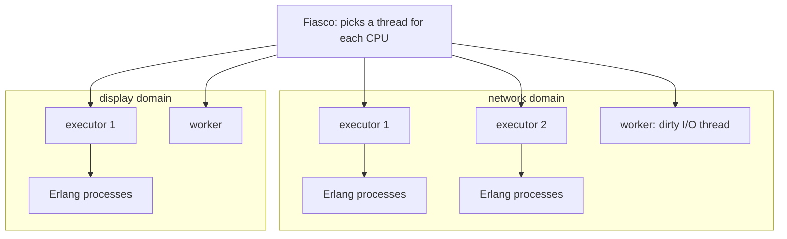
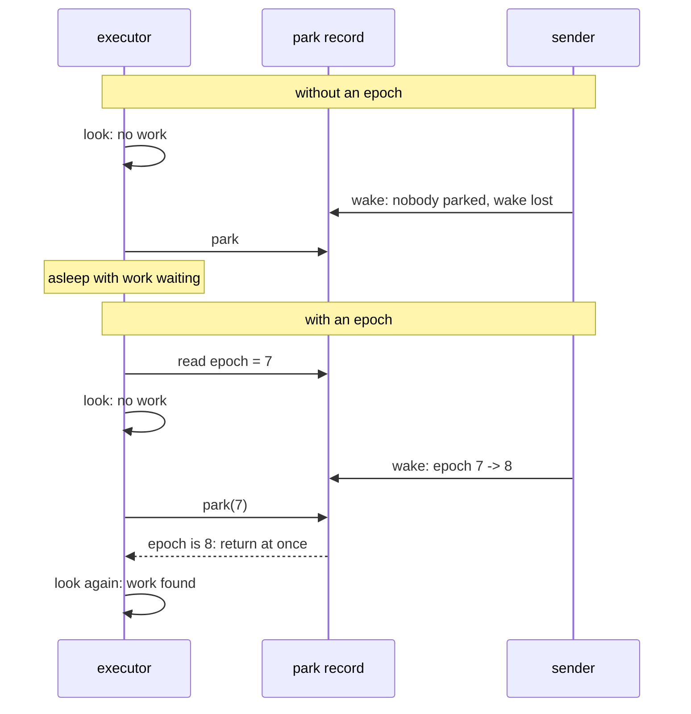
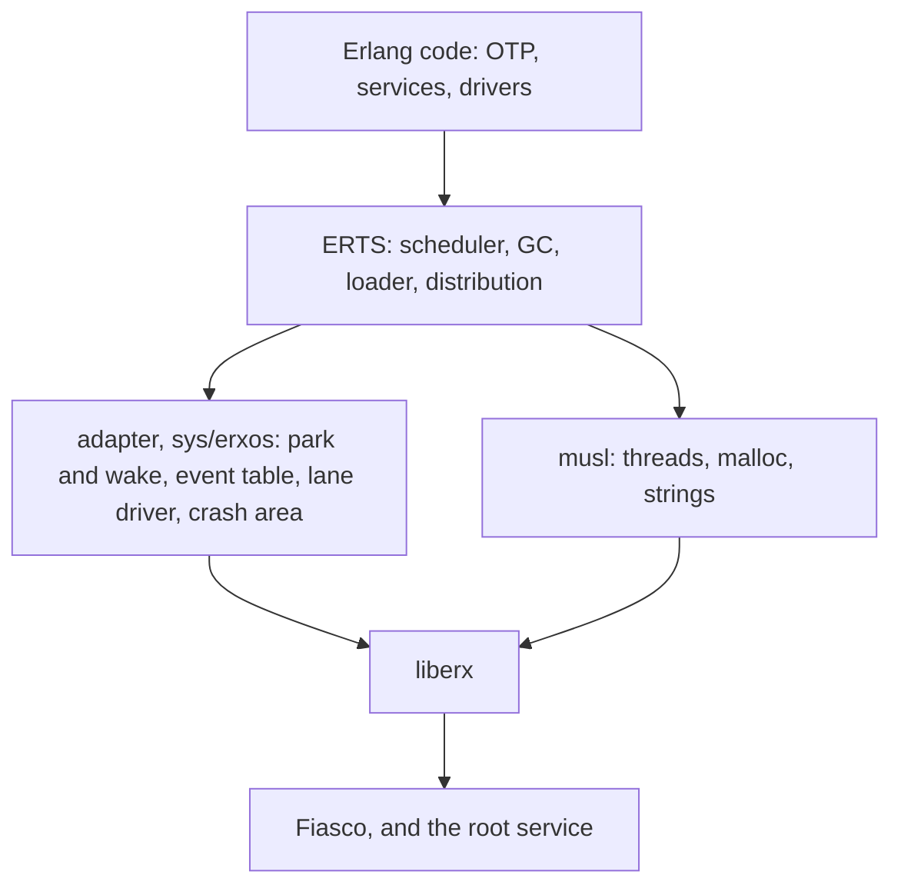

# Chapter 9. Processes, Runtimes and Two-Level Scheduling

> **Status.** **Built:** ERTS in user mode in every domain, with its
> Erlang processes as the system's one kind of process; Fiasco running
> each task's threads at its band's base, from one table of the four
> levels and of each band's base and ceiling, with no rank among the
> configured domains; each domain's slice, 1 ms, as its threads' quantum;
> a call to the root service on the caller's remaining slice; the two classes of
> runtime thread and how they sleep and wake; the table that turns a
> doorbell into work; the system domain on the interpreter, with
> BeamAsm available to other domains; musl under ERTS, with FreeBSD's
> errno and signal numbers; hosted mode on macOS; `ps` over Erlang
> processes; and `erx:trace`. **Designed:** the kernel's own trace
> rings in `erx:trace`; pinned schedulers and
> parking in place of spinning; the urgent scheduler, the one way a
> thread runs above its band's base; CPU sets and thread limits; refusing a scheduler thread every other blocking wait;
> refusing code that is not installed; one shared copy of common code;
> native programs in `ps`; and services that admit each client within a
> share of their time.

**Background needed.** [Chapter 8](08-kernel-interface.md) for
`liberx`, the root service, threads and waits;
[section 3.5.2](03-erlang.md#352-schedulers-and-reductions) for
schedulers and reductions.

An Erlang process in the network domain enters an endless loop. On the
same machine the display domain must draw the next frame, and the
storage domain has a write half done. Something must take the processor
from the loop, give it to the others, and give it back. When the
network domain falls idle, its threads must sleep without spending a
cycle and wake when the next packet arrives. A wakeup that comes while
a thread is deciding to sleep must not be lost; a lost one leaves a
packet unread until something else wakes the domain.

On a UNIX system the kernel's scheduler meets the first half of this
problem. An Erlang system there is one process, `beam.smp`, with one
scheduler thread per processor. The kernel sees those few threads and
nothing of the thousands of Erlang processes inside them; ERTS shares
each thread among its processes by its own rules. The second half,
sleeping without losing a wakeup, ERTS solves for itself with a spin,
then a wait on a pthread condition variable or in `kqueue`.

erXos keeps the two levels and makes them the system's design: Fiasco
schedules threads, and each domain's runtime, ERTS, schedules its
Erlang processes on its own threads. The kernel never calls into a
runtime.

One picture fixes this chapter's words. Take a network domain whose
ERTS has two scheduler threads and one dirty I/O thread, the
helper that runs long C calls
([section 3.5.4](03-erlang.md#354-bifs-nifs-and-ports)).

* The two schedulers are **executors**: threads that run Erlang
  processes in turn and never block except to **park**, that is, to
  sleep until a wakeup.
* The dirty I/O thread is a **worker**: a thread that may block.
* The executors make up the domain's **group** (chapter 8), and each
  holds a **slot** in it, its entry in the group's table, by which
  another executor can wake it by name.
* A packet's arrival rings a **doorbell** bound to the group.
* Every wakeup advances a counter, the **epoch**. An executor reads the
  epoch before it looks for work, and its park returns at once if the
  epoch has moved since, so a wakeup that races with the park cancels
  it.

## 9.1 The Erlang process is the system's process

Ask a UNIX machine what is running, and `ps` lists UNIX processes.
Ask erXos, and `ps` lists Erlang processes, because those are the
system's processes. A pid, a mailbox, links and monitors make the unit
of execution and of failure for the whole machine
([design.md, The model](../design.md#the-model)). The kernel has
address spaces and threads but no processes of its own
([section 3.9.1](03-erlang.md#391-every-erlang-process-is-an-operating-system-process)).

### 9.1.1 What a user and a programmer see

Type `ps` at the shell, rc, and it prints FreeBSD's default columns,
`PID TT STAT TIME COMMAND`, one row for each Erlang process of the
runtime the session runs in, which is the system domain's
(`erlang/apps/erx_shell/src/erx_cmd_ps.erl`). Each row is named by the
process's registered name, or the label it set for itself through
OTP's `proc_lib`, or the function it started in. This is **Built**.
The `TIME` and `%CPU` columns print `-`: the runtime does not measure a
process's processor time in a form `ps` reads, and erXos prints "not
known" rather than a guess. Native programs are designed to appear in
the same table, as rows of their own; that is not built.

The same processes appear in the Erlang shell's `erx:i()`, under
`/proc`, and in the inspector
([chapter 21](21-live-machine.md#211-the-machine-is-an-object)). No second,
hidden kind of process lies beneath them.

An Erlang programmer writes the same code as for OTP anywhere else.

### 9.1.2 Two levels in one picture

Figure 9.1 shows the two schedulers. Fiasco sees threads and picks
which one runs on each processor. Inside each domain, ERTS sees its
Erlang processes and picks which one each executor runs.



*Figure 9.1. The two levels. Fiasco schedules threads and knows nothing
of Erlang; each runtime switches among its own processes on its own
executors without entering the kernel.*

The split puts each decision where the information is. ERTS knows which
process holds a lock, which has a message waiting and which runs at
`high` priority; Fiasco knows which thread of which domain is ready on
which processor. A
switch between two Erlang processes needs no kernel entry, and a busy
domain makes a great many of them, which is why the kernel does not.

## 9.2 How Fiasco shares the processors

What keeps one domain from taking all the processor time? On erXos the
answer is Fiasco's fixed-priority scheduler and each domain's place in
it.

### 9.2.1 What a priority can do

Fiasco gives each thread a priority from 1 to 255 and always runs the
highest-priority ready thread on each processor. Four properties of
that scheduler decide what a priority can be used for
([design-fiasco.md, Bands](../design-fiasco.md#bands)):

* **No quota.** A ready thread waits for every ready thread above it on
  its processor, however long they run.
* **Round robin within a priority.** Threads of one priority take
  turns, a time slice each.
* **A wake preempts its equals.** A thread that leaves a wait takes its
  processor at once from a running thread of its own priority or a
  lower one. A thread that is ready but not running waits its turn.
* **No migration.** Fiasco has no load balancer. A thread stays on the
  processor where it was placed until `erx_thread_set_affinity` moves
  it.

From the first two follows the rule the design is built on: **a
priority above another is only for work that ends.** Work that may run
without end, which is every runtime's ordinary work, belongs at one
priority, where round robin lets none of it starve the rest. A higher
priority is for work that an event started and that finishes, the
handling of an interrupt first of all. Code the system does not trust
runs below both, since nothing else on Fiasco bounds what it takes.

### 9.2.2 Levels and bands

The design uses four priorities, called **levels**, listed in table
9.1 from the highest down.

| Level | Priority | What runs at it |
| --- | --- | --- |
| watchdog | 255 | the root's watchdog, which takes no lock |
| urgent | 3 | a thread that waits for urgent work, in a domain trusted with it (section 9.2.4) |
| base | 2 | the ordinary work of the root task and of every configured domain |
| app | 1 | code the system does not trust: an app, the programs of every session, a domain a user requests |

*Table 9.1. The four levels
([design-fiasco.md, Bands](../design-fiasco.md#bands)).*

A **band** is the range of levels a domain's threads may run at, a base
and a ceiling. A thread starts at its band's base and never runs above
its ceiling. Table 9.2 lists the bands.

| Band | Base | Ceiling | Whose threads |
| --- | --- | --- | --- |
| watchdog | watchdog | watchdog | the root's watchdog |
| root | base | urgent | the root service and the system domain |
| driver | base | urgent | driver and device domains |
| interactive | base | base | the display, web and session domains |
| app | app | app | apps, the programs of every session, a domain a user requests |

*Table 9.2. The five bands. A domain's limits record in the system
manifest names `driver`, `interactive` or `app`; the other two belong
to the root task's own threads.*

The configured domains are not ranked among themselves: the system
domain, the drivers and the interactive domains do their ordinary work
at the base level, beside the root service, and take turns. A rank
would put work that does not end above other work, and with no quota
that is starvation. With the system domain above the drivers, a busy
loader in it would keep every driver and session off its processor;
with the drivers above the system domain, a storage domain kept busy by
its clients would keep the console off its own. What a rank was wanted
for, handling an interrupt before everything that can wait, the urgent
level does instead.

So the bands give three things. Untrusted code delays no configured
domain: an app's thread runs only while nothing at the base or urgent
level is ready on its processor. No configured domain's busy threads
starve another: at the base level every ready thread gets its slice in
turn, and one that blocks loses nothing to one that spins beside it,
since its wake preempts the spinner. And an interrupt's driver can get
the processor at once, at the urgent level.

They give no share and no bound. A configured domain gets a processor
in proportion to its ready threads there, whatever its configured
grant says. A band belongs to a domain, not to a request: when an app
asks the storage service to write a file, the write runs on the storage
domain's threads, at that domain's band, not at the app's.

The root service records a band in the row of every task it makes,
fixed from the domain's row when the task is made, and nothing a task
sends changes it. A domain's own sub-spaces run at its band; a
session's programs run at the app band, as does an app's own session
whatever its template names
([design-fiasco.md, Bands](../design-fiasco.md#bands)).

The levels and bands of tables 9.1 and 9.2 are **Built**: each task's
row holds its band, and one table of the root service holds the four
levels and each band's base and ceiling, which every thread start reads
(`liberx/backend/fiasco/band.c`). The urgent scheduler, the one way a
thread reaches its band's ceiling, is **Designed** and not built, so
every thread runs at its band's base.

### 9.2.3 Where the schedulers run

Three settings make the base level work for ERTS
([design-fiasco.md, Scheduling](../design-fiasco.md#scheduling)).

**Each scheduler is pinned.** Since Fiasco never moves a thread, the
runtime places its schedulers: normal scheduler `i`, and dirty CPU
scheduler `i`, are pinned to the `i`-th processor of the domain's CPU
set, and a runtime starts as many normal schedulers as that set has
processors. So no normal scheduler waits behind another of its own
runtime. Left unpinned, all of a domain's schedulers share the root
service's processor and take turns there.

**A slice is 1 ms.** A thread's time slice is its domain's configured
slice, 1 ms in the development manifests, in place of Fiasco's 10 ms.
The slice is what a ready thread waits for each thread ahead of it at
its level, so it sets the step of what round robin costs.

**A scheduler parks; it never spins.** A thread that waits for another
thread's work blocks in Fiasco, because a wake preempts while a
spinning or yielding thread is merely awake and learns of its work when
its turn comes round. ERTS's busy waiting before a sleep is off in every
runtime (`+sbwt none`). On the Raspberry Pi 4 with spinning off, none of
54 receipts of the SD controller's interrupt took over 1 ms, and with
ERTS's `very_short` spin 7 of 53 did (`pi4/2026-11-22-irq-probe/`,
images E and F, in the project's history repository). Parking has a
price: under HVF on one CPU of an Apple M3 Max under load, with QEMU
11.1.3 and clang 23.1.3, the boot to the release shell takes a median
of 818.8 ms with spinning off against 642.8 ms with stock ERTS's
spinning, over 11 boots each (`bench/2026-11-22-spin/`, in the same
repository). The design accepts that price.

The 1 ms slice is **Built**: the root service starts every thread with
its domain grant's slice as its quantum, and the development manifests
carry 1 ms. Pinned schedulers and parking in place of spinning are
**Designed** and not built. As built, ERTS names no processor for its
schedulers, so a domain's executors share one processor and take turns
on it; they do not run in parallel, whatever figure 9.1 suggests.

### 9.2.4 Urgent work

The Raspberry Pi 4's console shows why base-level round robin is not
enough for every device. Its mini UART's receive FIFO holds eight
bytes, 0.7 ms of input at 115200 baud. A probe that stamped Fiasco's
interrupt entry, the wake and the driver's receipt found the kernel's
path under 10 us, and the rest of a 0.6 to 6 ms delay spent with the
driver's ERTS scheduler awake but not running, behind other threads of
its priority on its processor (`pi4/2026-11-22-irq-probe/`, images C
and E). A pasted line loses bytes.

Fiasco gives a processor at once to a thread that leaves a wait, and to
no thread that is merely ready. So the one thread sure to run when an
interrupt arrives is a thread that was waiting for it, at a level
above the work the interrupt must interrupt. In an ERTS runtime of the
root or driver band, that thread is the **urgent scheduler**
([design-fiasco.md, Urgency](../design-fiasco.md#urgency)):

* It is one more scheduler thread, set once at its start to its band's
  ceiling, the urgent level, and pinned to the first processor of the
  domain's set. No thread's level ever moves after that.
* It runs every process whose own priority is `high`, and no other;
  `max`, which OTP keeps for the runtime's own processes such as the
  distribution's, stays on the normal schedulers. The line owners
  and the drivers whose devices cannot wait a slice run at `high` ([section 15.5](15-devices.md#1552-sharing-inside-one-domain)).
* The domain's device lines are bound to it, so Fiasco delivers an
  interrupt straight to its wait, and the delivery preempts every
  thread on its processor but the watchdog.
* While it runs a process, it checks for deliveries between processes
  with a wait that does not block, so a new interrupt waits for the end
  of the running process's slice, not for its queue to empty.

Every process a runtime runs at `high` is on its **urgent
roster**, a checked-in list that names what makes the process run and
how much one message can cost it, whoever sends the message. The mini
UART driver is on it twice over: for its line, at most 32 bytes a
delivery, and for the console's output, which carries every session's
output and is work an untrusted party asks for. That output is bounded
by the line itself: the driver writes a byte only while the transmit
FIFO has room and otherwise waits blocked.

The urgent scheduler removes the wait for a turn at the base level. It
does not remove a wait for a lock that a base-level thread holds, for a
request to the root service, or for dirty work, and it gives no figure:
what it achieves is measured against the 0.7 ms FIFO. A runtime whose
`high` work does not end takes its processor from everything below the
urgent level.

The urgent scheduler is **Designed** and not built, and the design
builds it only if the Raspberry Pi 4's measurement, run with the levels,
the pinned schedulers, the 1 ms slice and parking in place, shows a
loaded run losing a byte
([design-fiasco.md, Open decisions](../design-fiasco.md#open-decisions)).
Until then every thread runs at its band's base, and
`erx_thread_set_urgency` answers `ERX_ENOTSUP`
(`liberx/backend/core/refused.c`).

### 9.2.5 CPU sets and thread limits

A domain's **CPU set** names the processors its threads may run on, and
its **thread limit** caps how many threads it may have across its
tasks. Both come from the same manifest row as the band
([design-fiasco.md, Threads, bands and stops](../design-fiasco.md#threads-bands-and-stops)).
The root creates every thread and hands Fiasco each thread's processor
mask through one call. In the design, one function first narrows the
mask to the domain's CPU set and the processors online. Its result has
a type of its own that only that call takes, so a mask that skipped
the narrowing does not build. A thread past the limit gets
`ERX_ELIMIT`. CPU sets and thread limits are **Designed** and
not built.

## 9.3 The runtime contract

What may a runtime ask of the kernel, and what must it promise?
[Section 4.2](04-history.md#42-thirty-years-of-two-level-scheduling)
told why two-level schedulers usually failed: the kernel had to call
into the user-level scheduler whenever a thread blocked, at whatever
point it had reached. erXos's contract
([section 4.2.3](04-history.md#423-why-erxos-keeps-two-levels))
removes the cause; this section shows it on Fiasco.

### 9.3.1 Executors and workers

In ERTS the normal and dirty CPU schedulers are executors; the dirty
I/O schedulers, ERTS's helper threads and the thread that waits for
fault records are workers
([design-runtime.md, Scheduling](../design-runtime.md#scheduling)).
The class is fixed at creation: `erx_thread_create` takes it, and an
executor gets its slot then (`liberx/backend/fiasco/thread.c`). ERTS
asks for the class through one option of its thread library that only
`erts_start_schedulers` sets (`otp/erts/include/internal/ethread.h`).

`liberx` refuses a worker what only an executor may do: `erx_park` and
`erx_group_take_ready` answer `ERX_ETYPE` to a thread with no slot
(`liberx/backend/fiasco/park.c`). This is **Built**.

The design also refuses the other direction
([design-scheduler.md, The runtime contract](../design-scheduler.md#the-runtime-contract)).
An executor may make two kinds of blocking call: a park, and a **umtx
wait**, a wait on a word of its domain's private memory
([section 8.5](08-kernel-interface.md#85-threads-waits-gates-and-faults)).
Every other blocking call answers `ERX_EWOULDBLOCK`. That refusal is
**Designed** and not built. It is a rule of `liberx`, not of Fiasco: a
runtime that bypassed `liberx` could block its own executors, which
harms only its own domain.

The umtx wait is allowed because ERTS builds its locks on it, and
forbidding it would mean rewriting ERTS's locking. The word lies in
memory only the domain's own threads touch, so an executor in a umtx
wait waits for a thread of its own domain. Locks are held for a few
instructions, so the wait is usually short; it is long only when
Fiasco has preempted the holder (section 9.3.4). Either way it waits on
its own domain, never on another.

### 9.3.2 The lost wakeup

Every sleeping scheme has the same race. An executor finds no work and
decides to sleep. Between the look and the sleep, a message arrives and
its sender rings the doorbell. The wakeup goes to a thread that is not
asleep, and the executor then sleeps with work waiting. The top half of
figure 9.2 shows it.

The epoch closes the race. The executor reads the epoch *before* it
looks for work and passes the value to the park. Under a lock, the park
compares the current epoch with the value read. If anything advanced it
in between, the park returns at once and the executor looks again. If
not, the executor joins the parked list under the same lock, and any
later wakeup finds it there.



*Figure 9.2. Park and wake, drawn for one epoch. The wakeup that falls
between the look and the park advances the epoch, so the park that
would miss it returns at once.*

There are two epochs, because there are two kinds of wakeup. A
doorbell wakes "some executor of the group" and advances the group's
epoch. ERTS also wakes one executor by name, when it puts a process on
a sleeping scheduler's run queue: `erx_executor_wake` advances that
slot's epoch. The park returns at once if either changed
([design-scheduler.md, Park and wake](../design-scheduler.md#park-and-wake)).

### 9.3.3 Park and wake on Fiasco

Fiasco has no park call, so `liberx` builds one from a semaphore per
thread, on which every wait in erXos ends
([section 8.5.2](08-kernel-interface.md#852-waiting-one-semaphore-per-thread)),
and a **dispatcher**, one thread in each task (Fiasco's address space)
that receives the task's doorbell deliveries
([design-fiasco.md, The park protocol](../design-fiasco.md#the-park-protocol)).
The group's **ready list** holds the doorbells that have fired and not
yet been handled. Follow a request into a parked storage domain.

1. A process in a session sends the storage service a request. The
   session's runtime copies the frame into a lane, the one-way ring
   that carries messages between two domains, and rings the lane's
   doorbell
   ([section 8.7.1](08-kernel-interface.md#871-one-path-for-devices-and-peers)).
2. Fiasco delivers the doorbell to the storage domain's dispatcher.
3. The dispatcher takes the park lock and runs the *signal* event: it
   puts the doorbell on the ready list unless it is listed already,
   advances the group's epoch, and takes the longest-parked executor
   off the parked list. It releases the lock and raises that executor's
   semaphore.
4. The executor returns from its wait. At its safe point, between two
   Erlang processes, it takes the ready list with
   `erx_group_take_ready`, which returns each doorbell's label once,
   however often it fired, and dispatches each label
   ([section 9.4.4](#944-the-event-table-readiness-without-file-descriptors)).

One doorbell wakes one executor. When none is parked, a running
executor finds the doorbell at its next safe point.

The protocol's decisions are one pure function,
`erx_backend_park_step` (`liberx/backend/core/park_table.c`), which
takes the park record and an event (a park, a wake, a doorbell, a
timeout, a thread's end and a few more) and returns at most one
semaphore to raise or wait on. It calls no kernel, so host tests drive
it ([section 6.3](06-construction.md#63-functional-core-effects-at-the-edge)). Parking is **Built**. Its cost is one thread switch: a
wakeup of an idle domain goes through the dispatcher, so it takes two
switches where a kernel with a park call would take one.

### 9.3.4 What a runtime does not get

On Fiasco a runtime gets threads, park and wake, and nothing else from
the scheduler
([design-fiasco.md, The scheduler on Fiasco](../design-fiasco.md#the-scheduler-on-fiasco)).

* **No upcall.** The kernel never enters a runtime at a point the
  runtime did not choose. erXos arms Fiasco's one upcall interface, its
  vCPU mode, for no runtime thread; the design arms it only for native
  programs' workers, never an executor
  ([section 8.5.6](08-kernel-interface.md#856-signals-through-vcpu-upcalls)).
* **No moving priority.** A runtime cannot raise or lower a thread as
  its work changes. In the design one thread, the urgent scheduler, sets
  its own level once, at its start (section 9.2.4); as built,
  `erx_thread_set_urgency` answers `ERX_ENOTSUP`
  (`liberx/backend/core/refused.c`).
* **No share.** Fiasco charges each thread for its own slices and keeps
  no account per domain
  ([section 5.6.5](05-overview.md#565-shared-services-and-shared-cpu)).
* **No grace period.** A slice ends where it ends, even inside a
  run-queue lock: a thread that holds a lock gets no time past its
  slice, and an executor that wants the lock sleeps in its umtx wait
  until the holder runs again.

Each absence buys simplicity: a runtime never entered unexpectedly
needs no code to recover, and a kernel that takes no hints cannot be
misled by a runtime that lies.

## 9.4 ERTS as a parts bin

Why does erXos carry its own ERTS instead of running an unmodified one
on a compatibility layer? Much of ERTS only adapts it to UNIX, such as its
poll set over file descriptors, and where erXos already has a mechanism
for a job, keeping both would give a reader two models to learn
([section 3.9.5](03-erlang.md#395-erts-as-a-parts-bin)).

### 9.4.1 One mechanism per job

Each job has one mechanism, ERTS's or erXos's. Table 9.3 shows the
scheduling rows.

| Job | Mechanism |
| --- | --- |
| choosing which process runs | ERTS's run queues, priorities, reductions and stealing; in the design, `high` on the urgent scheduler of a root- or driver-band runtime |
| choosing which thread runs | Fiasco |
| waiting for work | `erx_park` with epochs |
| readiness | doorbells on the ready list, through the event table |
| timeouts | ERTS's timer wheel per scheduler, which files each Erlang timer by when it expires; a park's deadline is the wheel's next expiry |
| long C calls | dirty schedulers: dirty CPU schedulers are executors, dirty I/O ones workers |

*Table 9.3. Scheduling in ERTS on erXos
([design-runtime.md, One mechanism per job](../design-runtime.md#one-mechanism-per-job)).*

ERTS's scheduler stays whole, because it has run production Erlang
systems for decades. Its sleep and readiness are redone: the poll set
assumes file descriptors, which a domain does not have, and the spin
spends time that another domain at the same priority could have used,
while on Fiasco a spinning scheduler hears of its work later than a
parked one (section 9.2.3).

### 9.4.2 The inside of ERTS on erXos

ERTS's scheduler, garbage collector, loader and distribution sit on an
**adapter**, the directory `otp/erts/emulator/sys/erxos/`, which holds
what ERTS needs from the system beneath it and is the only part of ERTS that includes a
`liberx` header
([design-runtime.md, The adapter](../design-runtime.md#the-adapter)).
Figure 9.3 shows the layers.



*Figure 9.3. ERTS on erXos. Only the adapter and musl call `liberx`,
and only `liberx` reaches Fiasco or the root service. The lane driver
is the port that carries frames between domains; the crash area is
where a dying runtime leaves its dump (section 9.8).*

ERTS's files outside the adapter carry some seventy numbered edits
([design-runtime.md, The edits outside `sys/erxos`](../design-runtime.md#the-edits-outside-syserxos)).
Two matter here. `scheduler_wait`, the step where a scheduler with
nothing to run spins and then sleeps, parks with `erx_park` instead of
a thread event or the poll set. `wake_scheduler` wakes with
`erx_executor_wake`.

### 9.4.3 The scheduler's sleep, in code

`sched_park`, in `otp/erts/emulator/beam/erl_process.c`, stands where
stock ERTS called `erts_tse_twait`:

```c
/* Answers as erts_tse_twait does: 0 at a wake, which may be spurious, or ETIMEDOUT. */
static int
sched_park(ErtsParkEpochs epochs, Sint64 timeout)
{
    const uint64_t deadline = timeout < 0 ? ERX_WAIT_FOREVER : erx_deadline_after((uint64_t) timeout);

    switch (erx_park(epochs.group, epochs.slot, deadline)) {
    case ERX_OK:
        return 0;
    case ERX_ETIMEDOUT:
        return ETIMEDOUT;
    default:
        erts_exit(ERTS_ABORT_EXIT, "%s:%d: Internal error\n", __FILE__, __LINE__);
        return 0;
    }
}
```

Two things matter. The function answers as the call it replaces did,
so the rest of `scheduler_wait`, its flags and its loop, is ERTS's own.
And the epochs arrive as an argument, `ErtsParkEpochs`, the group's and
the slot's values, which the caller read before it decided to sleep.
The timeout is the next expiry of the scheduler's timer wheel, so a
parked scheduler wakes for its next Erlang timer and no sooner. A dirty
I/O scheduler, which has no slot, keeps ERTS's thread event, a umtx
wait on erXos.

### 9.4.4 The event table: readiness without file descriptors

On UNIX, ERTS learns that a socket has data from `kqueue` or `poll`,
which report file descriptors. A domain has none. It has doorbells:
each connection's lane, each device line and each native program's
channel (the pipe between ERTS and the program, chapter 13) has one,
bound to the domain's group with a **label**, a number chosen by the
code that bound it. The ready list returns labels, and the **event
table** says what each names
([design-runtime.md, The event table](../design-runtime.md#the-event-table)).
A label leads to one of three sinks:

* a **connection sink**, a lane from another domain: the lane port's
  input task is scheduled, and a normal scheduler copies the frames out;
* a **port sink**, such as a native program's channel: ERTS's own input
  task for that port is scheduled, so the port's work runs one piece at
  a time, as every port's does;
* a **process sink**, such as a device's interrupt: the term registered
  with the label is sent to an Erlang process, as `{erx_irq, Device,
  Line}` reaches a driver.

A label whose sink has gone is dropped. The table's core,
`otp/erts/emulator/sys/erxos/erx_event_table.c`, knows nothing of ERTS
and calls no kernel, so host tests drive every path; `erx_event.c`
holds its effects. ERTS on erXos runs no poll thread. The event table
is **Built**.

## 9.5 Code: the interpreter, BeamAsm and shared code

Which code a domain may run is a security decision as much as a speed
one. A just-in-time compiler, or JIT, turns a program into machine code
while it runs: it writes code and then runs it, which is what an
attacker who finds a memory bug wants to do. erXos never maps a page
writable and executable through one mapping
([section 6.2.6](06-construction.md#626-a-mapping-that-is-never-writable-and-executable)),
so a JIT writes through one mapping and runs through another.

### 9.5.1 Three runtime images

erXos builds ERTS three ways, listed in table 9.3
([design-runtime.md, BeamAsm](../design-runtime.md#beamasm)).

| Image | What it is | Who runs it |
| --- | --- | --- |
| system image | the interpreter, without BeamAsm, its C++ runtime or OpenSSL | the system domain |
| interpreter image | the same build with OpenSSL | command domains (where a shell command with less authority than its session runs), every domain in deterministic mode, and any domain whose manifest row chooses it |
| BeamAsm image | ERTS with BeamAsm, OTP's JIT | every other domain |

*Table 9.3. The three runtime images.*

Which image a domain runs follows from three facts fixed at boot:
whether it is the system domain, one field of its manifest row, and
whether the machine boots in deterministic mode (`erx.det=1`, a mode
whose runs repeat exactly, in which BeamAsm's output would vary with
addresses and hash order). No domain chooses at run time. Both the
interpreter and BeamAsm are **Built**; the manifests in
`config/manifest/` choose the interpreter for every domain
([section 5.1.3](05-overview.md#513-runtime)).

The system domain interprets because it is the trusted base, and its
image holds no JIT and no C++. OTP's own notes put BeamAsm at "anything from no difference to up to four times as
fast" as the interpreter. The system domain gives that
up for a trusted base with no code generator to attack.

In a BeamAsm domain, each block of JIT code is a memory object mapped
twice, once writable for BeamAsm and once executable for the processor,
so one page is writable through one mapping and executable through the
other. Only a domain whose image is marked for JIT gets an address
space that allows such objects
(`otp/erts/emulator/sys/erxos/erx_jit_memory.c`).

### 9.5.2 Code by hash

The system domain's **code service** loads modules into the system
domain's runtime by hash: each module is named with the SHA-256 of its
file, and the service checks the bytes against it before ERTS's loader
reads them. A changed byte fails the load with
`{error, {hash_mismatch, Name}}`
([design-runtime.md, Code in the system domain](../design-runtime.md#code-in-the-system-domain)).
The code service and its check are **Built**
(`erlang/apps/erx_code/src/erx_code.erl`).

The system domain's runtime is designed to accept a module only if its
bytes lie in **installed storage**: the pages of its release, or an
arena only the code service writes. It refuses any other with
`{error, not_installed}`, however the binary travelled. That refusal is
designed and not built.
[Chapter 21, section 21.4](21-live-machine.md#214-how-code-gets-into-a-domain)
follows a module from the boot image, the host and an app into a domain.

### 9.5.3 Shared code

Every ERTS domain loads its own copy of `lists`, `gen_server` and the
rest of `kernel` and `stdlib`, charged to its own budget; the design
document measures loaded code at about 10 of the 16 MB the system
domain reports at its shell
([design-shared-code.md](../design-shared-code.md)). The design builds
one read-only image of the common modules into the boot image, and
every interpreter domain maps it at the same addresses, so one copy
serves the machine
([design-shared-code.md, The central construction](../design-shared-code.md#the-central-construction)).
The shared-code image is **Designed** and not built.

## 9.6 The C library seam and hosted mode

ERTS is a C program, and it gets memory, threads and the clock from a
C library.

> **Background: a C library, and musl.** The C library gives a program
> `malloc`, `pthread_create` and the rest of the C standard and POSIX.
> On UNIX most of these end in system calls, such as `malloc` in
> `mmap`. **musl** is a small C library written to be read and ported.

### 9.6.1 One seam

musl is the C library of every runtime and native program. No trap instruction is left in
it. Every place where musl would make a system call lands in one
function, `__erx_syscall`, a switch on musl's Linux system-call names
(`SYS_futex`, `SYS_mmap` and the rest) that carries each call onto
`liberx`; a call it does not handle answers `ENOSYS`
([design-fiasco.md, musl over the backend](../design-fiasco.md#musl-over-the-backend)).

| musl needs | erXos gives |
| --- | --- |
| pages for `malloc` | `erx_vm_reserve`, and `erx_space_protect`, which commits what it makes accessible |
| threads | `erx_thread_create`, `erx_thread_exit` |
| locks and condition variables | umtx waits on private memory |
| clocks | Fiasco's clock for `CLOCK_MONOTONIC`, the root's wall clock for `CLOCK_REALTIME` |
| random bytes | `erx_entropy_take` |

This is **Built**. The design deletes the Linux names, so that a call
not ported fails when the program is linked rather than when it runs
([design-runtime.md, The C library seam](../design-runtime.md#the-c-library-seam));
that deletion is designed and not built. A runtime uses no file
descriptor but standard output and error; native programs get files,
pipes and signals from a POSIX layer over `liberx`
([chapter 13](13-native-programs.md#137-the-posix-lite-personality)).

The errno and signal numbers musl returns are FreeBSD's, generated from
one table in the ABI
([section 7.3.1](07-one-source.md#731-tables-that-must-match-someone-elses)),
so a program written for FreeBSD prints the `errno` a FreeBSD user
expects. This is **Built**.

`pthread_cancel` acts at the target thread's next cancellation point,
as POSIX allows: Fiasco's backend does not stop a thread from outside
(`liberx/backend/core/refused.c`). ERTS never calls it.

### 9.6.2 Hosted mode

A crash inside ERTS on QEMU is slow to debug. **Hosted mode** runs the
same runtime as a macOS process, on `liberx`'s hosted backend, under AddressSanitizer,
the other sanitizers and `lldb`
([design-runtime.md, Hosted mode](../design-runtime.md#hosted-mode)).
It is **Built**. QEMU stays the authority: a test that passes only
hosted is not a pass.

A hosted runtime links macOS's libSystem, not musl: each C library
finds its per-thread data through the one processor register that
points at the current thread, and in a macOS process libSystem owns
it. Above the C library nothing differs, and build checks fail on a
file of `sys/erxos` that names `__APPLE__`, Linux or a backend.

## 9.7 Two schedulers you can watch as one

When a domain is slow, which scheduler is to blame? On UNIX, `top`
shows the kernel's view and a program's own tools show its view, rarely
both at once. erXos merges them.

### 9.7.1 One timeline

`erx:trace(Spec)`, typed at the Erlang shell, prints one stream of
events in the order of one clock
([design-live.md, Tracing](../design-live.md#tracing)). From ERTS it
takes OTP's own trace of each time an Erlang process is scheduled in
or out. From the root service it takes the **trace ring**, 4,096
records that `liberx` writes as it carries out parks, wakes and
doorbell deliveries
([design-fiasco.md, The trace ring](../design-fiasco.md#the-trace-ring)).
From the kernel it takes one more ring for each CPU, in the same
record format: the kernel's own IPC, faults, thread switches,
interrupts and object creations, which the root reads through a
read-only mapping of the kernel's rings
([design-fiasco.md, The kernel's trace rings](../design-fiasco.md#the-kernels-trace-rings)).
The trace process merges them all in time order
(`erlang/apps/erx/src/erx_trace.erl`). The merge and the root's ring
are **Built**; the kernel's rings are **Designed**.

So one stream shows an executor of the system domain park, the
dispatcher deliver a doorbell, the executor wake, and the Erlang
process that ran next. Only the root's own threads write the root's
ring, so a park in another domain does not appear there, though that
domain's process events do, and its IPC, faults and switches appear in
the kernel's rows. The kernel names a thread or a task by its own
object id, which no other object takes for the rest of the boot; a
message's arrival names both its sender and its receiver, recorded at
the copy, the one moment both are certain to exist. The trace adds the
root service's name for an object only when it saw that object
created, so an object older than the trace shows its id alone.

### 9.7.2 A worked example

A file service runs in domain A. Session B runs a build that reads
thousands of small files; session C runs an editor whose user has
pressed save. Each session has a lane into A, and in A a **facet**
process, which receives that session's requests and checks them
([section 7.7](07-one-source.md#77-the-system-manifest-the-machines-configuration-checked);
[design-scheduler.md, A worked example](../design-scheduler.md#a-worked-example)).

1. B's processes send read requests as fast as they can. When B's lane
   is full, B's senders wait inside B's own runtime, so A is asked for
   no more than the lane holds.
2. A's executors run B's facet and the processes that serve B's reads.
   That time is A's, on A's threads: A pays for the work it does for
   B.
3. C rings its doorbell. A's dispatcher lists it and wakes a parked
   executor of A; if every executor is running, one finds it at its
   next safe point.
4. A's ERTS runs C's facet beside B's, sharing A's executors by priority
   and reductions. C's request is decoded within a few of A's
   scheduling rounds, not behind B's whole backlog, because that
   backlog waits in B's lane, not in A's run queues.
5. If all of A's threads are busy, A takes turns on its processor with
   every other ready thread; nothing lends A the time of B or C.

The design adds two parts. Bands put A, B and C, all configured
domains, at one base level, so each takes turns with the others and
none is ranked above another. And each facet admits its client's requests within a **share**
of reductions per period, so B's facet stops taking requests once B's
share is spent, while C's are taken at once
([design-scheduler.md, Service work](../design-scheduler.md#service-work)).
Both are designed and not built: a facet admits each request whose
operation it lists (`erlang/apps/erx/src/erx_facet.erl`).

## 9.8 What happens when a part fails

Each level fails in its own way, and each failure stays where it
started.

**An Erlang process loops.** Its reductions run out at the end of its
turn, and ERTS runs the next process. Other domains do not see it.

**A NIF loops, or an executor blocks.** C code called from Erlang is
not counted in reductions, and a NIF that waits on a server blocks its
executor. Either way that executor runs no Erlang process until the
call returns, and the domain's other executors steal its queued
processes. Only its own domain is affected. A long C call belongs on a
dirty scheduler
([section 3.5.4](03-erlang.md#354-bifs-nifs-and-ports)).

**A domain spins.** In the design its threads take turns at its band's
base: a configured domain's with every other configured domain's
threads on those processors, which slow down but run, and an app's
only while nothing above the app level is ready.

**An executor dies.** The park protocol's *release* event frees the
slot, advances the group's epoch and wakes the longest-parked
executor, so a wakeup meant for the dead one is not lost with it.

**A domain ends.** Its runtime writes a dump to the domain's crash area
and stops the domain. Every thread of every task ends with it, its
group and park record end with it, and the processes linked to its
processes get exit signals
([design-runtime.md, Crash handling](../design-runtime.md#crash-handling)).

**The machine stalls.** Once a second the watchdog thread, at priority
255, checks that the root service has reported in; a missed report
resets the machine. On the Raspberry Pi 4 it also reloads the hardware
watchdog, so a hang of Fiasco itself ends in a reset
([design-fiasco.md, The watchdog](../design-fiasco.md#the-watchdog)).

## 9.9 Design choices

**Every Erlang process a kernel thread.** The kernel could schedule
each Erlang process itself, as a 1:1 thread library does. But every
spawn would be a request to the root and every switch a kernel entry.
Erlang processes are cheap because they never enter the kernel
([section 4.2.1](04-history.md#421-two-answers-both-tried)).

**Scheduler activations.** The kernel could tell the runtime whenever
one of its threads blocks. That needs the kernel to enter the runtime
at an arbitrary point, and every system that tried it for general C
code gave it up
([section 4.2.2](04-history.md#422-the-common-failure)). ERTS does not
need it, because an Erlang process never blocks its thread: a
`receive` with no message parks the process, and the executor runs
another.

**Shares instead of priorities.** Fiasco could give each domain a
share of processor time, a percentage of a core. That
needs a scheduling class Fiasco does not have, a large change to its
scheduler, accounting and switch path
([design-fiasco.md, The scheduler on Fiasco](../design-fiasco.md#the-scheduler-on-fiasco)).
Bands need only the priorities Fiasco has; the cost is that nothing
divides time: a configured domain's share follows its ready threads,
and busy configured domains keep apps off their processors.

**A rank among the configured domains.** The system domain could run
above the drivers, or the drivers above the system domain. Without a
quota either order starves someone whenever the higher domain's work
does not end (section 9.2.2), so the configured domains share one
level and only urgent work runs above it.

**Raising a thread for urgent work.** A scheduler could raise itself to
the urgent level when it picks up a `high` process. But a thread that is
ready and not running cannot raise itself, and that is exactly the
thread the Raspberry Pi 4's probe found the console waiting for; a
waker that raised it would give a thread's level two writers whose
order decides whether a raise is lost
([design-fiasco.md, Urgency](../design-fiasco.md#urgency)).

**Lending time to a service.** A client could donate its processor
time to the server working for it, so that a server with no time of
its own runs on its callers' time
([research-hierarchical-scheduling.md](../research-hierarchical-scheduling.md)).
erXos keeps this only where Fiasco gives it: a call to the root service
runs on what is left of the caller's slice, at the caller's level,
until the next reschedule on that processor
([design-fiasco.md, Scheduling](../design-fiasco.md#scheduling)). A
service in a domain runs on its own threads, and nothing must work out
who pays. The price is that a saturated service slows all its clients
together
([section 5.6.5](05-overview.md#565-shared-services-and-shared-cpu)).

**Stock ERTS on a POSIX layer.** erXos could give ERTS a full POSIX
emulation and leave ERTS untouched. Every wakeup would then pass
through an emulated `poll`, and erXos would carry two models of
readiness. erXos judges some seventy
numbered edits to ERTS cheaper to maintain than an emulation of the
system ERTS was written for.

## Summary

Every Erlang process is a process of the system. Fiasco runs each
thread at its band's priority, round robin within a priority, and a
domain's executors share one processor. In the design, every
configured domain's ordinary work shares one base level, untrusted
code runs below it, pinned schedulers park instead of spinning, and an
urgent scheduler, waiting above the base, takes a trusted runtime's
interrupts and its `high` work. Executors only park, workers may block, and a park against
two epochs cannot lose a wakeup. ERTS keeps its scheduler and replaces
its sleep and readiness with `erx_park` and an event table. The system
domain interprets; musl reaches `liberx` through one function; the
same runtime runs hosted on macOS; and `erx:trace` shows both
schedulers in one timeline.

The scheduler decides which thread runs; the next chapter turns to
where those threads live, the domain, and the wall around it.

## Where to read next

* [design-fiasco.md, The scheduler on Fiasco](../design-fiasco.md#the-scheduler-on-fiasco):
  the scheduler design on Fiasco, the levels and bands, the urgent
  scheduler and the park protocol.
* [design-scheduler.md](../design-scheduler.md): the full two-level
  design.
* [design-runtime.md](../design-runtime.md): ERTS on erXos, from the
  adapter and the event table to BeamAsm, the C library seam and hosted
  mode.
* [research-hierarchical-scheduling.md](../research-hierarchical-scheduling.md):
  the record of M:N threading and why it was abandoned.
* Thomas Anderson, Brian Bershad, Edward Lazowska and Henry Levy,
  "Scheduler Activations: Effective Kernel Support for the User-Level
  Management of Parallelism", SOSP 1991: the design whose failure the
  runtime contract answers.
* OTP, `erts/emulator/internal_doc/BeamAsm.md`: BeamAsm and its
  speed against the interpreter.
