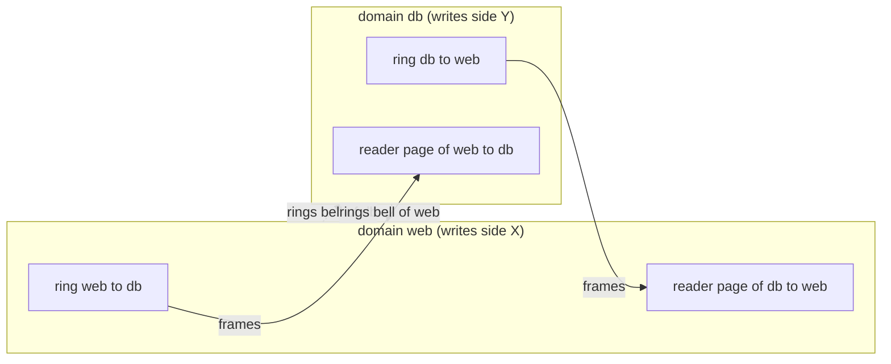
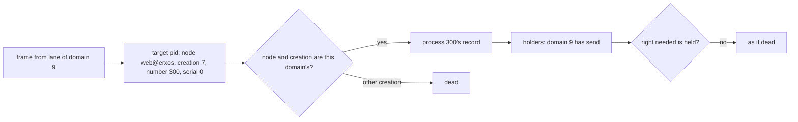
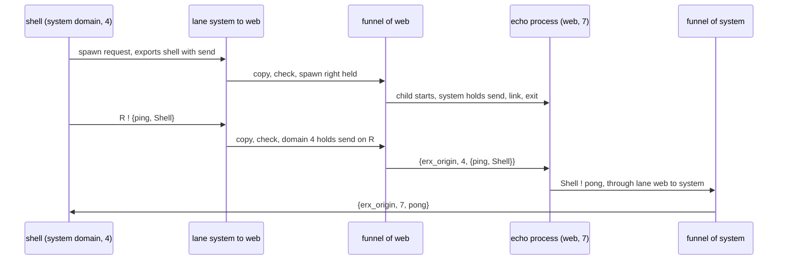
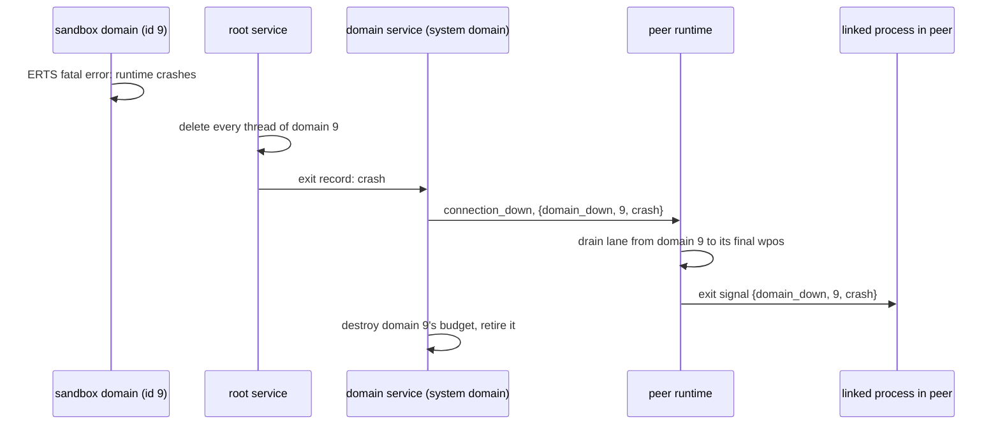

# Chapter 10. Domains: A Wall Around Some Processes

> **Status.** **Built:** domains, each with its own ERTS in its own
> address space and its own Erlang node; connections of two lanes with
> doorbells; the funnel; export tables; the `{erx_origin, D, Msg}`
> envelope; links, monitors, exits and spawns across domains; group
> leaders that stay inside their domain; `{domain_down, D, Info}` at a domain's end; the domain service, the
> domain library and the root service creating and ending domains; a
> quota of node names per principal.
> **Designed:** budgets that refuse connection memory past their limit;
> handles that carry rights, so the kernel interface itself stops a
> domain from writing its peer's memory; a spawn right for a domain's
> creator at boot; `gen_server` and `gen_statem` servers that take calls
> from other domains directly; a decoder in the system domain that
> creates no atom from another domain's frame.

**Background needed.** [Chapter 1](01-operating-systems.md) for
address spaces and shared memory; [chapter 2](02-microkernels.md) for
capabilities and the root task; [chapter 3](03-erlang.md) for
processes, links, nodes and the external term format;
[chapter 8](08-kernel-interface.md) for `liberx`, the root service,
handles and doorbells. [Chapter 9](09-processes.md) explains runtimes;
this chapter needs only that every domain runs its own ERTS.

A web shop on a UNIX system runs as one `beam.smp` process. Its HTTP server,
its database driver and its image resizer are OTP applications in that
one process. The resizer links a NIF, C code loaded into ERTS
([section 3.5.4](03-erlang.md#354-bifs-nifs-and-ports)), and a crafted
image makes the NIF write past the end of a buffer, into the database
driver's heap. The shop does not crash; it starts returning wrong
prices. A stray C pointer is not a process failure, so "let it crash"
cannot help
([section 3.3.6](03-erlang.md#336-what-let-it-crash-does-not-fix)).

On UNIX the remedy is a second `beam.smp`, whose page tables keep
the resizer's writes out of the shop's memory. The two talk through
Erlang distribution over TCP: the same `!`, links and monitors. But
distribution was built for trusted clusters. A node that presents the
right cookie may spawn any code on any other node, so the wall stops
stray pointers and nothing else
([section 3.6.2](03-erlang.md#362-nodes)).

erXos keeps the second process and drops the trust. A **domain** is an
address space with its own ERTS, which is an Erlang node of its own.
Domains message, link and monitor each other with the distribution
protocol, over a pair of one-way rings in shared memory instead of a
socket. The receiver reads every frame through one function, the
funnel, which copies it, checks it, and delivers it only to a process
the receiver has made reachable from that sender. Every message that
passes arrives wrapped, so no process takes it for a local one.

> **Background: address spaces, recalled.** Each address space has its
> own page tables, so a stray pointer faults instead of writing another
> program's memory. Two address spaces can map one physical page with
> different protection: one writable, the other read-only
> ([section 1.4](01-operating-systems.md#14-virtual-memory)). On erXos
> the root service writes every page table
> ([section 8.3](08-kernel-interface.md#83-the-root-service-who-holds-what)).

> **Background: rings and doorbells.** Two parties that share memory
> can pass a stream of records without a kernel call per record. A
> **ring** is a fixed area used in a circle. The producer writes records
> at its write position and then publishes the new position; the
> consumer reads up to that position and publishes its own read
> position, which returns the room. Each position has one writer, so no
> lock is needed, only the memory-ordering care of
> [section 1.7.3](01-operating-systems.md#173-memory-ordering). A
> consumer with nothing to read sleeps, and the producer wakes it with
> a **doorbell**, an object one party rings and the other waits on.

> **Background: frames, recalled.** To cross between nodes, a message
> becomes a **frame**: a control term that says what the signal is and
> between which processes, then the payload, both in the **external
> term format**
> ([section 3.6.3](03-erlang.md#363-how-a-message-crosses-between-nodes)).

## 10.1 A domain is a node

What makes a domain distinct from every other domain? It holds an
Erlang node, and its identity is ERTS's own node identity, a name and
a number.

### 10.1.1 What a domain holds

Each domain runs one ERTS in an address space of its own
([section 5.1.2](05-overview.md#512-domain)), with its own atom table,
loaded code, ETS tables and registered names. A domain's
`register(db, Pid)` names `db` in that domain alone, and code loads
from the domain's own release
([design-domains.md, Atoms, code, ETS and names](../design-domains.md#atoms-code-ets-and-names)).
A domain also has a **budget**, a record of the memory set aside for it
([chapter 12](12-memory.md#121-budgets-as-space-banks)); a **group**, the threads its runtime runs
on ([chapter 9](09-processes.md#933-park-and-wake-on-fiasco)); and a connection to the system
domain, the one it boots with.

So a NIF's stray pointer corrupts only its own domain's heap, and a
domain that fills its atom table ends alone. Each domain running its own ERTS is
Built ([the top-level README, Current status](../../README.md#current-status)).

### 10.1.2 Domain ids and pids

Every domain has a **domain id**, a 32-bit number the domain service
never reuses within a boot. The system domain is 4, and every other
domain takes the next unused id. The id is the domain's node
**creation**, the number ERTS uses to tell one run of a node from the
next run under the same name
([section 5.5](05-overview.md#55-four-decisions-every-chapter-assumes)).
It starts at 4 because ERTS gives no node a creation below 4
([design-domains.md, Domain ids, pids and
references](../design-domains.md#domain-ids-pids-and-references)).
A domain's node name is its name at the machine's host name, such as
`web@erxos`, and the runtime takes that name and creation before it
reads its first frame.

A pid is ERTS's: a process number and a serial, which counts reuses of
that number, with the node name and creation of the domain that owns
the process. So a pid names its owner domain by construction; no table
maps pids to domains, and no table can disagree. erXos prints a pid as
`<D.N.S>`: domain id, process number, serial. `<7.300.0>` is process
300, serial 0, of domain 7, and it prints the same on every node and
in every log. This is Built.

When a domain ends and a later domain takes the same name, the later
one gets a new id. A pid of the ended domain keeps the old id as its
creation, so it names no process of the later domain, whose funnel
treats it as dead (section 10.3.2).

References, Erlang's unique tags for calls and monitors, carry their
creator's node and creation too. On erXos each is four 32-bit words
drawn from AES-128, so one domain cannot guess another's; this is
Built. Section 10.5 shows
why: a reply tag that could be guessed could be forged.

### 10.1.3 Where the picture of distribution stops

"Erlang distribution inside one machine" is the right first picture:
`nodes()` lists the connected domains, and
`spawn_link('web@erxos', M, F, A)` starts a linked process in another
domain. It differs from a cluster in five places.

* **No socket, cookie or port mapper.** A connection is shared memory
  the system domain made, and it says which domain is at its other end.
* **No connection on demand.** A send toward a domain the system
  domain has not connected fails as toward an unreachable node.
* **No global names.** A registered name is one anyone can guess, so
  it cannot stand for a right to send. The funnel admits no send by
  name, `{db, 'web@erxos'} ! Msg` is dropped in the sender's own
  runtime, and OTP's `global` and `pg` work within each domain only.
* **No ticks.** Distribution drops a peer that stays silent, but a
  domain starved of CPU is silent too. A peer's end arrives instead
  from the system domain (section 10.7.4).
* **Not every right comes with a pid.** What a peer may do to a process
  is what the process's own domain has given it (section 10.4).

## 10.2 Connections, lanes and doorbells

How do two domains exchange frames without a kernel call per frame,
and without either being able to corrupt the other's memory? Through a
**connection**: two one-way **lanes** in memory both domains map, each
page with exactly one writer, and a doorbell for each direction. A
connection is all two domains share
([design-domains.md, Connections](../design-domains.md#connections)).

### 10.2.1 A lane

A lane carries frames from one domain, its **producer**, to another,
its **consumer**. It has three parts:

* a **ring**: a header page and a data area, which the producer alone
  writes and the consumer maps read-only;
* a **reader page**, which the consumer alone writes and the producer
  maps read-only;
* a **bell**, a doorbell
  ([section 8.7.1](08-kernel-interface.md#871-one-path-for-devices-and-peers))
  bound to the consumer's group, which the producer rings.

The producer writes two numbers in its ring header: `wpos`, the bytes
it has published since the lane was created, and `need`, a position it
is waiting for. The consumer writes two in its reader page: `rpos`, the
bytes it has consumed, and `wake`, a position it is waiting for. The
positions are 64-bit counts that never wrap in practice. Each record is
a 16-byte header and a body padded to 16 bytes; on a connection, the
body is one frame.

Each domain's **side** of a connection is one memory object holding
everything that domain writes: the ring of its outgoing lane and the
reader page of its incoming lane. Figure 10.1 shows the result.



*Figure 10.1. Two domains and their connection. Each side is one
memory object that only its own domain writes.*

One writer per page is the property that matters. A domain can never
overwrite what its peer has written; it can only write nonsense into
its own side, which section 10.3 shows the reader surviving.

In the system as built, each party's `liberx` asks the root to map its
peer's side read-only, and that request is what keeps one writer per
page. No call checks a handle's rights yet
([section 8.4.4](08-kernel-interface.md#844-rights)), so a domain that
sent the root its own request could map its peer's side writable. This
is one reason every build runs trusted code only. The design gives each
handle rights, so that the root maps the peer's side read-only whatever
the domain asks; that is designed and not built.

### 10.2.2 Publishing and waking

The producer publishes a record by storing `wpos` with a release
store, and the consumer reads it with an acquire load, so every byte
below it is visible; the same pairing on `rpos` returns room
([section 1.7.3](01-operating-systems.md#173-memory-ordering)). A
record may be longer than the lane: the producer publishes as much as
fits and the rest as room returns, so a lane of 64 KiB carries a frame
of 1 MiB whole.

Waking is where ring protocols usually go wrong: a record published
between the consumer's last look and its sleep, with no ring, waits
forever. A handshake closes the gap. A consumer
with nothing to read stores `wake = rpos + 1` in its reader page,
executes a full memory fence, and reads `wpos` once more; it sleeps
only if there is still nothing. A producer stores `wpos`, executes a
full fence, reads `wake`, and rings only if its store crossed it. A
producer that waits for room does the mirror image with `need` and
`rpos`.

Here is what the fences prevent. A processor may hold a store in a
buffer and let a later load run ahead of it. Without fences, the
consumer's load of `wpos` can run before its store of `wake` is
visible, and see nothing to read; at the same moment the producer's
load of `wake` can run before its store of `wpos` is visible, and see
nobody waiting. The consumer sleeps, the producer does not ring, and
the record waits forever. A full fence makes each side's store visible
before its load runs, so at least one load sees the other's store:
either the consumer stays awake or the producer rings.

While both domains are busy, nobody rings, and frames flow with no
kernel call at all, which matters because a ring is a request to the
root service
([section 8.7.1](08-kernel-interface.md#871-one-path-for-devices-and-peers)).

Two independent tools check the protocol, and both are Built.
**herd7**, a tool that lists every outcome a processor's memory model
allows for a small program, runs litmus tests
([section 6.5](06-construction.md#65-what-construction-cannot-say)) of
the handshake under Arm's model; each test has a twin without the
fences that must reach the lost wake, which shows the test can fail.
TLC explores every state of a TLA+ model of the lane: no record
overwritten before it is read, records read whole, no lost wake. The
code is in `liberx/erx_lane.c`.

### 10.2.3 Who makes a connection

Only the system domain makes connections. Its **domain library**, C
code in `liberx` (section 10.8), creates both sides and both bells. It
gives each domain its own side to write, the peer's side to read, and
the peer's bell to ring. Only an object's creator may destroy it
([section 8.4.2](08-kernel-interface.md#842-destroying-an-object)), so
neither party can pull memory out from under the other; the system
domain deletes a connection's objects once both parties have let go
([design-domains.md, Introduction and connection
down](../design-domains.md#introduction-and-connection-down)).

Joining two domains is an **introduction**. The domain service in the
system domain calls `erx_domain:introduce/2`, the library builds the
connection, and the system domain sends each domain a `connection_up`
message on its system connection. Inside each domain, three pieces
take over:

* the **connection agent**, `erx_connections`, an Erlang process that
  maps the two sides and opens a port for the connection;
* the **lane driver**, a port driver
  ([section 3.5.4](03-erlang.md#354-bifs-nifs-and-ports)) in erXos's
  ERTS that runs the funnel and passes frames between ERTS and the
  lanes;
* the **lane port**, one port of that driver per connection, which
  ERTS's distribution code treats as an accepted connection to the
  peer's node.

Introductions are Built for callers in the system domain. Another
domain asks for one through a **facet**, a process that stands for a
right to use one service ([chapter 11](11-security.md#116-facets-authority-over-services)).

No kernel message or capability passes between two domains, and the
system domain carries none of their frames.

Each page of a connection is charged to the domain that reads it,
which sized the lane, through a budget record for that connection. In
the system as built the record refuses nothing; a budget that refuses
memory past its limit is designed and not built
([chapter 12](12-memory.md#124-walls-what-is-built-what-is-designed)).

### 10.2.4 When a lane is full

A producer whose lane is full keeps its frames in ERTS's queue for the
connection, in its own memory. Past ERTS's busy limit, 1 MiB, ERTS
suspends its senders, as for any busy distribution connection;
`erlang:send/3` with `nosuspend` returns at once instead. That is the
whole of flow control ([design-domains.md, Flow control](../design-domains.md#flow-control)).

Input never waits on output. A domain takes frames whether or not its
own outgoing lane is full, so two domains streaming at each other never
hold each other's lanes. Answers it cannot yet send, such as exits for
dead processes, are bounded, and past the bound the driver ends the
connection rather than grow.

## 10.3 The funnel

How does a domain read frames from a peer that may be buggy or hostile,
without the peer crashing it or reaching a process it was not given?
Through one function. The **funnel** is the receiving runtime's one
reader of its lanes: it copies each frame out of the ring once, checks
it, decides what the sender may do, and only then hands it to ERTS
([design-domains.md, The funnel](../design-domains.md#the-funnel)). The
party that bears the cost of a bad frame checks it, and no third party
stands between two domains (section 10.10).

### 10.3.1 Copy first

A peer can write its side of the ring while the receiver reads it. A
reader that checks a length in shared memory and then uses the length
it finds there a moment later has checked nothing, since the peer can
change it in between. This bug, **time of check to time of use**, has
broken many kernels' system calls.

The funnel removes the class by never looking at shared memory twice.
`erx_lane_take`, in `liberx/erx_lane.c`, copies the next record into
memory the receiver alone can see, and every check runs on the copy.
It reads the peer's `wpos` once and checks it: a multiple of 16, not
behind `rpos`, not further ahead than the ring is long. A peer writing
concurrently can change what is copied, but not what has been checked.

`erx_lane.c` is the only file that reads a lane's pages, and on the
receiving side `erx_lane_take` does all the reading. A chokepoint build
check enforces it
([section 6.6](06-construction.md#66-only-x-may-do-y-chokepoints-as-build-checks)):
a lane's layouts may be named only in `erx_lane.c`. A second check
requires that only the lane driver calls `erts_net_message`, ERTS's
entry for frames arriving from another node, so no path into ERTS skips
the funnel. Each check has a seeded violation that makes it fail
(`tools/lib/erx/chokepoint_rules/lane.rb` and `funnel.rb`). All of this
is Built.

### 10.3.2 The checks, in order

The check itself, `erx_funnel_check` in `liberx/erx_funnel.c`, is a
pure function. It takes the copied frame, the lane's identity, the
receiver's limits and a way to ask the receiver's export table, and
returns a verdict. It touches no shared memory or hardware, so it
builds for the host, where it is fuzzed. It runs these steps in order
and stops at the first that decides:

1. **Header.** The control and payload lengths must add up to the
   record's length, with arithmetic that cannot overflow, and the
   control term must be at most 4 KiB.
2. **Control term.** The control term is parsed against a grammar that
   admits only the operations a domain may send, each with its exact
   arity and element types: sends to a pid or an alias, links,
   unlinks, monitors, exits and
   spawns. An **alias** is a reference
   that stands in for a pid as a send target and that its owner can
   switch off. A send to a registered name is outside the grammar, and
   so is a change of group leader: a **group leader** is the process
   that serves a process's input and output, and no group leader
   crosses a domain (section 10.7.3).
3. **Sender rule.** Every pid and reference of the sender's own in the
   control term must carry the lane's node name and domain id. The
   receiver knows the sender by the lane; the frame only has to agree.
4. **Target rule.** Every target must carry the receiver's node name.
   A target with that name but another creation names a process of an
   ended domain, and is treated as dead.
5. **Authority.** If the operation needs a right, the receiver's export
   table must give the lane's domain that right on the target.
6. **Payload.** Only then is the payload parsed, against the receiver's
   limits on size and nesting.

Authority comes before the payload on purpose. An operation the sender
is not allowed costs the receiver no parsing, and the answer never
depends on its size, so it reveals nothing.

What happens next is one table, `verdict_rows` in
`liberx/erx_funnel.c`, with a row per operation: the right it needs, on
which name, and the action for each cause. Five rows, in words:

| Operation | Right, on | Without the right | Target dead |
|---|---|---|---|
| send | `send`, the pid | dropped | dropped |
| monitor | `send`, the pid | answered `noproc` | answered `noproc` |
| link | `link`, the pid | `noproc`, unless already linked | answered `noproc` |
| exit | `exit`, the pid | dropped | dropped |
| spawn | `spawn`, the domain | answered `noconnection` | cannot happen |

*Table 10.1. Five rows of the verdict table.*

In every row, a frame without the right gets what a frame to a dead
target gets, or something a sender cannot tell from it; a spawn
without the right fails as one into a dead domain does. That is how
"forge a pid and nothing happens, exactly as if the process were dead"
is made true: by one table, not by care at each call site. A static
assertion keeps the table as long as the list of operations, and an
operation without a row, like a cell marked unreachable, fails closed
at run time as malformed.

Section 6.2.4 traced a frame to a guessed pid through these steps
([section 6.2.4](06-construction.md#624-pids-exports-and-the-envelope));
section 10.6 traces one that passes.

### 10.3.3 Malformed, or over a limit

The funnel tells two kinds of bad frame apart. A **malformed** frame is
one no correct runtime writes: a position out of bounds, a header that
does not add up, an unknown operation, a sender's pid of another
domain. It ends the connection: the lane port stops with the reason
`erx_lane_malformed`, and every link and monitor over it fires with
`noconnection`. A peer that wrote one does not follow the protocol, so
nothing after it is trusted.

A frame **over a limit**, too large or nested too deeply, is one the
receiver's own policy declines, which a correct sender could not know
in advance. It is dropped and counted, and the connection stays. A signal that must not vanish gets a
substitute instead: an exit signal whose reason is too large arrives
with the reason `{erx_reason_too_large, Bytes}`, so the link still
fires and nobody waits forever on a dead process.

### 10.3.4 How the funnel is checked

A parser facing a hostile writer must be right on inputs no test
author thought of. Besides the chokepoint checks of section 10.3.1,
two tests check the funnel, both Built. A fuzz target drives
`erx_funnel_check` with generated frames, and a differential test
holds it to ERTS's own `binary_to_term/1`, a decoder of the same
format with decades of use: every payload the funnel accepts must
decode to the same term.

## 10.4 Exports: a pid is a name, not an authority

Who may send to a process in another domain? Only a domain that the
process's own domain has given that right. A pid names a process; it
does not let anyone act on it. Each runtime keeps an **export table**
that says, for each of its own names, which peer domains may do what
with it, and the funnel consults it on every frame
([design-domains.md, Exports](../design-domains.md#exports)).

### 10.4.1 Why a pid cannot be the authority

In stock Erlang a pid is forgeable on purpose: `list_to_pid("<0.80.0>")`
builds one, pids appear in every log, and anyone who knows a pid may
send to it, link to it and kill it. Across a wall, a domain that saw a
pid in a log line could kill the process.

erXos keeps pids forgeable and moves the authority into a table the
sender cannot write, much as a capability of chapter 2 indexes a table
the kernel keeps
([section 2.3.3](02-microkernels.md#233-why-a-capability-cannot-be-forged)).
The receiver's table, not the pid, decides.

### 10.4.2 Three writers

A domain's runtime writes its export table in exactly three cases, and
each is an act of the domain that owns the name:

1. **Handing out a name.** When the runtime encodes one of its own
   pids anywhere in a frame bound for peer P, and P holds nothing on
   it, the runtime gives P `send` on it. So a process that sends `{ping, self()}` to another
   domain lets that domain answer and monitor it, and nothing more.
2. **A spawn into the domain.** When a peer spawns a process into the
   domain, the runtime gives the spawner `send`, `link` and `exit` on
   the child before the child runs: what ERTS gives any parent.
3. **An explicit export.** `erx:export(Name, Rights, Peer)`, called by
   a process of the domain, sets exactly what `Peer` holds on one of the
   domain's own names. It is the only way a peer gets `link` or `exit`
   on a process it did not spawn, or `spawn` on the domain itself.

The rights are `send` (messages, alias sends and monitors), `link`,
`exit` (`exit/2`, `kill` included) and
`spawn` (on the domain's own name). A fifth, `introduce`, is held on a
domain pid, the process that stands for a domain (section 10.8).
Nothing a peer does widens what it holds. Only the owner's own
encoder writes an export, so a domain that receives a pid from a third
domain gains no right to use it.

The export table is not a separate structure. A name's **holders**,
the peers and their rights, live in a field of the record that owns
the name, the process itself for a pid, so no export outlives what it
names. The funnel reaches them through the record ERTS already looks
up to deliver a message.

The insert function has three callers, one per writer, and a
chokepoint check fails the build on a fourth
(`otp/erts/emulator/sys/erxos/erx_exports.c`). Exports and the three
writers are Built. Figure 10.2 puts the pid and the lookup together.



*Figure 10.2. A pid's parts and the export lookup. The node name and
creation say which domain owns the process; the holders on the
process's record say which peers may act on it.*

### 10.4.3 What a peer cannot do

A peer that was handed a pid can message and monitor that process. It
cannot link to it or kill it. That narrows stock
Erlang on purpose. Without it, a server that answered a client's call
would hand the client its pid, and the client could kill the server.

The cost is a documented difference from stock OTP. A process that
links to a pid of another domain it was only handed gets `noproc`, as
if the process were dead, unless the other process had linked to it
first. Code that wants to know when a client in another domain dies
monitors the client instead
([design-domains.md, Alternatives considered](../design-domains.md#alternatives-considered)).

### 10.4.4 Safe Erlang

Pids are "both forgeable and too powerful", as Brown and Sahlin's Safe
Erlang (1999) put it
([research-prior-art.md, Safe Erlang](../research-prior-art.md#safe-erlang)).
An unforgeable pid would change every place OTP prints, compares or
parses one, so exports leave the pid as it is and keep authority in
the receiver.

## 10.5 The origin envelope

A frame the funnel admits has passed every check, but it is still a
message from another domain. Can a process act on it by mistake? Not on
erXos. Every message from another domain arrives wrapped as
`{erx_origin, D, Msg}`, `D` the domain id of the lane it came on, so it
never has the shape of a local message ([design-domains.md, The
peer](../design-domains.md#the-peer)).

### 10.5.1 The problem the envelope solves

OTP's protocols assume a trusted sender. A `gen_server` obeys
`{system, From, Request}` from `sys`, and one such request replaces the
server's state. Across a wall, a peer that holds `send` on a server
could send it `{system, From, {replace_state, F}}`. Guarding one module
at a time would be an open-ended list, which chapter 6 calls the smell
of a missing construction
([section 6.1.1](06-construction.md#611-the-smell-open-ended-enumeration)).

### 10.5.2 One wrap, no exceptions

erXos makes the list empty. ERTS wraps every message that arrives from
another domain, whether sent to a pid or to an alias, at the one place
such messages are decoded, in
`otp/erts/emulator/beam/erl_proc_sig_queue.c`:

```c
        msg = TUPLE3(factory.hp, am_erx_origin, make_small(edep->erx_origin), msg);
```

`D` comes from `edep->erx_origin`, the creation of the connection the
frame arrived on, which the frame does not choose. No process asks for
the envelope and none can refuse it. A sender that builds a tuple
shaped like an envelope gets it wrapped again, as
`{erx_origin, 9, {erx_origin, 4, Msg}}`, so it cannot pass as the
system domain. Signals, such as exits and `'DOWN'`s, are not wrapped;
the funnel admits them under the rules of section 10.7. This is Built.

So a `receive` written for local messages never matches a message
from another domain. `{erx_origin, 9, {system, From, Request}}` does
not match the `gen_server`'s `sys` clause; it reaches `handle_info` as
an unknown message with its origin attached.

### 10.5.3 Who takes the envelope off

Some protocols are meant to cross domains, and their owner unwraps the
envelope in its own `receive`, for its own message shapes only. Two
examples show the pattern. `gen` unwraps a reply to `gen_server:call`
only when it carries the reference of a call still waiting, and since
references cannot be guessed (section 10.1.2), a peer cannot forge a
reply. The facet behaviour, `erx_facet`, unwraps requests from the one
domain it serves, and admits one only when the reply goes back to that
domain. A few other owners, such as the file protocol's client and the
domain pid, do the same for their own protocols. `io` is not one: no io
request or reply crosses a domain (section 10.7.3).

The rule is that only a protocol's owner unwraps, and a build check
fails on any OTP module outside the listed owners that names the
envelope (`tools/lib/erx/origin_unwraps.rb`). `sys` is not an owner,
so no other domain can suspend, inspect or rewrite a process through
`sys`.

In the design, a `gen_server` or `gen_statem` started with the option
`{erx_serve, any}` also takes calls and casts from other domains
directly, checking that the reply goes back to the calling domain.
That option is designed and not built; in the system as built, a
service another domain calls stands behind a facet.

## 10.6 One message, end to end

One round trip uses every part of the chapter. The system domain is
`system@erxos`, id 4. A domain named
`web` runs as `web@erxos`, id 7, and its release contains a module
`echo`. The two are connected, as the system domain is connected to
every domain. Figure 10.3 shows the whole trip; the text follows it
step by step.



*Figure 10.3. One round trip between two domains. Each frame is
checked by the funnel of the domain it enters and arrives in an
envelope that names the lane it came on.*

The following is a sketch, not a recorded session. `echo:loop/0`, in
`web`, answers pings:

```erlang
loop() ->
    receive
        {erx_origin, _D, {ping, From}} -> From ! pong, loop()
    end.
```

At the Erlang shell of the system domain, whose process we call
`Shell`:

```erlang
R = spawn_link('web@erxos', echo, loop, []),
R ! {ping, self()},
receive {erx_origin, 7, pong} -> ok end.
```

**The spawn.** `spawn_link/4` is ERTS's distributed spawn. The system
domain's runtime encodes the spawn request into a frame, and encoding
`Shell`, the parent, writes an export: `web` may `send` to it. The
system domain rings `web`'s bell only if `web` said it was waiting. In
`web`, `erx_lane_take` copies the frame out. The parent carries
`system@erxos` and 4, the lane's domain, and every domain gives the
system domain `spawn` at boot, so `erx_funnel_check` passes it. ERTS
spawns the
child, process 300, gives the system domain `send`, `link` and `exit`
on it before it runs, and answers with a spawn reply. `R` is
`<7.300.0>`.

**The send.** `R` carries `web@erxos`, not the system domain's own
name, so `R ! {ping, self()}` takes ERTS's remote path. The control
term is `{22, Shell, R}`: OTP's distribution protocol numbers each
operation, and 22 is a send that names its sender. The payload is
`{ping, Shell}`.

**The funnel in `web`.** The copy is taken once. The header adds up.
The control term is a well-formed send. The sender carries the lane's
node and id. `R` carries `web@erxos` and creation 7, and process number
300 lies in ERTS's own range. The authority step asks process 300's
holders whether domain 4 has `send`; it does, from the spawn. The
payload passes `web`'s limits. The lane driver hands the frame to
`erts_net_message`, which queues it on process 300 behind anything
else the system domain sent it.

**The envelope.** When process 300's `receive` decodes the message,
ERTS wraps it: `{erx_origin, 4, {ping, Shell}}`, 4 because the frame
came on the system domain's lane. `loop/0` matches it and sends `pong`
to `Shell`.

**The reply.** `web` may send to `Shell` because the system domain
handed it out each time it encoded it: as the spawn's parent, as the
sender in `{22, Shell, R}` and in the payload. The reply crosses
`web`'s ring and the system domain's funnel, whose authority step
finds `web` among `Shell`'s holders. The shell's `receive` matches
`{erx_origin, 7, pong}`; it names 7, so a `pong` from any other domain
would not match.

No kernel call carried the frames, apart from a ring for a sleeping
consumer, and no third party saw either message.

## 10.7 Links, monitors, exits and spawns across a wall

Do Erlang's failure semantics survive the wall? Yes: links, monitors,
exits and spawns keep their meaning across nodes, and a domain that
ends looks to its peers like a node that went down
([design-domains.md, Links, monitors and exits](../design-domains.md#links-monitors-and-exits)).

### 10.7.1 A process exits

Each runtime keeps its own processes' links and monitors, as ERTS does
for any distribution connection. When a process exits, its runtime
removes its exports, then sends exit signals and `'DOWN'`s on the same
lanes, after every frame the process sent, so its last messages arrive
before its death.

Exit signals and `'DOWN'`s need no right, so no link goes unanswered.
That gives nothing away: the sender rule admits a death only from the
dead process's own domain, and a runtime acts on an exit only for a
link it holds. A domain can lie only about the deaths of its own
processes, which it could cause anyway.

### 10.7.2 Killing a process in another domain

`exit(Pid, kill)` from another domain needs the `exit` right and
reaches the target's runtime as an exit signal with reason `kill`. ERTS
kills the process at once, or when a NIF it is running returns.

Nothing outside the runtime watches a kill, so a hostile runtime could
pretend to comply. The kill that depends on nothing the domain says is
stopping the whole domain (section 10.8.3).

### 10.7.3 Spawning into another domain

A spawn into another domain, which `erpc` and `rpc` also use, needs
`spawn` on the domain's own name. A domain gives it to the system
domain at boot, and to anyone else only by `erx:export/3`; without it
the spawn fails with `noconnection`. ERTS's own code sets up
the child's half of the link or monitor before the child runs, so
`spawn_link` is as atomic across a wall as across nodes
([design-domains.md, Spawning](../design-domains.md#spawning)). A pid
among the arguments is data: it carries no right the child's domain
did not already have.

The child's group leader is its own domain's `init`, whatever the
caller's is, and `group_leader/2` fails with `badarg` when either
process is of another domain. The io protocol has the group leader run
code its client names: `io:format` sends a module, a function and
arguments that the terminal's `group` applies. A leader in another
domain would let a domain that can message it run code of its choosing
in the terminal's domain. So a group leader never crosses a domain, and
`erpc:call(N, io, format, ...)` prints on `N`'s own standard output,
not the caller's.

### 10.7.4 A domain dies

A domain ends when its runtime halts or crashes, when one of its
threads faults, when its connection to the system domain ends, or when
something holding the right stops it. The system domain learns of every
end through the exit record the root service posts to its fault gate
([section 8.5.3](08-kernel-interface.md#853-gates-for-faults-and-exits)),
and takes each of the dead domain's connections down.

Each peer, told that a connection is down, first drains the dead
domain's lane. The exit record comes only after every thread of the
domain has been deleted, so its `wpos` is final and every frame it
published arrives. Only then does the peer fire its links and monitors
with the dead domain's processes, with the reason
`{domain_down, D, Info}`. `Info` is `{halt, Status}`, `crash`,
`{fault, Kind}` or `stopped`. Figure 10.4 follows a crash.



*Figure 10.4. A sandbox crash, from fault to the linked process. The
peer reads everything the dead domain published before it reports the
death.*

An abnormal exit signal kills a linked process that does not trap
exits at once, with its last messages unread, so a process that must
act on them traps exits or monitors instead.

Delivering `{domain_down, D, Info}` to links and monitors is Built. A
QEMU suite checks it on a link, a monitor and a pending spawn, and
TLA+ models check the two orderings above.

## 10.8 The system domain and the domain library

Who creates a domain, and who ends it? The system domain, in three
layers: Erlang policy that decides, a C library that plans and builds,
and the root service that creates each kernel object
([design-system.md, The domain library](../design-system.md#the-domain-library)).

### 10.8.1 Three layers

The **domain service**, `erx_domain_srv`, an Erlang `gen_server` in the
system domain, decides whether a domain may be created, gives it its id
and name, and records it. It holds each domain's **domain pid**, a
process in the system domain that stands for the domain. Stopping a
domain is an exit signal to its domain pid, which ends with
`{domain_down, D, Info}`.

The **domain library** is C17 code in `liberx/system/`, which the
domain service calls through a NIF. It holds every handle the system
domain creates for other domains, and it performs every creation,
connection, stop and destruction. Each operation is a plan computed by
a pure function from a copy of its arguments, checked whole, then
applied step by step with an undo for each step: chapter 6's
functional core
([section 6.3](06-construction.md#63-functional-core-effects-at-the-edge)).

The **root service**, one thread of the system domain, performs each
step as a request: create a task, create a memory object, map it, pass
a handle ([section 8.3](08-kernel-interface.md#83-the-root-service-who-holds-what)).

So policy, which changes often and needs no pointer arithmetic, is
Erlang; building, which must never leave half a domain behind, is a
plan with undo; and writing Fiasco's tables is the root's alone.

### 10.8.2 Creating a domain

`erx_domain:create(Spec)` asks the domain service for a domain. In the
system as built the caller is a process of the system domain, and
every domain `create/1` makes belongs to the system principal (a
principal is erXos's unit of identity,
[section 5.1.7](05-overview.md#517-principal)). `Spec` names the domain and sets its
memory, its lane size and its runtime's limits. Each principal binds at
most 64 node names, and the service makes a name's atom only after
that check, so the atoms the system domain makes for names are
bounded; this quota is Built.

The service checks the spec, takes the next id and creates the domain
pid. The domain library then builds the domain as one plan: its budget,
its address space, its group, its runtime image and release from the
boot image, and its connection to the system domain. If any step
fails, every step before it is undone, and nothing of the domain
remains. Only then does the library start the first thread.

The runtime boots and starts its node under its name and id. Before it
reads its first frame, it gives the system domain `send` on its init
process and `spawn` on its own name. The design gives the same rights
to the domain's creator; that is designed and not built, and every
creator is in the system domain. Init starts the domain's release and
reports ready to the domain pid, and `create/1` returns
`{ok, Domain}`. Creating domains from the manifest at boot and on
request is Built.

### 10.8.3 Ending a domain

`erx_domain:stop(Domain, Reason)` is an exit signal to the domain pid.
The root service then deletes every thread of the domain and of the
program spaces below it, asking the runtime for nothing, so a runtime
stuck in a NIF stops the same way.

The domain service then takes the domain's connections down, ends the
domain pid with `{domain_down, D, Info}` and records the death. Last,
it destroys the domain's budget, which deletes every object charged to
it
([section 5.3.5](05-overview.md#535-a-domain-crashes-and-a-link-reports-it)).
A connection's objects are deleted only once the surviving peer has
unmapped them, so memory never vanishes under a domain that still maps
it. The domain's name stays bound, and a later domain of that name is
a new run of the node, with a new id.

## 10.9 What fails, and what it reaches

No failure in this chapter reaches past the domain or the connection
it began in:

* **A process in a domain crashes.** Its links and monitors fire,
  across domains as within one. The domain runs on.
* **A domain's runtime crashes, or a thread faults.** The domain ends.
  Its peers drain its lanes and see `{domain_down, D, Info}` on every
  link and monitor. No other domain's memory is touched.
* **A peer writes a malformed frame.** The receiver ends that one
  connection, and its other connections and processes run on. A domain
  whose connection to the system domain ends, for any reason, ends too.
* **A peer floods.** Frames over the receiver's limits are dropped and
  counted, but the receiver spends CPU on its funnel, and nothing
  bounds how often a peer rings a bell ([section 8.8.2](08-kernel-interface.md#882-what-a-hostile-domain-could-do-and-what-fails)).
* **A peer stops reading.** The sender's frames queue in its own
  memory, and past ERTS's busy limit its senders wait. The receiver
  loses nothing.
* **The domain service or the system domain fails.** The machine ends,
  as any fault of the root task ends it
  ([section 8.5.5](08-kernel-interface.md#855-when-the-root-task-faults)).

Three limits of the system as built belong with this list. Budgets
refuse nothing, so a domain can spend past its share. A domain that
bypassed `liberx` could write its peer's side (section 10.2.1). And
the system domain decodes another domain's frames as stock ERTS does,
so a peer that sends it new atoms grows its atom table, which the
system domain cannot afford to fill. The design gives the system
domain a decoder that creates no atom from another domain's frame;
that decoder is designed and not built. Each limit is a reason every
build runs trusted code only.

## 10.10 Design choices

**A router between domains.** One service could carry every frame from
each domain's outbox to the receiver's inbox, so a parser crash would
end a small router instead of a runtime. But by the design's count
each frame would cost three copies and up to three thread switches,
against one copy and at most one kernel call on a lane. And the router
would be a trusted base for all messaging, whose defect could deliver
a frame to a process its sender was never given
([design-domains.md, Alternatives considered](../design-domains.md#alternatives-considered)).

**A table kept by the sender.** It would be a copy of the receiver's,
drifting from it at every process exit, and a hostile sender would
ignore it. The receiver's table is the one enforced, so it is the only
one.

**Revocable pid exports.** A domain could withdraw a right on a pid. A
pid would then be dead to one peer and alive to another, which no
Erlang program expects. Revocation goes instead through aliases, which
an owner deactivates, and facets, which exit.

**Synchronous calls between domains.** A call primitive could make a
request and its reply one kernel operation. Erlang's
model is asynchronous messages with links and monitors, and the lanes
carry that model as it is. The system has no synchronous call
primitive at all: its gates carry only fault and exit records, and
native code inside a domain coordinates through the domain's own
threads, shared memory and doorbells.

## Summary

A domain is an address space with its own ERTS, an Erlang node whose
creation is the domain's id, so every pid names its owner domain. Two
domains share only a connection: two one-way lanes, each page written
by one party, and a doorbell each way, all made by the system domain.
A busy lane needs no kernel call, and an idle consumer never misses a
wake.

The funnel copies every frame once out of shared memory and only then
checks it. Authority comes from the receiver's own export table,
written only when the domain hands out a name, when a peer spawns into
it, or by an explicit export; a forged pid gets what a dead process
gets. Every admitted message arrives as `{erx_origin, D, Msg}`, and
only a protocol's owner unwraps it. Links, monitors and spawns keep
their meaning across the wall, and a domain's end reaches each peer
after everything it sent.

What a domain holds besides messages, and who may hand it out, is the
subject of [chapter 11](11-security.md).

## Where to read next

* [design-domains.md](../design-domains.md): the full design of
  domains, connections, the funnel, exports, the peer and flow
  control, with the invariants and their tests.
* [design-runtime.md, Connections in ERTS](../design-runtime.md#connections-in-erts):
  how the lane driver (`erx_lane_drv.c`), the connection agent and the
  edits to ERTS fit together.
* [design-system.md, The domain library](../design-system.md#the-domain-library):
  the plans the library computes and applies.
* [design-fiasco.md](../design-fiasco.md): what the root service does
  for connections, doorbells and stops.
* Lawrie Brown and Dan Sahlin, "Extending Erlang for Safe Mobile
  Code Execution", ICICS 1999, LNCS 1726: Safe Erlang, section 2 for the problem
  with pids and section 3.1 for its capabilities.
* The Erlang distribution protocol, `erts/doc/guides/erl_dist_protocol.md`
  in OTP's source: the control tuples a frame carries.
