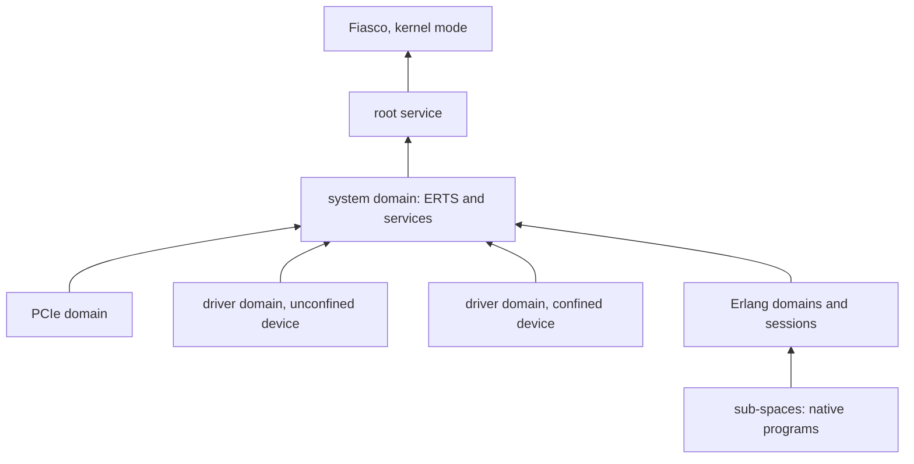
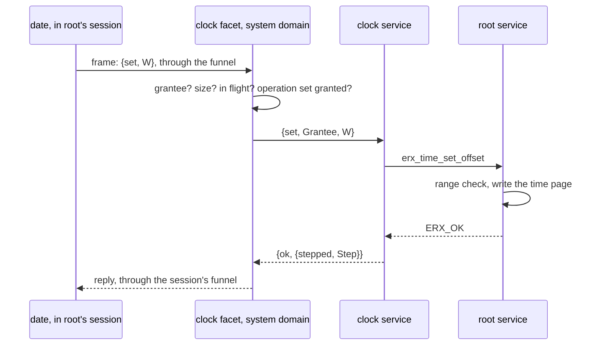
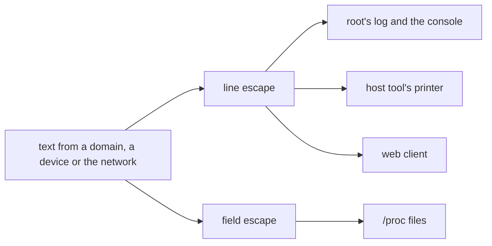

# Chapter 11. Authority and Security

> **Status.** Built: the walls between domains, which rest on Fiasco
> and the root service; handles, exports, facets and file grants; the
> refusal of a mapping that is writable and executable; the three
> runtime images; and the escaping of untrusted text. Designed: rights
> on handles, budgets that refuse, CPU bands, devices behind an IOMMU,
> the branch-predictor workaround at kernel entry, a safe decode of other domains' messages in the system domain, login
> with a passphrase, and the key vault. Table 11.4 in section 11.13
> lists both in full.

**Background needed.** [Chapter 2](02-microkernels.md) for
capabilities, the confused deputy and the trusted computing base;
[chapter 8](08-kernel-interface.md) for handles, the root service and
what Fiasco gives; [chapter 6](06-construction.md) for exports, the
funnel and the origin envelope.

A program you download onto a UNIX machine and run as yourself can
read your mail and send it to anyone on the network. It needs no bug
in the kernel. The kernel checks each `open` against your user id, the
program runs with your user id, and every check passes.

The user id is **ambient authority**: a process holds it by being who
it is, not because someone handed it the right to one particular
thing
([chapter 1](01-operating-systems.md#165-permissions-and-the-power-of-a-user)).

erXos starts from the other end. A program holds no authority it was
not handed. Every right is a thing in somebody's hands: a handle to a
kernel object, an entry in another domain's export table, a facet for
one service, or a grant of a file tree. The system manifest says which
domain starts with which, and a build check proves its security
properties before the image is made. Some of the checks that would
hold an untrusted program to its rights are designed and not built,
so every build runs trusted code only and says so at boot. This
chapter says which checks those are.

> **Background: threat models.** A **threat model** names who a
> security design defends against, what each adversary is assumed able
> to do and must not be able to do, the assets protected, and what is
> left out. Without one, a reviewer cannot tell a missing defense from
> a case the design never meant to cover.

## 11.1 The threat model

erXos is designed to run code it does not trust: apps a user
installs, drivers for devices that may be faulty or hostile, programs
built from someone else's source
([design.md, Threat model](../design.md#threat-model)).

### 11.1.1 Adversaries and assets

The unit of protection is the **domain**: an address space with its
own Erlang runtime and its own processes, walled off from every other
([chapter 10](10-domains.md#101-a-domain-is-a-node)). Five adversaries matter.

* **Code in an Erlang domain.** It may do anything inside its own
  domain, including send messages to other domains through its
  **lanes**, the one-way rings of shared memory that carry its
  messages, as **frames**, to each peer
  ([chapter 6](06-construction.md#624-pids-exports-and-the-envelope)).
  It must not touch another domain's memory, reach a process that was
  not exported to it, or act through a facet granted to someone else.
* **A native program in a sub-space.** A **sub-space** is an address
  space a domain creates for a program, holding only what the domain
  put there
  ([chapter 5](05-overview.md#525-programs-in-sub-spaces)). The
  program must not reach any domain, outlive its creator, or reach a
  file its creator did not give it.
* **A device, and the driver that holds it.** A device writes memory
  by DMA, and a driver can aim it. An **IOMMU** is a unit that
  confines the memory a device can reach. Behind one, the driver must
  not aim the device outside its own domain's buffers. Without one,
  nothing is enforced, and the driver's domain is part of the trusted
  base (section 11.2).
* **A peer on the network or the host link.** It may send any bytes,
  and must not make the receiving domain do more than refuse or drop
  them, or reach any domain before it has authenticated.
* **Whoever holds the storage medium.** It may choose every byte a
  file system reads from the data partition. It must not change a
  read-only system image without the image's hash tree noticing, or
  make the system install an update its key did not sign.

The assets are the kernel's integrity; each domain's integrity,
availability and secrecy against every other domain; the bounds of
budgets; and the operator's terminals (section 11.12).

### 11.1.2 Untrusted input

Every input that crosses from outside the trusted base is untrusted:
everything a domain hands the kernel interface; every message from
another domain; everything a device writes to shared memory; every
byte from the host link; every network packet; every file system
image and package; and every code artifact a user supplies.

Each kind crosses one narrow checking function, such as the root
service's request decoder, each runtime's funnel or the host link's
deframer. Each has a fuzz target, a test that feeds it random and
mutated input and watches for a crash or a wrong answer. A defect that
lets bad input through has one place to live, and one test that should
have caught it.

### 11.1.3 What the threat model leaves out

Three things are outside the model
([design.md, Residual risks](../design.md#residual-risks)): side
channels inside one domain, since the domain is the boundary of
secrecy; timing between domains, since a domain can learn how busy its
neighbors are from how fast its own calls return; and, on some
processors, speculation across domains. On a processor open to
branch-predictor attacks, explained in the box below, a domain may
read memory it cannot map. That is a limit of the system on such
processors. The design adds a call to the firmware's workaround at every
entry from user mode, on the processors the firmware reports as needing
it, and carries it only if the Raspberry Pi 4's null-request benchmark
shows it costs nothing measurable; it is designed and not built
([design-fiasco.md, The release's Fiasco build](../design-fiasco.md#the-releases-fiasco-build)).

> **Background: branch-predictor attacks.** A processor guesses which
> way a branch goes and runs ahead on the guess. A wrong guess's
> results are thrown away, but the memory it touched stays in the
> caches, and the time to read that memory later reveals which
> addresses were touched. An attacker who can train the predictor
> makes another program, or the kernel, guess wrong into code that
> reads a secret, and the secret leaks through timing. Defenses live at
> kernel entry and in the processor's firmware.

## 11.2 Trust placement

Every security design has a part that must be right for anything else
to be. erXos keeps that part small and says exactly what it is.

### 11.2.1 Two things keep domains apart

Only Fiasco runs in kernel mode; everything else, the system domain
included, runs in user mode. Two things keep one domain's memory and
kernel objects apart from every other's
([chapter 8](08-kernel-interface.md#881-what-isolation-rests-on)):

1. **Fiasco**, with its address spaces, its capability tables and its
   check on every invocation.
2. **The root service's request decoder and placement code.** The
   root service is one thread of the system domain. It creates every
   kernel object and writes every page table, on behalf of requests
   from `liberx`, the C library through which every domain makes its
   kernel calls
   ([chapter 8](08-kernel-interface.md#83-the-root-service-who-holds-what)).

A defect in either can break isolation; a defect anywhere else breaks
only its own domain. **Trust placement** is that statement made for
each property: the short list of code it rests on
([design.md, Trust placement](../design.md#trust-placement)).

| Property | Rests on |
| --- | --- |
| a domain's memory and threads against every other domain | Fiasco and the root service |
| a sub-space's memory and threads, against all but its creator | Fiasco and the root service |
| which processes may message a domain's processes | that domain's own runtime, above Fiasco |
| which domains exist, with which facets and grants | the system domain |
| a process's state inside its domain | that domain's runtime |

*Table 11.1. What each isolation property rests on. In the third row,
the receiving runtime checks every frame itself, so no third party
stands between two domains (section 11.5).*

### 11.2.2 The trusted base

The **trusted base**, chapter 2's trusted computing base
([chapter 2](02-microkernels.md#241-the-trusted-computing-base)),
is everything whose failure can break the guarantees above: Fiasco,
the root service, and the rest of the system domain, with its ERTS,
its `liberx` and domain library, and its Erlang services. Figure 11.1
draws it.



*Figure 11.1. The trust map, as designed. An arrow points from a part
to what it depends on. Fiasco, the root service, the system domain,
the PCIe domain and the holder of an unconfined device are the trusted
base; a domain lower down depends on those and on nothing beside or
below it.*

The system domain's share is kept small. It runs ERTS's interpreter
build, with no JIT, no C++ and no OpenSSL (sections 11.10 and 11.11),
and its inputs come through the root's decoder and the funnel, both
small and fuzzed. One input escapes
those narrow decoders: the message inside a frame, which the system
domain decodes with ERTS's ordinary decoder (section 11.5.1).

No device is confined in the system as built, so every domain that
holds a DMA-capable device is in the trusted base
([chapter 15](15-devices.md)). DMA behind
an IOMMU is designed and not built. So is the **PCIe domain**, which
alone reaches PCIe configuration space and so can turn on any
device's DMA.

### 11.2.3 Why the system domain may stop the machine

A fault in any other domain ends that domain. A fault in the system
domain or the root service ends the machine
([chapter 8](08-kernel-interface.md#855-when-the-root-task-faults)).
The system domain holds the tables that say who owns what and which
facets and grants exist; carrying on after a fault would mean handing
out authority from tables a bug may have damaged. For the same reason
the root ends the machine when Fiasco refuses an unmap the root
expected to succeed: their records no longer agree.

### 11.2.4 Why no verifier

ERTS loads compiled Erlang code without checking it, and a crafted
module can corrupt the runtime that loads it
([design.md, Why no verifier](../design.md#why-no-verifier)). Java and
eBPF answer this with a verifier, code that proves a program safe
before it runs. erXos runs untrusted code only in its own domain,
where a malicious module corrupts only that domain's runtime. A
verifier would add a large, subtle program to the trusted base, and
eBPF's history of verifier bugs shows what that costs.

## 11.3 Four forms of authority

Authority in erXos always has a holder and a checker, and the two are
never the same party. Table 11.2 lists the four forms.

| Form | Names | Held as | Checked by | Ends when |
| --- | --- | --- | --- | --- |
| handle | a kernel object | a number in the root's table for the holder's task | the root service, on every request | the holder closes it, or the creator destroys the object |
| export | a process in another domain | an entry in the target domain's export table | the target domain's funnel | the process exits, or an alias is deactivated |
| facet | the right to use one service | the pid of a process that stands for the grant | the facet itself | the facet exits |
| file grant | a tree of files | the pid of a grant process at the file's server | the grant, at the server | the grant exits |

*Table 11.2. The four forms of authority.*

In all four the checker is on the target's side, where the holder
cannot reach its state. And none is conferred by being known: a pid,
a path or a domain's name grants nothing
([chapter 2](02-microkernels.md#233-why-a-capability-cannot-be-forged)).

## 11.4 Handles: authority over kernel objects

A domain names a kernel object, such as an address space, a thread or
a doorbell, by a **handle**, an entry of the root service's table for
the domain's task
([chapter 8](08-kernel-interface.md#841-what-a-handle-names)).

### 11.4.1 What a handle protects

* **A handle is meaningless outside its table.** Domain A's handle 7
  and domain B's handle 7 are different entries; a number the root
  never gave a task names nothing in that task's table.
* **Only the creator destroys.** `erx_object_destroy` refuses every
  task but the object's creator with `ERX_ERIGHTS`, and no pass
  conveys the right to destroy.
* **A destroyed object's handle names nothing.** Each entry records
  its object's generation, which a destroy advances, so every other
  holder's entry answers `ERX_ESTALE` until closed, and never names
  the object that takes the record next.
* **Handles flow only down.** A holder passes a handle from its own
  table only into a space it created
  ([chapter 8](08-kernel-interface.md#845-why-handles-flow-only-down)),
  so no domain installs anything in another domain's table.

### 11.4.2 What a handle does not protect

**A handle carries no rights.** Chapter 2's capability is a reference
*with rights*, and a holder can pass on fewer rights, never more
([chapter 2](02-microkernels.md#235-delegation-shrinking-rights-and-revocation)).
An erXos handle has no rights at all: a pass takes a rights mask and
reports it back, but no entry stores it
([chapter 8](08-kernel-interface.md#844-rights)). Whoever holds a
handle may use the object in any way its kind allows.

The consequence is concrete. A connection between two domains is a
pair of shared-memory rings, one for each direction; each domain
writes its own ring and reads its peer's, and holds handles to both.
A domain whose code asks the root for a writable mapping of the ring
it should only read gets one. Its own `liberx` never asks, but nothing
below `liberx` stops code that bypasses it. The read side stays
read-only through the holder's own code, not through the root, and
that is a limit of the system.

**A closed number can be reused.** A closed handle answers
`ERX_EINVAL` until the task receives another handle, which takes the
lowest free entry, as a UNIX file descriptor does. A program that uses
a number after closing it reaches whatever took its entry
([chapter 8](08-kernel-interface.md#843-using-a-handle-after-closing-it)).
The bug is the holder's own, but in a server that keeps handles for
many clients it can send one client's data to another.

### 11.4.3 The design that closes both

In the design
([design-fiasco.md, Rights](../design-fiasco.md#rights)), each entry
records its holder's rights. A create gives every right of the
object's type; a duplicate or a pass intersects the source entry's
rights with the caller's mask, and a pass also drops the right to
destroy. The root's one lookup checks the right each call needs and
refuses a missing one with `ERX_ERIGHTS`, so a domain handed a ring
to read cannot map it writable. A handle's value also carries its
entry's generation, which every close advances, so a use after the
holder's own close answers `ERX_ESTALE`. Doorbells and interrupts keep
a fast path with only Fiasco's check, so a ring through a reused slot
there stays unchecked. This design is not built.

## 11.5 Exports and the funnel: authority over processes

On one Erlang node, a process that knows a pid can send to it. erXos
keeps that inside a domain and changes it at the wall between
domains, where a pid is a name and nothing more
([chapter 6](06-construction.md#624-pids-exports-and-the-envelope)).

### 11.5.1 The export table and the funnel

Each domain's runtime keeps an **export table**: its own record of
which of its processes each peer domain may reach, and with which
rights. Only the owning runtime writes it, and an entry appears in
exactly three ways
([design-domains.md, Authority](../design-domains.md#authority)):
the owner sends one of its own pids or aliases to the peer, as stock
Erlang hands out a name; a peer spawns a process into the domain; or
a process exports one of its own pids or aliases by an explicit call.

No operation on the wire adds a right. A peer that passes a pid on to
a third domain gives that domain nothing: the third domain's frames
arrive on its own lane, toward which the owner never exported the
name.

Every frame from another domain passes through the receiving
runtime's **funnel**, which copies it out of the shared ring, checks
its structure and its target against the export table, and only then
hands it on
([chapter 3](03-erlang.md#392-distribution-across-a-domains-wall);
[design-domains.md, The funnel](../design-domains.md#the-funnel)).
The lane says which domain sent the frame, never a field inside it,
so a domain cannot speak for another domain's processes.

The message inside an accepted frame stays encoded until the receiving
process takes it; ERTS's ordinary decoder then adds every atom it
names to the runtime's atom table, which is never freed and ends the
runtime when full
([chapter 3](03-erlang.md#355-the-atom-table)). Elsewhere that harms
only the domain itself. In the system domain it is a limit of the
system: a domain that sends frames full of new atoms to any process
exported to it there, a facet for one, can fill the table, and the
machine ends. In the design, the system domain decodes other domains'
messages in safe mode, which creates no atom. That is designed and not
built.

### 11.5.2 A missing right is a dead process

When the funnel finds no export for a frame's target, the runtime
answers as for a process that does not exist: a message is dropped, a
link or monitor reports the process dead. Otherwise an attacker could
map another domain's processes by watching which pids answer
differently. A pid's export lasts as long as the process. To revoke
earlier, the owner exports an **alias**, an OTP reference that stands
for the process, and deactivates it.

### 11.5.3 The envelope

What the funnel admits arrives wrapped as `{erx_origin, D, Msg}`,
where the connection sets `D`. No `receive` written for a local
message matches that shape, and only the module that owns a protocol
unwraps its own shapes
([chapter 6](06-construction.md#624-pids-exports-and-the-envelope)),
so no system process must remember to check where a message came
from. Safe Erlang, a 1999 proposal, took the other road and replaced
pids with unforgeable references that carry rights; erXos keeps pids
as ordinary terms, so every OTP library works unchanged.

## 11.6 Facets: authority over services

A network domain that may sample the clock must not be able to set
it. That is a right to use part of a service, and erXos gives each
such right a process of its own.

### 11.6.1 One grant, one grantee, one process

A **facet** is a process that stands for one grant of one service to
one domain, the **grantee**, and acts for that domain alone
([design-domains.md, Facets](../design-domains.md#facets)). The
grantee is introduced to the facet and never to the service behind
it. The facet admits only the operations and arguments the grant
allows, within its limits, and forwards them to the service. Most
facets are processes of the system domain.
A domain that holds no facet for a service has no way to reach it: a
call that needs one fails with `no_facet` before it reaches anything.
A front end reaches a session the same way: the session's **line**, to
the web domain, the SSH domain or `bleuart`, is a facet the
session mints for that domain when the system domain names it at a
login, a host opening or `bleuart`'s `root_line`, lasts no longer
than the login grant or host opening that asked for it, and is the one
name
of the session the front end holds but those its replies hand out
([design-system.md, A session's lines](../design-system.md#a-sessions-lines)).

A grant is a row of the system manifest. Here is one from
`config/manifest/development.txt`, abridged (the full row also sets
a CPU share, section 11.6.2):

```text
facet root_clock
  name "clock"
  grantee @session.system
  service @service.clock
  operations set
  max_request 256
  in_flight 1
```

Every session made from the system principal's template, which is
root's session, gets a facet named `clock` in front of the clock
service. The facet admits only `set`, takes a request of at most 256
encoded bytes, and holds at most one in flight. The manifest check
refuses a row whose service no file under `abi/services/` declares
([chapter 7](07-one-source.md#78-declared-services-and-inspection-paths)).

When a domain reports that it is ready, the domain service mints its
facets from the rows that name its template, each bound to that domain
alone (`grant_facets` in
`erlang/apps/erx_domain/src/erx_domain_srv.erl`), and hands it their
pids by name. That is the only way a domain learns a facet.

### 11.6.2 What every facet checks

Every facet is an instance of one OTP behaviour, `erx_facet`
(`erlang/apps/erx/src/erx_facet.erl`), so its checks hold for every
facet by construction. Each service supplies a small callback module:
`operation/1` names the operation a request invokes, and `admit/3`
decodes the request's arguments. Before a service's own code sees a
request, the behaviour checks five things.

1. **Who asks.** The request must arrive in the envelope
   `{erx_origin, D, ...}` with `D` equal to the grantee, so passing a
   facet's pid on delegates nothing.
2. **Where the answer goes.** The caller's pid and reply alias must
   both be the grantee's, so the reply never goes to a third domain.
3. **How large.** The request's encoded size must be at most the
   grant's `max_request`.
4. **How many.** A request past the grant's `in_flight` limit is
   refused with `{error, busy}`.
5. **Which operation.** An operation the grant does not list is
   refused with `{error, eperm}` before `admit/3` runs.

Anything else is dropped and counted. A facet ends when its grantee's
domain ends or the service behind it does. **Revoking a grant is the
facet's exit**: nothing is admitted after it, and nothing done before
it is undone.

The design adds two rules to the facet's end. A facet ends with only
the leading atom of the reason of what it ended with, since a
service's exit reason can hold what one grantee sent it, a passphrase
among them, and every grantee in front of the service would otherwise
receive it. And a session can be started bound to the processes it
ends with, as a facet is: the domain service watches them from the
start, so a front end's login has no moment in which its session runs
unwatched ([design-login.md](../design-login.md)). Both are designed
and not built.

The design adds admission by the grantee's **share** of the service's
CPU time per period, so one grantee cannot crowd out another. It also
generates each service's admission path from its declaration, and
checks `max_request` in the funnel
([design-domains.md, Facets](../design-domains.md#facets)). These are
designed and not built.

### 11.6.3 Why a process and not a list

The usual way to protect a service is an access-control list: the
service keeps a table of who may do what and checks each caller
against it. A facet has three advantages. The checks sit in one
behaviour every service shares, so no service forgets one. Revocation
is a process exit, which Erlang already handles: a monitor fires, a
pending call fails, and no service needs a "revoked" state. And a
facet carries limits per grantee, where a table would need a column
per caller for each limit. The cost is a process per grant in the
system domain, and a message hop between grantee and service.

A facet also answers chapter 2's **confused deputy**, the server that
uses its own authority on a client's behalf for an object the client
named but had no right to
([chapter 2](02-microkernels.md#234-the-confused-deputy)). A facet
never acts on a pid only because a request names it. When a service
must act on a process, a file or a device for a client, the design
has the facet mint a handle from the scope of its own grant, never
from a name the client supplied
([design-domains.md, Authority](../design-domains.md#authority)).

## 11.7 File grants: authority over files

In erXos a path is only a way to find a grant, and the grant, not the
file's owner and mode bits, decides what a domain may do with the
file.

### 11.7.1 A namespace of grants

Each domain has a private **namespace**, a table from path prefixes to
the file servers that serve them
([chapter 14](14-files.md)).
An entry that leads to another domain's server holds the pid of a
**file grant**: a process at the server that stands for one client
domain's right to one tree, with a root and rights the server fixed
when it made the grant
([design-files.md, Who a grant is for](../design-files.md#who-a-grant-is-for)).
Root's session, for example, mounts `/data` through a read-write grant
of the storage domain's tree. A grant checks four things before any
file system code sees a request.

* **Who asks.** As a facet does, a grant takes a request only in an
  envelope whose `D` is its client's domain id.
* **That the request is well formed**, against the grammar and bounds
  of the file protocol, 9P2000.L.
* **The root.** A walk of `..` at the grant's root stays there, a name
  holding `/` is refused, and the server follows no symbolic link
  during a walk; the client resolves a link's text through its own
  namespace. No request reaches above the root.
* **The rights**, one of `ro`, read only; `rw`, read and write; `rx`,
  read and run. A grant with `ro` or `rx` refuses every writing
  operation with `erofs`.

There is no fourth value meaning "write and run", so no grant carries
both, and a bug that lets an attacker write a file does not let them
run it. A session runs a program from a file only through an `rx`
entry, and a namespace refuses an `rx` mount over any grant but an
`rx` one with `eacces`.

### 11.7.2 Narrowing for a program

A native program holds no grant at all. Its sub-space holds its
channel to its **handler**, the session's Erlang process that serves
that program, a data area for its reads and writes, and the memory its
session mapped for it. Every path it opens goes to the handler, which
resolves it over the program's own table
([chapter 13](13-native-programs.md#1322-the-handler)). That table is narrowed from its
starter's: each entry on the same server, rooted at or below the
starter's, with rights no wider
([design-files.md, Invariants](../design-files.md#invariants)). Every
session also runs a file server of its own, its export
(`erx_session_export`), with a fixed tree of `/bin`, `/dev` and
`/etc`, as two file grants of its own domain: an `rx` grant for `/bin`
and an `rw` grant for `/dev` and `/etc`. Entries on the export in a
program's table are designed and not built
([chapter 14](14-files.md)).

## 11.8 A worked example: who may set the clock

A clock set a year ahead rejects every TLS certificate; a clock set
back accepts expired ones. This section follows the right to set it,
and ends where the system as built does not hold that right: any task
can ask the root service to set the clock.

### 11.8.1 The grants

Two rows grant the clock service. Root's session holds `set`
(section 11.6.1). On the Raspberry Pi, the session of the `ntpd`
principal, which runs the network time client, holds `sample`
(`config/manifest/raspi4b-development.txt`, abridged):

```text
facet ntpd_clock
  name "clock"
  grantee @session.ntpd
  service @service.clock
  operations sample
```

A `sample` is a time server's measurement, which the clock service
checks against its step rules; a `set` moves the clock to a time the
operator names. Neither includes the other, and no other session
holds either
([design-time.md, Who may set it](../design-time.md#who-may-set-it)).

### 11.8.2 Following one set

Root types `date 202611201200` in its session. Figure 11.2 follows
the request.



*Figure 11.2. A facet between a domain and a service. The facet
decides before the clock service sees anything, and tells the service
which domain asked.*

1. `date`, an Erlang command, computes the offset `W` that makes the
   clock read the named time, finds the session's facet named `clock`
   (`set_clock` in `erlang/apps/erx_shell/src/erx_cmd_date.erl`), and
   sends it a call, `{set, W}`.
2. The session's runtime writes the call as a frame into its lane
   toward the system domain. The system domain's funnel copies it out,
   checks that the facet's pid is exported to the session, and
   delivers the message in the envelope with `D` set to the session's
   domain id.
3. The facet checks `D`, the size, the count in flight and the reply
   names. `erx_clock_facet:operation/1` names the operation, `set`,
   which the grant lists.
4. `admit/3` checks that `W` is an integer within the clock's range,
   and forwards `{set, Grantee, W}` to the clock service, which learns
   the grantee from the facet, never from the request.
5. The clock service calls `erx_time_set_offset`. The root service
   checks the offset's range and writes the time page, which every
   domain maps read-only. The answer travels back the same way.

### 11.8.3 Three refusals, and one gap

**A session that holds `sample` asks to set.** The operation check in
`ntpd`'s clock facet finds `set` missing from the grant and answers
`{error, eperm}`. The clock service never hears of it.

**A session with no clock grant at all.** An app's session has no
facet named `clock`. `date` reports the refusal as it does for a user
who is not the superuser: `date: clock_settime: ` and the text of
`EPERM`, with exit status 1. Had the app
learned the pid of root's clock facet, the system domain's funnel
would drop its frame, because the facet is exported to root's session
only; the facet's own check of `D` stands behind that.

**Code that bypasses `liberx`.** Here the system as built falls short.
The root service does not check which task asks it to set the clock:
it serves that request from any task. What keeps other domains from
sending it is their own `liberx`, whose setter answers `ERX_ENOTSUP`
in every task but the system domain without sending anything. Code
that builds the request itself can set the clock. In a build that
runs trusted code only, no code does, so the facet rows are held by
the code that follows them, not enforced against code that does not
([design-time.md, On Fiasco](../design-time.md#on-fiasco)).

The design closes the gap with section 11.4.3's rights. The setter
names the time page's handle, and the root checks the caller's write
right on it, answering `ERX_ERIGHTS` without one. Only the system
domain holds the time page with that right. The facet then decides
which domain may ask the clock service, and the root decides that
only the clock service may write the page. That check is designed and
not built.

## 11.9 Principals, sessions and quotas

Where UNIX has a user id, erXos has a **principal**, a record in the
system domain's Erlang policy, which Fiasco and the root service never
see
([chapter 5](05-overview.md#517-principal)).

### 11.9.1 What a principal holds

A principal has a name, a budget, a CPU share and quotas
([design-domains.md, Principals, sessions and quotas](../design-domains.md#principals-sessions-and-quotas)).
Its **session template** says what a session of that principal gets:
its runtime, its Erlang release, its limits, and, through the
manifest's facet rows, the services it may use. A **session** is a
domain made from the template, in which a person's shell, commands and
programs run. A principal's authority is exactly the facets and grants
its template names.

The manifest's principals are built: the system principal, whose
template gives root's session, and app principals such as `ntpd`. So
is a quota of 64 domain names per principal per boot. Domain names
are atoms in the system domain, and the quota keeps a principal from
filling the system domain's atom table by naming domains. It does not
cover the atoms inside other domains' messages (section 11.5.1).

Login with a passphrase, into a session of one's own principal, is
designed and not built. The console opens root's session at boot with
no login, and SSH logs root in with the development key, or with the
keys placed on a board's card. The login facet that SSH and the web
are to log in through is built; the one row that holds it is
`bleuart`'s on the Raspberry Pi 4's development manifest, for
`root_line` alone, and no passphrase checker is built, so its
passphrase login answers `unavailable` until the vault's checker
exists. The vault derives for every name alike, under limits of 5
failures per name and per terminal, each less than a minute after the
last, and one derivation at a time, so a stranger's name gets the same answer, after the same work,
as a wrong passphrase
([design-login.md](../design-login.md#the-passphrase-check)).

### 11.9.2 Limits that hold, and limits that are records

A domain's limits are fixed when it is created, within its
principal's ceilings. The limits its own runtime applies hold, because
the runtime that bears the cost enforces them: the largest frame it
takes from a lane, the largest decoded message, the nesting depth the
funnel accepts, and the size of its export table. The number of a
domain's connections holds too, since the domain service makes every
connection.

Memory and CPU are another matter. A **budget** is the record that
pays for a domain's memory ([chapter 12](12-memory.md#121-budgets-as-space-banks)). One shared
pool of memory serves every domain, and any domain can drain it: a
budget record stores a guarantee and a cap and refuses nothing, and
when the pool runs dry every domain's allocations fail with
`ERX_ENOMEM`. In the design each domain's budgets are walls. Fiasco
gives each domain a quota of kernel memory, and each budget counts the
user pages charged to it and refuses a request past the wall, so a
domain over its budget hurts only itself. Walls are designed and not
built.

CPU time is shared by priority, not by account. Each thread starts at
the Fiasco priority of its domain's band, and an app's band is the
lowest, so an app that spins every thread it may create gets only
what the configured domains leave of each CPU, and no domain is
guaranteed any share. The design gives each domain a **band**, a
lowest and a highest priority, with a CPU set and a thread limit: the
configured domains share one priority for their ordinary work, and
above it runs only urgent work, which a trusted runtime runs at Erlang
`high` and whose cost for one message is bounded and listed,
whoever sends it
([design-fiasco.md, Urgency](../design-fiasco.md#urgency)). Bands in
that form are designed and not built.

## 11.10 Machine code

A bug that lets an attacker write into a program's memory is bad. A
bug that also lets them run what they wrote is worse, and the second
step needs memory that is both writable and executable.

### 11.10.1 No writable and executable mapping

No task's mapping is writable and executable at once
([chapter 1](01-operating-systems.md#144-protection-bits)). The root
service enforces the rule: its range table accepts only read, read
and write, or read and execute (`liberx/backend/core/vm_table.h`), and
the root is the only writer of every page table. A patch to Fiasco's
own map that refuses such a mapping in the kernel is designed and not
built
([chapter 6](06-construction.md#626-a-mapping-that-is-never-writable-and-executable)).
The rule covers one mapping, not one page: BeamAsm, the JIT compiler
in ERTS, writes code through a writable view of a memory object and
runs it through a second, executable view of the same object
([design.md, Machine code](../design.md#machine-code)).

### 11.10.2 Who may make code

A domain may create **JIT memory**, the kind of memory object BeamAsm
writes code into, only if its address space was made with the JIT
flag. The packer, the build tool that makes the boot image, marks the
BeamAsm image as one that makes code, and the domain library sets the
flag only for a domain built from a marked image
(`liberx/system/dom_core.c`). The root refuses JIT memory in a space
without the flag (`liberx/backend/fiasco/service_task.c`).

The flag gates only JIT memory, though. The root lets any task map a
plain memory object read-write at one address and read-execute at
another, and lets a protect move a mapping from read-write to
read-execute (`liberx/backend/fiasco/vm_rules.c`). So any domain can
run code it wrote into its own memory, whatever its image. That is a
limit of the system: the right to make code does not follow from the
image. The system domain runs the interpreter image, links neither
asmjit nor any C++, and makes no machine code at run time, but that
rests on its own code, not on a refusal. For files the rule does
hold: no file grant carries write and run together (section 11.7.1).

## 11.11 Keys, the vault and cryptography

Cryptography in erXos has one design rule and one design goal. The
rule: OpenSSL never runs in the trusted base. The goal: a private key
never enters the domain that uses it.

> **Background: signatures and a key vault.** A **public-key
> signature** uses a pair of keys: the private key makes a signature
> over some bytes, and anyone with the public key can check it. A
> **key vault** is a program that holds private keys and signs on
> request, so the programs that need signatures never hold the keys.

### 11.11.1 Three runtime images, and OpenSSL in two

ERTS is linked into three runtime images
([design-crypto.md, Three runtime images](../design-crypto.md#three-runtime-images-and-openssl-in-two-of-them)):

| Image | Build | OpenSSL | Run by |
| --- | --- | --- | --- |
| system image | interpreter | no | the system domain alone |
| interpreter image | interpreter | yes | command domains, and domains that choose it |
| BeamAsm image | BeamAsm JIT | yes | every other Erlang domain |

*Table 11.3. The three runtime images. The interpreter runs compiled
Erlang code directly; the JIT first turns it into machine code.*

The construction holds by absence. Erlang reaches OpenSSL through the
`crypto` module, whose C half is a **NIF**, a native function an
Erlang module loads
([chapter 3](03-erlang.md#354-bifs-nifs-and-ports)) from its
`on_load` function. The system image has no such NIF, so `crypto`
loaded there by mistake fails to load, and no list of modules to avoid
is needed. Every other domain finds `crypto` in its image, so TLS, SSH
and HTTPS work in sessions and service domains. OpenSSL seeds its
generator only through `getrandom`, which `liberx` answers from the
system's entropy or fails
([design-crypto.md, Seeding](../design-crypto.md#seeding)).

Signatures can still be checked without OpenSSL: ERTS has a small
Ed25519 check built from Monocypher, a compact C library
(`erx_bytes:ed25519_verify/3`). It refuses alternative byte spellings
of a signature that Monocypher alone would accept, and a fuzz target
runs it on the host.

Every key in the system as built is a development key: the SSH key
above, and the key the app packer makes on the host to sign packages.
The trust store for TLS holds five root certificates.

### 11.11.2 The vault

The vault, `erx_vault`, holds every principal's private keys, after
Plan 9's factotum
([design-system.md, The vault](../design-system.md#the-vault)). A
domain that must authenticate holds a **key facet**: a facet for one
purpose that asks the vault to sign input of that purpose's protocol
and returns the signature, never the key. Its grantee can have the
key sign any input of the right shape while the grant lives, but
cannot obtain the key, have it sign for another purpose, or delegate
the facet. The vault runs in a service domain of its own, so OpenSSL
stays out of the system domain. The vault and key facets are designed
and not built.

## 11.12 Text from untrusted sources

A log line looks harmless. But if a domain's name, a peer's banner or
a file name reaches the operator's terminal unchanged, it can drive
that terminal.

> **Background: terminal escape sequences.** Some byte sequences are
> commands to a terminal: move the cursor, clear the screen, set the
> window's title, and in many terminal programs, report that title
> back as if the user had typed it. They start with control characters
> such as ESC (0x1B). One that reaches the terminal inside text an
> attacker chose can hide earlier lines, forge a prompt, or inject
> input. Unicode adds quieter tricks: a right-to-left override makes
> text display in a different order from its bytes, and invisible
> characters make two different names look alike.

### 11.12.1 One escape, generated from one table

Every place that shows text under the name of its source, a log
record, a domain's name, an inspected value, writes it through one
function, the **line escape**
([design-live.md, Escape rules](../design-live.md#escape-rules)). It
renders every character of an unsafe class as a visible token,
`<U+202E>` for a right-to-left override, and every byte that is not
part of a valid, shortest UTF-8 sequence as `<0x..>`. The unsafe
classes are the control characters, tab and newline among them, the
format characters, the line and paragraph separators, and the
unassigned and invisible code points.

The classes are written once, in `abi/terminal.txt`, and a Ruby
generator emits from it the tables of each escaper: the Erlang module
`erx_text`, the host tool's, the web client's and the root service's
log. Every display escapes by the same rules because each has the
same tables, not because each was written to agree.



*Figure 11.3. The escape at each text sink. Each sink has one escaping
function, and all of them read tables generated from one file.*

`/proc` needs a second escape. Its files are read by programs, which
must get back the exact bytes a reporter chose, so the **field
escape** writes tab, newline and backslash as `\t`, `\n` and `\\` and
each unsafe byte as `\xNN`, and can be reversed exactly. In the root
service's log, a build check lets only the log core
(`kernel/core/log.c`) reach the log's raw store, so record text enters
it only through the escape.

### 11.12.2 What is not escaped

A program's own output is not attributed text. As on UNIX, `write`
and stdio deliver a program's bytes to its terminal unchanged, and
the line discipline does only what `termios` asks. A shell or editor
that draws its screen needs raw bytes; a log that shows a stranger's
text must never pass them.

Crash reports carry a quieter risk: they leak. In every domain but the
system domain, `erx_report` filters OTP's crash and logger reports
down to the process, the error's class, the reason's leading atom and
the stack's functions. A key in a crashed process's state does not
reach someone else's log.

## 11.13 Trusted code only, and what a hostile app can do

Every erXos build prints one line before anything else:

```text
development build: trusted code only
```

The line is a promise about how the build may be used. Table 11.4
gathers what holds today and what is designed.

| Area | Built | Designed |
| --- | --- | --- |
| walls between domains | Fiasco and the root service keep memory and kernel objects apart | devices behind an IOMMU; the branch-predictor workaround at kernel entry; the PCIe domain; a fuzz campaign over Fiasco's calls |
| handles | a per-task table; only the creator destroys; a destroyed object's handles answer `ERX_ESTALE`; no rights | rights in each entry; a generation in the value |
| processes | exports, the funnel and the envelope | a safe decode of other domains' messages in the system domain; `max_request` checked in the funnel |
| services | facets and their five checks; 64 domain names per principal | admission by CPU share; a generated admission path |
| files | file grants of `ro`, `rw` or `rx`; narrowing for programs | |
| the clock | the facet path; the root sets the clock for any task | the root's check of the write right on the time page |
| memory and CPU | budget records that refuse nothing; a priority per band, apps lowest | budgets as walls; bands as a base and a ceiling; the urgent scheduler |
| machine code | no single mapping writable and executable; JIT memory only for marked images; a plain object mappable writable and executable at two addresses | Fiasco's own refusal of a writable and executable mapping |
| keys | three runtime images; the Ed25519 check; development keys | the vault, key facets and login with a passphrase |
| text | the line and field escapes from one table; `erx_report` | |

*Table 11.4. What holds today and what is designed.*

### 11.13.1 What a hostile app could do

Suppose an app's code were hostile, on the system as built
([chapter 8](08-kernel-interface.md#882-what-a-hostile-domain-could-do-and-what-fails);
[design-fiasco.md, What a hostile app can do](../design-fiasco.md#what-a-hostile-app-can-do)).
Its frames meet funnels, facets and grants that check who asks, but
it could still:

* fill the system domain's atom table with frames, which ends the
  machine (section 11.5.1);
* map writable a ring it was handed to read (section 11.4.2);
* run code it wrote into its own memory, through two mappings of one
  plain memory object (section 11.10.2);
* commit pages past its budget until the machine's pool runs dry
  (section 11.9.2);
* set the wall clock by sending the root the setter's request itself
  (section 11.8.3);
* spin every thread it can create, and send requests and take faults
  as fast as its threads can, delaying every other domain's setup on
  the root's one thread;
* ring a peer's doorbell as often as it likes, costing the peer a
  wake each time.

Without a defect in Fiasco or in the root's decoder and placement
code, it could not reach another domain's memory or kernel objects.
It could not hold a device the manifest did not give it, or forge a
frame from another domain. On a processor open to
branch-predictor attacks (section 11.1.3), it might also read memory
it cannot map. Until the designed checks of Table 11.4 are built, the
system is for trusted code, as its first line at boot says.

## 11.14 When a guard fails

Each check fails visibly, and the failure reaches only what the check
guards.

* **A facet or a file grant faults.** The grantee's monitor fires and
  its pending calls fail; the service and its other clients run on.
* **The funnel refuses a frame.** The frame is dropped, as a message
  to a dead process is, and the sender learns nothing it could probe
  with.
* **A domain's runtime is corrupted by its own code.** The domain
  ends; its links and monitors report it dead to every peer.
* **The system domain or the root service faults.** The machine ends,
  with a reason (section 11.2.3).
* **Fiasco faults.** The machine is lost, which is why Fiasco is the
  only code in kernel mode.

## 11.15 Design choices

**User ids against held authority.** erXos could have given each
domain a user id and checked it at each service, as UNIX does at each
`open`. That is familiar and cheap, but it makes every program run
with all of its user's authority: the mail-reading program of this
chapter's first paragraph. Held authority costs a manifest row per
grant and a facet process per grantee, and in return a program
reaches exactly what someone handed it.

**Checks at the receiver against a broker in between.** A single
broker could check every message between domains. It would be one
place to audit, and also one party whose failure, queue or quota
reaches every pair of domains. erXos puts each check with the party
that bears its cost: the funnel in the receiving runtime, the facet in
the service's domain, the grant at the file server.

**Escaping at the sink against cleaning at the source.** Text could be
cleaned once, where it enters the system. But "clean" depends on the
sink: a `/proc` file must keep exact bytes that a terminal must not
see. So each sink escapes with its own function, and all the
functions read one generated table.

## Summary

erXos defends a stated threat model: untrusted Erlang code, native
programs, devices, peers and storage media. Fiasco and the root
service's decoder and placement code keep domains apart; the system
domain completes the trusted base and stops the machine rather than
run on damaged records. Authority takes four forms, handles, exports,
facets and file grants, each checked on the target's side, and none
conferred by knowing a name. The Erlang layer's checks hold against
any code, except that other domains' messages can fill the system
domain's atom table. The root's layer holds less: handles carry no
rights, budgets refuse nothing, any task can set the clock, and any
domain can run code it wrote into its own memory. Every sink that
shows a stranger's text escapes it with tables generated from one
file, and every build says at boot that it runs trusted code only.

The next chapter takes up the memory those budgets pay for.

## Where to read next

* [design.md, Security](../design.md#security): the full threat
  model, trust placement, authority and residual risks.
* [design-fiasco.md, Security on Fiasco](../design-fiasco.md#security-on-fiasco)
  and [Rights](../design-fiasco.md#rights): what the system gives
  against a hostile app, and the design of rights on handles.
* [design-domains.md, Authority](../design-domains.md#authority),
  [Facets](../design-domains.md#facets) and
  [design-files.md, Who a grant is for](../design-files.md#who-a-grant-is-for):
  exports, facets and file grants.
* [design-time.md, Who may set it](../design-time.md#who-may-set-it),
  [design-system.md, The vault](../design-system.md#the-vault) and
  [design-live.md, Escape rules](../design-live.md#escape-rules): the
  clock, keys and escapes.
* Jerome Saltzer and Michael Schroeder, "The Protection of
  Information in Computer Systems", 1975: least privilege, complete
  mediation and the other principles this chapter's mechanisms apply.
* Norm Hardy, "The Confused Deputy", 1988: the problem facets and
  minted handles answer.
* Russ Cox, Eric Grosse, Rob Pike, Dave Presotto and Sean Quinlan,
  "Security in Plan 9", USENIX Security 2002: factotum, the model for
  the vault.
