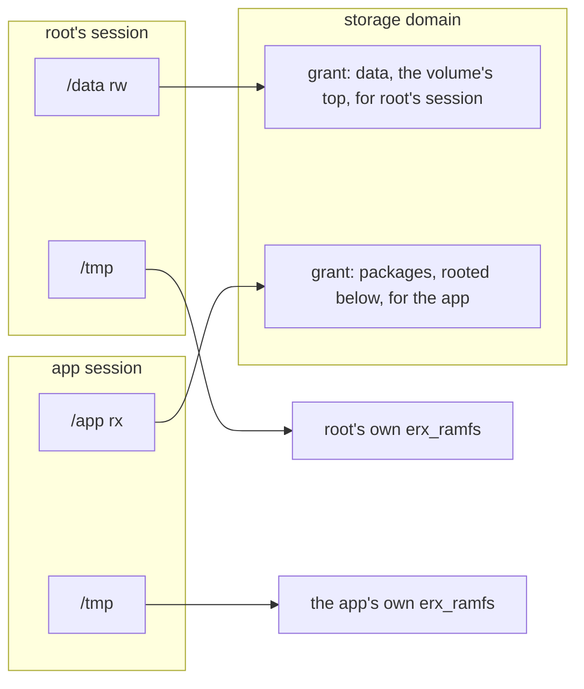
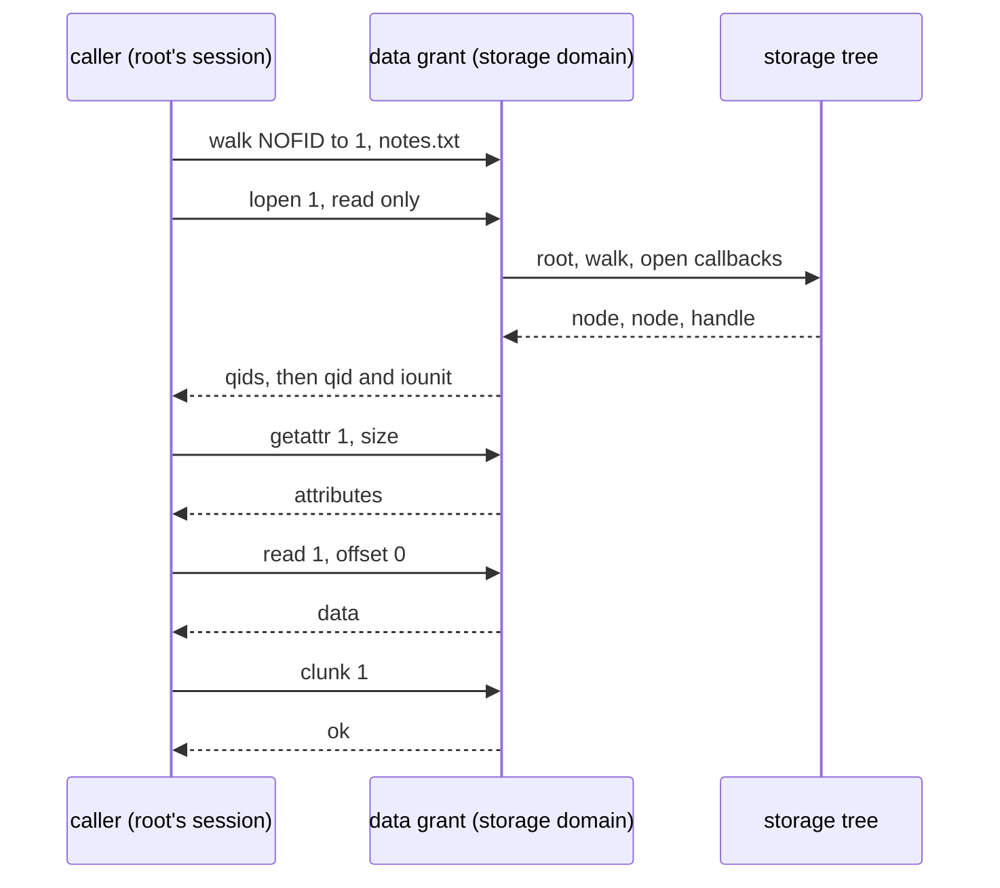
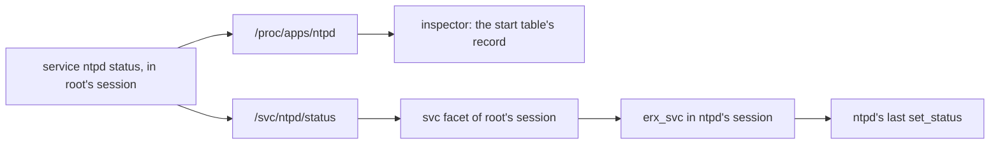

# Chapter 14. Files, Namespaces and Service Trees

> **Status.** Built: a private namespace for every domain; file
> servers in other domains reached through file grants and 9P2000.L;
> the `erx_fs` behaviour; one path resolver for every runtime and
> every program's handler; a program's namespace narrowed from its
> starter's; stream files whose waiting reads a keeper holds; `/tmp`
> on a RAM file system in Erlang; `/proc` as a read-only view of the
> inspector; the host link's 9P bridge; and the session's export, a
> file server of `/bin`, `/dev` and `/etc` that every session starts.
> Designed: walks from a grant's root without an `attach`; every
> grant's tree named by its server as the numbering of its files,
> whatever the grant's root; a display's facet kept from programs by
> its interface at every resolution; entries on the export in a
> program's table, and the
> export serving the session's local files; shared mappings of files;
> a `sysctl(3)` reader for programs; and an app's own tree at
> `/svc/NAME`.

**Background needed.** [Chapter 1](01-operating-systems.md) for
files, paths, descriptors and mounting (section 1.6);
[chapter 3](03-erlang.md) for processes, monitors and behaviours;
[chapter 10](10-domains.md) for connections, exports, the funnel and
the origin envelope; [chapter 11](11-security.md) for facets and file
grants (sections 11.6 and 11.7).

Root's session on an erXos machine runs `cat /data/notes.txt`, and the
file's bytes appear. An app's session on the same machine runs the
same line and gets `No such file or directory`. The file has not been
hidden by a permission bit. For the app, `/data` does not exist: no
name it can write leads to the storage domain that keeps the file.

How does a path find a file that lives in another domain, behind a
wall the kernel enforces? Something must turn `/data/notes.txt` into
a request, carry it across the wall, check it and bring the bytes
back, without becoming a second way to get authority beside the four
forms of chapter 11.

In erXos, after Plan 9, each domain sees files through its own
namespace, a private table from path prefixes to the file servers it
was given. Where UNIX has one tree for the whole machine
([chapter 1](01-operating-systems.md#164-file-systems-and-mounting)),
erXos has one table per domain.
An entry that leads to another domain holds the pid of a
[file grant](11-security.md#1171-a-namespace-of-grants) at that
domain's server. A pid alone grants nothing
([chapter 10](10-domains.md#104-exports-a-pid-is-a-name-not-an-authority)),
but this one was exported to this domain alone, and pid and export
together act as a capability: a path is their visible face. Every file server speaks one protocol, 9P2000.L, and an
Erlang file server is a callback module of one behaviour, `erx_fs`.
The same idea serves state and control: `/proc` for what the system
observes, and a tree an app serves for what it says.

Section 14.1 covers the namespace and path resolution; 14.2 the
protocol, the grant and the behaviour; 14.3 what a native program
sees; 14.4 `/tmp` from inside; 14.5 state and control as files; and
14.6 the review every familiar name faces. Failure and the
alternatives that lost close the chapter.

## 14.1 A path is the face of a capability

What makes `/data` exist for root's session and not for the app? An
entry in its namespace. An entry reaches another domain only through
a pid that domain's server made for this one
([design-files.md, Namespaces](../design-files.md#namespaces)).

> **Background: Plan 9 in a page.** Plan 9, the Bell Labs system of the
> late 1980s, served every resource as a file tree: disks, windows, the
> network, the processes themselves. A program reached a tree by
> mounting it into its **per-process namespace**, its own view of the
> names, so two programs could see different files at `/dev`. Every
> server spoke one protocol, 9P. A client attaches to a server's root
> and gets a **fid**, a number naming a file on that connection. It
> **walks** the fid down names to new fids, opens one, reads and
> writes it, and **clunks** it to let it go (Pike and others 1995;
> [chapter 4](04-history.md#433-plan-9-names-and-files)). 9P2000.L
> is a later variant of 9P that adds operations carrying Linux's file
> semantics, such as `lopen`, `getattr` and `readdir`.

### 14.1.1 What a namespace holds

A namespace is a list of at most 64 **entries**. Each entry has a mount
point, a provider, a root and rights. The **mount point** is where the
entry starts, as plain names (`/data` is the one name `data`). The
**provider** says who serves the names below it, one of:

* `release`, the domain's **release slice** at `/`: the part of the
  boot image that holds the domain's own OTP release, in memory the
  kernel mapped before the domain could reach any server;
* an EROFS image, the read-only format of
  [chapter 16](16-storage.md#162-read-only-system-images), held in a file and read by the
  domain's own runtime;
* a file grant at a file server, named by its pid and its tree, which
  came with the pid from the code that started the grant;
* a facet's file grant, named by the facet's name alone: the
  file grant that the domain's **facet registry** (`erx_facets`, the
  table of every facet the domain holds, by name) has under that name,
  with the tree its server named for the grant, looked up afresh at
  each resolution;
* `ended`, a file grant that has gone, on which every request answers
  `eio`.

In this chapter, "grant" alone always means a file grant: the process
at a file server that serves one client domain on one tree
([chapter 11](11-security.md#1171-a-namespace-of-grants)). The
**root** is the place below the provider's tree where the entry
starts, and the **rights** are one of `ro`, `rw` and `rx`, with no
value for write and execute together.

A runtime keeps one namespace for all of its processes, held as one
`persistent_term` ([chapter 3](03-erlang.md#353-memory-and-garbage-collection))
that only `erx_ns`'s process writes.
Every resolution reads it in place, without a copy or a lock. It is
per domain, not per process, because every process of a domain holds
the same exports: a per-process table would hide paths without
protecting anything.

Root's session's table, abridged, has entries of this shape (the
pids are illustrative):

```text
/          release            ro
/data      facet data         rw
/tmp       grant <0.212.0>    rw   its own erx_ramfs, section 14.4
/proc      grant <0.215.0>    ro   its own erx_procfs, section 14.5
```

Notice that nothing in it names the storage domain. `/data` names a
facet, `data`, which the domain service minted for this session from
a row of the system manifest and handed to it by name
([chapter 11](11-security.md#1161-one-grant-one-grantee-one-process)).
The app's session got no such facet, so no path it writes can reach
what the `data` grant reaches. The storage, apps and machine services appear at
`/data`, `/apps` and `/machine` this way in every session that holds
their facets. All of this is built.

### 14.1.2 Two domains, one server

Figure 14.1 shows root's session and an app's session over the same
storage domain. Each reaches the storage server through a grant of
its own, and the app's grant is rooted elsewhere in the volume, where
nothing above its root can be reached.



*Figure 14.1. Two domains' namespaces over one storage domain. Each
entry that crosses a wall ends at a grant made for that domain alone;
the app has no entry that leads above its grant's root, and neither domain's
`/tmp` is the other's.*

Even a grant's pid, leaked to the app, is useless to it. The storage
domain exported that pid to root's session only, so its funnel drops
any frame the app addresses to it
([chapter 10](10-domains.md#104-exports-a-pid-is-a-name-not-an-authority)),
and the grant takes a request only in an origin envelope naming its
own client's domain
([chapter 10](10-domains.md#105-the-origin-envelope)).

### 14.1.3 Mounting and binding add no authority

A domain changes its namespace with three calls of `erx_ns`: `mount`,
`bind` and `unmount`. None can widen what the domain holds.

`mount` takes a pid, which reaches only what the domain was
introduced to, or the name of one of the domain's own facets. `bind`
copies an existing entry narrowed to a subtree: `/data/projects` bound
at `/p` is an entry on the same grant, rooted at `projects`.
`unmount` removes an entry.

A facet's entry holds the facet's name, not a pid. Each resolution
reads it as the grant the domain's facet registry holds for that name
at that moment, with the lesser of the entry's rights and the grant's.
That choice makes recovery free: when the storage domain restarts and
the domain service hands the session a new grant, the next lookup of
`/data` finds it with no change to the table. A mount by pid works the
other way. `erx_ns`'s process monitors every pid its table holds, and
when one ends it rewrites that pid's entries to `ended`. A pid later
reused for another process never receives a mounted path's requests.
Both behaviors are built.

### 14.1.4 Resolving a path

How does `../notes.txt` find a file when the server that holds it is
behind a wall? One name at a time, on the client's side
([design-files.md, Resolving a path](../design-files.md#resolving-a-path)).

The resolver is `erx_path`, a pure Erlang module preloaded with
`prim_file`. It takes a path,
a table and a working directory as terms, and reaches a tree only
through two callbacks: one walks names on an entry, one reads a
symbolic link. Every runtime and every program's handler uses it, so
a path means one thing everywhere.

The resolver keeps a **place**: the path of the directory it has
reached so far, every name of which is a directory a walk answered.
A name joins the place only when a walk says it is a directory.
`..` removes the place's last name, and `.` leaves the place as it is.
Three rules follow:

* `..` is physical. After following a link, `..` names the parent of
  the link's target, the directory the walk came down through.
* `..` at the top of an entry steps out to the parent of the entry's
  mount point. At `/` it stays at `/`.
* `missing/..` answers `enoent` and `file/.` answers `enotdir`, because
  neither `missing` nor `file` was ever walked as a directory.

The server never sees `.`, `..` or a link it must follow. Every walk
carries only plain names; a server that meets a link stops and hands
back its text, and the client resolves that text through its own
namespace. So a link to `/etc` on the storage domain's disk leads to the
client's `/etc`, and no server decides whether a link escapes a
grant's root. The resolver has a fuzz target.

## 14.2 One file protocol

Why does every file server, from the SD card's to `/proc`, speak
9P2000.L? Because one protocol means one grammar to check, one client
in every runtime and tool, and no translation where the host link
meets the machine
([design-files.md, The file protocol](../design-files.md#the-file-protocol)).

### 14.2.1 9P2000.L as Erlang terms

Inside the machine, each 9P2000.L message travels as an Erlang term
whose fields are the message's fields in 9P2000.L's order. A request
to a grant is

```erlang
{erx_9p, Alias, Owner, Request}      % e.g. Request = {walk, ?NOFID, 1, [<<"notes.txt">>]}
```

and the reply comes back to `Alias` as `{erx_9p, Alias, Reply}`,
inside its origin envelope when it crosses a wall.
`Alias` is a fresh alias for each request
([chapter 10](10-domains.md#1032-the-checks-in-order)), playing the
part of 9P's tag, so no reply can be forged or replayed into another
request's place. `Owner` is the process that is to hold any fid the
request makes. An error is an OTP posix atom such as `enoent`, never
a number.

The terms already pass the funnel's grammar, so a server needs no
binary parser. 9P2000.L's bytes exist only at the machine's edges, where a codec turns
terms into wire messages and back. One edge is built: the host link's
9P bridge, through which `tools/erx files` reads the machine's files. The codec has a fuzz
target. Three details matter to a server's author. A grant is already
attached when the server makes it, so `version` resets nothing, and a
`walk` from `NOFID`, the number 9P reserves for "no fid", starts at
the grant's root, so a client inside the machine never sends `attach`.
And a `write` reply also names the offset the bytes landed at, which
an append needs.

### 14.2.2 A read, end to end

Here is one call, `file:read_file("/data/notes.txt")`, in a process of
root's session, traced to the bytes. Figure 14.2 shows the messages.

1. `prim_file` hands the path to `erx_path` with the domain's table.
   The longest matching mount point is `/data`, a facet's entry, so the
   resolver takes the grant the facet registry has under `data`.
2. `erx_file_remote`, the one client every Erlang caller uses, sends
   two requests together: a `walk` of `notes.txt` from `NOFID`, the
   grant's root, to a new fid 1, and an `lopen` of fid 1. Each is
   a frame on the session's connection to the storage domain,
   addressed to the grant's pid, each with its own alias.
3. The storage domain's funnel admits the frames, since its runtime
   exported the grant to root's session. The grant checks each
   request's grammar and bounds, client, root and rights, and only
   then calls its tree's callbacks.
4. The replies return to their aliases. The caller then asks fid 1's
   size with `getattr`, reads it in further exchanges, and at close
   sends `clunk` of fid 1. `read_file` returns `{ok, Bin}`.



*Figure 14.2. A 9P2000.L walk, open and read between domains. The
client sends the walk and the open together, without waiting for
either reply; the grant's checks run before any callback of the tree.*

A **qid** in the replies is the server's identity for a file, and an
**iounit** is the most bytes one read or write may carry. A client
keys a file by the server's domain, the grant's **tree** and the qid's
path. A tree is the numbering the server draws qid paths from, not
the place a grant starts: the `data`, `packages` and `home` grants of
the storage domain all lie in its one volume and name one tree, so
root's `/data/root/notes` and its home's `/root/notes` are one file to
every client, and two programs that map it shared through the two paths
share one copy. Sending the
walk and the open together saves a round trip across the wall, and
walking from the grant's root rather than from a fid that an `attach`
made spares the server an `attach` and a `clunk` on every open.
If the walk fails, fid 1 was never made, so the `lopen` fails too,
with `ebadf`, and changes nothing. Every step above is built but the
walk from `NOFID`, which is designed: the built client sends an
`attach` for a fid on the root first and clunks that fid with the
open.

### 14.2.3 The file grant: one client, one tree, one process

A file grant, defined in
[chapter 11](11-security.md#1171-a-namespace-of-grants), is the
process at a file server that serves one client domain on one tree,
with a root and rights fixed when it was made. Chapter 11 lists its
four checks: who asks, form, root and rights. Two more duties belong
to the file system itself.

The first is fids. Every fid has an **owner**, a process of the client
domain named by the request that made it. The grant monitors each
owner ([chapter 3](03-erlang.md#333-monitors)) and, when one ends,
clunks every fid it still owns. Erlang delivers signals between two
processes in order, so the `DOWN` arrives after every request the
owner sent. A process that crashes with files open leaves nothing
behind, and no client keeps a record of fids to clean up
([design-files.md, Fid owners](../design-files.md#fid-owners)).

The second is not being a `gen_server`. Whoever holds a grant's pid,
a process of another domain included, can send it any term. A
`gen_server` acts on OTP's system messages, so a client could suspend
it or replace its state with `sys:replace_state/2`. The grant is a
plain process with one receive. Everything except its monitors'
`DOWN`s and its keepers' answers goes through the funnel's grammar
for the protocol and is refused if malformed.

### 14.2.4 Serving: the `erx_fs` behaviour

What does it take to write a file server? A callback module of the
`erx_fs` behaviour. The behaviour owns the protocol, the fids, the
locks and every check; the module answers questions about its tree
([design-files.md, Serving: the `erx_fs` behaviour](../design-files.md#serving-the-erx_fs-behaviour)).
The core of the interface:

```erlang
-callback root(Fs) -> {ok, Tree :: binary(), Node, qid()}.
-callback walk(Node, Name :: binary(), Fs) ->
              {ok, Node1, qid()} | {error, file:posix()}.
-callback getattr(Node, Fs) -> {ok, attr()} | {error, file:posix()}.
-callback open(Node, Flags, Fs) -> {ok, Handle} | {error, file:posix()}.
-callback read(Handle, Offset, Count :: 1..65536, Fs) ->
              {ok, binary()} | {error, file:posix()} | wait().
-callback readdir(Handle, Offset, Max :: 1..256, Fs) ->
              {ok, [dirent()]} | {error, file:posix()}.
-callback clunk(Handle, Fs) -> ok | {error, file:posix()}.
%% A tree that writes adds write/4, make/4, setattr/3, unlink/4, rename/5 ...
```

Notice two things. The callbacks never see a fid, a client or a
right: by the time `walk` runs, the grant has already checked all
three. And `write` and its kin are optional: a module that leaves them
out is read-only by construction, since the grant refuses every
writing operation before it would need them. The refusal list is
generated from the protocol's operation table in
`abi/protocols/9p.txt`, each operation marked as reading or writing
([chapter 7](07-one-source.md)).

Each grant runs callbacks one at a time, in arrival order; a tree
that several grants share keeps its requests atomic itself, as `/tmp`
does (section 14.4). Besides `/tmp` and `/proc`, the storage domain's
littlefs server, the device service's `/dev` and the display's window
trees are `erx_fs` modules
([chapter 16](16-storage.md#163-littlefs-in-the-storage-domain),
[chapter 22](22-display.md#2211-a-windows-directory)).

### 14.2.5 Stream files and keepers

A read of `/dev/kbd` waits for a key that may never come. If the grant
waited in its callback, the program's other requests on that grant,
its writes, its clunks, even the flush that would cancel the read,
would queue behind it.

So no callback waits for an event. A read or write that must wait
answers `{wait, Keeper, Request}`, naming the request's **keeper**: a
process of the tree that owns the event, such as the window's keyboard
queue. The grant monitors the keeper, hands it the request and goes on
with its client's next frame. When the key arrives, the keeper answers
the request once, straight to the client's alias. A flush or a clunk
reaches the keeper through the grant, so it cannot be lost between
them. A file whose reads wait like this is a **stream file**. Stream
files and keepers are built; the window's `kbd` and `mouse` reads
have keepers, tested on the host.

The alternative, a helper process per waiting read that a flush
kills, loses input: the
helper cannot say whether it took the bytes before it died.

### 14.2.6 Clients

Erlang code reaches files through `prim_file`, ERTS's file layer, as
it does on any host. `prim_file` resolves the path with `erx_path`. A
local provider, the release slice or an EROFS image, answers in the
calling process. A grant goes through `erx_file_remote`, which sends
the requests and turns the server's error atoms into the answers
`prim_file` gives on a UNIX host, so `file:read_file/1` behaves the
same whatever server holds the file
([design-files.md, Erlang clients](../design-files.md#erlang-clients-prim_file-and-erx_file_remote)).

A native program has no grant and speaks no 9P. It sends its `open`,
`read` and `write` to its handler, and the handler runs the same
resolver over the program's table
([chapter 13](13-native-programs.md#1322-the-handler)). The bytes of
a read or a write move through the program's **data area**, memory the
session made and mapped into the program, rather than in messages on
the channel.

## 14.3 Narrowing for a program, and shared mappings

What should a C program the user ran from the shell be able to open?
What its starter lets it open, and no more
([design-files.md, Narrowing for a program](../design-files.md#narrowing-for-a-program)).

### 14.3.1 The program's table

A program's namespace is a table in its handler, of the same type as a
domain's and changed by the same pure functions of `erx_ns`. By default
the starter names its own whole namespace; it can narrow it. Every
entry of the program's table lies on one of the session's own grants,
rooted at or below the starter's entry there, with rights no wider.
Suppose root's shell starts a program with only `/data/projects`
visible, read-only. The handler records one entry, on the session's
`data` grant, with root `projects` and rights `ro`. The program can
open `/data/projects/a.c`; `/data/notes.txt` answers `ENOENT`, and a
write anywhere answers `EROFS`. Narrowing is built.

The table is a value, not a fid: the handler walks from the grant's
root each time, so nothing needs cleaning up when the program ends.
The program cannot be a confused deputy ([chapter 2](02-microkernels.md#234-the-confused-deputy)), because it holds
no grant to confuse: every request goes through a handler that acts
only on the program's own table
([chapter 11](11-security.md#1172-narrowing-for-a-program)).

One kind of grant never reaches a program through its table: a
display's. A program draws only through its own window, so the
handler leaves out of every resolution of a program's path any facet of
the `windows` interface. The interface comes with the facet from the
system domain, which takes it from the manifest, never from the
display's server, and the handler reads it each time it resolves, so a
display whose grant arrives after the program started, one that
replaces another under the same name, and one installed under any name
and bound anywhere all stay out
([design-files.md, Narrowing for a program](../design-files.md#narrowing-for-a-program)).
The built handler drops such entries once, by their tree's name, when
it builds the table; the rule above is designed.

A session's local files, such as its release slice, are not on any
grant, so a program cannot reach them through the session's grants.
The session therefore runs a file server of its own, its **export**.
This is a second sense of the word: a file server, not the export of
a pid of [chapter 10](10-domains.md#104-exports-a-pid-is-a-name-not-an-authority).
The export is an `erx_fs` module in the session's own domain, with a fixed
tree of `/bin` (the session's commands), `/dev` (`null`, `zero`,
`urandom` and `tty`) and `/etc` (`passwd` and `group`). Every session
starts it as two grants of its own domain: an `rx` grant for `/bin`
and an `rw` grant for `/dev` and `/etc`. That much is built. Two parts are designed and not built: entries on the export in
a program's table, and the export serving the session's local
providers as well.

### 14.3.2 Shared mappings

Two programs of one session map the same file with `MAP_SHARED`. One
stores a byte; the other must see it, and so must the file's server,
eventually. Who holds the bytes?

In the design, the session does. It keeps one memory object for each
file its programs map shared, the file's **shared object**, and one
Erlang process, the file's **mapper**
([chapter 12](12-memory.md#1282-no-server-maps-what-a-client-can-delete)).
Every mapping of the file in the session maps that object. The mapper
fills it with ordinary 9P reads, and at `msync`, the last `munmap`
and the last `close` writes back the pages the kernel reports stored
to. Meanwhile the handlers send the session's reads and writes of the
file to the mapper, so descriptor I/O and the mapping agree. The file's server sees nothing but reads and writes,
and no page fault ever waits on another domain
([design-files.md, Shared mappings](../design-files.md#shared-mappings)).

Shared mappings of files are designed and not built. A program can
map with `MAP_SHARED` only a memory object its session already
mapped for it.

## 14.4 `/tmp`: a file system in Erlang

What does a complete file server look like from inside? `/tmp` is the
smallest one erXos has, and it is built
([design-tmp.md](../design-tmp.md)).

> **Background: RAM file systems.** A RAM file system gives fast
> scratch space that needs no disk. It keeps its files in memory, so
> they vanish when their owner stops. It needs no journal, since its
> files are not meant to outlive a crash.

Every domain that runs ERTS has its own `/tmp`, served by `erx_ramfs`
in that domain, charged to the domain's budget and lost when the domain
ends. It is a file server like any other: the runtime mounts its
grant at `/tmp`, and
`prim_file` reaches it through `erx_file_remote`, as it reaches the
storage domain.

The grant owns the tree. The tree is one Erlang value held by `/tmp`'s
one grant, the domain's own, as an **own tree**: every callback the
grant makes is one step of a pure function, `erx_ramfs_core:step/4`,
on that value, in the grant's own process. Nothing else reads or
writes the tree, so each request is atomic against every other without
a lock, a request costs one message to the grant and its reply, and
the step function can be tested and fuzzed on its own.

Three choices, after FreeBSD's tmpfs, shape the tree.

* **A walked fid keeps its node.** A node lives while a name names it,
  an open holds it or a grant's fid names it. A `stat` that races a
  rename over its name finds the old file or the new one, never
  `ENOENT`.
* **Data is pages, and holes are free.** A file's bytes are 4 KiB
  chunks in a map from chunk index to binary. A missing chunk reads as
  zeros.
* **A cap.** The tree counts its chunks, plus a fixed charge for each
  node and name, against a cap in the domain's startup limits. A step that would pass the cap
  changes nothing and answers `{error, enospc}`.

Take `echo hello > /tmp/hi` from root's shell. The client sends
`lcreate` of `hi`, then `write`, then `clunk` to the domain's own
`/tmp` grant. The grant checks each and calls `make`, `write` and
`clunk` on `erx_ramfs`, each one step of the tree it holds. The step
for `write` checks the cap and puts one chunk in the new node's map.
Nothing leaves the domain, yet every request passes the same protocol
and grant that serve other domains.

## 14.5 State is a file to read, control is a file to write

How does a user see a domain's run queue, or tell an app to reload?
State is a file to read, control a file to write. Each kind of fact
has one of three homes.

* **What the system sees**, such as a domain's processes or a CPU's
  load, is a path of the inspector, declared in `abi/inspection.txt`
  and shown at `/proc`
  ([chapter 7](07-one-source.md#78-declared-services-and-inspection-paths)).
* **What an app says about itself, and the commands it takes**, live
  in a file tree the app serves: a `status` file to read and a `ctl`
  file to write a command to.
* **A conversation**, an exchange that goes on over time, is a
  protocol with its own design.

Files are a view: Erlang messages stay each service's primary
interface.

### 14.5.1 `/proc`: the inspector as files

`/proc` is the inspector's tree of paths as a read-only file tree. It
is served by `erx_procfs`, an `erx_fs` module that each domain's
runtime starts in that domain and mounts at `/proc`
([design-live.md, The /proc tree](../design-live.md#the-proc-tree)).
Each inspector path is a directory with a `status` file holding its
record: `/proc/status` is the machine, `/proc/domains/7/status` a
domain, `/proc/processes/7.85.0/status` a process, written without
angle brackets so a shell needs no quoting. A `status` file has one
line per attribute, with its name, value and reporter separated by
tabs:

```text
% cat /proc/domains/7/status
processes	<count>	runtime
run_queue	<count>	runtime
```

The angle brackets stand for the live values; `runtime` is the
reporter that `abi/inspection.txt` names for both attributes.

A value that is not known prints as its status, `[unknown]`,
`[partial]`, `[unsupported]` or `[timeout 500]`, never as a guess. Every
field passes the field escape, so one line is one attribute whatever
bytes a reporter chose
([chapter 11](11-security.md#1112-text-from-untrusted-sources)).

A read of a `/proc` file is the query `erx:i/1` would make for that
path, which outside the system domain goes through the domain's
inspect facet. A path the facet's scope does not reach reads as
`enoent`. So `/proc` grants nothing `erx:i/1` in the same domain does
not, and each record has one gate for both forms. `/proc` and the
records README lists, such as each CPU at `/proc/cpus/N` and the
clock at `/proc/time/status`, are built.

Where FreeBSD has `sysctl`, erXos has the inspector's tree: every
system value is an attribute of it, and `erx:i/1`, `/proc` and the
host tool's `erx inspect` are views of it
([design-live.md, System values](../design-live.md#system-values-one-tree-many-views)).
The tree is read-only: configuration lives in the system manifest,
whose security properties a build check proves, and a writable value
would be a second, unproven way to change the machine. A `sysctl(3)`
reader for programs, mapping `hw.ncpu` to `cpus_online` and so on, is
designed and not built.

### 14.5.2 An app's own tree: `/svc/NAME`

`/proc` knows that the ntpd app is running, because the start service
recorded it. It does not know which server ntpd last heard from: only
ntpd knows that. Where does ntpd say it?

In its own tree. An app whose template declares that it serves `svc`
starts `erx_svc`, the SDK's tree server, and an administrator's
session finds the tree at `/svc/ntpd`
([design-app-trees.md, Overview](../design-app-trees.md#overview)).
The tree is flat
([design-app-trees.md, The tree](../design-app-trees.md#the-tree)):

| File | Read | Write |
| --- | --- | --- |
| `status` | what the app last set with `erx_svc:set_status/1` | refused, `eacces` |
| `ctl` | present only if the app takes commands; reads as empty | one command a write |
| any other name | bytes the app set with `erx_svc:set_file/2` | refused, `eacces` |

*Table 14.1. The files of an app's tree.*

`status` uses the same line form as a `/proc` `status` file's first
two fields, name, tab, escaped value, so one parser reads both. A
write to `ctl` is one command line of at most 4,096 bytes, handed to
the process the app named. The write succeeds if the app answers `ok`
and fails with the app's errno otherwise. A 9P write carries no text
back, so a refusal's reason goes to the app's log
([design-app-trees.md, Commanding: `ctl`](../design-app-trees.md#commanding-ctl)).

Figure 14.3 shows how `service ntpd status` reads both homes: the run
state from `/proc/apps/ntpd`, then ntpd's own words from
`/svc/ntpd/status`.



*Figure 14.3. An app's tree beside `/proc`. The run state is what the
system observed; the rest is the app's to say, served by the app and
reached through a facet, never stored in the inspector.*

The `/svc` directory is a namespace entry whose names are the `svc`
facets the session holds; the domain service mints one for each
session whose template holds the `start` facet. No link under `/svc`
is followed, so an app cannot point its tree at another app's. When ntpd's session ends, its facets end and
`/svc/ntpd` disappears. The whole of `/svc` is designed and not built.

## 14.6 Familiar only where true

Every familiar name in erXos faces one review question: what does
this promise that it does not do? A UNIX user must get what they
expect, or a clear refusal
([design-app-trees.md, What FreeBSD does](../design-app-trees.md#what-freebsd-does)).

**`/proc`.** A UNIX user expects to read live process state with
`cat` and `grep`, and gets it, with domains, CPUs and the clock
besides. What it does not do is accept writes. `erx_procfs` has no write
callback, so its grants refuse every writing operation before the tree
sees it, and no file of `/proc` is a way to change a process. Debugging and
tracing are separate tools with their own authority
([chapter 21](21-live-machine.md#213-tracing)).

**`/dev`.** A program finds `null`, `zero` and `urandom` where it
expects them, and they behave as on UNIX. `tty` is a name and not a
file: a walk and a `stat` reach it, and an open answers `ENXIO`,
because a terminal in erXos is not a file of the protocol. Its
reads, modes and readiness belong to the program protocol and the
session's line discipline, the code that edits and echoes typed input
as `termios` asks
([chapter 13](13-native-programs.md#137-the-posix-lite-personality)).

**`/etc/passwd`.** A program that calls `getpwuid` finds its own
principal and `nobody`, user 65534, the owner a file shows when its
server records none. What it must not promise is that modes guard
files. `chmod` changes only the mode a server records, `chown` fails
with `EPERM` unless it changes nothing, and grants alone decide what
a program may reach. So `access` and `test -w` answer from the rights
of the grant the path resolves through, and predict what `open` does
([design-programs.md, The POSIX-lite personality](../design-programs.md#the-posix-lite-personality)).
The session's export serves these `/dev` and `/etc` files and is
built; a program's table holding entries on it is designed and not
built (section 14.3.1).

## 14.7 When a part fails

What does the user see when a part dies?

* **A file server's domain ends.** Its grants end, and every open
  descriptor on them answers `eio`. A facet's entry finds the new grant
  at the next `open` once the server restarts; an entry mounted by pid
  becomes `ended` until it is unmounted.
* **A client process ends with files open.** The grant's monitor on
  each fid's owner fires, after every request the process sent, and the
  grant clunks its fids. A removed file it held open is freed.
* **A client domain ends.** Its grants drain: they take no more frames,
  clunk every fid and end.
* **`/tmp`'s grant or its lock table crashes.** They are linked under a
  one-for-all supervisor that restarts them, at most once in five
  seconds. `/tmp`
  comes back empty and is mounted again, files open before answer
  `eio`, and a crash report goes to the log.
* **`erx_ns`'s process crashes.** The table lives in the persistent
  term, not in the process. A restarted process reads it and monitors
  its grants again.
* **A request is malformed.** The grant refuses it before any
  callback runs. `/tmp`'s step function answers every request the
  callbacks can build, with an error where it refuses, so nothing a
  client sends crashes the tree.

A domain that floods a server fills its own lane and waits in its own
runtime ([chapter 10](10-domains.md#1024-when-a-lane-is-full)). A
grant holds at most the requests in flight its facet row sets, 16 for
`data` in the development build's manifest.

## 14.8 Design choices

Each of these lost, for a stated reason
([design-files.md, Alternatives considered](../design-files.md#alternatives-considered)).

**One machine-wide tree with permission bits.** Owner and mode bits
would decide. Authority would then live in a second
system beside exports and facets, which every service would have to
check; a namespace built from grants needs no check beyond the
funnel's.

**A file protocol of erXos's own.** It could add what 9P2000.L lacks:
a server making a narrowed grant for each program, a terminal saying
when it is ready to read, and a shared mapping registered with the
file's server. Each addition would need its own grammar, its own
client in every tool and a translation wherever the host link and the
network speak 9P2000.L. Everything it would buy has a home already:
the handler narrows by walking, a terminal belongs to the program
protocol, and a shared mapping is the session's.

**A program that speaks the protocol itself.** Each program would hold
grant pids and send frames. A program would then be a domain, with a
lane to every server, and could be a confused deputy. Its handler is
cheaper and confines it.

**Servers that follow links.** Each server would then decide whether
a target escapes the grant's root, and links to other mounts could
not work. Handing the text back to the client settles both.

## Summary

Each domain's namespace is its own. An entry that leaves the domain
holds a file grant's pid or a facet's name, so a path reaches only
servers the domain was given, and
mounting or binding never adds authority. One pure resolver,
`erx_path`, gives every path one meaning on the client's side;
servers see only plain names and never follow links. Every file server
speaks 9P2000.L, carried as checked Erlang terms inside the machine and
as bytes at its edges. A server is an `erx_fs` callback module; its
grants check client, grammar, root and rights before any callback, tie
each fid to an owner process, and hand waiting reads to keepers. A
native program reaches files only through its handler, over a table
narrowed from its starter's. `/tmp`'s tree is one process and one pure
step function. `/proc` shows what the
system observes, read-only, and an app's own words and commands belong
in its tree at `/svc/NAME`, which is designed. Familiar names stay
only where they behave as a UNIX user expects, or refuse with a clear error.

## Where to read next

* [design-files.md](../design-files.md): namespaces, the protocol's
  every operation and bound, the resolver, narrowing, the `erx_fs`
  behaviour and shared mappings, with their invariants and tests.
* [design-tmp.md](../design-tmp.md): the RAM file system's data model,
  its step function and its verification.
* [design-app-trees.md](../design-app-trees.md): `/svc/NAME`, its
  status lines, `ctl` and FreeBSD's `service` command beside it.
* [design-live.md, The /proc tree](../design-live.md#the-proc-tree):
  every `/proc` path, the name encoding and the inspector behind it.
* Rob Pike, Dave Presotto, Sean Dorward, Bob Flandrena, Ken Thompson,
  Howard Trickey and Phil Winterbottom, "Plan 9 from Bell Labs",
  *Computing Systems*, 1995: per-process namespaces and 9P.
* Rob Pike, Dave Presotto, Ken Thompson, Howard Trickey and Phil
  Winterbottom, "The Use of Name Spaces in Plan 9", *Operating Systems
  Review* 27(2), 1993: why a private namespace replaces a global tree.
* FreeBSD's `tmpfs(4)` manual page: the RAM file system behind `/tmp`'s
  choices.
