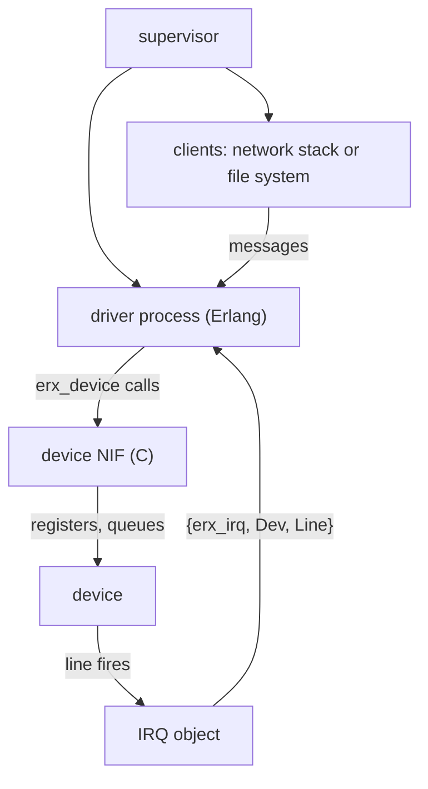
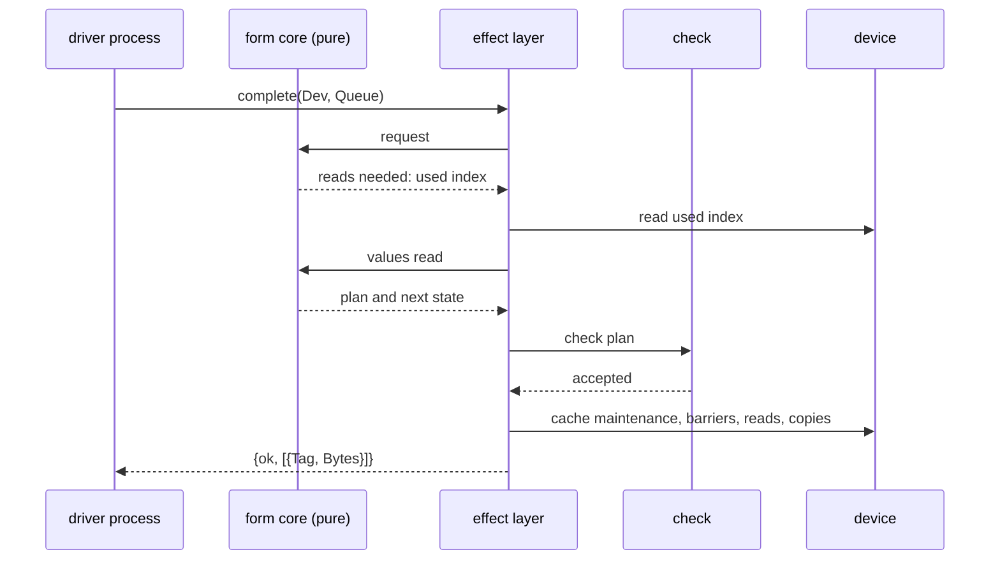
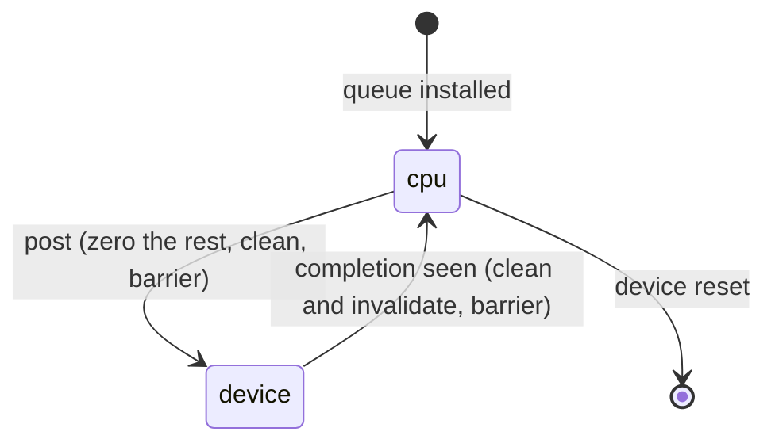

# Chapter 15. Devices and Drivers

> **Status.** Built: drivers as supervised Erlang processes (virtio
> devices on QEMU `virt`; the SD card, GENET Ethernet and the firmware
> framebuffer on the Raspberry Pi 4); the device NIF with the virtio
> and GENET descriptor forms and the check of every DMA plan; the
> device tree reader's DMA facts, the unit rule, the driver-control
> facet and both drivers' restarts. Built, and unexercised because no
> PCIe domain runs: the give of a PCIe function. Built as pure code
> with host tests, driving no device: the PCIe enumerator's parts,
> USB's cores and decoders, the TRB descriptor form, and the check of
> the Pi 4's header map. Built: the root's setting of the Pi 4's
> on-board pins at boot. Designed: the running PCIe and USB domains,
> MSI delivery, virtio over PCIe, the SD controller's ADMA2 form, the
> pin driver, which takes over the root's setting of pins, the Pi 4's
> header drivers and `/proc/sensors`.

**Background needed.** [Chapter 1](01-operating-systems.md), section
1.5: registers, interrupts, DMA, caches and the device tree.
[Chapter 3](03-erlang.md): processes, supervisors, NIFs and BIFs.
[Chapter 6](06-construction.md), section 6.4: one DMA post, traced.
[Chapter 8](08-kernel-interface.md), section 8.7: IRQ objects and the
objects a device is given. [Chapter 10](10-domains.md): domains.

A driver bug that writes one wrong address into a network card can
make the card overwrite any page of memory, and on most machines
nothing in the processor notices. Drivers are also the largest and
least tested part of most kernels.

A driver that runs in kernel mode programs descriptor rings with
addresses it computes, places each cache flush and barrier by hand,
and parses whatever the device wrote. A wrong pointer anywhere in this
is a kernel panic, or silent corruption.

erXos runs each driver as a supervised Erlang process, in a domain
that holds its device. Under the process sits one small piece of C,
the device NIF, which reaches registers, interrupts and DMA memory for
the driver and parses nothing the device wrote. Where a device must be
told an address, a pure function computes a plan, and an independent
check verifies it whole before anything reaches the hardware.

Section 15.1 restarts a driver under a live connection. Sections 15.2
to 15.5 follow a device from the manifest to its driver; 15.6 to 15.8
cover PCIe, USB and the Pi 4's small devices; 15.9 and 15.10 cover
failure and the choices.

## 15.1 A driver is a process

Open a TCP connection from root's Erlang shell to an echo server
outside the guest, restart the network driver under it, and the
connection carries on. The restart is one line in the system domain's
shell:

```erlang
erx_driver_ctl:restart(erx:cap(network_ctl), net).
```

The line goes through the network domain's **driver-control facet**
([chapter 11](11-security.md#116-facets-authority-over-services)),
through which the system domain stops, starts or restarts a domain's
drivers. The driver process ends. A new one resets the virtio network
device and reinstalls its queue, and the interface and its DHCP client
start again over it. Bytes sent over the old connection still come
back: the connection lives in the network stack's processes, which
never stopped. This is **Built**.

### 15.1.1 What a driver's end reaches

A driver's supervisors, not the driver, decide what its end reaches.
In the network domain each interface has a **link supervisor** whose
first child is the driver.
The driver is the link's *significant* child: in OTP's terms, its end
shuts the link supervisor down, and the supervisor above starts the
link again whole. The driver comes first and resets the device; then
the interface and the DHCP client, which lose only soft state. A crash
and a restart through the facet end the same way. A driver lives at
least a second, so a dead cable restarts its link once a second rather
than in a tight loop.

The storage domain is arranged the other way, on purpose. Its block
driver's supervisor restarts nothing: every child is permanent, under a restart intensity
of zero. So the block driver's end ends the storage domain, and the
domain service starts it again with its device. The reason is littlefs
above the driver: a file system that ran on across a driver restart
would have to reason about half-done writes, while a fresh domain
mounts the volume as of its last `sync`. A block driver killed
mid-transfer leaves every closed file intact and the file being
written cut at a sync.
Both arrangements are **Built**.

### 15.1.2 Why drivers are Erlang

A driver is mostly protocol: reset the device, negotiate features,
queue requests, match completions to callers, recover from a stall.
Erlang processes and `gen_server` were built for that. The rest is
parsing what the device wrote, which Erlang does with binary pattern
matching. A field that does not match crashes the one process that
read it, and its supervisor starts it again; in C the same mistake
reads past a buffer.

What stays in C is small and named. The **device shim** is the device
NIF's C: register access, interrupt
binding, queues, and the DMA plan with its check. The per-byte
primitives, such as checksums and bulk copies, are C because a per-byte
loop costs too much in Erlang. Any other native driver code would need
a row of the **driver table**
([design-system.md, The driver
table](../design-system.md#the-driver-table)), naming the device and
the measurement that showed Erlang too slow for it. On
Fiasco, a measurement admits none, because it would time
the kernel's interrupt path rather than the driver, and the table has
no rows. Every driver erXos
runs is Erlang.

Figure 15.1 shows the parts of one driver domain.



*Figure 15.1. A driver domain. The driver is one Erlang process among
others; only the device NIF touches the device, and an interrupt
reaches the driver as a message.*

## 15.2 How a device reaches its driver

No driver in erXos probes for its device at run time. A device belongs
to the domain the **system
manifest** gives it to, the checked file that lists the machine's
domains and what each holds ([chapter
7](07-one-source.md#77-the-system-manifest-the-machines-configuration-checked)).
So which domain may touch a device is settled before the machine
boots, and the device reaches its driver as a record.

### 15.2.1 Units and holders

The manifest gives devices out by **unit**: a set of devices that
share a register page or an interrupt line, given whole to one domain,
its **holder**. The Raspberry Pi 4's manifest gives the SD unit to
the storage domain in three lines:

```text
unit block
  placement "sd"
  holder @domain.storage
```

The placement `sd` names an entry of the board's **platform record**,
the file that lists the board's devices, their addresses and its
pins. It holds the EMMC2 controller, which
drives the SD card, and the board's older SD controller, which shares
EMMC2's interrupt line (section 15.5). The unit is named `block` on
QEMU `virt` too, so the system shell's
`erx_driver_ctl:restart(erx:cap(storage_ctl), block)` means the same
on both machines.

Each time the holder starts, the system domain's domain library makes
the unit's kernel objects for it, an act called a **give**: a physical
memory object over each run of register pages, a contiguous memory
object for DMA, and an IRQ object for each line
([chapter 8](08-kernel-interface.md#872-devices)). A device's DMA
memory is charged to the system domain's budget, not the holder's, and
is kept across the holder's restarts, so a restarted holder gets the
same memory back. The **device service**,
the system domain's service that hands each holder its devices, then
sends the holder each device's record: the handles of its objects, its
peripheral's name in the CMSIS-SVD sources, its device-tree path,
whether it is cache-coherent, and its descriptor form
([design-runtime.md, The device NIF](../design-runtime.md#the-device-nif)).
A driver passes the record to `erx_device:open/1`. All of this is
**Built**.

### 15.2.2 Facts the firmware owns

Two facts decide whether a device's DMA is safe, and neither is known
when the image is built: whether the device sees the processor's
caches, and which addresses it uses for which memory. On the Pi 4 the
SD controller sees the first GiB of RAM at bus address `0xC0000000`,
while GENET sees RAM at the processor's own addresses
([design-platforms.md](../design-platforms.md#dma)).

erXos takes both from the device tree the firmware hands over, read by
the root at boot before any device object is made
([design-device-tree.md](../design-device-tree.md#the-construction-facts-the-firmware-owns-are-read-where-it-left-them)).
The **coherent** flag comes from the node's `dma-coherent` property:
QEMU `virt` marks each virtio node, and the BCM2711's tree marks none.
The **DMA range** comes from the `dma-ranges` properties above the node:
the device sees processor address `dma_cpu + x` at bus address `dma_bus
+ x`. The reader answers each fact with a value or
with an absence. A device whose facts are missing or malformed gets no
DMA memory at all: the reader never fills in a default, and no table
written at build time holds a range that could disagree with the board
that boots. The reader is **Built**. It cannot
check that the hardware does what the tree says: the firmware is
trusted as part of the machine.

## 15.3 The device NIF

A driver reaches its device through one Erlang module, `erx_device`,
and nothing else. A build check fails the build if a module outside
the driver applications and the console's UART drivers names it;
similar checks guard the NIF's other narrow calls.

> **Background: virtio.** An emulator such as QEMU offers devices
> designed for emulation rather than copies of vendors' hardware.
> **Virtio** is the standard that defines them: a network card, a
> disk, a GPU, a keyboard. Each has a few registers and one way of
> moving data, the **split ring**: three arrays in memory. A
> descriptor table gives each buffer's address and length; an
> available ring lists the descriptors the driver hands over; a used
> ring lists those the device has finished. On QEMU `virt` each virtio
> device sits at a fixed address, a transport called virtio-mmio,
> listed in the device tree.

### 15.3.1 A driver, start to finish

The virtio block driver shows the whole interface in a few lines.
Its `start_device/1` brings the device up:

```erlang
start_device(Spec) ->
    maybe
        {ok, Dev} ?= step(open, erx_device:open(Spec)),
        ok ?= erx_virtio:identify(fun(Register) -> erx_device:read(Dev, Register) end,
                                  ?ERX_VIRTIO_ID_BLOCK),
        {ok, Queue} ?= step(queue_create, erx_device:queue_create(Dev, ?QUEUE, ?QUEUE_SIZE,
                                                                  erx_blk_request:buffer_size())),
        {ok, Features} ?= step(negotiate, negotiate(Dev)),
        {ok, Irq} ?= step(attach, erx_irq_line:attach(Dev, ?IRQ_LINE)),
        {ok, Capacity} ?= capacity(Dev, ?GENERATION_TRIES),
        {ok, #state{dev = Dev, irq = Irq, queue = Queue, capacity = Capacity, features = Features}}
    end.
```

Notice two things. Registers are named, not addressed: `read` takes
an atom such as `config_generation`. And the driver writes no ring
address; it asks for a queue of a size, and `negotiate` installs it.

### 15.3.2 Registers by name

Each register name resolves through a table generated from the
device's CMSIS-SVD file, the XML description of its registers
([chapter 7](07-one-source.md#74-the-hardware-has-one-source-too)).
The table gives each register's offset, width, access and fields, so a
driver cannot write a read-only register. The reads and writes are
BIFs inside ERTS, not NIF calls, because a driver makes them one at a
time and a BIF costs less to call.

Some registers can aim the device: a ring's base address, a DMA length,
the bit that marks a descriptor valid. The SVD source marks each such
register or field `ownedByNif`, and the NIF refuses, with `badarg`, a
driver's write that would change one, and writes those itself from its
own queues ([design-device-dma.md, Register
ownership](../design-device-dma.md#register-ownership)). This is
**Built**; the virtio-mmio, GENET and SD controller descriptions carry
the marks.

The Pi 4's SD driver shows the rule at its sharpest. Some SD commands
start a DMA transfer, so the NIF keeps the command register:
`erx_device:command/2` is the one way to write it, and it refuses any
command word that would start DMA, because the NIF arms no DMA queue
for the SD controller. So the SD driver moves every
byte through the data register, by programmed I/O.

### 15.3.3 Interrupts are messages

A driver binds its device's line through `erx_irq_line`, and each
interrupt then arrives as an ordinary Erlang message. The virtio block
driver's handler:

```erlang
handle_info({erx_irq, Dev, ?IRQ_LINE}, State = #state{dev = Dev}) ->
    Status = erx_device:read(Dev, interrupt_status),
    ok = erx_device:write(Dev, interrupt_ack, Status band 3),
    ok = erx_irq_line:ack(State#state.irq),
    drain(State);
```

The line stays masked from its delivery until `erx_irq_line:ack`, so
a device that holds its line raised cannot flood the domain. That holds
for a level-triggered line. An MSI is edge-triggered, and Fiasco unmasks it at each delivery, so its
acknowledgement paces nothing
([design-fiasco.md, Urgency](../design-fiasco.md#urgency)). The
driver acknowledges before it drains the completions, so one that
lands during the drain fires the line again instead of being missed.
No thread blocks waiting: the domain's **dispatcher**
([chapter 8](08-kernel-interface.md#871-one-path-for-devices-and-peers))
waits in the kernel for all its IRQ objects. Every delivery is a hint to
look, so a late, repeated or spurious interrupt costs one status read
and a drain that finds nothing.

### 15.3.4 Queues outlive the driver

A queue, and the pool of buffers behind it, belongs to the device's
record in the NIF, never to the driver process, so a driver's crash
leaves the buffers it posted posted, where the device may still write
them. A restarted driver that asks for the same queue gets it back.
Its `negotiate` resets
the device first, and only once the device reports idle does the NIF
take back the old buffers and install the queue again. So nothing a
device may still hold an address for is given out again. This is
**Built**.

## 15.4 DMA: the plan and its check

DMA must get three things right on every transfer: every address the
device is given lies in memory its domain holds, the processor and the
device never write the same memory at once, and every cache operation
and barrier is in place for a device that does not see the caches
([section
1.5.5](01-operating-systems.md#155-caches-and-devices-that-do-not-see-them)).
[Chapter 6](06-construction.md#64-a-worked-example-the-device-dma-plan)
followed a post; this section gives the structure and follows a
completion.

### 15.4.1 Forms, plans and one check

The device NIF holds a **descriptor form** for each kind of device it
drives, the code that knows that device's ring layout. A form's core is
pure: it reads no hardware and no memory the device can see. When it
needs a value the device wrote, such as a ring's index, it asks the
effect layer to read it and is called again with the answer. So a
queue call, such as a post or a completion, runs in rounds, each
ending in more reads, in a **plan** and the queue's next state, or in
the call's end ([design-device-dma.md, Calls, observations and
plans](../design-device-dma.md#calls-observations-and-plans)).

One independent check, `erx_device_dma_check`, stands between every
plan and the hardware. It verifies that every device address and
length the plan writes stays inside the queue's DMA memory, as the
device sees it, and that no **region**, a span of that memory such as
a ring or a buffer, has two writers. The effect layer calls the check and applies only a plan it accepted; a refused plan is
a bug in the form, and the call fails with nothing applied. Figure
15.2 shows one call.



*Figure 15.2. A call through the device NIF. The form decides and the
effect layer acts; the check sees each plan whole before anything is
applied, and the cache maintenance comes from neither the form nor the
driver.*

Two forms are **Built** and drive devices: the virtio split ring, for
every virtio driver on QEMU `virt`, and GENET's register ring on the
Pi 4. GENET's descriptors are device registers, and the NIF writes
their addresses once, when the queue is installed. A third form, the
TRB ring of a USB host controller, is built as pure code with host
tests, drives no device and is not part of the NIF. The SD controller's ADMA2 form is designed and not built, which
is why the SD driver uses programmed I/O.

### 15.4.2 Writers, and the maintenance that follows

A form has no way to say "clean this line" or "issue a barrier".
Instead each region's writer is a function of the queue's state: a
buffer's writer is the device from its post until its completion, and
the processor otherwise (Figure 15.3).



*Figure 15.3. A buffer's writer passing between the processor and the
device. Every cache operation sits on a change of writer, and no plan
names one.*

Code outside every form compares the states before and after a plan,
finds the regions whose writer changed, and derives the maintenance from
that alone ([design-device-dma.md, The construction: handoffs of
granules](../design-device-dma.md#the-construction-handoffs-of-granules)):

1. **Zeroing.** A buffer passing to the device has every byte the
   request does not fill set to zero.
2. **Handing over.** Before the device uses a region, the processor
   cleans it, so no dirty line can later overwrite the device's data.
3. **Taking back.** After the device is done, the processor cleans and
   invalidates the region before reading, discarding any line fetched
   by speculation meanwhile.

Regions start and end on whole **granules**, the unit a cache writes
back at once, so maintaining one region never touches another's
bytes. For a coherent device, such as every virtio device on QEMU
`virt`, only the barriers stay; for GENET, which is not coherent,
every rule acts. A build check keeps cache maintenance and barrier
instructions in the effect layer alone.

### 15.4.3 A completion, traced

Suppose the virtio block driver has posted a read of one sector, and
the device has finished it and raised its line. The driver's
`handle_info` acknowledges and calls `erx_device:complete(Dev, Queue)`:

1. The core asks for the used ring's index; the effect layer reads it,
   with the barrier that keeps later reads behind it.
2. The core asks for the used entries the index covers, each naming a
   descriptor chain and the bytes the device wrote.
3. The core returns a plan and a next state in which the buffer's
   writer is the processor again; the check confirms both.
4. From the change of writer, the buffer is cleaned and invalidated
   where needed, and the effect layer copies the bytes, up to the
   length the device reported, into a fresh Erlang binary.
5. The buffer returns to the pool, and the call answers
   `{ok, [{Tag, Bytes}]}`, which the driver passes to the caller.

Two properties follow with no code in the driver. The binary is a copy, so no Erlang term
aliases memory the device can write. And the buffer was zeroed at its
post, so a device that reports more bytes than it wrote returns zeros,
never an earlier request's bytes, which might belong to another file.

### 15.4.4 What the check does not protect

An **IOMMU**, the translation unit between devices and memory
([chapter 8](08-kernel-interface.md#872-devices)), could confine each
device to its own buffers. Neither machine erXos runs on confines the
devices it drives: QEMU's IOMMU serves only PCIe, and the Pi 4 has
none. There the check stops a bug in a form from aiming a device at
the kernel's memory, but not a driver domain that has been taken over,
which can program its device through registers in ways no check
foresaw. So every domain that holds a DMA device is in the trusted
base ([chapter 11](11-security.md#112-trust-placement)).

## 15.5 Devices that share a page or a line

On QEMU `virt` each virtio device has a 512-byte register window,
eight to a 4 KiB page. On the Pi 4 the mini UART, the console, shares
a register page with two SPI controllers, and EMMC2 shares its
interrupt line with the older SD controller. The kernel maps memory in
whole pages and binds one IRQ object to a line, so neither a page nor
a line can be split between two domains.

### 15.5.1 The unit rule

erXos makes this a fact of configuration rather than a case to handle
([design-shared-devices.md, The unit rule](../design-shared-devices.md#the-unit-rule)).
A unit is closed under "shares a page" and "shares a line": devices
that share either are in one unit, given whole to one domain. The
manifest check refuses a manifest that splits a unit, and the give
makes one register window per run of pages and one IRQ object per
line, so the kernel never meets a page or a line claimed twice. The
rule is **Built**, in the manifest checker, the domain library and
the QEMU harness, which places the virtio devices by unit.

### 15.5.2 Sharing inside one domain

Inside a domain, records whose windows share a page share the NIF's
one mapping of it, and each still reaches only its own registers,
since every name resolves inside its device's window. A shared line
needs one more rule, because one line delivers one message. The line
has a **line owner**, a process that binds it once, and the drivers of the devices that name it join the line owner
instead of binding. The storage domain on the Pi 4 starts the line
owner of EMMC2's line before the block driver. No
driver runs the older SD controller: the domain holds it as part of
the unit and opens nothing of it. Only `erx_irq_line` binds or
acknowledges a line. The console, in the system domain, joins the line
owner of its line the same way
([design-shared-devices.md, The console](../design-shared-devices.md#the-console)).
All of this is **Built**.

A line owner runs at Erlang priority `high`, so it is taken before
every queued process of priority `normal`. In the design the Raspberry
Pi 4's mini UART driver runs at `high` too, since its eight-byte
receive FIFO overruns within a time slice; that is designed and not
built. In a driver or root domain the design also gives `high` work a
scheduler thread of its own above every domain's ordinary work, the
urgent scheduler of [section 9.2.4](09-processes.md#924-urgent-work).

## 15.6 PCIe

> **Background: PCIe in a page.** PCI Express joins a processor to
> devices that can be plugged in, and on the Pi 4 to its USB
> controller. A **host bridge** joins the processor to the bus, and
> each device behind it offers one or more **functions**. A function's
> **configuration space**
> ([chapter 1](01-operating-systems.md#156-finding-the-devices)) names
> its vendor and model. Its **BARs** (base address registers) say how
> much memory its registers need and, once written, where they appear.
> Switches turn on its memory decoding and its right to master DMA.
> Software walks the bus, sizes each BAR, assigns addresses and turns
> each function on. A function usually has no interrupt wire: it
> interrupts by writing a value to an address of the interrupt
> controller, a **message-signalled interrupt** (MSI).

Whoever writes configuration space decides where each function's
registers appear and whether it may master DMA, so erXos gives that
power to one place alone.

### 15.6.1 The PCIe domain

In the design, the **PCIe domain** holds each host bridge's
configuration window and no other device, because it is in the trusted
base whole. Its one process, the **enumerator**, walks the bus,
places each function's BARs
inside the bridge's windows, and reports each function to the device
service ([design-pcie.md, The PCIe domain](../design-pcie.md#the-pcie-domain)).
A function then goes to its manifest holder like any device: the give
carves its register windows from its placed BARs and writes its
interrupt route. Only the PCIe domain touches configuration space; the
holder asks for what it needs through the device service.

### 15.6.2 A plan before any write

The enumerator does not write configuration space as it discovers
things. Each function has a **target**, kept in the domain library:
its addresses, fixed by the boot's first walk of its bridge, and the
mode its holder chose, `off`, `decoding` or `mastering`, with an
interrupt route
([design-pcie.md, The construction](../design-pcie.md#the-construction)).
A pure function, `erx_pcie_plan:plan/2`, takes the function's
configuration as read and its target, and returns at most three
stages of writes: lower the switches as far as needed, write the data
(BAR addresses, the MSI address), raise the switches to the target. So
a BAR never moves while the function decodes it, and bus mastering is
raised last and lowered first. Host tests check those properties over
every switch state, mode and route.

The holder chooses the mode through the device service's `pci` facet.
A driver opens its function, which turns decoding on and bus mastering
off; resets the controller through its own registers; and only then
asks for `master`. The plan refuses mastering for a function that does
not read as its holder left it. So a function the firmware or boot
loader left running cannot master DMA before its driver has reset it.

### 15.6.3 What is built

No image erXos boots runs the PCIe domain; that is designed and not
built, as are MSI delivery, virtio over PCIe and every PCIe driver.
The enumerator's parts, from the configuration-space decoder to the
plan and the BCM2711 bridge's bring-up core, are **Built** as pure
code with host tests. The domain library's
intake of a PCIe report and its give of a function are **Built** in C,
wired into the system domain and unexercised, since no PCIe domain
sends a report.

## 15.7 USB

> **Background: USB in a page.** USB joins a computer to devices that
> come and go. A **host controller**, here an xHCI controller, runs the
> bus. Devices hang off its root ports or the ports of **hubs**, which
> are USB devices too. When a device is plugged in, software resets its
> port, gives it an address and reads its **descriptors**: records of
> its **interfaces** (a keyboard function, a storage function) and
> their endpoints. Data moves in **transfers** on endpoints.

USB breaks the manifest's assumption that devices are fixed: a user
plugs in a keyboard, unplugs it, and plugs a disk into the same port.

### 15.7.1 Hotplug ends at the controller's domain

In the design no USB device enters the manifest or crosses a domain
([design-usb.md, The construction](../design-usb.md#the-construction)).
A USB device is reached only through transfers its controller runs, so
it belongs to the controller's domain. Other domains see **places**,
fixed when the domains are configured.
Input numbers `hid0` to `hid7` are files of input records in the
controller domain's input tree, which the display domain reads. Drives
`disk0`, `disk1`, ..., numbered across the machine, let the media domain ask for whatever
medium a drive holds, whole ([chapter 16, section 16.5.2](16-storage.md#1652-drives)). A keyboard takes the lowest free input number
when it appears and frees it when it goes. No
[file grant](11-security.md#1171-a-namespace-of-grants), facet or
message is added when a device arrives: a reader's file grants are
made once, when its domain is created.

### 15.7.2 A name dies at once, hardware later

A function process never names its device by its xHCI slot number or
hub port, which the controller reuses. The bus process gives each
attached device a fresh Erlang reference, and every transfer names a
**pipe** (USB's word, not a UNIX pipe): that reference and an
endpoint. Detach removes the reference at once, so a transfer on a
stale pipe answers `{error, gone}`, whatever device later takes the
slot: chapter 8's rule for handles, applied to USB.

The hardware cannot be freed at once, because the controller may
still be using a detached device's rings and buffers. They return to
the pool, and the slot number to use, only when the controller reports
that it holds nothing of them.

### 15.7.3 One kind of port

The bus core knows one kind of port, a hub's: read status, reset,
clear a change, power on and off. The controller process answers these
for its root ports by translating them into registers, so a device on
a root port
and one three hubs down run the same states. Three kinds of process
own all the state, each deciding by a pure step: one for the
controller, one for the bus, and one for each claimed interface.

Both machines' controllers sit on PCIe (`qemu-xhci`, and the Pi 4's
VL805 chip), so USB needs the PCIe domain. The cores, the descriptor
and HID report decoders and the input tree are **Built** as pure
code, with host tests and fuzz targets. No
USB driver runs on a booted machine; that is designed and not built.

### 15.7.4 A stick that stops answering

A USB stick can wedge in the middle of a command and answer nothing
more. The engine of a storage function, a pure core like the others,
then climbs a short ladder, and every rung waits under a deadline the
core keeps itself, so no wait is without an end
([design-usb.md, Recovery](../design-usb.md#recovery)). It first
cancels the transfer still posted by resetting that pipe, so the next
step never races it; then it sends the storage class's reset and clears
both bulk pipes; and when a rung fails, or one operation needs recovery
twice, the function ends, asking for a reset of the device's port; the
bus resets the port and starts the function again on the stick that
comes back. The ladder is **Built**; the bus's port reset is
**Designed**.
After a recovery that works, the command is sent again, at most four
times and within the request's own deadline, which is safe because
every command the engine sends reads or writes the same blocks when
repeated. A caller sees an error only once the retries or the deadline
are spent, and a stick that stops answering costs its own requests and,
at worst, its own port.

## 15.8 The Raspberry Pi 4's small devices

The Pi 4's 40-pin header carries pins that can be GPIO, I2C, SPI,
UART or PWM signals, and its firmware reports the chip's temperature
and clocks. Both follow the rules of every other device.

### 15.8.1 One table of pins

A chip has more signals than pins, so each pin has a register field
that says which block drives it, and another for its pull resistor.
The device that holds those registers is the **pin controller**. A
UART whose pins are still plain inputs sends nothing, so something
must write those fields before a driver uses its device.

Which pin does what is one table per board, the **pin table** in the
platform record
([design-pinctrl.md, The pin table](../design-pinctrl.md#the-pin-table)).
A row gives a pin one owner: a device, plain `gpio`, the firmware
(for the console and the JTAG debug port), or `reserved`. In the
design a firmware row must also be a pin that one of the firmware
settings the build writes really sets, so a table cannot move the
console by naming other pins. A device's
row adds the pin's function and pull. A pin has one row, so two
devices cannot own one pin, and the table is checked against a table
of the chip's pins from its datasheet, so it cannot give the console's
pins to SPI. On the Pi 4 the table has two lists: the **header map**,
a row for each of GPIO 0 to 27
([design-header-io.md, The
construction](../design-header-io.md#the-construction-one-map-of-the-header)),
and the **on-board pins**, which the board wires to a chip, such as
GPIO 30 to 33, which carry UART0 to the Bluetooth controller. The
check of the Pi 4's table is **Built**.

In the design one driver, the **pin driver**, runs in the domain that
holds a pin controller and is the only code with a name for a pin
register ([design-pinctrl.md, The pin
driver](../design-pinctrl.md#the-pin-driver)). At its start it reads
the registers, and a pure function returns the writes that put every
device with one setting in it, or refuses the whole plan. The driver
applies the plan, reads the registers again and plans again: a pin
the second plan would still write is reported as not set. A pin that
is already right costs no write. The driver of a device with one
setting never asks for its pins: the pin driver's start has set them,
or the boot starts nothing that would use the device. Which
configuration uses each device the build derives from the manifest's
holders, grants and rescue marks and writes beside its rows; a device
the manifest gives to no one has no rows, and its pins stay as the
firmware left them. A device's setting also clears its pins' edge
and level detection, which only a plain GPIO pin's holder asks for.
The system then
boots its rescue configuration, and does not boot when rescue needs
the device too. A device with more settings is set by its own
driver's first select.

After its start the pin driver writes for two kinds of request only.
One is a line written to `/dev/gpio`, for a plain GPIO pin that a
grant holds. The other is the name of a **state**. A row may give a
pin a second setting under a name, and a driver changes its own pins
by selecting that name: the Pi 5's Ethernet driver resets its PHY by
selecting `reset` and then `default`, and the table says which pin
goes low. No driver sends a function number or a level. A state stays
until another is selected, and the pin driver keeps no record of it:
the state a device is in is read from its registers. A device whose
driver selects states is written only by those selects, never by a
start of the pin driver, so a card's supply does not move under a
transfer when the pin driver restarts. `/proc` shows each pin's owner,
its setting in the table and the setting its registers hold. The pin
driver is designed and not built.

What is **Built** is narrower. The firmware sets the header's bus
pins from the `gpio=` lines the packer writes into `config.txt`, one
for each device row of the map. The system domain's root sets the
on-board pins' functions once at boot, from rows the packer copies
into the manifest: its pure core has a field for GPIO 28 to 57 alone,
so no row can reach a header pin, and it writes only the registers
that change, reads them back and prints one line. The pin driver
takes both jobs over, and the packer then writes no `gpio=` line.
In the design, drivers serve `/dev/gpio`,
`/dev/i2c1`, `/dev/spi0` and `/dev/pwm0`, each from the domain that
holds its controller; they are designed and not built.

### 15.8.2 Readings from the firmware

The Pi 4's firmware answers requests through a mailbox, and some answers
are sensor readings. In the design a reading is one more row of the
platform record, sent by the device service's one firmware worker
through the kernel call that already carries the firmware's
notifications, so there is no second route to the firmware
([design-board-sensors.md](../design-board-sensors.md#the-construction-the-firmwares-requests-are-rows-of-the-platform-record)).
A sensor driver shows the readings at `/proc/sensors`, which is
designed and not built.

## 15.9 What fails, and what it reaches

| What fails | What happens | What the user sees |
| --- | --- | --- |
| a network driver crashes or is restarted | the link ends and the interfaces supervisor starts it again: driver (resetting the device), interface, DHCP client | TCP connections carry on |
| the block driver crashes | the storage domain ends and the domain service starts it again | `/data` returns, each file as of its last `sync` |
| a device writes nonsense into a buffer | the driver's pattern match fails and the process crashes | as for that driver's crash |
| a form returns an unsafe plan | the check refuses it; nothing is applied | the driver's call fails |
| a device stops answering, so a register access aborts | usually the driver's domain ends; an error the kernel takes late can end another domain | as for that domain's restart |
| a device's DMA facts are absent | the device gets no DMA memory | its driver's `queue_create` is refused, and the driver does not start |
| a driver domain is taken over | on these machines its device can write any memory | nothing stops it; the domain is in the trusted base |

Three limits deserve plain words. A fault in the device NIF, native
code in the runtime, ends its whole domain rather than one process. A
device error that the processor reports while it runs in the kernel
is charged to whichever thread next enters user mode, so it can end
another domain's task. A device that misbehaves can hang or panic the
kernel, which stops the whole machine. And a device the firmware or
boot loader left running can write memory before its driver's first
reset ([design-platforms.md](../design-platforms.md#dma)).

## 15.10 Design choices

**Drivers in Erlang, not in C.** A driver is split from the policy
beside it, after sDDF, the seL4 Device Driver Framework, and written
in Erlang for the reasons of section 15.1.2. The
cost is an interrupt's path through the dispatcher and the runtime's
scheduler.

**A plan and a check, not careful code.** A kernel's DMA interface can
hand a driver the cache operations, but the driver still places each
one. In erXos forms cannot express maintenance, and the check is a second,
independent statement of the rules, so a bug must pass two pieces of
code written to different specifications.

**One domain for configuration space.** Running the enumerator in the
system domain would save a domain, but would put a parser of
device-written data in the code whose fault resets the machine.

## Summary

A driver in erXos is an Erlang process in a domain that holds its
device. Its supervisors decide what its end reaches: a network driver
restarts under a live TCP connection, while the block driver's end
restarts the storage domain whole. The only C beneath a driver is the
device NIF. It reaches registers by generated name, refuses writes
that could aim the device, turns interrupts into messages, and keeps
queues in the device's record, so a crash frees nothing the device may
still use. Where a device must be told an address, a pure form returns
a plan and one independent check verifies it; cache maintenance
follows from a region's change of writer. Devices reach domains by
unit, through the manifest, with DMA facts from the device tree or
none at all. In the design of PCIe and USB, one domain alone touches
configuration space, and USB hotplug never leaves its controller's
domain; their cores are built.

## Where to read next

* [design-system.md, Drivers](../design-system.md#drivers) and
  [design-runtime.md, The device NIF](../design-runtime.md#the-device-nif):
  the driver's contract, resets, and each call of the NIF.
* [design-device-dma.md](../design-device-dma.md) and
  [design-device-tree.md](../design-device-tree.md): the forms, the
  check and the cache rules; the reader of DMA facts.
* [design-shared-devices.md](../design-shared-devices.md): units,
  line owners and the console.
* [design-pcie.md](../design-pcie.md), [design-usb.md](../design-usb.md),
  [design-pinctrl.md](../design-pinctrl.md),
  [design-header-io.md](../design-header-io.md) and
  [design-board-sensors.md](../design-board-sensors.md): PCIe, USB,
  pins, the Pi 4's header and its firmware readings.
* Marshall Kirk McKusick, George V. Neville-Neil and Robert N. M.
  Watson, *The Design and Implementation of the FreeBSD Operating
  System*, second edition, 2014: its chapter on devices describes
  drivers in a conventional kernel.
* OASIS, *Virtual I/O Device (VIRTIO) Version 1.2*, 2022, section 2.7:
  the split ring.
