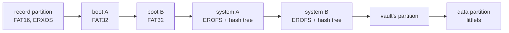
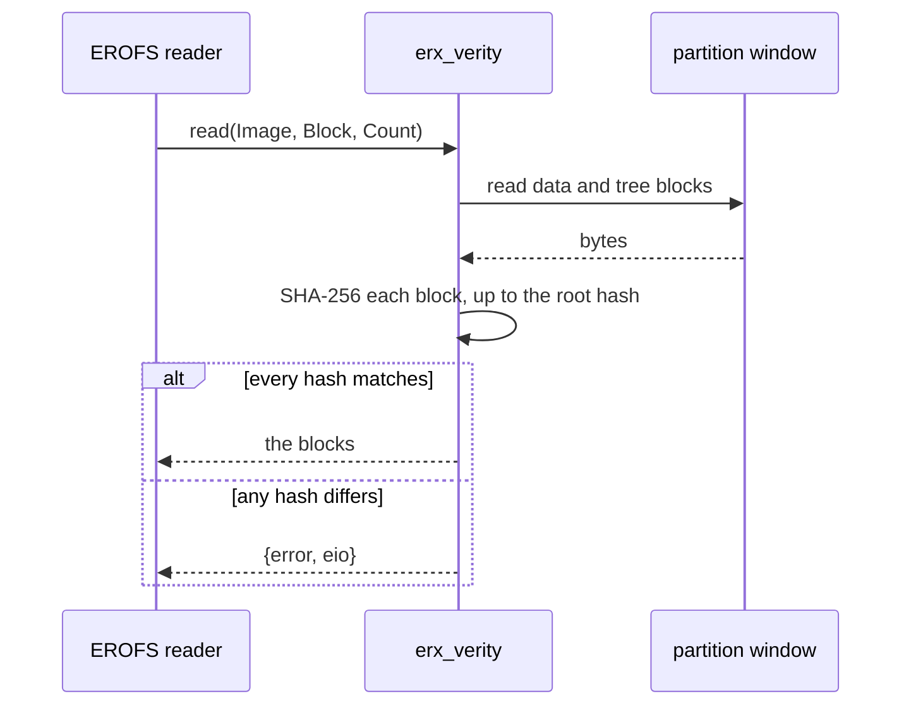
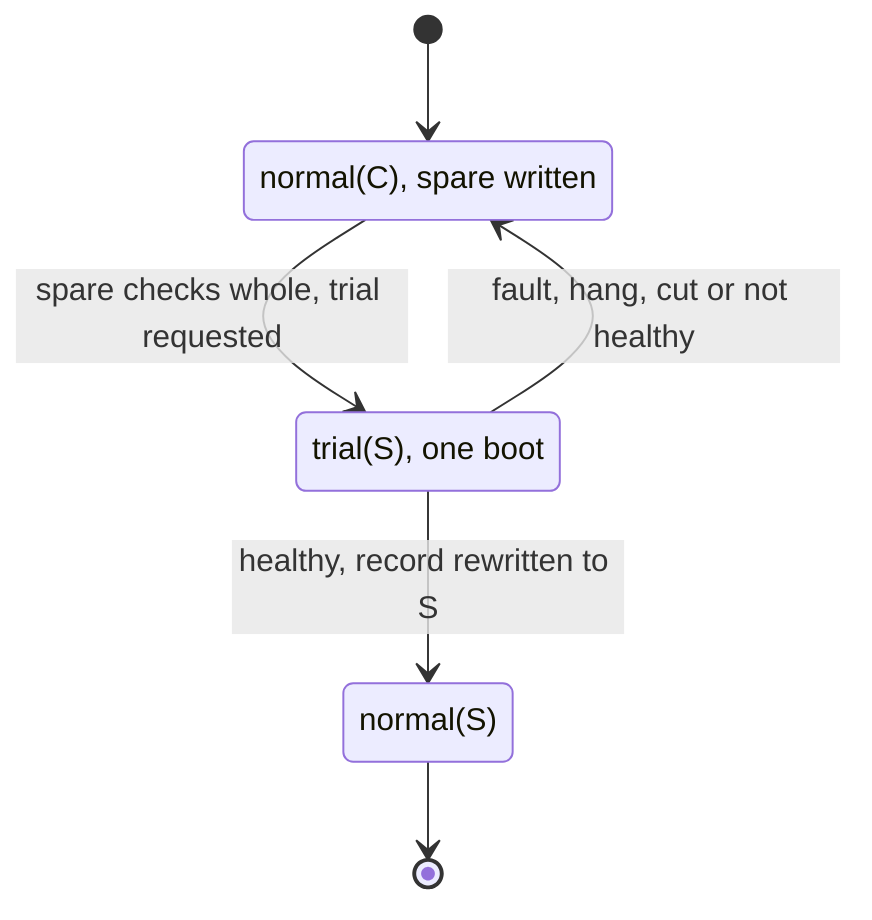

# Chapter 16. Storage and Updates

> **Status.** **Built:** a storage domain serves `/data` from littlefs
> over the virtio block driver on QEMU and the SD card driver on the
> Raspberry Pi 4; killing the block driver in the middle of a transfer
> ends the domain, its restart mounts `/data` again, and every file
> synced before the kill is there. Each user's home, `/root` or
> `/home/NAME`, is served from `/data`. The medium's layout of two
> slots, the vault's partition and the data partition, the
> boot-selection record the packer writes, and the QEMU harness that
> reads it and boots the slot it names are built. The build writes slot
> A's system partition as an EROFS image with a dm-verity hash tree,
> the EROFS reader in every runtime reads only blocks that pass the
> tree, and the storage domain serves the partition's packages as the
> `system` tree. The pure FAT reader that finds root's login keys on
> the card is built. The F2FS codec and mount core are built and tested
> on the host.
> **Designed:** the slot writer, updates with a trial boot and a
> commit, the reset count, the vault's storage domain, drives, whose
> FAT and EROFS volumes the media domain serves at `/media`,
> and erXos's F2FS as a mounted file system with its power-cut harness.

**Background needed.** [Chapter 1](01-operating-systems.md) (block
devices, file systems, journals), [chapter 10](10-domains.md)
(domains and how one ends), [chapter 11](11-security.md) (facets and
file grants), and the outlines of chapters
[14](14-files.md) and
[15](15-devices.md) (file servers and
drivers).

A Raspberry Pi in a kiosk loses power whenever someone trips over the
cable or the building's power fails. A cut may land in the middle of
an update copying a new system onto the card. The machine must come
back every time, with every file it promised to keep and a system
that boots, from an SD card that promises little about power cuts and
whose every byte may have been changed by someone holding it.

A system can keep its file systems consistent across a crash with
journals or copy-on-write, replace system files in place, and keep
the old system as a snapshot to boot if the new one fails. If its file
systems run in the kernel, a bug in a file system's parser is a kernel
bug, and a crafted disk image is an attack on the kernel.

erXos runs storage as services in Erlang domains of their own. The
system itself is a read-only image whose every block is checked
against a hash before anything parses it; the files that change live
on a separate data partition, behind a file system in its own domain;
and an update writes a complete second copy of the system and boots
it once on trial, so the copy that runs is never written. A bug in a
file system ends a domain, never the machine.

> **Background: partitions and the SD card.** A disk is one long row
> of numbered blocks (chapter 1, section 1.6.1). A **partition** is a
> range of those blocks set aside for one use, listed in a partition
> table at the start of the disk. The oldest table, the master boot
> record, has four entries; one of them may point to an extended
> partition holding more. An SD card is flash memory behind a small
> controller. Flash cannot overwrite a page in place: it erases a
> large region, the **erase unit**, and then writes pages into it.
> Each region survives a limited number of erases. The card's
> controller hides this by keeping a table from the block numbers the
> computer uses to the pages that hold them, its flash translation
> layer. That table is the card's secret, and a power cut while the
> controller updates it can damage blocks the computer never wrote.

## 16.1 Storage as a service

A bug in the code that reads a disk ends one domain in erXos, which
restarts while the rest of the machine runs on. Every part of storage,
from the driver to the file system, runs in an Erlang domain, behind
facets like any other service ([design-storage.md,
Overview](../design-storage.md#overview)).

### 16.1.1 The medium and its partitions

The medium has the same layout on every machine, and one file,
`abi/medium.txt`, says where every partition lies. The packer, the QEMU
harness and the driver all take their numbers from it (chapter 7).
Figure 16.1 shows the layout.



*Figure 16.1. The medium's partitions, in order. A slot is a boot
partition and a system partition; the record names which slot boots.
Only the data partition grows to fill the card.*

A **slot** is a pair of partitions: a boot partition, the FAT32 volume
the firmware reads, holding the kernel and the boot image, and a system
partition, holding the system's read-only files. There are two slots, A
and B. The **record partition**, first on the medium, is a small FAT16
volume labelled `ERXOS` that holds the boot-selection record (section
16.6) and the files a user adds before the first boot, such as root's
`authorized_keys`. The vault's partition holds the sealed key files of
the vault (chapter 11, section
[11.11.2](11-security.md#11112-the-vault)), and the data partition, the
last, holds `/data`. Every boundary falls on a 1 MiB line, the erase
unit the layout assumes. The layout is built: the packer writes it to
a card image, and the QEMU disk image has it too.

### 16.1.2 Partition windows

A file system in erXos never holds the disk. It holds a **partition
window**: an Erlang process of the block driver that serves one
partition's sectors, numbered from zero, and nothing beyond them.
(Chapter 8's "window", the root service's view of RAM, is a different
thing.) The window checks every request against its range, refuses a
write if it is read-only, and passes what is left to the driver. A file
system that asks for a sector past its partition's end gets `erange`.

The system manifest declares which domain may hold each window, and a
build check proves the declaration safe: it refuses, for example, a
window on a slot held by anyone but the system domain. On QEMU the
development manifest declares the data partition's:

```text
window data
  holder @domain.storage
  device "/virtio_mmio@a003e00"
  role data
  partition 0
  image none
```

The block driver does not read these rows. It
is a few processes in the storage domain: a device process that talks
to the controller through the device NIF (chapter 15), a partition
process, and the windows. The partition process reads the partition
table, admits it only if it matches `abi/medium.txt`, and starts a
window for the record partition, each boot partition, the vault's
partition and the data partition. From the boot value (section
16.6.2) it adds read-only windows on the booted slot's system
partition and on the whole record partition, for root's login keys.
It hands windows only to processes of its own domain. This is built.

### 16.1.3 What a failure ends

The storage domain's supervisors restart nothing. `erx_blk_sup` and
`erx_storage_sup` give every child the permanent restart type and a
restart intensity of zero (chapter 3, section
[3.3.4](03-erlang.md#334-supervisors)), so the end of any child ends
the supervisor, the application, and with it the whole storage domain.
The domain service then restarts the domain, at most five times in
600 seconds, as the manifest's row for it says.

Erlang's habit, the one chapter 3's supervisors teach, is to restart
only the process that failed. Here that habit would be wrong, because
of the disk's write cache. A restarted
driver resets the controller, and nothing promises that a reset keeps
what the device's cache held. A file system that carried on over the
new driver could believe a write was safe that the reset threw away.
So each window binds itself to the first device process it reaches and
answers `eio` to everything once that process is gone, even if a new
one runs. The file system breaks at its next request, the domain ends,
and the restarted domain mounts the volume afresh from what the medium
holds.

Follow that event when the block driver is killed:

1. Files are written to `/data`, some of them synced, and a transfer
   is running.
2. The block driver in the storage domain is killed while the transfer
   runs.
3. littlefs's next block request gets `eio` from the window; the
   volume is broken, and littlefs, its supervisors and the storage
   domain end.
4. Meanwhile `/data` answers `eio` in root's session, and a file
   opened before the restart must be opened again.
5. The domain service restarts the domain. The driver resets the
   device, and the domain reports ready only once littlefs has mounted
   the volume.
6. `/data` reads again: every synced file is present, each kept file
   cut at a sync.

Root's session does not fail; it sees a pause in `/data`.

## 16.2 Read-only system images

The files of the running system are never written by the system that
runs them. Each slot's system partition is a read-only file system
image, built once on the developer's machine, followed by a hash tree
that lets any reader prove each block is the one the build wrote.

> **Background: hash trees.** A cryptographic hash such as SHA-256
> turns any block of bytes into 32 bytes, and no one can find a
> second block with the same hash. To check a whole disk image block
> by block, hash every block, then hash the list of hashes in blocks,
> and so on until one hash is left, the **root hash**. This is a
> Merkle tree. To check one block, a reader needs the block, the tree
> blocks on its path up, and the root hash; if the root hash is
> trusted, so is the block. Linux's dm-verity uses such a tree to
> check a read-only partition as it is read.

### 16.2.1 EROFS and its tree

The system partition holds an EROFS image. EROFS, the Enhanced Read-Only
File System, is a Linux file system for read-only images: nothing on it
changes, so it needs no free-space map and no journal, and a reader has
little to get wrong. The tree after it is dm-verity's format, version 1,
with SHA-256 and 4 KiB blocks, so each tree block holds 128 hashes.
The image's manifest,
inside the slot's boot image, records the root hash, the tree's offset
and its salt. The firmware loads the boot image from the boot partition,
so the root hash does not pass through the partition it checks.

The packer writes the EROFS image with the fsimg tool, computes the
tree itself, and records the tree in the manifest's `system_image`
row.

### 16.2.2 Every block checked before it is parsed

The EROFS reader, `erx_erofs`, is Erlang, preloaded in every runtime
beside `prim_file`, so every domain can read an EROFS image without
loading anything first. It never reads the medium itself. Every block
comes through `erx_verity`, the hash-checking reader, and `erx_verity`
hands back a block only once it matches the tree ([design-storage.md,
Reading EROFS images](../design-storage.md#reading-erofs-images)).
Figure 16.2 traces one read.



*Figure 16.2. An EROFS read checked against the hash tree. The reader
sees bytes only after they have matched; a changed block never reaches
its parser.*

The check runs in the calling process, in Erlang, with the runtime's
SHA-256 built-in, and asks for the tree blocks it needs on every read.
The parser still checks every bound itself, and a fuzz target feeds it
images no tree vouches for.

Flip one byte of a directory block in the system partition. Its hash
no longer matches the tree, so the read answers `eio`; the reader
fails that one operation and logs the image and block, and the process
that asked carries on. Change files and rebuild the tree to match, and
every read still answers `eio`, because the root hash comes from the
boot image.

### 16.2.3 The `system` tree, and every reader checks for itself

The storage domain serves the `apps/` directory of the booted slot's
system partition as the **`system` tree**, read-only, through
`erx_storage_system` ([design-storage.md, The `system`
tree](../design-storage.md#the-system-tree)). The build places there
the packages that come with the system, such as the kiosk app on the
Raspberry Pi's card; packages a user installs lie in `/data` (section
16.3.3). A **package** is an app's
one `.app` file: a signed header, an EROFS image of the app's files and
that image's own hash tree (chapter
[23](23-apps.md#2322-three-parts-in-one-file)). A domain that runs an app
reads the package through the tree and checks every block against the
package's own tree, a second time, in its own memory. So a storage
domain can refuse to hand over a file, but it cannot change what a
reader accepts. The system domain and the app template each hold a
read-only **file grant** of the tree, a process of the storage domain
that serves the tree to that one holder (chapter 11, section
[11.7.1](11-security.md#1171-a-namespace-of-grants)); the build
derives both from the manifest. This is built.

Nothing at boot needs the tree: every domain's code lies in the boot
image (chapter 10, section
[10.8.2](10-domains.md#1082-creating-a-domain)), so a broken system
partition costs packages, never the boot.

## 16.3 littlefs in the storage domain

`/data` is served by littlefs, a small file system from the embedded
world, designed to survive random power failures. It gives
copy-on-write guarantees, keeps its RAM use bounded as the file system
grows, and spreads writes over the blocks it rewrites (dynamic wear
levelling). The storage domain runs it as a NIF (chapter 3), C code
inside the domain's runtime
([littlefs in the storage
domain](../design-stopgap.md#littlefs-in-the-storage-domain)).

> **Background: how a file system survives a cut.** A file system
> changes several blocks for one operation: the file's data, its size,
> the directory that names it, the map of free space. A cut between
> those writes leaves them disagreeing. Three answers exist. A
> **journal** writes a note of the whole change first and replays it
> after a crash (chapter 1, section 1.6.4). **Copy-on-write** never
> overwrites a live block: it writes new copies and then switches one
> pointer, so a cut leaves the old version or the new. A
> **log-structured** file system writes everything as an append-only
> log and cleans old segments later, which suits flash, where writing
> in place is expensive anyway. littlefs is copy-on-write with small
> logs for metadata; F2FS is log-structured.

### 16.3.1 The owner, the worker and one block request

A NIF that waits for the disk cannot run on a normal scheduler, so
littlefs runs on a dirty I/O scheduler, one of ERTS's threads for long
C calls. But littlefs's block reads and writes must reach the window,
an Erlang process, and a process stuck in a dirty NIF cannot receive
messages. Two processes share the work, in `erx_lfs`:

* the **owner** takes every client request, one at a time, and never
  blocks;
* the **worker** alone calls littlefs, one operation at a time.

When littlefs needs a block, its C callback posts `{erx_lfs_block, Op,
Sector, Count, Req}` to the owner and waits. The owner sends the request
to the window and, on the answer, calls `erx_littlefs:complete/2`, a
short normal NIF that wakes the callback. An operation waits only for
the owner, which waits for nothing, so no cycle of waits can form.

### 16.3.2 What reaches it, and what its failure ends

Two kinds of untrusted input reach littlefs. The partition's bytes
reach it through littlefs's own bounds checks and checksums, and a
fuzz target feeds it crafted images under the NIF's own configuration. A client's paths, sizes and offsets
reach it through the NIF's argument decoding, which bounds each before
littlefs sees it. A mount that fails never formats the partition.

Any block failure breaks the volume and, as section 16.1.3 traced,
ends the storage domain; a littlefs assertion aborts the runtime with
the same result. A partition that fails at every mount leaves the
domain down once its five restarts are spent. Durability is plain: a
file synced before a cut is there after it, and a write not yet synced
may be lost.

Running C as a NIF has a cost. A memory error in littlefs that
crashes the runtime ends the domain, but one a crafted partition could
steer reaches everything the runtime holds: every file of the volume
and the block driver itself. This is a limitation of the
system. The design places littlefs in a sub-space port of the
storage domain (chapter 13, section
[13.1](13-native-programs.md#131-a-program-is-a-port)), holding only
its channel and a data area, so that a fault ends only the port. That
placement is designed and not built.

### 16.3.3 Who reaches `/data`

The volume is the files service `data`, and its `packages/` directory is
a second service, `packages`, where installed apps lie (chapter
[23](23-apps.md#2351-a-package-is-a-file)). For each grantee the
storage domain starts a file grant of the tree, which admits only that
domain's requests, through the facet the manifest declares (chapter 11,
section [11.6](11-security.md#116-facets-authority-over-services)). A
`packages` file grant reaches nothing outside `packages/`. The system
domain and root's session each hold a `data` file grant over all of
`/data`, read and write.

Each user's home is a third service, `home`, over the volume's `root/`
and `home/` directories ([design-files.md, Building, binding and
mounting](../design-files.md#building-binding-and-mounting)). Its file grant is rooted at
the grantee's own home, `/root` for root and `/home/NAME` for anyone
else, and the grant makes the directory when the volume lacks it. The
build gives every user's session template a `home` facet, so a user
reaches their own home and nothing else of `/data`. All three services
are built.

The storage domain also serves `login_keys`, a read-only tree of one
file, `root`, holding the keys of the `authorized_keys` file a user
put on the record partition. It reads the card only when the file is
first asked for, with the FAT reader of section 16.5.1. At boot, while
`/root/.ssh/authorized_keys` does not exist, root's session reads
`login_keys` and writes the keys there; from then on SSH reads only
that copy, which root edits like any file ([design-ssh.md, Root's
login keys on the medium](../design-ssh.md#roots-login-keys-on-the-medium)).
This is built.

## 16.4 erXos's F2FS

The design gives the data and vault partitions F2FS, the Flash-Friendly
File System Samsung wrote for Linux (Lee and others, 2015), implemented
afresh in Erlang ([design-f2fs.md](../design-f2fs.md)). The vault's
partition is a second volume because the vault's sealed keys are kept
apart from everyone's files: in the design a storage domain of its own
serves it, the vault is its only client, and so no user's request
reaches it ([design-storage.md, Data
model](../design-storage.md#data-model)). It writes the standard
on-disk format, so other systems can mount and check what erXos
writes, and erXos can mount what they write. erXos's F2FS as a
mounted file system is designed and not built. Two pure parts are
built and tested on the host: the codec, which reads a volume's
on-disk structures, and the mount core, which picks the superblock
copy and checkpoint and decides the mount mode. The codec has a fuzz
target.

### 16.4.1 The durable view is never overwritten

F2FS commits its state in **checkpoints**: a checkpoint names the
tables that say which blocks are in use. Between two checkpoints, an
`fsync` of one file appends a **roll-forward record** to a chain that
the next mount replays. What a mount rebuilds after a cut, the last
checkpoint and its chain, the design calls the **durable view**, and
its one rule is that no write ever lands on a block the durable view
references
([design-f2fs.md, The construction](../design-f2fs.md#the-construction)).

The allocator holds this rule by itself. A block that stops being used
stays "touched" until the next checkpoint commits, and the allocator
hands out only blocks that are neither in use nor touched. Four rules
about the order of writes and flushes complete it. With these, stale
chains, torn
records and blocks freed too early cannot arise from erXos's writes, and
need no code of their own.

### 16.4.2 One process owns a volume

The volume's whole state is one Erlang value, held by one process.
Every request is one step of a pure function:

```text
step(State, Request) -> {State1, Reply, Plan}
```

A plan is a list of phases, each a set of block writes followed by a
flush, or a set of reads ([design-f2fs.md, One process owns a
volume](../design-f2fs.md#one-process-owns-a-volume)). The volume
process carries the plan out against the window. A step that needs a
block it does not hold answers `{need, Addresses}`; the process reads
them and runs the step again from the start. So the core never waits,
and a host test can call any step with exactly the blocks it needs:
chapter 6's pattern of a pure decision that returns a plan.

### 16.4.3 Crash states as the oracle

The F2FS design lists every state a power cut can leave, row by row, and
says what a mount of the image must show for each ([design-f2fs.md, The crash states as the
oracle](../design-f2fs.md#the-crash-states-as-the-oracle)). A cut during
a checkpoint's last block, for example, must leave either the old
checkpoint with its chain or the new one, whole, and never a mixture.
The table says what correct means before any code is written.

The **power-cut harness** makes those states. It runs the core over a
test window that records every write, and after each step of a workload
makes every state a cut could leave: each write since the last answered
flush kept, lost or torn at a sector boundary, every combination up to
ten writes and samples beyond. Each state is mounted and checked: every
file holds bytes some write put there, or zeros, and a second mount
gives the same tree. Each property has a seeded fault the harness must
catch, such as a record's first flush dropped ([design-f2fs.md, The
power-cut harness](../design-f2fs.md#the-power-cut-harness)). The
harness is designed and not built.

## 16.5 FAT, drives and the SD controller

### 16.5.1 FAT

FAT is the file system every camera and every other computer can
read, which is why the record partition is FAT16: a user writes
`authorized_keys` to the `ERXOS` volume from a laptop before the first
boot. The storage domain reads it with `erx_fat_read`, a pure core
that finds one file in the root directory by its long name. It admits the boot
sector only if it lays the volume out as `abi/medium.txt` says, reads
exactly the clusters the file's size needs, and refuses a chain that
loops or leaves the data area, so whatever the card holds, the read is
bounded. It holds no device: it reads sectors through a function it is
handed. This reader and its fuzz target are built.

The design adds the **FAT server**, `erx_fat`, which serves one FAT
volume of a drive as files ([design-storage.md, Removable media:
FAT](../design-storage.md#removable-media-fat)). It reads and writes
FAT16 and FAT32 with long names, refuses FAT12 by name, matches names without regard to case as Windows does, and
reports files as mode `0644`, since FAT has no owners. The FAT server
is designed and not built.

### 16.5.2 Drives

Every medium but the boot card is a **drive**: a USB stick, an SD
card in a USB reader, or a second disk a QEMU guest is given. A
stranger made it, so every byte on it is hostile, and the design
turns any such medium into files by one path
([design-drives.md, The construction](../design-drives.md#the-construction)).

The domain that drives the medium's transport, the USB domain for a
stick, serves the medium **whole**, as one window, and parses none of
it, so nothing a stranger wrote is read in a domain that holds a
device. A drive's grant lends that window to the **media
domain**, which holds no device and nothing but the drives. The grant
needs no channel of its own: the drive's row in the system manifest is
the grant, and the system domain has the drive's domain make it for the
media domain as it has any domain make a service for another, a facet
whose one request asks for the window, made again whenever either
domain restarts. The window itself never leaves its domain. The facet
answers with a stand-in it starts for each medium, which passes the
media domain's sector requests to the window under the grant's limits
and charges their work to the grant, so the media domain cannot make
the drive's domain spend more than the grant allows
([design-drives.md, How the grant reaches the media domain](../design-drives.md#how-the-grant-reaches-the-media-domain)).
There the
medium passes through a few steps. A pure reader takes its partition table
apart, an MBR, a GPT or none at all, by FreeBSD's tests, and refuses
the whole table when one entry runs past the medium, overlaps another
or covers the table's own sectors. Each partition, a **volume**, gets
one process, in which a probe that follows FreeBSD's `fstyp` names its
file system from its own bytes, so a stick formatted as exFAT or ext4
is refused by that name, and the volume is then mounted: FAT behind
the FAT server, EROFS behind the same decoder the system uses, and, in
development builds only, littlefs behind its owner and a sub-space of
its own for littlefs's C. Sessions that hold the
`media` facet see the drives at `/media/disk0/s1` and so on, beside
each drive's `status`, which names every volume's format, label and
mount, and its `ctl`, to which `eject` is written before a stick is
pulled. A session puts a volume wherever it likes in its own
namespace, `mount /media/disk0/s1 /mnt`, and takes it away with
`umount /mnt`, which removes the entry and ejects nothing.

The rule that keeps the design safe is that everything a medium's
bytes reach belongs to that medium. The reader, the volume processes
and littlefs's sub-spaces are children of one supervisor per medium,
which ends when the medium's window does, and each runs under a memory
bound; only volumes that together exhaust the media domain's memory
end more than their own mounts, and the domain's restart recovers
them. A crafted volume therefore
ends at most its own mount, and a crafted table its own stick's; a
pulled stick ends its volumes, and an open file on it answers `eio`;
the next stick in the same drive meets nothing the last one left; and
no stick is mounted twice at once, since asking for its window again
restarts its block service first.
`eject`, and the machine's orderly shutdown, give each volume a last
request that closes it to anything later, writes what it holds and
flushes, so nothing it acknowledged is lost on a stick that flushes. A volume is written only when its
format is one erXos writes, the probe finds on it no second format the
system writes, the medium can flush and the format allows it, so a
stick formatted twice is never written as the wrong format.

An EROFS image on a stick has no hash tree the boot image vouches
for, so the media domain reads it unauthenticated. The EROFS decoder
is shared, but the block source a drive's image is read through, and
the code that mounts it, live only in the media domain's own
application, and a build check keeps every other runtime's mounts on
the hash-checked path, so the rule of section 16.2.2 holds for the
system's own images unchanged. Compressed EROFS images are refused by
name. No release serves littlefs from a stick: development builds do,
for tests, and only in its sub-space form, never as the NIF of section
16.3, so a memory error in it reaches its own volume, the kernel's
calls and the CPU, and no runtime
([design-stopgap.md, littlefs on a
drive](../design-stopgap.md#littlefs-on-a-drive)). Drives are designed
and not built; the USB stick's transport and its medium's lifetime
are built.

### 16.5.3 The SD host controller

On the Raspberry Pi 4, the card sits behind an SD host controller with
the standard register set, and `erx_blk_sd` drives it in Erlang
([design-storage.md, The SD host
controller](../design-storage.md#the-sd-host-controller)). It moves data
by programmed I/O through the controller's data port, at default speed
and 3.3 V. `erx_blk_write` builds every read, write and status command,
and one table lists the identification commands, so one table and one
module decide what reaches the card. The driver and its fuzz target
are built; on a 4 GB board `/data`
survives a power cycle. Moving data by DMA through the controller's
descriptor tables is designed and not built.

## 16.6 Updates through two slots

An update that overwrites the running system can be cut halfway and
leave nothing that boots, so erXos never writes the slot it runs
from. It writes the other slot, the **spare**, boots it once as a **trial**,
and makes it the committed slot only if the trial is healthy. The
record that chooses the slot is built; the rest of the update path is
designed and not built.

### 16.6.1 The boot-selection record

The whole state of an update is one 512-byte sector: the
**boot-selection record**, the file `autoboot.txt` of the record
partition. The Raspberry Pi's firmware reads it to choose a slot, and
every platform uses the same bytes. While slot A is committed it reads:

```text
[all]
tryboot_a_b=1
boot_partition=2
[tryboot]
boot_partition=3
```

Partition 2 is boot A and partition 3 boot B. When the system asks for a
trial, it sets the firmware's one-shot `tryboot` flag and resets; the
firmware boots partition 3 under the `[tryboot]` section, and clears the
flag, so the boot after that returns to partition 2 unless something
rewrote the record. While B is committed the two numbers swap.

The record has exactly two encodings of the same length, so a commit
rewrites one sector and never the file's directory entry
([design-platforms.md, Slots and the boot-selection
record](../design-platforms.md#slots-and-the-boot-selection-record)). A
sector that is neither allows no write; the record sits alone in its
erase unit. The packer writes it, committing slot A, and the QEMU
harness plays the firmware: it reads the record, parses the slot it
names, and boots it; its parser of the record has a fuzz target.
These are built.

Write C for the committed slot, the one the record names, and S for
the spare. The boot value, introduced in section 16.6.2, is
`normal(X)` or `trial(X)` for the slot X the firmware booted. Figure
16.3 shows the states the record and the boot together allow.



*Figure 16.3. The boot-selection record as a state machine. Every
failure from the trial state leads back to the committed slot, because
only a healthy trial rewrites the record.*

### 16.6.2 The slot writer decides from facts it reads

In the design, one small domain, the **slot writer**, holds the only
writable windows on the slots and the record
([design-storage.md, System updates](../design-storage.md#system-updates)).
Before every write it reads two facts for itself: the record, from the
medium, and the **boot value**, which slot the firmware booted and
whether as a trial. One pure function over the two decides what it
allows:

| Boot value and record | The slot writer allows | The update service |
| --- | --- | --- |
| `normal(C)`, record names C | writes to the spare's two partitions | writes the system image, the boot image, then the spare's manifest last; checks the spare whole; asks for a trial |
| `trial(S)`, record names C | one commit, rewriting the record to name S | once the trial is healthy, asks for the commit, then a reset |
| anything else | nothing | nothing |

No row lets a normal boot rewrite the record or any boot write its
own slot. A firmware that falls back to the spare and boots it
normally while the record names C matches no row, and nothing is
written.

Nothing records an update's progress. Whether the spare is complete is
checked, at each boot and after each write, against the update
manifest the update writes last. A spare cut short in either partition
has no manifest that matches it, so it is never tried, and the next
install writes it again. The facts on the medium are the only state.

An update reaches the update service, in the system domain, from the
developer's host over the host link or from the network, through the
service's install facet; the service reports what it is doing and
whether the spare passes its check ([design-storage.md, System
updates](../design-storage.md#system-updates)). The design does not
say more about where an update is published or what command a user
types to start one.

The slot writer, the update service and the commit are designed and not
built. The boot value is built: the domain library passes it to the
storage domain when it starts the domain, and the block driver uses it
to start a window on the booted slot's system partition alone.

### 16.6.3 A trial writes nothing but the record

A failed trial must leave nothing to undo. So, in the design, on a trial
boot the block driver's one write path, `erx_blk_write`, refuses every
write except to the record and the reset count, and every file system
mounts read-only. `erx_blk_write` is the only module that builds a
write request for the device: a build check refuses any other module
that posts one, and this is built. With one write path, the rule holds whatever the storage
services and the system domain do. The trial rule itself is designed
and not built: `erx_blk_write` does not apply it.

### 16.6.4 Hangs, faults and the reset count

A trial must end in a boot of the committed slot whatever goes wrong.
Every end of the machine nobody ordered, a fault of the
system domain, a missed watchdog pet or a failed boot, is a reset
([design-fiasco.md, The end path](../design-fiasco.md#the-end-path)).
After a trial the firmware's flag is spent, so that reset boots the
committed slot. The root service's watchdog thread resets the machine
when the system domain's runtime stops petting it, and on the
Raspberry Pi 4 it also arms the hardware watchdog with a 4 s timeout,
so a hang of the kernel or of the root service resets the board
([design-fiasco.md, The watchdog](../design-fiasco.md#the-watchdog)).
Both watchdogs are built. A hang before that thread starts, in the
firmware's own stage or in the kernel's boot, is not covered and needs a
power cycle. The call that asks the firmware for a trial boot is
designed and not built: the kernel interface refuses it, so no trial
is ever asked for.

The design adds a **reset count** in a sector of its own beside the
record: the number of boots in a row that ended unordered. It rises
early in every boot and is cleared at an ordered end or a successful
login. A count past three makes the system boot its rescue
configuration, the console and a login with no network and no user
domain. The reset count is designed and not built.

## 16.7 What fails, and what it reaches

| Failure | What ends | What the user sees |
| --- | --- | --- |
| A bug or assertion in littlefs | the storage domain, then restarted | `/data` answers `eio` for a moment; open files must be reopened |
| A block driver crash | the storage domain, then restarted | the same; files synced before it are kept |
| A crafted data partition | the storage domain, at every restart | `/data` stays unavailable; the partition is never formatted |
| A changed block of a system partition | the one read | `eio` on that file; the machine boots, since nothing at boot reads the partition |
| A crafted stick | that volume's mount, or the stick's for a crafted table, in the design | `eio` in that volume; every other drive goes on |
| A stick pulled out | its volumes, in the design | open files on it answer `eio`; the next stick mounts afresh |

In the design, a trial that faults or hangs ends only the trial boot,
and the committed system boots again.

None of this covers the card itself. Every rule here assumes a medium
that writes a sector whole and honours a flush, and an SD card
promises neither.

## 16.8 Design choices

**Erlang for file systems and the driver.** A file system in Erlang
cannot write outside its own heap, and its crash is a process exit that
a supervisor sees. The per-byte work, SHA-256 and checksums, stays in C
built-ins. The cost is speed. littlefs, in C, is the exception, and its
memory errors are the limitation section 16.3.2 states.

**Restart the domain, not the driver.** Restarting the driver alone
would let a file system trust writes a device reset discarded. Ending
the domain cannot misreport durability, and the domain service
already does it.

**Checks where the data is used.** Trusting the storage domain to
check hashes for everyone would save a second hash of each package
block; checking in every reader makes a storage domain that can
withhold a file but never forge one.

**Two slots, not an update in place.** An update in place replaces
files in a running system; a cut halfway leaves a mixture. Two slots double
the space the system takes on the card, in return for a running slot
that is never written and a fallback that needs no repair.

**A drive's bytes end with its medium.** One domain per drive, or per
stick, would wall each medium off at the cost of a runtime per stick. A
process per volume under one supervisor per medium, in a domain that
holds no device, keeps a crafted volume to its own mount and leaves
nothing of a pulled stick behind, at the cost that a fault of the
media domain itself ends every drive's mounts at once.

**No recorded progress.** A note saying "spare complete" would
have to be right after every cut. Checking the spare against a
manifest written last makes the note unnecessary.

## Summary

Storage in erXos is Erlang services in their own domains. A file
system reaches the medium only through partition windows, each
serving one partition. When the driver or littlefs fails, the storage domain
ends and restarts, and every file synced before the failure is kept. The
system's files sit on a read-only EROFS image whose every block is
checked against a hash tree before it is parsed, with the root hash
taken from the boot image. littlefs holds `/data` as a NIF in the
storage domain, and its memory errors reach that domain's runtime.
F2FS in Erlang, with a pure core and crash states as its oracle, is
the designed file system for `/data`; its codec and mount core are
built. Updates write the spare slot, try it once and commit only from
a healthy trial, with the boot-selection record as the only state; the
record's layout is built, and the trial and commit are designed.
Every other medium is a drive: served whole by its transport's domain,
its table and formats read in the media domain, each volume behind a
process of its own, designed.

## Where to read next

* [design-storage.md](../design-storage.md): the medium, the block
  driver, the EROFS reader, the `system` tree, FAT, the SD controller
  and updates, with every invariant and its test.
* [littlefs in the storage domain](../design-stopgap.md#littlefs-in-the-storage-domain):
  the owner and worker, the failure path and the tests.
* [design-f2fs.md](../design-f2fs.md): erXos's F2FS, its construction,
  crash states and power-cut harness.
* [design-platforms.md, Slots and the boot-selection record](../design-platforms.md#slots-and-the-boot-selection-record):
  the record on each platform, and trial requests.
* [design-fiasco.md, The end path](../design-fiasco.md#the-end-path):
  how every end of the machine becomes a reset.
* Changman Lee, Dongho Sim, Joo-Young Hwang and Sangyeun Cho, "F2FS: A
  New File System for Flash Storage", USENIX FAST, 2015: the design of
  F2FS.
* littlefs project, README,
  <https://github.com/littlefs-project/littlefs>: littlefs's goals.
* Raspberry Pi Ltd, "config.txt" documentation, sections on
  `autoboot.txt` and `tryboot`,
  <https://www.raspberrypi.com/documentation/computers/config_txt.html>:
  the firmware's A/B boot.
* Ralph Merkle, "A Digital Signature Based on a Conventional Encryption
  Function", in *Advances in Cryptology - CRYPTO '87*, Lecture Notes in
  Computer Science 293, Springer, 1988, pp. 369-378: the hash tree.
