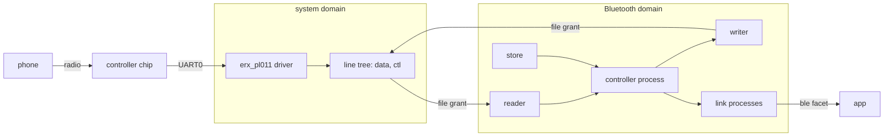
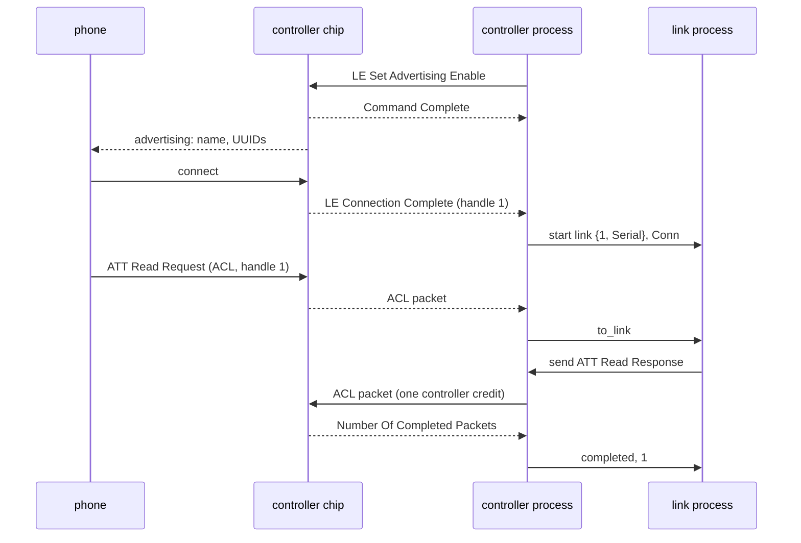

# Chapter 19. Bluetooth

> **Status.** Built, with host tests, and its bring-up also on QEMU
> `virt` against a Bumble virtual controller, and run on the Raspberry
> Pi 4 as far as advertising: the
> H4 framing and the HCI codec, the controller process with its
> supervision, the patch reader, the advertising data with the
> served services' UUIDs, the identity address, the line tree with its keeper in the system domain, its
> power cycle and its service as a `line` file grant; the `ble`
> interface, its manifest check and the facet's mint with its one
> request check, which has a fuzz target; the GATT server, its
> attribute table and its access gate, with the registry that
> attaches a handler to a service and delivers each write to it; the
> serial service's declaration and its table, the client library an
> app handles a service with and the serial service's byte stream over
> it, tested on the host only; and pairing and bonding
> with the pairing window and the bond store. On the Pi 4 the controller
> comes up and a phone's scan sees the board advertising under the name
> `erxos`, and a Mac connects to it, discovers its GATT table and has a
> read of the serial service's write-only characteristic refused; an echo
> through an app and pairing have not run on the board. Designed: an installed app's own `ble` grant, the rule that a service's
> state belongs to its handler beyond its owner's check of sets and
> notifications, the console over the serial service,
> and tests against a Bumble peer that scans, connects, reads, streams
> and pairs.

**Background needed.** [Chapter 3](03-erlang.md), sections 3.3 and
3.4: links, supervisors and restart strategies.
[Chapter 6](06-construction.md), section 6.3: a pure core with its
effects at the edge. [Chapter 14](14-files.md), sections 14.2 and
14.5: file trees, stream files and keepers, `ctl` files.
[Chapter 15](15-devices.md), sections 15.1 and 15.5: drivers and the
unit rule.

Anyone within radio range of a Raspberry Pi 4 can send bytes to its
Bluetooth chip. The chip's firmware is closed: it parses what comes
over the air, then hands the host what it decided to pass on. A host
stack that trusts those bytes trusts both the firmware and every
stranger in the room.

erXos parses every byte from the controller in a domain of its own,
the **Bluetooth domain**, written in Erlang, which holds no device,
so a parser defect is never a defect in kernel mode.
The system domain holds the chip's UART and serves it as a file tree
of two files, `data` and `ctl`, parsing none of the bytes it moves.
Above the line, one controller process, built around a pure core,
drives the chip, and a link process per connection carries each
phone's traffic.

## 19.1 Bluetooth Low Energy, peripheral first

What does a phone see when it meets an erXos machine? In the design,
a device that advertises, accepts a connection and answers reads and
writes: the **peripheral** role, the side that advertises and waits.

> **Background: how Bluetooth Low Energy works.** Bluetooth Low
> Energy (BLE) lets a small device and a phone exchange a few bytes
> at a time without much power. A peripheral **advertises**: it sends
> short packets, at most 31 bytes of data each, at a fixed interval.
> They carry its name or the identifiers of its services, each a
> **UUID**, a 128-bit number with shorter forms for standard
> services. A **central**, such as a phone, scans for them, may ask
> for a second packet, the **scan response**, and then connects.

> **Background: the attribute protocol.** A connected phone reads and
> writes the peripheral's data through the **attribute protocol**
> (ATT). The peripheral, the ATT server, holds a table of
> **attributes**, each a value with a type and a small number by
> which the phone names it, its **attribute handle** (no relation to
> the kernel handles of chapter 8). The server may also **notify**
> the phone when a value changes, or **indicate** it, a notification
> the phone confirms. The Generic Attribute Profile (GATT) groups
> attributes into **services**, each made of **characteristics**: a
> heart-rate service holds a measurement characteristic.

The design offers a phone four things
([design-bluetooth.md](../design-bluetooth.md#requirements)):

1. Its name and the UUIDs of its advertised services, in a phone's
   scanner.
2. The characteristics that apps on the machine declare, to read,
   write and subscribe to.
3. A byte stream between a phone and an app, shaped like Nordic's UART
   service so that existing phone terminal apps open it.
4. Pairing and bonding by LE Secure Connections, so that a
   characteristic can require an encrypted or an authenticated link.
   Pairing makes a shared key for one connection; **bonding** keeps
   that key, so the phone and the machine recognize each other next
   time.

Of these, the advertised name and services, the table of characteristics
with the level each requires, and pairing and bonding are built. The app
side of characteristics and the serial stream are designed and not built.

The central role, which scans and connects, belongs to the design
of HID over GATT, for keyboards and mice. Classic Bluetooth, the older
BR/EDR radio of headsets, is neither built nor designed, and neither
is the legacy pairing that LE Secure Connections replaced.

## 19.2 Where the parts run

Which domain holds the chip, and which reads what it says? The system
domain holds the chip's UART; the Bluetooth domain reads its bytes.

> **Background: the host controller interface.** A Bluetooth chip
> runs the radio on its own processor; the main computer, the
> **host**, runs everything above. The two talk over the **host
> controller interface** (HCI) of the Bluetooth Core Specification.
> The host sends **commands** ("reset", "start advertising"), and the
> controller answers with **events** ("command complete", "a
> connection completed"). Both send **ACL data packets**, which carry
> a connection's traffic, each tagged with a **connection handle**, a
> small number the controller assigns to a connection and reuses
> after it ends. On a serial line, the H4 transport puts one byte
> before each packet to say which kind follows.

In the rest of this chapter a plain "handle" means a connection
handle, not a kernel handle of
[chapter 8](08-kernel-interface.md#841-what-a-handle-names).

On the Raspberry Pi 4 the controller is a Cypress CYW43455, wired to
UART0 on GPIO 30 to 33
([design-bluetooth.md, The hardware](../design-bluetooth.md#the-hardware)),
whose functions the system domain sets before its line service opens
the line: its pin driver in the design, and its root at boot in what is
built ([chapter 15](15-devices.md#1581-one-table-of-pins)).
The board's five UARTs are copies of the PL011, Arm's standard UART
design, and share one register page and one interrupt line. Under the
unit rule of [chapter 15](15-devices.md#1551-the-unit-rule) they are
one unit, held whole by the system domain, which needs UART3 for the
host link. The Bluetooth domain cannot hold UART0 without holding the
host link too.

So the system domain shares the controller's line the erXos way, as a
file tree with a `ctl` file
([chapter 14](14-files.md#145-state-is-a-file-to-read-control-is-a-file-to-write)).
The **line tree**, declared in `abi/services/line.txt`, has two
files:

| File | Read | Write |
| --- | --- | --- |
| `data` | the bytes the controller sent, waiting while there are none | bytes to send, in order |
| `ctl` | refused | `reset`, and nothing else |

"Line" here means a serial line, not chapter 15's interrupt line. The
tree, `erx_line_fs`, and its keeper, `erx_line`
([chapter 14](14-files.md#1425-stream-files-and-keepers)), move bytes
between the files and the UART driver, `erx_pl011`, parsing only
`ctl`'s single word, which has a fuzz target. A waiting read is held
by the keeper and holds up no write. If the controller overruns the 64 KiB receive buffer, the line
is **broken**: the buffer is dropped and every read answers `eio`
until the next `reset`. The tree and its keeper are **Built**, with
host tests. The keeper serves its trees as the system domain's `line`
service, and a **file grant** of the `line` interface
([chapter 11](11-security.md#1171-a-namespace-of-grants)) hands one
to the Bluetooth domain; both are **Built**, and the QEMU suite of
section 19.7 runs the domain over a grant. The manifest check allows
at most one such grant, since one line service serves one line.

A `reset` puts the line in one known state, whatever the last run
left ([design-bluetooth.md, A reset](../design-bluetooth.md#a-reset)):
it stops the UART driver, turns the controller off, restarts the
driver with the UART programmed from nothing, turns the controller
on, and discards what the controller sent while it powered up. All
the steps are **Built** in `erx_line.erl` and `erx_pl011.erl`, with
host tests over a model driver and a model device service; a line
with no power line, as on QEMU `virt`, skips the two power steps. The
enable line is `BT_ON`, a pin of the firmware's GPIO expander
([research-wifi-pi4.md](../research-wifi-pi4.md#f3-host-wake-out-of-band-interrupt)),
which the keeper asks the device service to switch; its pin and
polarity are a board probe's question. The Raspberry Pi 4's row names the
power line, and after its reset the controller answers and advertises, so
the cycle runs on the board; the pin and polarity were not probed on their
own.

The Bluetooth domain mounts its grant of the line at `/line` and
opens `/line/data` and `/line/ctl` as ordinary files. Its manifest
row holds that grant and a store for its bonds (19.6). A machine may
also offer a login console over the serial service: each phone's
stream logs a person in by passphrase through the system domain's
login facet, the one every front end holds
([design-login.md](../design-login.md)), and then masters a tty of the
new session, as an SSH channel does. A small domain of its own,
`btconsole`, runs that console as a client of the `ble` facet and holds
the login facet, so the Bluetooth domain keeps to its radio; the radio
stack decrypts the link all the same, so the separation contains a
console defect and buys no secrecy. The console's characteristics
require `bonded`, so no write of a phone that is not yet a bond reaches
it, and its `ble` grant alone asks to hear a bonded phone's identity
address, the one name of a phone that stays across its connections,
which the console gives the login as the terminal's peer; no other
handler hears it from the bond, though a phone that does not use a
private address shows it as its connection address to every handler. The `bonded` level and the grant's `identity` are
built; the console and its login are designed and not built. The manifest check is designed to refuse
anything more, because a stranger in radio range reaches whatever the
domain holds through a parser defect; that check is designed and not
built, so the row's contents rest on the manifest text. Figure 19.1
shows the path.



*Figure 19.1. The Bluetooth controller process and its line to the
chip. The system domain moves bytes and parses none; every byte from
the chip is decoded in the Bluetooth domain, which holds no device.*

The build makes a release of the stack, `erx_bt`, for a domain named
`bt`. The Raspberry Pi 4's development manifest names that domain and
grants it UART0's line, and the QEMU suite names it in a manifest of
its own; QEMU `virt`'s development manifest does not. On the Pi 4 the row has
brought the controller up and advertised; no connection, GATT access or
pairing has run there. No manifest grants `ble` to any domain, so no domain
reaches the domain's GATT table (section 19.6).

## 19.3 The HCI codec

How does a stream of bytes from a hostile chip become something an
Erlang process can act on? The H4 framing cuts the stream into
packets, the HCI codec decodes each packet into a checked term, and
nothing after the codec sees raw bytes. Both are pure functions.

The framing, `erx_h4:split/1`
([design-bluetooth.md, H4 framing](../design-bluetooth.md#h4-framing)),
takes the bytes read so far and returns every whole packet and the
remainder, an incomplete packet that waits for the next read. Erlang's
binary matching does the work:

```erlang
split(<<?ERX_H4_INDICATOR_EVENT, Code, Length, Parameters:Length/binary,
        Rest/binary>>, Packets) ->
    split(Rest, [{event, Code, Parameters} | Packets]);
split(<<?ERX_H4_INDICATOR_ACL, _:16, Length:16/little, _/binary>>, _Packets)
  when Length > ?ERX_BT_ACL_RX_MAX ->
    {error, {acl_too_long, Length}};
split(<<?ERX_H4_INDICATOR_ACL, Word:16/little, Length:16/little,
        Data:Length/binary, Rest/binary>>, Packets) ->
    split(Rest, [acl_packet(Word, Data) | Packets]);
split(<<Indicator, _/binary>> = Rest, Packets)
  when Indicator =:= ?ERX_H4_INDICATOR_EVENT;
       Indicator =:= ?ERX_H4_INDICATOR_ACL ->
    {lists:reverse(Packets), Rest};
split(<<Indicator, _/binary>>, _Packets) ->
    {error, {bad_indicator, Indicator}};
split(<<>>, Packets) ->
    {lists:reverse(Packets), <<>>}.
```

The first clause matches only when the event's whole length is
present, so nothing reads past the input. An ACL packet longer than
251 bytes, the host's own bound, is an error before its data is
read, and so is any indicator but an event's or an ACL packet's. The
specification calls either case a loss of synchronization, after
which a reset is needed (Core Specification 6.3, Vol 4 Part A). In
erXos the controller process stops, and its restart resets the line
and the controller. The bound is a constant, not a value the
controller reported, so a controller cannot raise it.

The codec, `erx_hci`, decodes each event against the layout the
specification gives. A length that does not match gives `malformed`,
never a partial read. An event the host does not use gives
`{unknown, Code}`, which the controller process counts and drops. No
atom is made from input, so a chip cannot fill the atom table
([chapter 3](03-erlang.md#355-the-atom-table)).

Every code and bound the codec uses comes from
`abi/formats/bluetooth.txt`, which cites the specification's section
for each and from which the build generates the macros, by the rule
of [chapter 7](07-one-source.md#71-parallel-copies-and-the-rule-that-replaces-them).

The framing and the codec are **Built**, with a fuzz target that
mutates inputs written from the specification's layouts and must
catch each of its seeded faults, such as the ACL bound removed
(`tools/fuzz/erx_bt_hci.rb`).

## 19.4 The controller process

One process, `erx_bt_hci`, owns everything about the controller: the
bring-up, the command in flight, the buffers, the map from handles to
connections and the advertising. Its pure core, `erx_bt_hci_core`,
takes every decision, in the shape of
[chapter 6](06-construction.md#63-functional-core-effects-at-the-edge):
`step(Input, Now, Core)` returns the next state and a list of
actions. The process turns each message (a decoded event, the
writer's answer, a timer, a link's request) into an input and
performs the actions: reset the line, write bytes, start, end or tell
a link, or stop with a reason. All of this is **Built**.

### 19.4.1 The bring-up, a line of steps

A freshly powered controller knows nothing of the host. The bring-up
is a fixed list of steps that the core builds when it is created
([design-bluetooth.md, The bring-up](../design-bluetooth.md#the-bring-up)):

1. Reset the line: write `reset` to `ctl`.
2. `HCI_Reset`.
3. Identify the controller: its version, its supported commands and
   features, its address.
4. Load the patch, where the manifest names one, then reset and
   identify again.
5. Ask the controller's buffer sizes, and tell it the longest packet
   the host accepts.
6. Configure: the events the host wants, the machine's address, and
   the advertising parameters and data.
7. Ready: enable advertising.

Each command step waits for its Command Complete with status success.
Any other answer, or none before the deadline, stops the process with
the step and the status as its reason, so a bring-up reaches `ready`
or ends with a stated cause. The steps after the patch are distinct
from the first ones, so the list has no loop.

The core keeps at most one deadline, in one field that also says what
it guards: a line reset, a wait, a command due or a command sent. A
second timer, or cancelling one never armed, cannot be written, and
an early or repeated wake-up changes nothing.

### 19.4.2 The patch

Hosts that drive this chip first load a patch into its RAM: a vendor
file of HCI commands, `BCM4345C0.hcd` for the Pi 4, replayed one
record at a time. `erx_bt_patch` reads the file whole first and
accepts it only if it consists entirely of complete Write RAM and
Launch RAM records, so a damaged file sends nothing. A controller
that reports another manufacturer than the manifest names stops the
bring-up, so no vendor command reaches a chip it was not written
for. The reader and these checks are **Built**, with host
tests. The Pi 4's development image carries no patch: the controller's ROM
alone advertises on the board. The design has the image carry
`BCM4345C0.hcd`, unmodified under Cypress's license, and load it in the
mode every reset boots, the one that answers every command, so the patch
needs no other kind of reset; that this mode takes the patch is a board
probe's question.

### 19.4.3 Commands and controller credits

The process keeps one command in flight, whatever the controller
accepts, since the host's commands are few and never urgent; an
answer that names any other command stops the process.

Each free buffer in the controller is a **controller credit**: room
to send it one data packet. This is not the channel credit of
[chapter 13](13-native-programs.md#1321-the-channel), which limits a
native program's requests. Each live handle counts its packets in
flight, and the free credits are the controller's total less the sum.
A report of completed packets for a handle that is not live, or for
more packets than that handle has outstanding, stops the process. A
forged report therefore cannot grow the free count, and the count
cannot fall below zero. Credits are derived, never stored, so a
disconnection returns a handle's credits by removing the handle.

### 19.4.4 A connection, end to end

Figure 19.2 follows one phone from the machine's advertising to one
attribute read.



*Figure 19.2. Advertising, connecting and one attribute read. The
controller process owns the handle and the controller credits; the
link process owns the conversation, handing each ATT request to the
GATT server. The advertising carries the name and no service UUID;
advertising a service's UUID is designed and not built.*

When the controller reports a connection, it has already stopped
advertising. The core starts a link process named `{Handle, Serial}`,
the serial counting the core's connections, and checks that name on
every request the link makes. If handle 1 passes to the next phone, a
request the old link sent late changes nothing. The link also gets a
fresh Erlang reference, its `Conn`, the name apps use.
It is the rule of
[chapter 15](15-devices.md#1572-a-name-dies-at-once-hardware-later):
a name dies at once, and the hardware's resource, here the handle's
credits, returns only when the controller reports Disconnection
Complete. Advertising stays on exactly while connections are below
the manifest's limit, one by default.

### 19.4.5 Advertising and the machine's address

The advertising data and the scan response, with the name and the
appearance (a number that tells a phone what kind of device to
show), are a pure function, `erx_bt_adv:data/1`. Each is at most 31
bytes; a name that does not fit is shortened at a character
boundary. The function can carry service UUIDs, but the controller
process passes none: advertising the UUID of a served service is
designed and not built.

The machine's address on the air is a **static random address**, made
from the system's random generator, which the root service keeps.
Like the IPv6 addresses of [chapter 17](17-network.md#1721-one-owner-one-step), it does not
embed a hardware address, so it names neither the board nor its chip
([design-bluetooth.md, The identity address](../design-bluetooth.md#the-identity-address)).
The store, `erx_bt_store`, makes the address at its start; the
controller process asks for it at each of its own starts, so a
restart of the controller keeps the machine's identity. Both are
**Built**.

## 19.5 Supervision and failure

What happens when the controller sends garbage, or a link misbehaves?
Almost always the same thing: the part that saw it stops, and its
restart resets the line and the controller, so the next bring-up
starts from one state.

The supervision tree in `erlang/apps/erx_bt` is **Built**:

`erx_bt_sup`, the top, is `rest_for_one` with four children in order:
the store, the registry of GATT services, the file service with the
pairing window, and the controller group. A restart of the group
leaves the store, its address, the handlers' attachments and a
pairing wait alone; a restart of the store or the registry restarts
everything after it. The group, `erx_bt_host_sup`, is
`one_for_all`, at most five restarts in 60 seconds, over the link
supervisor, the line's reader and writer, and the controller process,
so all four always belong to one run of the core. Links are temporary
children, never restarted: a link that ends is a disconnection.

| What fails | What ends | What the next state is |
| --- | --- | --- |
| a malformed or unanswered exchange with the controller, or a failed read, write or `reset` of the line | the controller group | the line reset, the controller reset, a fresh bring-up |
| a link process crashes | that link | the core disconnects its handle with reason Remote User Terminated Connection; the phone may reconnect |
| a late request from a link that has gone | nothing | the core ignores it |
| more than five group restarts in 60 seconds | the group, so `erx_bt_sup` restarts it | OTP's default intensity applies: a second such failure within five seconds stops `erx_bt_sup` and the `erx_bt` application |

A restart costs one bring-up without advertising, and every
connection. The alternative is a case for each half-finished state a
controller can be left in; the reset removes all of them.

## 19.6 The design above the controller

What does an app write to offer a phone a characteristic, and who
decides whether the phone may read it? The design answers with
configuration and one function. The declarations, the table, the gate,
the registry and pairing are **Built**, with host tests. What is
designed and not built is said where it comes up: an installed app's
own grant, the rule that a service's state belongs to its handler, and
the app that handles the serial service.

An app declares its services as data, one checked-in file per service
under `abi/gatt/`
([design-bluetooth.md, Declarations](../design-bluetooth.md#declarations-abigatt)).
The serial service's file reads:

```text
service nus 6e400001-b5a3-f393-e0a9-e50e24dcca9e advertise
characteristic rx 6e400002-b5a3-f393-e0a9-e50e24dcca9e 244 write open write_without_response open
characteristic tx 6e400003-b5a3-f393-e0a9-e50e24dcca9e 244 notify open
```

Each characteristic names its accesses and the level each requires:
`open`, `encrypted`, `authenticated` or `bonded`, the last an
authenticated link whose key is a kept bond's, which a pairing link
reaches only once the bond is stored. The design has the domain serve
every service that some `ble` grant of the machine names, a configured
domain's or the one every installed app's grant is cut from (below);
the domain serves every declared service, and reading the
served set from the manifest's rows is designed and not built. The
Bluetooth domain builds its attribute table once at its start, and nothing adds or moves an attribute while
the domain lives, so no attribute handle moves under a connected
phone.

Every access then passes one pure function, the **gate**
([design-bluetooth.md, One table, one gate](../design-bluetooth.md#one-table-one-gate)),
which compares the level the declaration requires with the link's
security and answers allowed or the specification's ATT error. A
phone cannot send the link's security: it is set only when the
controller reports that encryption started, and a link is encrypted
with at most one key in its lifetime, so the level cannot change
under it. No app checks security, so none can forget to.

Who may offer a service to phones? Whoever holds a **`ble` grant**, a
facet of the Bluetooth domain whose one parameter names the services
its holder handles
([design-bluetooth.md, The `ble` facet](../design-bluetooth.md#the-ble-facet)).
A configured domain holds one by a row of the manifest; the facet and
its request check are built, and no shipped manifest grants it to a
domain. An installed app holds its own, without anyone editing the manifest: the board's
`apps` row says which GATT services apps may handle (the Raspberry Pi 4's
development row offers `nus` alone), the package names the ones it
handles in its own `gatt` field, and install checks that every name is
offered and that no other app already declares it
([chapter 23](23-apps.md#2313-one-row-bounds-every-app)). Each session
of the app then holds the row narrowed to its package's services, so
the app can handle those services and no others. A service that no
installed app handles is still in the table; it answers reads from its
declared values and refuses writes. Installing, updating or removing an
app therefore never changes the table or the advertising data. The Pi 4's
development card carries the terminal echo as a second package, so the
board's checklist exercises this path
([design-bluetooth.md, Decisions](../design-bluetooth.md#decisions)); the
published card carries the kiosk alone. The `apps` row's `gatt` field,
the package's own field, install's checks and the narrowing of each
session are designed and not built. The serial service's library,
`erx_gatt_serial`, is built and tested on the host against the registry;
no domain of a suite or a board attaches to it yet.

A service has at most one handler, the process that attached to it. The
registry's `attach` makes the caller the handler, refuses a second one,
monitors it, hands it each write from a phone and takes the answer only
from it; a service with no handler answers a write Unlikely Error at
once. These are built. The rest of the rule is designed and not built:
everything about the service that changes while the domain lives
belongs to that handler. The registry accepts `set`, `notify` and
`indicate` only from the handler. A write from a phone reaches the
handler that owned the service when the write's first byte arrived, or
nobody, so bytes sent while one app owned a service never reach the
next. When a handler ends, each link is told, serves the declared
values again, and drops the service's queued notifications
([design-bluetooth.md, A service belongs to its handler](../design-bluetooth.md#a-service-belongs-to-its-handler)).

Pairing happens only in a window that someone opened by opening the
control tree's `pair` file, and the window ends with its first
pairing attempt, whether it succeeds or fails. After a failure the
next attempt waits, from 2 up to 64 seconds, and the wait outlives
every window. A pairing never replaces a bond; only an explicit
`forget` ends one
([design-bluetooth.md, The pairing window](../design-bluetooth.md#the-pairing-window)).
The pairing itself, LE Secure Connections in `erx_smp_core` over the
crypto of `erx_smp_crypto`, is a pure state machine run by the link's
core; the window, the control tree and the bond store, `erx_bt_store`,
are processes of `erx_bt_sup`. All are built, with host tests and fuzz
targets (`erx_bt_smp_tests`, `erx_bt_window_tests`, `erx_bt_store_tests`,
`erx_bt_smp_fuzz`, `erx_bt_pair_fuzz`). The store keeps its bonds in a
development state file; a store behind the system's vault is designed
and not built.

## 19.7 Testing a radio without a lab

QEMU emulates no Bluetooth controller, and the Pi 4 is tested by hand.
How, then, is the stack tested? Mostly on the host, where the cores
need no radio.

The controller's core is explored exhaustively
(`test/erlang/erx_bt_hci_tests.erl`): the test walks, breadth first,
every state reachable from `start` by the inputs it models. It
explores two configurations, one with a patch and one without, each
allowing two connections at once; a path makes up to three
connections in turn, so a handle is reused while the other is live.
A comment beside the test's budget puts the walk at about 160,000
states for each. Every state must keep the free controller credits
at zero or above and connections within the limit, ignore requests
from gone links, and stop only for a listed reason. Seeded faults
([chapter 6](06-construction.md#651-seeded-faults)), such as a
handle kept live after its Disconnection Complete, must make it
fail.

Over a model of the line (`test/erlang/erx_bt_group_tests.erl`), the
controller group reaches `ready` again after its controller process
is killed, keeps its address, and turns a killed link into one
disconnect command. The patch reader, the line tree and the PL011
programming have host tests too, and so do the ATT server and its
gate (`erx_bt_gatt_tests`), the link's core and process, the registry,
pairing, the window and the store, with fuzz targets for the ATT, SMP,
link, control-file and state decoders. All of these tests are
**Built**.

For the protocol above HCI, the design uses Bumble, a Bluetooth stack
written in Python, whose virtual controllers
speak H4 over a TCP socket
([design-bluetooth.md, On QEMU against Bumble](../design-bluetooth.md#on-qemu-against-bumble)).
Two uses are **Built**. `test/host/erx_bt_bumble_test.rb` feeds one
corpus of frames to erXos's ATT, SMP, HCI and L2CAP decoders and to
Bumble's, and every difference must be listed with its reason in
`test/bt/differences.txt`. The QEMU suite `bluetooth` boots the
Bluetooth domain on QEMU `virt`, whose controller's line is a
virtio-console port joined through a socket to one Bumble virtual
controller, and checks that the bring-up reaches advertising. A Bumble
peer on a second socket that scans, connects, reads and pairs, with
a seeded fault in each test, such as advertising data built wrong,
which must make the UUIDs vanish from the peer's scan, is Designed.

What only a board answers, the design lists as board probes
([design-bluetooth.md, Board probes](../design-bluetooth.md#board-probes)):
the UART's pins and the controller's power as the firmware leaves
them, the enable pin, and whether the patch is needed. A manual
checklist with a phone follows. The board has run the domain to
advertising on the ROM alone, with the pins set by the system domain's
root at boot. A script, `tools/ble_board_check.rb`, drives a Mac's `blew`
through the scripted steps (scan, connect and discover, write and read the
serial service); an echo through an app and pairing are not yet run on the board.

## 19.8 Design choices

**A domain of its own**, not the domain that holds the board's other
low-speed devices: one runtime more, so that a parser defect
reachable from radio range reaches no driver.

**Declarations rather than services registered at run time.** The
stacks the design surveyed have an application register its attribute
table in code, which brings attribute handles allocated while phones
are connected, announcements that the table changed, and conflicts
between apps. Configuration removes them: the table is built once from
the declarations, and installing an app changes no attribute.

**A power cycle and a fresh UART at every reset.** Without them, each
bring-up would need a case for every state the last one could leave:
a controller at another rate, patched or half-patched, a UART holding
the last controller's bytes.

**The patch named by the manifest, not chosen by the controller.**
The driver could choose the patch file by the name the controller
reports, but that name is text the controller writes, so in erXos it
chooses nothing.

**115200 baud rather than 3 Mbaud.** A faster rate needs vendor
commands that differ between hosts and a switch timed to a response.
BLE's traffic fits 115200; the faster rate is an optimization to
measure.

## Summary

Every byte a Bluetooth controller sends is hostile, so erXos decodes
them in a Bluetooth domain that holds no device; the system domain
moves them through a two-file line tree and parses none. A pure core
drives a fixed bring-up, derives its controller credits from the live
handles and names each connection by handle and serial. Almost every
failure ends the controller group, whose restart resets the line and
the controller. Above the controller, a table built once from checked-in
declarations, one gate and pairing in a window someone opens decide
what a phone may do. This is built and tested on the host, and its
bring-up on QEMU against a Bumble controller, and on the Pi 4 it
advertises, but no phone has connected, read or paired there; an
installed app's grant, a service's handler as the owner of its state
and advertised service UUIDs are designed.

## Where to read next

* [design-bluetooth.md](../design-bluetooth.md): the whole design.
* [design-shared-devices.md, The unit rule](../design-shared-devices.md#the-unit-rule):
  why the system domain holds the controller's UART.
* [research-wifi-pi4.md](../research-wifi-pi4.md): the Pi 4's
  wireless chip in the board's device tree.
* Bluetooth SIG, *Bluetooth Core Specification*, version 6.3, 2026:
  Vol 4 Part A for the H4 transport, Vol 4 Part E for HCI, Vol 3
  Parts F and G for ATT and GATT, Vol 3 Part H for pairing.
* Google, *Bumble* (github.com/google/bumble): the Python stack the
  design tests against.
