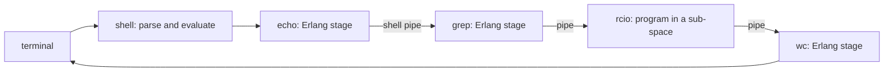
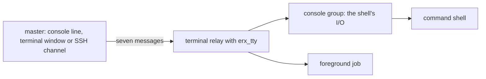
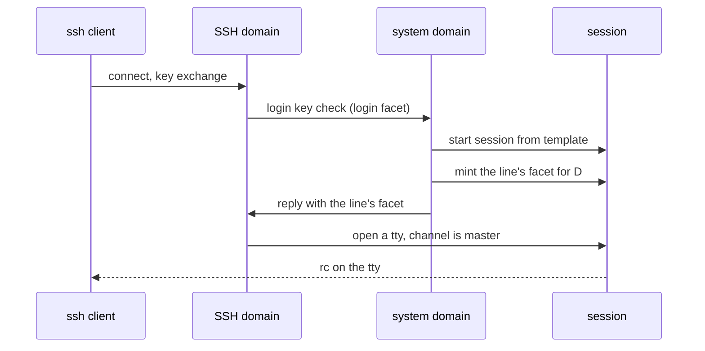

# Chapter 20. The Command Shell and the UNIX Surface

> **Status.** Built: the command shell, rc's language in Erlang with
> a bounded parser and job control of Erlang jobs; Erlang commands
> with the familiar output (`ls`, `cat`, `grep`, `sort`, `ps`,
> `top` and others); text pipes between Erlang commands and native
> programs; the line discipline `erx_tty`, a pure core with host
> tests, run by each session tty's terminal relay; the console's lines
> and `Ctrl-G` menu, which connects to a session or starts one; the
> start table with its settings in `/data/etc/rc.conf`, and `service`;
> root's SSH login to `rc` in development builds; the session's side of
> the SSH domain's line. Designed:
> `/etc/start.conf` and start flags; interrupting and killing a session
> from the menu; terminal input to native programs through `/dev/tty`;
> stopping a native program with `Ctrl-Z`, the `Ctrl-T` status line,
> `within`, `rc` as a program for `system` and `popen`, toybox, the
> `secure` attribute and password logins at the console, the SSH domain
> itself with its host key in the vault, the system domain's login
> facet, evi, the screen editor run as `vi`, and the input-loss event
> that refuses a line which lost input (built: a NUL the console UARTs put in their input, which the editor
> refuses to run).

**Background needed.** [Chapter 3](03-erlang.md), sections 3.2 and
3.3: processes, messages and links. [Chapter 6](06-construction.md),
section 6.3: a pure core with effects at the edge.
[Chapter 13](13-native-programs.md), sections 13.2 to 13.6: programs,
handlers, pipes and signals. [Chapter 14](14-files.md), sections
14.5 and 14.6: `/proc` and the rule "familiar only where true".

A UNIX user who logs in to erXos types `ls`, then `ps | grep ssh`,
then presses `Ctrl-Z` on something slow. Each habit rests on a promise:
familiar columns, bytes in the pipe, a job that stops and waits. A
system that keeps the names but breaks the promises is worse than
unfamiliar names, because the habits lead the user wrong without
warning.

erXos keeps that surface wherever its own model matches, and shows its
own model where it does not. Where UNIX systems differ, the commands,
the line discipline and the service verbs are modelled on FreeBSD's.
The **command shell** is written in Erlang and speaks the language of
rc, Plan 9's shell. Its commands are Erlang modules that print what
the commands of the same names print on UNIX, and every pipe carries
text. A terminal is a tty whose line discipline runs in a process of
the session, and an SSH connection is one more line feeding a tty.

The sections cover the rule for familiar names, the shell and its
pipelines, commands over live Erlang state, ttys and the console,
services, SSH, the screen editor, failures and the choices that lost.

## 20.1 UNIX look and feel, honestly

erXos makes one promise about familiar names: a name means what a UNIX
user thinks it means, or the system shows something else under a name of
its own. The rule has three parts ([overview.md, Familiar tools in a
different
foundation](../overview.md#familiar-tools-in-a-different-foundation)).
What a UNIX user already knows is kept wherever it fits. Where UNIX
systems differ, erXos follows FreeBSD. Nothing wears the name, syntax or
shape of something it is not. Section 14.6 of [chapter
14](14-files.md#146-familiar-only-where-true) applied the rule to files;
this chapter applies it to the parts a user types at.

> **Background: what a shell does.** A **shell** reads a command line,
> splits it into words, expands them (variables, wildcards such as
> `*.c`, other commands' output), starts each command and connects them.
> A **pipe**, written `|`, sends one command's output to the next one's
> input, so `ls | wc -l` counts files. A **redirection** sends a stream
> to a file: `ls >out`. The shell also runs **jobs**, the commands of
> one line, in the foreground or the background. A UNIX shell starts
> each command by `fork`, which copies the shell's process, and `exec`,
> which replaces the copy with the command's program.

The table shows the rule deciding cases from this chapter.

| Familiar thing | What erXos does | Why |
| --- | --- | --- |
| `sh` | The shell is `rc`, and says so in its banner | Its language is rc's, not POSIX's; calling it `sh` would invite scripts it cannot run |
| `ps` columns | The familiar columns and keywords; `-` for a value not measured | A script's `awk '{print $3}'` finds the same field in every row |
| `rc.conf` | Designed: `/etc/start.conf`, rc.conf's assignment syntax only. Built: `/data/etc/rc.conf` | The file sets fields of declared rows and runs no code |
| `exec`, `rfork` (a finer-grained `fork`) | Fail with a diagnostic | The shell has no process image to replace and nothing to fork |
| `/dev/tty` | A name the program's handler opens, not the file server; reads and writes go to the tty | A terminal's reads, modes and signals are not file-protocol requests |

Each row came from asking what the familiar name promises and
whether erXos keeps the promise. Where it does, as for `ps`, the output
matches the familiar one byte for byte. Where it does not, the design
picks a different name rather than a near miss. The built system falls
short of the rule in one row: it keeps its start settings in
`/data/etc/rc.conf`, a file that is not a shell script, and the name
`/etc/start.conf` is designed and not built (section 20.5). In the
`/dev/tty` row, the file server's refusal is built; the handler's open
is designed and not built, so no program reads the terminal today.

## 20.2 rc in Erlang

### 20.2.1 The language

The command shell's language is rc's because rc removes the traps of
the Bourne shell that bite most often. The commonest is rescanning.
In `sh`, each use of `$f` splits its value at spaces and expands it
again for wildcards, so a file named `my notes.txt` becomes two
arguments unless every use is quoted.

> **Background: the rc shell of Plan 9.** Tom Duff wrote rc at Bell
> Labs; it became the shell of Plan 9, and his paper "Rc - The Plan 9
> Shell" describes it. It keeps the shape of the UNIX shell, with
> pipes, redirection and `&`, and changes its grammar. It has one
> quoting rule: text between `'` and `'` is literal, and `''` inside
> stands for a quote. A variable's value is a list of strings, and a
> value is never split or expanded again after it is set. Control flow
> uses braces and parentheses, as C does: `if(test -f x) echo yes`. A
> command's status is a string, empty for success.

The shell speaks rc's language as Duff's paper defines it
([design-shell.md, The language](../design-shell.md#the-language)). A
short session shows most of it:

```sh
% files=(*.log)
% echo $#files
3
% for(f in $files) if(grep -q error $f) echo $f has errors
app.log has errors
% fn count { grep -c $1 $2 }
% count warn app.log
12
```

`files` is a list and `$#files` its length. The shell never splits or
expands a variable's value again: text that came from a value is never
cut at spaces and never read as a wildcard
(`erlang/apps/erx_shell/src/erx_shell_eval.erl`). So each `$f` is one
argument, whatever spaces or `*` it holds. `fn` defines a function, and `$1` and `$2` are
its arguments. A user who knows `sh` meets a handful of translations:
`>[2=1]` for `2>&1`, `` `{cmd} `` for `$(cmd)`, `$status` for `$?`,
`if not` for `else`, and `fn f { ... }` for `f() { ... }`. Anything beyond
the language is better written in Erlang.

The **status** of a command is a string, as in rc. It is empty for
success, a program's exit status as a number, a signal's name such as
`sigint`, or an Erlang command's error, such as `enoent`. A
pipeline's status joins its stages' with `|`.

The shell also gives line editing with emacs keys, a prompt of `% `,
and job control.

### 20.2.2 A parser that cannot be made to run away

The tokenizer and parser, `erx_shell_lex` and `erx_shell_parse` in
`erlang/apps/erx_shell/src`, are pure functions. Given the source read
so far, they return the syntax tree of the next complete command, which
may span several lines, and the source after it. They return
`incomplete` when more input could finish
the unit, and otherwise a diagnostic that names a line and column. The
interactive layer reads another line on `incomplete`; a script that ends
there fails as one that does not parse.

A line can come from a person, a script or a program, so the parser
treats it as untrusted input and bounds two things. Nesting is bounded
at 256 levels; pipelines and sequences are flat lists that never deepen
the tree. Size is bounded by a figure the code derives rather than
declares. The parser runs in a child process whose heap is fixed at
8 MiB. A test sweeps the costliest shapes of source it knows. The worst
parse takes 778 bytes of heap per byte of source, which the code rounds
up to 1,024. Half the heap divided by that cost gives the bound of 4 KiB
per command. A longer one fails with `line too long, over 4096 bytes`,
and a parse that outgrew the heap would kill only the child
(`erlang/apps/erx_shell/src/erx_shell_parse.erl`). The parser has a fuzz
target.

### 20.2.3 One evaluator per stage

Each stage of a pipeline needs its own copy of the shell's state.
The command shell gives it one without `fork`: each stage of a
pipeline, each command substitution and each
background block is an Erlang process that starts with a copy of the
shell's variables and functions. As in rc, a stage cannot
change its parent's variables.

Every such process runs with `max_heap_size` set, 4 MiB by default,
counting the binaries it references: the option that
[section 3.8](03-erlang.md#38-where-the-model-stops) noted nothing sets
by default. A runaway recursion such as `fn f { f }; f` meets the
limit and ends alone; the session goes on.

### 20.2.4 One command namespace

A command name resolves in one **command namespace**, in this order
([design-shell.md, Commands](../design-shell.md#commands)):

1. a function the user defined with `fn`, or a builtin of the shell:
   rc's `builtin`, `eval`, `exit`, `shift` and `whatis`, and `cd`,
   `jobs`, `fg`, `bg` and `kill`;
2. an **Erlang command**, a module that implements the `erx_cmd`
   behaviour and declares its name, such as `erx_cmd_ps` for `ps`;
3. a **program command**, a native program the session's export lists
   in `/bin` ([chapter 13](13-native-programs.md#1324-what-a-program-can-start)).

A name has one meaning. An Erlang command shadows a program of the same
name. A path names a program only as `/bin/NAME`; any other path is
`not found`.

These Erlang commands are built: `cat`, `cp`, `date`, `dmesg`, `echo`,
`erl`, `false`, `grep`, `halt`, `host`, `ifconfig`, `ls`, `mkdir`,
`mount`, `mv`, `ntpctl`, `ping`, `ps`, `pwd`, `reboot`, `rm`,
`service`, `sort`, `top`, `true`, `uname` and `wc`, each a module
`erx_cmd_NAME` in `erlang/apps/erx_shell/src`. The desktop adds a
28th, `clock` (`erlang/apps/erx_desk/src/erx_desk_cmd_clock.erl`), since
the namespace collects the commands of every application. The file utilities
among them are Erlang by choice and stay so
([chapter 13](13-native-programs.md#1373-toybox-and-the-file-utilities)).
The rest of the familiar UNIX tools, such as `head`, `find` and
`xargs`, are designed to come from toybox, a BSD-licensed collection
of utilities run as programs; toybox is designed and not built, so
those names resolve to nothing.

An Erlang command declares the services it needs, as `ping` does with
`-erx_needs([net])`. One run without them fails with `no_facet`
before it starts. The shell and every command it runs there hold the
session's authority and nothing more; none has authority of its own.

The escape hatch is Erlang itself. `erl` runs the Erlang shell above
the command shell until it ends, and `erl EXPR` prints one
expression's value. Records with structure belong there, in
`erx:ps()` and the inspector of
[chapter 21](21-live-machine.md#211-the-machine-is-an-object).

### 20.2.5 Pipelines of text

Every stage of a pipeline reads bytes and writes bytes, whatever is at
the other end
([design-shell.md, Pipelines](../design-shell.md#pipelines)). So
`cat app.log | grep error | wc -l` means what it means on any UNIX,
and no stage can tell
what kind of stage feeds it. Only the transport differs. Two Erlang
stages pass bytes through a **shell pipe**, an Erlang process that holds
at most 64 KiB in order. Where a native program takes part, the stages
meet at a pipe the session's pipe server made ([chapter
13](13-native-programs.md#134-pipes-in-user-space)). Figure 20.1 shows a
line that mixes them.



*Figure 20.1. `echo ... | grep x | rcio upcase | wc -c`. Erlang stages
pass bytes through a shell pipe; wherever a program takes part, the
stages meet at a user-space pipe.*

[Section 13.5](13-native-programs.md#135-a-pipeline-end-to-end) traced
such a line through a pipe into a program. The shell adds one rule: no
stage renders, frames or reparses another's output. An Erlang command
that wants to know whether its output is a terminal, as `ls` does to
choose columns, asks `erx_cmd:isatty/2`; nothing else in a command
depends on what is at the other end.

Input is bounded at every step. A line a command reads with
`erx_cmd:read_line/1` is at most 64 KiB, or the stage fails with
`line too long`, and `sort` holds its input within its heap limit and
fails alone if the input outgrows it, rather than spilling to
temporary files. Both bounds differ from the UNIX tools, which take
lines of any length, and both mean that a program writing a gigabyte
without a newline into `grep` ends `grep` and nothing else.

### 20.2.6 Job control

`&` runs a line in the background, `jobs` lists the jobs in the form
`[N] + Running  command`, and `fg` and `bg` take a job's
number. `Ctrl-C` interrupts the foreground job and `Ctrl-Z` stops it.
These are built for jobs of Erlang processes.

The job table is a pure state machine, `erx_shell_jobs`. The shell
feeds it what happens: a key from the terminal, a job's end, a `fg`.
It answers with the next table and effects for the shell to carry out
in order, such as `{stop, Tag}`, which pauses every process of the
job, and `{say, Bytes}`, which writes `[1] + Stopped  sort big.txt`.
Every Erlang process of a job carries the job's **tag**, so a stop
finds its processes by tag, not from a list the shell must keep
current. Being pure, the table is tested on the host event by event.

A native program in a job is handled differently. `Ctrl-C` ends a
program's starter, the handler kills the program's spaces, and the
line's status reads `sigint` ([chapter
13](13-native-programs.md#1363-ctrl-c-and-the-sessions-job-control)).
Stopping a program with `Ctrl-Z` is designed: the session pauses the
program's spaces and resumes them at `fg`, so the terminal relay never
waits on a program. This is designed and not built.

### 20.2.7 Narrowing a command, and rc for programs

`within` runs a command with less than the session holds: `within
/data/logs -- find /data/logs -name '*.err'` gives `find` one read-only
file grant and no `/bin`, so it reaches nothing else and starts nothing
([design-shell.md, Starting
programs](../design-shell.md#starting-programs)). An Erlang command so
narrowed runs in a domain of its own, since in the session's domain it
could reach whatever the domain holds. `rc` is also a program in `/bin`,
which a C program's `system` and `popen` run as `rc -c`
([design-shell.md, rc as a
program](../design-shell.md#rc-as-a-program)). Both are designed and not
built.

## 20.3 UNIX tools over live Erlang state

erXos's `ps` reads the session's own table and prints it as text in
the familiar form
([design-shell.md, Text commands](../design-shell.md#text-commands)).
The built `ps` lists the session's Erlang processes; listing its
native programs in the same table is designed and not built.

```text
% ps -o pid,rss,comm | sort -rn -k2
```

lists the session's processes by memory, largest first. `ps` takes
the keywords `pid`, `tt`, `state`, `time`, `pcpu`, `rss`, `comm` and
`command`, prints the usual header line, and reports an unknown
keyword as `ps: KEY: keyword not found`, with status 1.
The table shows how each column fills, for an Erlang process and, in
the design, for a program.

| Column | An Erlang process | A program |
| --- | --- | --- |
| `PID` | its pid, such as `<7.85.0>` | its process id |
| `STAT` | `R`, `S` waiting in `receive`, `T` stopped | `R`, `S`, `T` paused |
| `TIME`, `%CPU` | `-`: the runtime keeps no CPU time per process | its CPU time |
| `RSS` | its memory from `process_info/2`, in KiB | its sub-space's charges, in KiB |
| `COMMAND` | its registered name, else the function it started in | its name and arguments |

The dash is the honest part. ERTS keeps no CPU time per Erlang process,
so erXos prints `-`, the mark UNIX `ps` uses for a column it has no
value for. A `0` would claim a measurement, and a word such as
`unknown` would break the column for `awk` and `sort -k`; `sort -n`
sorts a `-` among the zeros. `ps` reads `process_info` in its own
runtime, and prints a bare `-` for a value the runtime does not measure
or a process that ended while being read
(`erlang/apps/erx_shell/src/erx_cmd_ps.erl`). The design's rule is that
no command prints a value it does not have ([design-shell.md,
Invariants](../design-shell.md#invariants)). Values read from the
inspector also say why they are missing: `top` prints `-` and the
reason, such as `- [unknown]`, and `/proc`, `ntpctl` and the Erlang
shell print the status itself, such as `[unknown]` or `[timeout 500]`
([chapter 21](21-live-machine.md#2121-six-statuses)).

`/proc` gives the same live state as files
([chapter 14](14-files.md#1451-proc-the-inspector-as-files)):
`cat /proc/status` prints the machine's record, and
`cat /proc/time/status` the clock's. Each line of a `status` file is an
attribute, its value and its reporter separated by tabs, so

```text
% cat /proc/domains/7/status | grep run_queue
```

finds one attribute of a domain with ordinary text tools. Pipes carry
text, and the records with their structure live in `erl` and the
inspector.

`ls` writes a file name through the line escape of
[chapter 11](11-security.md#1112-text-from-untrusted-sources) when its
output is a terminal, and writes the name's bytes unchanged into a
pipe. A file named
with an escape sequence cannot repaint the screen, yet `ls | grep`
sees the real name.

`grep` takes the options `-E`, `-F`, `-c`, `-i`, `-l`, `-n`, `-q` and
`-v`. A pure translator, `erx_grep_re`, turns a POSIX regular
expression into one for Erlang's `re` module, or refuses one that is
not valid POSIX, so `re` never reads POSIX syntax as its own. A
program can hand `grep` its pattern, so the translator has a fuzz
target. `-r` is designed and not built.

## 20.4 Ttys and the console

### 20.4.1 What a tty is

> **Background: terminals, ttys and the line discipline.** A
> **terminal** was once a keyboard and screen on a serial line; today
> it is a terminal window or an SSH client, which still sends bytes
> for keys and draws the bytes it receives. UNIX keeps the state of
> one terminal in a **tty**: its settings, its window size and the
> input it holds. The settings are `termios`, a set of flags such as
> `ICANON` and `ECHO`. In **cooked** mode (`ICANON` set) the
> **line discipline**, the code between the terminal and the reader,
> collects a line, applies backspace and kill-line, echoes keys, and
> hands a reader one whole line. In **raw** mode it hands bytes as they
> come, which is what a screen editor wants. It also turns `Ctrl-C`
> into `SIGINT` and `Ctrl-Z` into `SIGTSTP` for the foreground job. A
> **pseudo-terminal** is a tty whose other side, the **master**, is a
> program such as `sshd` or a terminal window rather than a serial
> line.

erXos's line discipline lives in user mode, not the kernel, as one
pure state machine, the Erlang
module `erx_tty` in `erlang/apps/erx/src`, which a session's ttys run and
so does the system console, reading a tty of its own ([design-live.md, The
tty](../design-live.md#the-tty)). Each function takes an event and the
tty's state and returns what to do and the next state:

* `input(Bytes, Room, Tty)` takes typed bytes and returns echo for the
  master, a signal for the foreground job, a report that a waiting read
  can go on, the bytes it did not take and the next state;
* `output(Bytes, Room, Tty)` takes a program's output and returns the
  bytes for the master, at most `Room` of them; under the default
  settings only a newline changes, to CR-LF (`ONLCR`);
* `set(Termios, Tty)` checks new settings whole, and
  `size(Rows, Columns, Tty)` reports only a size that changed.

When a key makes a signal, `input/3` stops there and leaves the
bytes typed after it untaken, so the
session acts on `Ctrl-C` before any reader sees what followed it. Both
the Erlang codec and musl's `bits/termios.h` are
generated from one flag table, `abi/termios.txt`, so a C program's
`struct termios` bits are the ones the line discipline reads ([chapter
7](07-one-source.md)).

Host tests drive the pure core event by event, time included as a
`timer` event, and it has a fuzz target.

### 20.4.2 The terminal relay

One process owns each tty: the **terminal relay**, `erx_session_relay`,
in the session's domain. It holds the `termios`, runs `erx_tty` and
talks to the master. It alone reads terminal input for the session's
commands, and it never waits on any of them, so a busy command delays
none of its work.

The relay hands input to Erlang processes through **groups**. In
Erlang every process has a **group leader**, the process that serves
its input and output ([chapter
10](10-domains.md#1032-the-checks-in-order)). A shell's group leader
on a tty is the tty's **console group**, and each job's processes have
the job's own group leader, its tag. The relay knows which group is in
the foreground and sends typed lines and signals there.

A session has one tty per master. The console's tty is made as the
session starts, and each SSH channel gets one. In the design a
terminal window on a display asks the session for another, as
`posix_openpt` makes a pseudo-terminal; the session's side of that is
built (`erlang/apps/erx_session/src/erx_session_tty.erl`) and the
terminal window is designed.
Each tty runs the command shell, and its master's end is a hangup that
ends that tty's shells. Figure 20.2 shows the parts.



*Figure 20.2. A tty between its master and a session's shells. The
master may live in another domain and speaks seven fixed messages; the
relay alone interprets the bytes, through the pure line discipline.*

A master in another domain, such as the system domain's console,
speaks exactly seven messages to the tty
([design-live.md, The tty](../design-live.md#the-tty)). The tty
announces itself with `{tty_open, Tty}`, sends output as
`{tty_output, N, Bytes}` of at most 4 KiB, and hears back
`{tty_taken, N}`. The master sends `{tty_input, N, Bytes}` and, where its
line lost input, `{tty_lost, N}`, numbered in one sequence so that a
message lost on the way is a loss too, `{tty_size, Rows, Columns}` and
`tty_hangup`. The master
interprets none of the bytes, so the console, a terminal window and an
SSH channel serve ttys with no editing or signal code of their own.

Follow one `Ctrl-C`. The user at an SSH client presses it while
`sort` runs. The client sends byte 0x03, the channel process sends
`{tty_input, N, <<3>>}`, and the relay passes it to `erx_tty:input/3`.
With `ISIG` set, the core returns a signal for the foreground group,
discards the input and output the tty holds, and leaves any bytes
after the key untaken. The relay tells the shell through its console
group, and the shell feeds the job
table, which answers `{terminate, Tag}`; the shell ends `sort`'s
stage. The line's status says it was interrupted, and the shell
prompts again.

### 20.4.3 The console

`erx_console` is the system domain's console service
([design-live.md, The console](../design-live.md#the-console)). It
serves two **console lines**: the UART, which is erXos's
`/dev/console` as on UNIX, and the host link's `console` line, which
reaches the developer's machine. In a development build the console
logs `root` in at the UART at boot, and root's session takes the line.
The serial console shows the banner, the line
`rc: the command shell; erl starts the Erlang shell`, and the `% `
prompt. When that shell ends while input may still come, the console
starts a fresh one, as `getty` starts another login.

`Ctrl-G` belongs to the console and no session ever reads it, so the
operator can always reach the real menu. The built menu lists the
line's principal's live sessions under the keys `1` to `9` and then
letters, an entry `n` that starts a new session, and, in a development
build, the system shell at key `s`; a key connects the line to what it
names (`erlang/apps/erx/src/erx_console_menu.erl`). Interrupting and
killing a session from the menu are designed and not built.

`Ctrl-G` is the byte BEL, and a terminal also ends some replies to
queries with BEL, so a session that asked the terminal for its colors
would have the reply open the menu. `erx_console_keys` runs over the
input the parser of ECMA-48, the standard grammar terminals use for
control sequences, and treats a BEL inside an open control string as
the string's end, not as a key. The parser keeps its state from one read to the next, so
no way of cutting the reply into pieces makes a `Ctrl-G`. It has host
tests and a fuzz target.

A UART has no flow control on the console's line, so a fast paste can
overrun its receive FIFO. Its driver reads no more input than it can
hold for the console, so while the console is behind the bytes wait in
the FIFO, its interrupts masked, and only the FIFO's own overrun loses
any. The driver reports each loss as an event of
its own, in order with the bytes, and the console passes it on, to its
own shell or as `tty_lost` to a session's tty, so the loss reaches the
line editor between the keys typed before and after it
([design-live.md, Lost input](../design-live.md#lost-input)). The
driver sees each loss only because it is the UART's only user while it
runs: on Fiasco the kernel's own lines go to a ring of the kernel's
from the log service's first take, since a kernel write would read the
mini UART's status and clear the bit that marks a loss
([design-fiasco.md, The kernel's lines](../design-fiasco.md#the-kernels-lines)),
which is designed and not built. The
editor then finishes no line of that read, nor of any read started while
it is unfinished, ringing the bell at Enter,
until the user empties the line, so a command that lost bytes never
runs, not even killed and yanked back, since killed text keeps the
damage of the read it came from; a program reading the terminal gets a NUL where the input was
lost, the byte FreeBSD gives there, and nothing for a loss a signal key
flushes before the program reads it, so a program that edits its own
line in raw mode is no better protected than on FreeBSD. Every other
place that drops input
makes a loss too: a message the system domain drops on its way to a
session, a byte the tty has no room for, and a character the editor's
bounds refuse. The event is designed and not built: the drivers
put a NUL byte in the input, which the editor refuses to run.

The system domain has its own command shell, the **system shell**, with
the system domain's authority, on the console's terminal. Its input
waits in a tty of the console's own, with a session prompt's settings on a
terminal, which make `Ctrl-C` and `Ctrl-Z` signals and read CR as a
newline, and none on a pipe, until the shell's editor asks for it. In the design a release build asks for a login at the
console. Only a login at a line the manifest marks `secure` opens the
system shell, as UNIX's `/etc/ttys` marks the terminals where root may
log in. Being secure is a property of the line, so no route into a
session, a window or an SSH connection, carries the system shell. The
`secure` attribute and password logins are designed and not built. In a
development build anyone at the UART reaches the system shell through
the `Ctrl-G` menu.

## 20.5 Starting services

An administrator types `service ntpd enable` and `service ntpd
start`, and reads `/etc/rc.conf` to see what this machine changed. erXos
offers FreeBSD's verbs over its **start table**, the one place that says
which sessions run without a person ([design-apps.md, The start
table](../design-apps.md#the-start-table)).

A **start row** names a principal, the identity a session runs as, and
says whether it starts at boot. It may name a display for the app's
window, and it sets a restart intensity: how many restarts within how
many seconds end the row. The manifest's `start` rows declare every row
the machine can have, with defaults. One file holds this machine's own settings
of those rows, in rc.conf's assignment syntax. The built file is
`/data/etc/rc.conf`, with four fields per row, `enable`, `display`,
`restarts` and `period`:

```text
# the panel shows the clock
clock_enable="YES"
clock_display="display"
```

The file takes only the syntax of an assignment from `rc.conf`: its
reader expands nothing and runs nothing, and a setting for a row the
manifest does not declare is skipped. No row carries a grant, a limit or code, so editing the file cannot widen
what any app holds.

The design goes further on two points, both designed and not built.
It names the file `/etc/start.conf`, by the rule of section 20.1,
since the file is not a shell script. And it adds a fifth
field, the start flags: opaque text the app reads from one environment
variable, `ERX_START_FLAGS`.

The `service` command is built (`erx_cmd_service`), with the table's
parser (`erlang/apps/erx_starter/src/erx_start_table.erl`) and a fuzz
target for the file's reader. `service -e` lists the configured
domains in boot order, then the enabled rows.
`start`, `stop`, `restart` and `status` act on an enabled row; on any
other they answer
`Cannot 'start' NAME. Set NAME_enable to YES ...`. `service` holds no
authority of its own: it reads the table from `/proc/apps` and writes
one line per act to the start service's `ctl` file, through the
session's `start` grant, and the start service judges each line.
The built `enable` writes the setting, prints
`NAME enabled in /data/etc/rc.conf`, and also starts the row, which a
UNIX user would not expect. In the design `enable` starts nothing, and
the row starts at the next boot or at `service NAME start`; that is
designed and not built.

## 20.6 An SSH connection is a line

> **Background: SSH in a page.** SSH gives a person on another machine
> an encrypted, authenticated connection. The server proves who it is
> with a **host key**, a key pair whose public half the client
> remembers. The user proves who they are, most often with a **login
> key**, whose public half the server lists, on UNIX in
> `~/.ssh/authorized_keys`. Over one connection the client opens
> **channels**; a channel asks for a pseudo-terminal of a given size
> (`pty-req`), then for a shell (`shell`) or one command (`exec`), and
> carries the bytes both ways.
>
> (RFC 4252, section 7, defines the `publickey` method; RFC 4254 defines
> channels and the `pty-req`, `shell`, `exec` and `window-change`
> requests.)

The design fits in one sentence: an SSH connection is a login line, and
each of its channels is a tty master ([design-ssh.md, An SSH connection
is a line](../design-ssh.md#an-ssh-connection-is-a-line)). So line
discipline, job control, `termios`, window size and hangup are the tty
layer's, unchanged.

What is built is the development form. A daemon, `erx_ssh_dev`, runs
OTP's `ssh` server in root's session, listening on port 2222. The first
boot imports the `authorized_keys` file of the card's FAT volume into
root's home. A channel's process, `erx_ssh_dev_channel`, opens a tty of
the session with the size from `pty-req`, and the command shell runs on
it. `window-change` becomes `{tty_size, Rows, Columns}`, closing the
channel hangs the tty up, and an `exec` runs `rc -c` on its command: on
that tty when the client asked for one, and otherwise as a job whose output
and error output reach the client apart and unchanged. The `authorized_keys` decoder,
`erx_boot_keys`, has a fuzz target.

The designed form moves the protocol out of the session. OTP's `ssh`
daemon runs in a domain of its own, the **SSH domain**, which parses
everything the network sends. It holds only its listener, a login
facet of the system domain and the use of its host key, which the key
vault signs with so the domain never holds the private key
([design-ssh.md, The SSH domain](../design-ssh.md#the-ssh-domain)).
Figure 20.3 shows a login's path.



*Figure 20.3. An SSH login in the design. The SSH domain parses the
network's bytes but decides nothing about who logs in; the channel
becomes one more tty master. The session's line is a facet the session
mints for the SSH domain when the system domain names it, so the SSH
domain reaches the session only through it. This path is designed and
not built.*

Two properties fall out of the construction. erXos needs no
`PermitRootLogin` setting: the system shell opens only at a secure
console line, and an SSH connection is never one, so no SSH login
reaches the system shell whatever the configuration says. And a
connection's end is a hangup, which ends its shells and, with them, the
session, as a UNIX session ends with its terminal. The login facet is
the one every front end holds, the web's and the phone console's too
([design-login.md](../design-login.md)). A login's session is started
bound to the front end's process that asked for it, here the
connection's: the domain service, which makes the session, watches
that process from the start onwards and stops the session when the
process ends, on every path, a crash of the login service included, so
no front end has a log-out to forget. A front end takes the end of its
login facet, which such a crash brings, as its own end, so its domain
restarts, as any configured domain does, and is granted a new facet. What the facet can tell apart is
domains, not processes: it trusts the SSH domain to call from the right
connection, and guarantees only that no other domain reaches that
domain's logins. The SSH domain, a
login through it end to end and its host key in the vault are designed
and not built. One part of the
design is built: the session's side of the SSH domain's line,
`erx_tty_line`, through whose minted facet a channel opens a tty and runs `rc` or
`rc -c` on it, with host tests.

## 20.7 evi, the screen editor

A screen editor tests a terminal stack hard: raw mode, single keys,
drawing anywhere, window changes, and a sane terminal after a stop or a
kill. erXos's editor is **evi**, Erlang vi, run as the command `vi` and
designed to behave like nvi in the basics a user reaches for
([design-vi.md](../design-vi.md)). evi is designed and not built.

Its design is a case for functional cores. The screen is a value: a
pure function lays the visible part of the editor's state out
as rows of printable text, and a second pure function turns the old
screen and the new one into the bytes that change the terminal from
one to the other. Nothing else writes to the terminal. A resize, a
redraw on `^L` and the return from `fg` are therefore not special
cases of the drawing code; each produces a new screen, or forgets the
old one, and the difference does the rest. The text is a value too: a
persistent tree of the file's bytes in chunks, so undo moves between
whole earlier trees and no change records how to reverse itself.

evi shows that the terminal stack needs nothing special for it. `vi`
sets the tty raw through `erx_cmd:tty/2`, reads keys as any command
does, and puts back the `termios` it found when it returns or fails;
the shell restores its own when a job ends or stops, which covers a
killed `vi`. A byte the line escape would change is drawn in a
visible form, so no file can become a terminal control.

## 20.8 When a part fails

The shell is built so that a failure ends the smallest thing that can
hold it. The table follows each part.

| What fails | What ends | What the user sees |
| --- | --- | --- |
| A parse over its bounds | Nothing; the command is refused | `line too long, over 4096 bytes` or a syntax diagnostic; the terminal reads on |
| A line past its heap limit | That line's evaluator | `rc: the line passed its heap limit`; the shell reads on |
| An Erlang command that crashes | That line | `rc: the line crashed`; the reason is not shown, since it may carry the shell's variables |
| A native program | Its spaces, via its handler | Its exit status or signal in `$status` |
| The command shell itself | That shell | The console starts a fresh one, as `getty` would |
| A tty's master (an SSH channel, a window) | That tty's shells | The relay's hangup ends them; the session's other ttys go on |
| Input lost on a console UART | Nothing; the line is refused | The bell; Enter rings until the line is emptied |
| The console service | Restarted by its supervisor | The slogan again on the line |

A crash reason is not printed because it is an Erlang term that may
hold the shell's variables, and so a secret. A master's end is a
hangup by construction, since the relay monitors its master.

## 20.9 Design choices

**rc, not a POSIX shell.** A POSIX `sh` would run third-party scripts
and every one-liner from the web. It would also bring rescanning, the
quoting rules behind most shell bugs, and subshells that need `fork`.
rc's quoting and list values remove those traps, and its small grammar
fits a pure parser. The cost is real: `2>&1` and `$(...)` do not paste
in. Third-party `sh` scripts are left to toybox's shell, run as a
program, which is designed.

**Text pipes, not object pipes.** Commands could pass objects, and
an Erlang shell could pass terms. Bytes let commands
combine with programs, files and the terminal with one meaning, and
keep a UNIX user's `| sort -k` and `| wc -l` working. Structure
lives in the Erlang shell and the inspector, one `erl` away.

**Erlang commands, not toybox's.** toybox's `ps` reads a Linux-style
`/proc`. erXos's reads the session's table directly, and so lists Erlang
processes, and in the design programs, in one table. No toybox applet is
built under a name an Erlang command declares.

**The line discipline in the session, not the kernel.** A tty layer
belongs in the kernel where every terminal is a kernel device. In
erXos a terminal is a master process, so the tty belongs to
the session that reads it: a fault in it is a fault in one session, and
it is tested on the host.

**Job control by pauses.** A shell could stop a job by sending
`SIGTSTP`, which the processes may catch. Pausing instead means a
hostile program cannot refuse to stop.

## Summary

erXos keeps a UNIX name only where the thing behind it keeps the
promise, and otherwise uses a name of its own; the design's
`/etc/start.conf` is one such name, while the built system still keeps
its start settings in `/data/etc/rc.conf`, which sets fields of
declared rows and runs no code.
The command shell speaks rc's language in Erlang,
with a pure parser whose size bound is derived from a measured heap
cost. Each stage is an Erlang process with a heap limit, so a runaway
stage ends alone. Every pipe carries text; the Erlang commands print
the familiar output, with `-` in a column for a value they do not have,
and records stay in `erl` and the inspector. A tty's line discipline is a
pure state machine run by the session's terminal relay, and every
master speaks the same seven messages to it. `service` gives the familiar
verbs over start rows that carry no authority.

## Where to read next

* [design-shell.md](../design-shell.md): the shell in full, with the
  terminal relay's protocol.
* [design-live.md, The tty](../design-live.md#the-tty) and
  [The console](../design-live.md#the-console): the line discipline
  and the console's lines and menu.
* [design-apps.md, The start table](../design-apps.md#the-start-table):
  start rows, `/etc/start.conf` and the `service` verbs.
* [design-ssh.md](../design-ssh.md): the SSH domain, keys and policy.
* [design-vi.md](../design-vi.md): evi's screen-difference drawing and
  persistent buffer.
* Tom Duff, "Rc - The Plan 9 Shell": the language the shell speaks.
* Marshall Kirk McKusick, George V. Neville-Neil and Robert N. M.
  Watson, *The Design and Implementation of the FreeBSD Operating
  System* (2nd ed., 2014), section 8.6, "Terminal Handling", in
  chapter 8: the tty layer whose behavior `erx_tty` follows.
