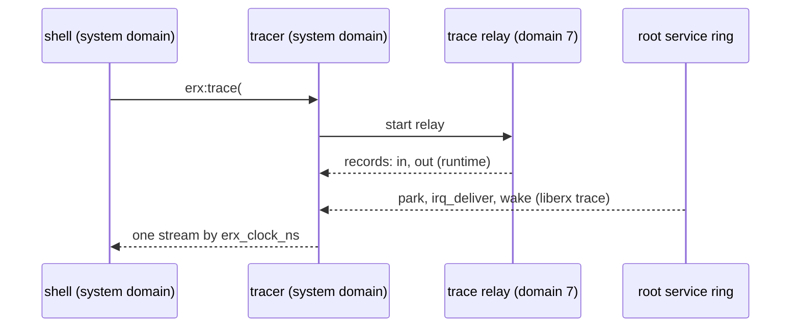
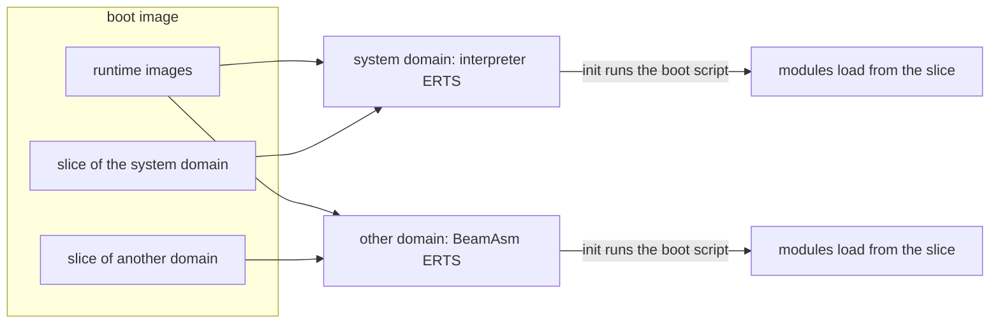
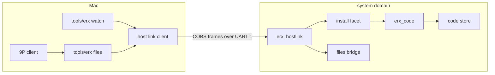

# Chapter 21. The Live Machine

> **Status.** Built: `erx:i/0,1` and `erx:inspect/2`, with a reporter
> and a status on every value, unsupported and partial ones on Fiasco
> included; inspection agents and inspect facets; `/proc`, `dmesg`,
> `ps` and `top`; `erx:source/1` within the caller's runtime; `erx:trace/1`
> over the system domain's processes and the root service's trace
> ring; the host link with `tools/erx load`, `watch`, `files` and
> `web`; the code store; loading into the system domain over the host
> link socket, over SSH and as the shell's `load -s`; booting a domain
> from its release slice; the log service to the console; the report
> filter; the crash record on the console. Designed: tracing other domains and the frames between
> them; the host link's inspect, trace, source and console commands;
> loading code into other domains, with overlays and `load -r`; the
> system domain refusing code outside installed storage; the host
> tool's `--tty`; log files under `/var/log`; a crash record that
> survives the reset; domain crash dumps under `/proc`;
> the host's tree mounted in the machine.

**Background needed.** [Chapter 3](03-erlang.md), sections 3.6 and
3.7: two versions of a module, and looking at a running node.
[Chapter 5](05-overview.md): domains, sessions and facets.
[Chapter 9](09-processes.md), section 9.7: the one timeline.
[Chapter 11](11-security.md), section 11.12: the line escape and the
field escape. [Chapter 14](14-files.md), section 14.5.1: `/proc` as
files.

A board in a kiosk answers slowly. Is the network domain starved of
memory? Has a session's process ten thousand messages queued? Is a
driver waiting for an interrupt that never comes? To answer, a
developer must see every layer of the machine at once, and trust that
each number means what it says.

Where FreeBSD answers with a dozen tools (`ps` and `top`, `procstat`,
`dtrace` and `ktrace`, `dmesg` and `syslogd`, `kldload`, `savecore`),
erXos gives the machine one **inspector**: a service in the system
domain that answers for any part of the machine, from a CPU to one
Erlang process, as a record of attributes, each carrying who reported
it and a status (21.1, 21.2). Tracing puts Erlang processes and the
root service's events on one clock (21.3). Code compiled on the
developer's Mac loads into the running machine, named by the hash of
its bytes, by the same mechanism that gives a domain its code at boot
(21.4). Logs and crash reports are attributed, escaped and
free of process data (21.5, 21.6). Each part is ordinary Erlang code
and fails the ordinary way: one process ends, and the rest goes on.

## 21.1 The machine is an object

Every part of the running machine can be inspected as a live object,
an idea from Genera, the Lisp machines' operating system
([chapter 4](04-history.md#43-the-lineage)), and each domain sees only
what its facet allows.

### 21.1.1 Paths and records

Everything the inspector can show has a **path**, a list of segments
that names it the way a file path names a file. `[]` is the machine,
`[cpus, 0]` the first CPU, `[domains, 7]` domain 7, `[domains, 7,
budget]` its budget and `[processes, Pid]` one Erlang process. The
paths, the kinds of record and every attribute with its type are
declared once in `abi/inspection.txt`, from which a Ruby generator
emits the Erlang module `erx_schema` and the host tool's table
([chapter 7](07-one-source.md)).

The answer for a path is an **inspection record**, an Erlang map
([design-live.md, Inspection records](../design-live.md#inspection-records)):

```erlang
-type record() :: #{schema := 1,
                    path := [segment()],
                    kind := atom(),          % machine, cpu, domain, process, ...
                    id := term(),
                    attrs := #{atom() => attr()},
                    children := children()}.

-type attr() :: {reporter(), value()}.
-type value() :: {ok, term()} | {partial, term()} | unknown | unsupported
               | {timeout, Milliseconds :: pos_integer()} | {error, term()}.
```

At the Erlang shell, `erx:i()` prints the machine: its record, each
CPU, the system domain's group, budget and threads, and a table of
processes, within 80 columns. `erx:i(Path)` prints one record, and
`erx:i(Pid)` is short for `erx:i([processes, Pid])`. Figure 21.1
sketches part of the screen that
`erlang/apps/erx_shell/src/erx_render.erl` lays out.

```text
/  machine
  build          kernel     <build id>
  development    kernel     true
  cpus_online    kernel     <count>
  uptime         kernel     <ns>
/cpus/0  cpu
  idle_time      kernel     [unsupported]
  ready_threads  kernel     [unsupported]
/domains/4/budget  budget
  used           root pool  [partial]
/processes  <count> entries
  pid        state    reductions  queue    name         current
  by         runtime  runtime     runtime  runtime      runtime
  <4.0.0>    waiting  <count>     0        init         init:loop/1
root pool: pages of the root's pool: those handed out, carved budgets'
included, and the pool's total and free; not the kernel's or sigma0's
memory, page tables or mapping records
```

*Figure 21.1. Part of an `erx:i()` screen on Fiasco, with live values
shown in angle brackets. Every value names its reporter, a table names
each column's reporter on its `by` line, and a backend reporter's
scope is printed under the screen, quoted from the schema (sigma0 is
Fiasco's first memory pager).*

The `erx:i/0,1` functions, the inspector behind them
(`erlang/apps/erx/src/erx_inspector.erl`) and the renderer are
**Built**. `erx:inspect(Path, Options)` returns the same record as data
for a program, with a wait of the caller's own; it is **Built** too.

### 21.1.2 Who reported it

A **reporter** is the party that measured or decided a value. There are
three, and on Fiasco a fourth: `kernel`, for what the kernel interface
reports about kernel objects; `service`, for what a system service
keeps in its own records, such as a domain's name and state from the
domain service; and `runtime`, for what a domain's runtime says about
its own processes.

The inspector assigns the reporter by where it collected the value,
never by what the value claims. An attribute from a domain's runtime
is `runtime`'s, whatever that runtime wrote in its answer, so a domain
can lie about its own processes, but the record says plainly that the
domain is the one speaking.

The fourth comes from how erXos runs on Fiasco. Some values the
kernel interface promises are counted not by Fiasco but by `liberx`'s
Fiasco backend in the root service, in user mode
([chapter 8](08-kernel-interface.md)). A **backend reporter** names
such a component. The root service counts the pages of its own pool,
so the system domain's budget reports `used` under the backend reporter
labelled `root pool`, as `partial`
([design-fiasco.md, Reporting a budget](../design-fiasco.md#reporting-a-budget)).
The schema declares each backend reporter with a label and the scope of
what it sees, printed under any screen that names it, as at the foot
of figure 21.1, so a backend's count never passes for the kernel's.

### 21.1.3 How a query travels

Follow one question from a person's session to the answer. Root's
session, a domain of its own, runs an Erlang shell. Its user types
`erx:i([processes, {pid, 7, 85, 0}])` to see process `<7.85.0>` of
domain 7, a driver's domain.

1. **The facet.** `erx:i/1` hands the path to the session's **inspect
   facet**, a process in the system domain that stands for this
   session's right to inspect
   ([chapter 5](05-overview.md#534-a-message-to-a-service-through-a-facet)).
   The session sends a path and options and nothing else; what it may
   see, its **scope**, is fixed in the facet when the system domain
   made it.
2. **The scope check.** The facet runs each query in a **query
   worker** of its own, which decides who owns the path before it
   collects anything. A process belongs to the domain its pid names,
   here 7. If 7 lies outside the scope, the answer is
   `{error, scope}`.
3. **The runtime's facts.** Only domain 7's runtime knows its Erlang
   processes, so the worker asks it and nobody else; it makes no kernel
   call for a process. Each domain but the system domain starts an
   **inspection agent**, `erx_inspect_agent`, at boot. The worker asks
   it over the domain's connection; the agent runs `process_info/2`
   inside domain 7 and answers with a frame that the system domain's
   funnel checks like any other.
4. **The record.** The worker marks every attribute of the answer
   `runtime`, adds the process's `domain` under `service`, and drops
   what the scope may not see. The session's shell renders the record
   through the line escape.

Two rules keep a lying runtime to describing itself. An agent answers
`{error, scope}` for any path outside its own domain
(`erlang/apps/erx/src/erx_inspect_agent.erl`). And the worker drops
whole an answer that does not fit the question (another path, an
attribute a runtime may not report, a record the schema refuses), so
each runtime attribute reads `{error, invalid}`; from an answer it
takes, it drops every process of another domain that the answer names
(`erlang/apps/erx/src/erx_inspect_worker.erl`).

The kernel call `erx_object_info` is made only for the machine, the
CPUs, the system domain's threads, and a domain's group or budget; on
Fiasco another domain's group or budget reads `unsupported` (21.2.2).

The agent, the query worker and the inspect facet are **Built**.

### 21.1.4 Scope

A scope is either `all` or `{principal, P}`. It names a principal, not
a list of domains, because the worker resolves P to its domains at each
query, so a domain the principal starts later is in scope from its
start (`erlang/apps/erx/src/erx_inspect_facet.erl`). In a development
build root's session holds a facet of scope `all`; in a release build
only the system shell, at a console line marked secure, inspects the
whole machine ([design-live.md, Inspection](../design-live.md#inspection)).

Two rules make scope hard to probe. A path outside the scope and a path
that names nothing get the same answer, `{error, scope}`, so a scoped
caller cannot learn whether a process of another principal exists. And
every attribute has a visibility class in the schema: `any`, `owner` or
`all`. Among the few `visible any` attributes are those every UNIX
user reads with `uptime` and `top`: the build, the uptime, the CPUs
online, total and free memory, and each CPU's idle time and ready threads. Free
memory and idle time move as other domains run, a side channel erXos
accepts so that every session can show the load.

### 21.1.5 Names travel as data

A record names a process by three numbers, `{pid, 7, 85, 0}`, never by
a live pid, because sending a pid of the system domain to another
domain **exports** it: the receiver may then message and monitor that
process ([chapter 3](03-erlang.md#392-distribution-across-a-domains-wall)).
A live group leader in a record would hand every holder of a broad
scope a way into the trusted base. A triple of numbers hands out
nothing, and a pid rebuilt from its text
with `list_to_pid/1` is still refused by the funnel.

The schema has no pid, port, reference or fun type, so
`erx_schema:validate_record/1`, run on every answer before it leaves
the system domain, refuses a record holding one at any depth. A test
plants a live group leader into a record and
checks that the validation refuses it (`test/erlang/erx_inspector_tests.erl`,
`a_live_group_leader_is_refused_test`).

### 21.1.6 From a process to its source

A process record carries the process's current location: module,
function, arity, file and line. `erx:source(Pid)` prints the source
around that line, from the `src` directory beside the module's `ebin`.
It does so only when that is truthful: the loaded code must match the
file by its MD5, the process must not be running old code, and the
line must exist. Otherwise the answer is `{error, unsupported}`, never
a line from another version (`erlang/apps/erx/src/erx_source.erl`).
The release ships no `src` directories, and a module loaded from the
host (21.4) is named by its hash and comes from no directory, so both
answer `unsupported`; a module compiled on the machine into an `ebin`
beside its `src`, or in an image that carries sources, shows its lines.
`erx:source/1` is **Built** for processes of the caller's own runtime.
The path `[processes, Pid, source]`, which would reach the source of a
process in another domain through the inspector, and `tools/erx
source` on the host, are designed and not built.

## 21.2 Never fabricate

The inspector's one hard rule is that it never shows a value it does
not have. A tool that prints `0` for a figure it could not measure has
told a lie in the shape of a fact.

### 21.2.1 Six statuses

Every value carries one of six statuses:

| Status | Meaning | Rendered as |
| --- | --- | --- |
| `{ok, V}` | V is the value, with the attribute's full meaning | the value |
| `{partial, V}` | V is a count of part of what the attribute means | `[partial]` |
| `unknown` | the reporter could not tell | `[unknown]` |
| `unsupported` | the reporter does not offer this attribute | `[unsupported]` |
| `{timeout, Ms}` | the reporter did not answer within Ms milliseconds | `[timeout Ms]` |
| `{error, Why}` | the collection failed | `[error]` |

`erx:i/1`, `/proc` files and `ntpctl` print a status other than `ok`
in its brackets, as in the table. `top`
prints a missing figure as `-` followed by its reason, such as
`- [unsupported]`, and a partial figure's number with its reporter
named beside it or in the line's label. No command prints such a value
as a bare number
([design-live.md, Invariants](../design-live.md#invariants), V2).
`ps` prints `-` for a column it lacks, but it reads its own runtime's
processes directly, not through the inspector.

Waiting has a bound. A query worker waits at most 500 ms for an agent
and lives at most 5,000 ms (`abi/services/inspect.txt`). A late agent
turns every runtime attribute into `{timeout, 500}`, and the rest of
the record still shows. A worker that ends without answering gives
`{error, failed}`; each query has its own worker, so no other waits.

### 21.2.2 What Fiasco cannot say

On Fiasco a good part of the record reads as `unsupported`, by design.
The backend sets a bit of a report's `reported` mask only for a field
it has with the attribute's full meaning, and marks a field it counts
only partly in a second mask
([design-fiasco.md, Reporting kernel objects](../design-fiasco.md#reporting-kernel-objects)).
The inspector turns the two masks into statuses. Two terms in the
table: Fiasco counts CPU time in periodic timer ticks, each charged
whole to whatever thread the tick interrupts; and the root's **status
page** is memory in which the root service's own `liberx` writes its
group's `parked` and `ready` figures as its threads park and wake.

| Attribute | On Fiasco | Why |
| --- | --- | --- |
| a CPU's `idle_time` | `unsupported` | a tick-based count bounds idle time neither from below nor from above |
| a CPU's `ready_threads` | `unsupported` | Fiasco does not report it |
| the system domain's group `parked`, `ready` | `ok` | read from the root's status page |
| another domain's group | every attribute `unsupported` | the group report answers only the root's own group |
| the system domain's budget `used` | `partial`, reporter `root pool` | the root counts its pool's pages, not the kernel's own memory |
| another domain's budget | every attribute `unsupported` | the backend refuses every budget handle but the root's own |

It is a limitation of the system on Fiasco, recorded in README's
[Current status](../../README.md#current-status): the inspector cannot
show how much of its budget the network domain has spent.

### 21.2.3 `/proc`

A `/proc` read is the query `erx:i/1` would make, through the same
facet ([chapter 14](14-files.md#1451-proc-the-inspector-as-files)).
Two details matter here.

**A file is a snapshot.** Opening a `/proc` file runs one query, and
reads see that answer until the file is closed. A record longer than
64 KiB ends with a line `[partial]`, and a reader holds at most 256
open snapshots, so its tree costs at most 16 MiB of its own domain's
memory ([design-live.md, The /proc tree](../design-live.md#the-proc-tree)).

**A gap is shown, never filled.** `/proc/kernel/log` shows the kernel
log from the oldest line the ring still holds. Where entries of the
sequence are missing, a line `[missing N]` stands in their place.
`dmesg` writes that file.
`/proc` and `/proc/kernel/log` are **Built**
(`erlang/apps/erx_files/src/erx_procfs.erl`).

## 21.3 Tracing

`erx:i/1` shows a moment. Some questions need a film: in what order did
the driver's process run, the executor park and the interrupt arrive?

> **Background: how the BEAM traces a process.** Tracing lets a
> running Erlang system report events of chosen processes without
> recompiling or stopping them. A **trace session** is a
> handle that holds which processes are traced, for
> which events, and which process receives the trace messages, the
> **tracer**. The flag `running` reports each time a process is
> scheduled in or out; `call` reports calls to chosen functions;
> `send` and `receive` report messages. With a timestamp flag, each
> trace message carries the time the event happened.

### 21.3.1 Three rows on one clock

A trace in erXos is a merge of **rows**, each a source of events with
its own reporter ([design-live.md, Tracing](../design-live.md#tracing)):

| Row | Reporter | On Fiasco |
| --- | --- | --- |
| `erts` | `runtime` | OTP's `in` and `out` events of the traced processes |
| `backend` | backend reporter `liberx trace` | the root service's trace ring: parks, wakes, interrupt deliveries, task starts and ends |
| `kernel` | `kernel` | one `unsupported` entry |

The `backend` row is the 4,096-record **trace ring** of
[chapter 9](09-processes.md#971-one-timeline)
(`liberx/backend/fiasco/trace.c`). The kernel's own trace call,
`erx_trace_read`, is refused on Fiasco, so the `kernel` row shows one
`unsupported` entry: the reader sees that the kernel was asked.

`erx:trace(Spec)` starts a trace from a map:

```erlang
erx:trace(#{select => [whereis(erx_hostlink)], kernel => true}).
```

`select` names up to 16 pids or domain ids; `kernel` adds the `backend`
and `kernel` rows, which need a facet of scope `all`. Each entry prints
as one escaped line, ordered by `erx_clock_ns`, the system clock.

### 21.3.2 The merger

The hard case of merging in time order is a slow source. The merger,
a pure module (`erlang/apps/erx/src/erx_tracer.erl`),
holds each entry until every source still waited for has shown a later
time, or until the entry is 100 ms old, whichever comes first. A ring
is in time order, so a read of it tells the merger that nothing earlier
than its last record is still to come. OTP's trace messages from
different schedulers arrive in no fixed order, so a batch of them tells
the merger only that nothing earlier than the previous batch's latest
entry is still to come. A source that stops answering delays the
stream by at most 100 ms; an entry that arrives after later ones went
out is printed at once, marked `late`, never dropped.

The trace process around the merger
(`erlang/apps/erx/src/erx_trace.erl`) wakes every 10 ms, reads the
rings, feeds the merger and sends what it releases. Two bounds keep a
trace from hurting the machine it observes. At most a fixed window of
unacknowledged entries is out; an entry that finds it shut is only
counted, so a receiver that stops reading costs a counter, never a
queue. And the trace process has a maximum heap size,
past which ERTS kills it, so a flood ends the trace, not the system
domain; the receiver sees the end through a monitor. A ring that
refuses a read is read no more, and the trace goes on with its other
sources. The trace's own processes are spawned untraced, an
erXos change to OTP, so no trace sees its own machinery run.

`erx:trace/1`, the merger and the `erts` and `backend` rows are
**Built**, for the system domain's processes.

### 21.3.3 Across domains

The design traces every domain the facet's scope covers, through that
domain's own runtime. A trace facet starts a **trace relay** in the
traced domain, the tracer OTP sees there, which renders each trace
message into plain terms and sends them in batches to the system
domain, whose funnel admits them because they create no atom.

Frames between domains are traced by their receiver. Each runtime's
funnel sees every frame arriving on its lanes, and in a traced domain
it records each frame it accepts or refuses, with the peer taken from
the lane, never from the frame. Figure 21.2 shows a trace across two
domains as the design gives it.



*Figure 21.2. A trace across two domains. Each row keeps its own
reporter, and the merger orders them on one clock; the relay in
domain 7 is designed and not built.*

The trace relay, tracing processes of other domains, and frame tracing
are designed and not built. The built trace refuses any domain but the
system domain's with `{error, scope}`
(`erlang/apps/erx/src/erx_trace.erl`, `domains/0`).

## 21.4 How code gets into a domain

A developer edits a module on the Mac and wants it running in the
machine a second later, without a reboot. Erlang already replaces
modules in a running node
([chapter 3](03-erlang.md#361-two-versions-of-a-module)); erXos adds
a link to carry the module and a name for it that cannot be faked.
This section starts from how a domain gets its code at boot, because
loading from the host runs the same mechanism after the boot.

> **Background: what a code hash names.** A module's name, `lists`,
> says which module, not which version. Two builds of `lists` share
> the name and may differ in every byte. A **cryptographic hash** such
> as SHA-256 maps any bytes to 32 bytes, so that finding two inputs
> with the same hash is beyond reach. The hash of a compiled module's
> bytes names one exact version, and a copy from anywhere is the right
> one if its bytes hash to the name. It proves the bytes are the ones
> named, not that they are safe to run.

### 21.4.1 Blobs and manifests

Every compiled artifact, a BEAM module or a native image, is a **blob**
named by the SHA-256 of its bytes, and a module's version is its blob's
hash. A **manifest** maps names to hashes. The boot image's index is a
manifest, each OTP release has one, and so does an **overlay**, the
modules loaded into a domain from outside (21.4.6)
([design-live.md, The code store](../design-live.md#the-code-store)).
Naming code by hash gives the transfer, the deduplication, the history
and the integrity check one mechanism: a copy from any store is the
right module if its bytes hash to the name, and a store that changed a
byte fails the load instead of changing what runs.

Blobs live in three kinds of place. The boot image and the EROFS images
of installed apps hold read-only blobs under their manifests. The code
service, in the system domain, holds hot-loaded blobs in memory, one
**hot store** for each principal, so no principal learns what another
loaded. A domain's loader always starts from a hash and a place to
fetch it from; it never trusts the place.

### 21.4.2 Code at boot

A domain starts from three things the boot image holds. Figure 21.3
shows them for two domains.



*Figure 21.3. What a domain starts from. The runtime is one file of the
boot image; the slice holds the domain's own `.beam` files and boot
script.*

* **A runtime image.** The system domain runs the **system image**, an
  interpreter build of ERTS with no JIT, so the trusted base holds no
  generated machine code. Every other domain runs the BeamAsm image,
  which translates each module to machine code as it loads, or the
  interpreter image when its specification chooses it
  ([design-runtime.md, BeamAsm](../design-runtime.md#beamasm)).
* **A release slice.** Each domain's code is an OTP release: the
  `.beam` files of its applications, their application files and a
  boot script, a file `init` reads that lists the modules to load and
  the applications to start, in order. `tools/erx pack` builds the boot
  image with each domain's release as one **release slice**, a read-only
  part of the image
  ([chapter 14](14-files.md#1411-what-a-namespace-holds)
  names it the `release` provider at `/`).
* **A start.** The domain library maps the runtime image and the slice
  into the new domain and starts ERTS's first thread
  ([design-runtime.md, Starting a runtime](../design-runtime.md#starting-a-runtime)).
  ERTS starts, `init` runs the boot script, and the code loader reads
  each module from the slice. In the QEMU development image the
  system domain's arguments name the script: `-boot /bin/start`
  ([chapter 24](24-startup.md#2423-erts-boots-the-system-release)).

Because the boot image is read-only memory, the same bytes can serve
every domain that loads them. Each domain's loader copies the
modules it loads into its own memory, charged to its own budget; one
read-only image of the common modules, mapped by every domain, is the
shared code of [section 9.5.3](09-processes.md#953-shared-code), which
is designed and not built.

**Apps.** An installed app's code is not in the boot image. It comes in
an EROFS image, a read-only file system image whose hash tree lets each
domain's own reader check every block it reads
([chapter 16](16-storage.md#162-read-only-system-images)), so the
domain that loads a module from an app checks its bytes itself.
Packages placed in the system partition when the image is built are
admitted and started at boot ([chapter 23](23-apps.md)); installing
one on a running machine is designed and not built.

Booting from the slice is **Built**: every QEMU suite starts its
domains this way.

### 21.4.3 The system domain runs only installed code

The system domain runs the services every other domain depends on, so
it must never run code that a service merely received. Its runtime is
designed to start with the flag `ERX_BOOT_INSTALLED_ONLY`, after which
ERTS accepts a module only if its bytes lie in **installed storage**:
the pages of the system release's slice, or the **install arena**, a
region of the system domain whose binaries only the call
`erx_code:install_beam/2` creates, and which refuses every caller but
the code service. Any other binary fails to load with
`{error, not_installed}`. The check is by address range, so it holds
however the binary travelled inside the domain, and the install facet
(21.4.5) is the one way in from outside
([design-runtime.md, Code in the system domain](../design-runtime.md#code-in-the-system-domain)).
Every other domain loads any code it is given, and a malformed module
ends only that domain.

This rule is designed and not built. The boot information carries the
flag and ERTS ignores it; there is no install arena, and the code
service loads the checked bytes from its own heap. Without the rule, any code in the system domain can load a binary with
`code:load_binary/3`, and what keeps untrusted bytes out of the system
domain is that the development build runs trusted code only.

### 21.4.4 The host link

The **host link** connects the host tool, `tools/erx`, to the machine
over a second serial line that belongs to the system domain. Under QEMU
that line is a UNIX socket in the run's own directory, which only its
user can enter ([design-live.md, The host link](../design-live.md#the-host-link)).
`tools/erx boot --hostlink` sets it up. Figure 21.4 shows the parts.



*Figure 21.4. The host link. Every request names a facet by its number
in the host link session's facet table; the code service checks each
module against its hash before anything is loaded.*

**Frames.** A serial line drops and garbles bytes. Each frame is
encoded with consistent overhead byte stuffing (COBS), which leaves no
zero byte inside it, and ends with a zero, so a receiver finds the next
frame after any damage. A frame carries a stream number, a session
identifier, a sequence number, a target, a body of at most 8,192 bytes
and a CRC-32C ([design-live.md, Host link frames](../design-live.md#host-link-frames)).

**Link sessions.** Here "session" means a conversation over the link,
not a login session. The tool opens a **host link session** with a
hello carrying a fresh random nonce. The machine answers with the
nonce, a new 128-bit session identifier and its build identifier; the
tool refuses a machine of another build. The machine ends the previous
link session, with every facet it held.

**Authority.** A link session's authority is a **facet table**,
created empty with it and ending with it. A call names its target by
number: 0 is the root, which opens facets, and any other number an
entry of the table. No call names a process, so nothing on the wire
reaches what the link session was not given.

**At most once.** A tool that resends a lost call must not load a
module twice. Each call carries an identifier, and the link session
remembers the 64 highest it has seen, its window. Each call in the
window is in one of three states: unseen, executing or answered, and
an answered call keeps its reply while there is room. A duplicate of
an answered call is not run again: it gets the kept reply, or
`{error, reply_lost}` if the reply was not kept. A new call that would
push an executing one out of the window is answered `{error, busy}`
without running. So a garbled frame, which fails its CRC and is
dropped, can be resent safely.

**Credit.** The machine's serial driver buffers at most 64 KiB, so the
tool sends only within credit, 16 KiB at first, renewed as the machine
reads.

The transport trusts its one physical or local peer: CRC and session
identifiers authenticate no one, so remote use goes through SSH, never
a bridge of the serial line to a network.

The host link is **Built** (`erlang/apps/erx_uart/src/erx_hostlink.erl`
and the modules beside it), with its framing fuzzed
(`test/erlang/erx_hostlink_frame_fuzz.erl`). Its root opens two facets,
`install` and, in a development build that configures a web domain,
`web`; the files stream is served too. The design's other facets,
`inspect`, `trace`, `console`, `update`, `domain` and per-domain
`code`, answer `{error, unsupported}`: they, and `tools/erx inspect`, `trace`,
`source` and `console` over them, are designed and not built.

### 21.4.5 Loading from the host

A load is an exchange with the **install facet** of the code service
(`erlang/apps/erx_code/src/erx_code.erl`), whoever holds the facet. It
has three steps:

1. **Missing.** The holder hashes each module and asks which hashes
   the store lacks.
2. **Put.** It sends each missing blob in 64 KiB pieces. The store
   keeps it only if the bytes hash to the name; a blob one bit off is
   refused with `hash_mismatch`.
3. **Load.** It sends the manifest. The code service hashes every
   named blob again, so a changed store can fail a load but never
   change what is loaded.

The load itself is all or nothing. `code:prepare_loading/1` checks
every module of the manifest, and `code:finish_loading/1` makes the
whole batch current or none of it, the two halves of OTP's
`code:atomic_load/1`. A batch refused only because a module still has
old code is finished again after a purge, as an ordinary load would
purge; any other refusal leaves the old code running. A module that
loads and then crashes is ordinary buggy code: its supervisor restarts
it, and the store's history holds the hash to load back.

An unchanged module costs no transfer, which is why the host compiles
with `+deterministic`: the same source gives the same bytes and the
same hash (`tools/lib/erx/code_watch.rb`). The store keeps each
module's history, the hashes loaded and when (`erx_code:history/2`),
and a rollback is a load of an older hash. The store holds 16 MiB; to
make room it frees first
the blobs that only older history names, and never a module's current
blob (`erlang/apps/erx_code/src/erx_code_store.erl`).

**Routes.** Two holders run the exchange. The host link's session
holds the install facet for the host tool, and a login session holds
it for the session command `load`, which reaches the machine over SSH.
The routes differ only in how the bytes arrive
([design-live.md, One load, three routes](../design-live.md#one-load-three-routes)):

| Command | Carries the bytes | Used for |
| --- | --- | --- |
| `tools/erx load --socket PATH --system FILE...` | the host link: under QEMU, the UNIX socket that `tools/erx boot --hostlink` makes; on a board, a UART bridge's socket | QEMU, and a board whose network is down |
| `tools/erx load --ssh DEST --system FILE...` | an SSH `exec` of the session's `load -s -m`, the modules on its standard input | a board on the network |
| `load -s FILE.beam ...` in the machine's own shell | a file the session can read | a module already on the machine |

`tools/erx watch` takes the same transports and loads each source of a
directory when it changes: it polls the directory every half second,
compiles each changed source with the same `erlc` that built the image,
and loads the last good compile of every module it has compiled as one
batch. The tool refuses a call that names no target or two, and the
host link session opens the install facet alone, so `--socket` takes
`--system` only (`tools/lib/erx/code_commands.rb`). A QEMU check
reloads a module 32 times on four CPUs while workers call it, and
checks that no call ran stale code (`tools/lib/erx/reload_guest.rb`).

The code service, its in-memory store with history, and `load` and
`watch` into the system domain, over the host link socket, over SSH and
as the board's own `load -s`, are **Built**. The tool's `--tty DEVICE`,
which opens a serial adapter directly, is designed and not built; a
board's host link UART is reached through a bridge that serves it as a
UNIX socket.

Whoever holds the install facet can change what the system domain
runs. A development build gives it to the host link and to `root`'s
session, so an SSH key in root's `authorized_keys` is as strong as
root's password ([the Raspberry Pi guide](../guide/raspberry-pi-4.md#load-code-over-ssh)).

### 21.4.6 Other domains and overlays

The same exchange reaches any other domain through a **code facet**,
a second service of the same interface that differs from the install
facet only in scope. The install facet's scope is the system domain.
A code facet's is the domains of the principal that holds it, or
every domain but the system domain for the development build's
`root`, and the system domain is in no code facet's scope
([design-live.md, Code from the host](../design-live.md#code-from-the-host)).
Four more parts make this safe and give it a memory:

* **The code server.** Every domain but the system domain runs one
  code server, `erx_code_agent`, a process under `kernel`'s
  supervisor and the only process through which the code service loads
  into that domain. The code service sends it the manifest; the code
  server asks for each missing blob one 64 KiB piece at a time, checks
  its hash, loads the batch whole with the same `prepare_loading` and
  `finish_loading` pair, and answers
  ([design-live.md, The code server](../design-live.md#the-code-server)).
  A module of any size therefore fits every message and every heap
  limit, and a malformed module ends only the domain that loaded it.
* **Overlays.** A **supervised** domain is one the domain service
  starts again from the same specification when it ends. The code
  service keeps an **overlay** for each such specification: the
  manifest of the modules loaded into it from outside. A load is a
  candidate overlay, a batch load by the code server, and then the code
  service publishes the candidate. A batch that is not published ends
  its domain, so a supervised domain runs only code its published
  overlay names, and the restarted domain loads the overlay before its
  applications start. The overlay belongs to the specification the
  domain is restarted from, which boots the same release for as long
  as the overlay lives, so the overlay always stands over the release
  it was loaded over.
* **History, rollback and reset.** The code service keeps the last 16
  hashes it published for each module, and a rollback is a load of an
  older hash. The command `load -d DOMAIN -r` drops the overlay, and
  the domain's next start boots the release as built.
* **Memory only.** An overlay and the hot stores live in the code
  service's memory. A reboot returns every domain to the release in
  the boot image; a change that must outlive a reboot ships in a new
  boot image or a new version of the app.

Loading into another domain is designed and not built. The code
server, the code service's per-target state machine and its sending
of start loads are written, but no code facet is granted, so `tools/erx load --domain D` over SSH
is refused with `load: no code facet`, and over the host link socket
it is refused by the tool, which opens the install facet alone. The
domain service does not report a domain's start to the code
service, which an overlay needs. The reset command `-r` is designed
and not built.

### 21.4.7 Files and the browser

`tools/erx files` relays a UNIX socket on the Mac to the host link's
files stream, so any 9P2000.L client on the host mounts the machine's
trees: in a development build, `proc` and `data`
(`tools/lib/erx/files_relay.rb`,
`erlang/apps/erx_uart/src/erx_hostlink_files.erl`). It is **Built**. The machine mounting a directory of the
Mac at `/host`, through QEMU's virtio-9p device and a domain of its
own, is designed and not built.

`tools/erx web`, the browser view over the web facet, is the subject
of [chapter 22](22-display.md#2272-the-web-client).

## 21.5 Logs and crash reports

When something fails, the record of why must reach a person, attributed
and readable, without carrying the secrets of the process that failed.

> **Background: logging and crash dumps.** A **log** is a stream of
> short records, each with a time, a severity and a text; UNIX collects
> them in `syslogd`, which files them under `/var/log`. Erlang's
> `logger` does the same within a node, and OTP's behaviours log a
> **crash report** when a process ends abnormally: its exit reason,
> its last message and its state. A **crash dump** is the registers,
> stack and memory of a whole program or kernel that died, kept for a
> developer to read after the restart.

### 21.5.1 One log service

Every log event of the machine, the kernel's records and every
domain's `logger` events, reaches one service in the system domain,
`erx_syslog` ([design-log.md](../design-log.md)). It stamps each
record, holds each domain to a rate, escapes the text and hands the
line to its consumers. A domain's record renders as one line:

```text
SECONDS.MICROSECONDS LEVEL domain ID principal P NAME: TEXT
```

Everything before `NAME` is the service's own text, ASCII by
construction; the domain's name and the record's text pass through the
line escape. A kernel record keeps the line the kernel's log core
rendered, with its own sequence number, `#SEQ SECONDS.MICROSECONDS
LEVEL TEXT`, so a gap in the numbers shows where kernel records were
lost. No domain's line begins with `#`, so a reader tells the two forms
apart by the first character.

Fiasco's own lines, its warnings among them, become kernel records too.
From the log service's first take, the kernel sends every line it
prints to a 4 KiB ring of its own instead of the console's UART, and
each take drains the ring into the log as records whose text begins
`fiasco: `, escaped like every other kernel line. The ring holds only
whole lines: a line it cannot hold whole is dropped whole, never cut,
and counted, and the count becomes a record of its own. The kernel
writes the UART again only when the machine stops: a panic, a failed
assertion, a kernel trap, the debugger's entry or the root's end takes
the UART back before it prints its first byte, so the stop's report
never waits in the ring, and the ring's lines go out first, escaped as
a take would give them. So while the console's driver runs it is the
UART's only user, and no kernel write can hide a lost keystroke
([design-fiasco.md, The kernel's lines](../design-fiasco.md#the-kernels-lines)).
A development build's debugger is the one exception: an operator who
resumes it leaves the kernel writing the UART beside the driver until
the machine ends. The ring is designed and not built.

The service, its pure core and its console consumer are **Built**
(`erlang/apps/erx/src/erx_syslog.erl`, `erx_syslog_core.erl`). The
store that appends the lines to `/var/log/messages`, rotates the files
and serves them read-only, so that `tail -f /var/log/messages` and
`grep` work as on UNIX, is designed and not built; the files are the
whole interface, as Plan 9 would have it.

### 21.5.2 Reports carry no term

OTP's crash reports quote what a process held: `proc_lib`'s prints the
message queue and the process dictionary, `gen_server`'s the last
message and the whole state
([design-log.md, Reports carry no term](../design-log.md#reports-carry-no-term)).
In a domain whose processes hold a key or a peer's bytes, each is a
leak. The **report filter**, `erx_report`, a primary `logger` filter
that every event of the runtime passes, closes them in one place. It
rewrites each of OTP's reports to names: the process, its registered
name, the error's class, the reason's leading atom and the stack's
functions, and drops every other term; a domain's own events pass
unchanged. Every runtime but the system domain's installs it at boot,
through an erXos change to OTP's `kernel`, so no domain can forget it,
and it never raises, since `logger` removes a filter that raises. The
system domain keeps its reports whole for its operator. The filter is
**Built** (`erlang/apps/erx/src/erx_report.erl`); its test crashes the
Bluetooth controller process with the controller's bytes in its
mailbox and checks that no report carries them
(`test/erlang/erx_report_tests.erl`).

### 21.5.3 The crash record

A fault in the system domain ends the machine, since every domain
depends on the root task ([chapter 10](10-domains.md)). On its way
down, the root service writes one **crash record** to the console, a
fixed layout of the ABI file
([design-fiasco.md, The end path](../design-fiasco.md#the-end-path)).
It holds the cause, the program counter and fault address, the build
identifier, the uptime, a short message, the faulting thread's
registers and a backtrace. Of the four causes the layout
names (fault, halt, missed watchdog pet, panic), the root writes a
fault or a missed pet; even `erlang:halt(abort)` arrives as a fault.
The root first gives the UART back to the kernel, which writes out its
own lines still in its ring. When the ending thread owns the kernel
log, the root then writes the log records still waiting for a reader; on any other thread the log
may be mid-write, so it is skipped (`liberx/backend/fiasco/end.c`).
The record is **Built**.

No memory region survives the reset, so the record lives only in the
console's output: the harness's log on QEMU, and whatever is wired to
the Pi's UART. The record's layout also has a **brief form**, with no
registers, stack or log, for release builds
([design-system.md, The crash record](../design-system.md#the-crash-record)).
The brief form is designed and not built; the root always writes the
full form.

A crash of any other domain ends only that domain, whose runtime
writes its dump into the domain's crash area
([chapter 8](08-kernel-interface.md#834-one-request-end-to-end-a-domains-crash-area)).
Reading that dump at `/proc/domains/ID/crash` is designed and not
built.

## 21.6 Attributed text

Text shown under its source's name is **attributed text**: a domain's
name, a log line, a source line from a file a domain supplied. It is
escaped by whatever displays it; a program's own output is not
([chapter 11](11-security.md#11122-what-is-not-escaped)).

Each display has its one escaping function, and the tables of each are
generated from one file, `abi/terminal.txt`
([chapter 11](11-security.md#11121-one-escape-generated-from-one-table)):

| Sink | Escape | Status |
| --- | --- | --- |
| the console's log lines and menus (`erx_console`) | line escape | Built |
| inspection records in the shell (`erx_render`) | line escape | Built |
| trace lines (`erx_trace:line/1`) | line escape, once over the whole line | Built |
| `/proc` files (`erx_procfs`) | field escape | Built |
| the host tool's printer | its Ruby twin of the line escape | Built |
| the host tool's `inspect`, `source` and `trace` output | its Ruby twin | Designed |

Bytes a domain chose, printed raw on a console or the host terminal,
can rewrite the operator's screen, and some escape sequences make a terminal send text
back as if the user had typed it. The one guest
stream the host tool is designed to pass raw is a console session's
terminal stream, a tty's output, as `ssh` passes a remote shell's.

## 21.7 Design choices

**One tree, not many tools.** Separate tools would each keep a model
of overlapping data, with a permission rule of its own. erXos keeps
one schema, and `erx:i/1`, `/proc` and
the browser are views of it behind one facet: the schema must name
everything, and a new attribute appears in every view at once.

**The receiver traces its frames.** A router between domains could
record every frame for all of them, but erXos has no router on a
connection; only the receiver's funnel knows whether a frame was
accepted.

**9P on the host link, not a file protocol of its own.** A file facet
of erXos's own would be a protocol no host tool mounts; 9P2000.L is
already the machine's file protocol, and any 9P client on the Mac
mounts it, with its own fids as handles.

**Code by hash, not by name and version number.** A version number is
a claim its writer makes; a hash is a fact anyone can check. With
hashes, the transfer, the deduplication, the history, rollback and the
integrity check are one mechanism.

## Summary

The inspector shows any part of the machine as a record whose every
attribute names its reporter and carries a status, so a value the
system cannot measure, such as a CPU's idle time on Fiasco, never reads
as a number. A query passes through the caller's inspect facet; another
domain's process is answered by that domain's agent alone, and records
name processes by numbers, handing out no authority. Tracing merges
OTP's events and the root service's ring on one clock, within bounds.
The host link carries modules from the Mac at most once per call, and
the code service loads them by hash, all or nothing. Logs are one
attributed, escaped line per record, and crash reports outside the
system domain carry no term.

## Where to read next

* [design-live.md](../design-live.md): the inspection schema, scopes,
  `/proc`, tracing, the host link, the code store and the escapes, with
  each invariant and its test.
* [design-log.md](../design-log.md): the log service, its line, its
  store and the report filter.
* [design-system.md, The crash record](../design-system.md#the-crash-record):
  the two forms of the crash record.
* [design-fiasco.md, Reporting kernel objects](../design-fiasco.md#reporting-kernel-objects)
  and [The trace ring](../design-fiasco.md#the-trace-ring): what the
  root service reports on Fiasco, and why the rest is unsupported.
* `abi/inspection.txt`: every path, kind, attribute and reporter.
* David A. Moon, "Symbolics Architecture", *IEEE Computer* 20(1),
  January 1987, pp. 43-52: the Lisp machine whose live, inspectable
  environment this chapter follows.
* Stuart Cheshire and Mary Baker, "Consistent Overhead Byte Stuffing",
  *IEEE/ACM Transactions on Networking* 7(2):159-172, 1999: the framing of the
  host link.
