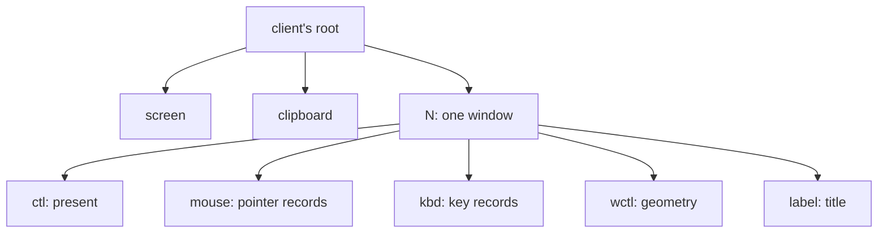
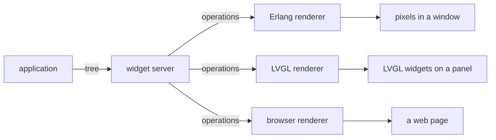
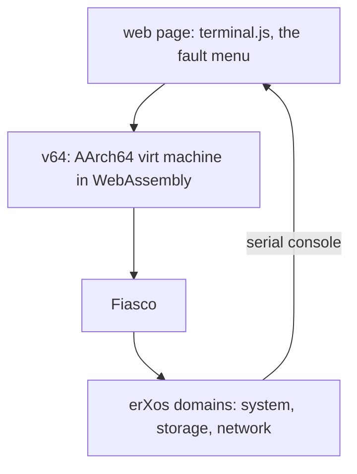

# Chapter 22. Displays, Windows and the Web

> **Status.** Built: the display domain, whose window server serves
> each window as a directory of files; the pixel area and `present`,
> by the copy path; the draw protocol, executed in the client's
> session, and `/dev/draw` for a program started with a window; the
> virtio-gpu, virtio-input and Raspberry Pi framebuffer drivers in
> Erlang; the input router; the single window policy; the widget
> server with its LVGL renderer; the theme; the kiosk dashboard on
> QEMU and the Raspberry Pi 4; Doom as an example program; the
> terminal emulator's pure core; the browser demo; and `tools/erx web`.
> Built as pure cores with host tests, run by no guest: the
> overlapping window policy and the desktop programs' cores. Built and
> run in a window: `erx_desk` with its `clock` command. Designed:
> the terminal window and presentations in it, the Erlang and browser
> renderers, the web's network front end, the desktop session, find and
> act, the direct path to the device, and graphics hardware.

**Background needed.** [Chapter 11](11-security.md), section 11.12:
the line escape. [Chapter 13](13-native-programs.md), sections 13.1
and 13.4: programs in sub-spaces, and pipes.
[Chapter 14](14-files.md), sections 14.1, 14.2 and 14.5: file trees,
file grants, stream files and keepers, `ctl` files.
[Chapter 15](15-devices.md), sections 15.1 and 15.3: drivers as Erlang
processes, and virtio.

A program that shows a picture needs somewhere to put its pixels, a
way to say which of them changed, and the keys and clicks meant for
it. The part of a system that hands these out holds the most private
things a person has. It sees every password typed at the machine and
every pixel of every window. If it also runs code its clients send it,
a bug in that code sees all of that too.

erXos's answer has four parts. A **display** is a domain that holds a
screen and its input devices and serves each window as a directory of
files, an idea from Plan 9's window system. A window's pixels are a
buffer that its client writes and the display only reads. The client
names the rectangles that changed with one command, `present`, and the
display parses nothing else a client sends. An Erlang application
never draws. It hands a toolkit in its own session a tree describing
its interface, and a renderer shows that tree in the idiom of its
medium: a screen, a panel or a browser.

The chapter covers windows as files (22.1), input and the terminal
(22.2), widget trees (22.3) and LVGL (22.4). Then come kiosks and the
desktop (22.5), find and act (22.6), erXos in a browser (22.7),
graphics hardware (22.8), failure (22.9) and the design's choices
(22.10).

## 22.1 Windows are files

> **Background: framebuffers, pixel formats and compositing.** A screen
> shows a grid of **pixels**. The memory that holds one value per
> pixel, row after row, is a **framebuffer**; display hardware reads it
> many times a second and sends it to the panel. A pixel's layout is
> its **pixel format**. In Plan 9's notation `x8r8g8b8` means 32 bits
> a pixel: 8 each for red, green and blue, and 8 unused. The distance
> in bytes from one row's start to the next is the **stride**, often
> rounded up for alignment. When programs share a screen, each draws
> into its own image, and a **compositor** copies the visible part of
> each into the framebuffer in stacking order. Copying only the
> rectangles that changed, the **damage**, makes the cost follow what
> moved, not the size of the screen.

A display is a domain like the storage and network domains of
[chapter 5](05-overview.md#512-domain). It holds one display device and
its input devices. It runs their drivers, the window server
`erx_winfs`, one process per window, and one process that owns the
screen. It runs no terminal, toolkit, font reader or program of a
session. On QEMU's `virt` machine the display device is virtio-gpu and
the input devices are virtio-input's keyboard and tablet. On the
Raspberry Pi 4 it is the framebuffer the board's firmware sets up. All
three drivers are built, as Erlang processes over the device NIF of
[chapter 15](15-devices.md#153-the-device-nif).

A display's **window** is a rectangle on a screen, a different thing
from chapter 8's window in the root service's address space.

### 22.1.1 A window's directory

`erx_winfs` serves one file tree per display, an `erx_fs` tree of the
kind [chapter 14](14-files.md#1424-serving-the-erx_fs-behaviour)
describes. The tree holds a directory for each client, and a client
reaches the display through a file grant rooted at its own directory.
That grant is all the client holds of the display. `mkdir` of a name of the client's choosing makes a window.
The listing, from
[design-display.md, The window tree](../design-display.md#the-window-tree):

```text
/N/ctl      read: the display's channel, scale and palette, the last present's report; write: a present
/N/mouse    read: 49-byte records 'm x y buttons msec' and 'r ...' after a resize
/N/kbd      read: records 'c' runes typed, 'k' keys down, 'K' keys down after a release
/N/wctl     read: the window's rectangle and state; write: a geometry command
/N/label    read and write: the window's title
/screen     read: the screen's rectangle and channel
/clipboard  the display's clipboard, read and write; present only when the grant carries clipboard
```

Figure 22.1 draws the same tree.



*Figure 22.1. A window's directory of files. The client's grant is
rooted at its own directory, so no other client's windows are names in
its tree.*

The formats come from Plan 9: 49-byte `mouse` records, and `kbd`
records of a byte naming the kind, the key's characters in UTF-8 and a
NUL. A read of `mouse` or `kbd` that finds
nothing waits for the next record. These are stream files, and the
window process is their keeper
([chapter 14](14-files.md#1425-stream-files-and-keepers)). A window
serves no terminal file, because a terminal is a program's choice
(section 22.2.3).

A window ends when the process that made it ends, when its directory
is removed, or when the grant ends. The window server records each
window's maker and monitors it, so no field in shared memory decides
who may act on a window. Each window counts against the grant's
`windows` quota, which the manifest sets.

### 22.1.2 The pixel area and `present`

A window's pixels never travel in a message. When a client's domain is
first connected to the display, the system domain makes one memory
object with the connection: the client's **pixel area**. The client's
domain maps it writable, the display maps it read-only, and no other
domain maps it. Its size is the grant's `pixels` parameter, 8 MiB by
default, room for one window of 1920 by 1080 pixels at 32 bits each.

In this chapter a **buffer** is a range of that area, not the DMA
buffer a driver hands a device in chapter 15. It is laid out as Plan
9's pixel library, `libmemdraw`, lays out an image: rows from the top,
each of

```text
stride(width, depth) = 4 * ((width * depth + 31) div 32)     bytes in a row
```

The client chooses where each buffer lies. A buffer has no header the
display reads. Everything the display needs is in the one command a
client writes to its window's `ctl`:

```text
present OFFSET WIDTH HEIGHT [X0 Y0 X1 Y1]...
```

It names the buffer by its offset, width and height, and up to 16
rectangles that changed; none means the whole buffer. A pure parser,
`erx_winctl`, reads the line. The window then checks it whole before
anything is shown. The sizes must lie between 1 and 16,384 and the
offset must be page-aligned. The buffer's bytes must end inside the
pixel area, by checked arithmetic, and each rectangle is clipped to the
buffer. A line that fails any check fails the write with `EINVAL` and
changes nothing on the screen.

The answer to the write comes when the device has taken the frame. It
does three jobs. It tells the client that the buffer presented before
is free to draw into. It paces the client to the device. And since a
window sends its next present only after the answer, each window has
at most one present in flight. No release event or frame callback is
needed, because the answer to a write is already a signal.

### 22.1.3 A present, end to end

Follow a program that draws a red square into its window. Every step
is built.

1. The program's first open of `/dev/draw` made its handler
   ([chapter 13](13-native-programs.md#1322-the-handler)) open it a
   window; a program can also be started with one. The handler gave it
   a `/dev` of its own, with `draw`, `ctl`, `kbd`, `mouse`, `wctl` and
   `label`. The session read `screen`, made the window, then allocated
   its buffer at the screen's size in the pixel area.
2. The program writes draw messages, Plan 9's draw protocol, to `/dev/draw`: allocate an
   image of solid red, draw it over a rectangle of image 0, the
   connection's name for the window itself, and send `v`, the message
   that flushes. The write reaches the session's **draw connection**,
   `erx_draw_conn`, a process of the program's own session.
3. The draw connection's pure core, `erx_draw_core:plan/2`, decodes and
   checks the whole write. Only when every message passes does the
   process perform the operations, through `erx_memdraw`, a NIF around
   `libmemdraw`'s primitives. Image 0 lies over the window's buffer, so
   the red pixels land in the pixel area.
4. The flush makes the draw connection write `present` to the window's
   `ctl`, naming the buffer and the part of image 0 that changed. The
   write crosses to the display domain as a file request on the
   connection's lanes
   ([chapter 10](10-domains.md#102-connections-lanes-and-doorbells)).
5. The window process checks the line and hands the present to
   `erx_screen`, the one process that reads clients' buffers, writes
   the screen image and calls the driver.
6. `erx_screen`'s pure core, `erx_screen_core`, works out which part of
   the rectangle is visible. The process copies that part into the
   screen image and hands the driver the changed rectangle.
7. The virtio-gpu driver transfers the rectangle to the host and
   flushes it. When the device answers, the answer travels back to the
   window and to the program's `ctl` write, and the program may draw
   again.

The display decoded no draw message, loaded no font and ran nothing on
the program's behalf: draw messages are executed in the client's own
session (section 22.10).

`erx_screen` never waits on the driver. A frame request returns at
once and the answer arrives as a message, so the mailbox keeps
draining while the device works. What arrives meanwhile replaces
**pending state** of fixed size: the newest layout replaces the one
before, and each window has at most one waiting present. A client
that sends a hundred thousand geometry commands to a stalled device
grows nothing in the display.

Nothing paints between two changes. No display process has a redraw
timer, and the driver pushes only the rectangles it is given, so an
idle screen costs no CPU and a battery panel can sleep.

### 22.1.4 Two paths to the device

The design has two composition paths. The **copy** path is the one
above. The **direct** path skips the copy: when one window covers the
screen and the device can read client memory, the driver pushes from
the buffer itself. `erx_screen_core` can choose between them, but
both built drivers report that their device cannot read client memory,
and `erx_screen` builds its core with the direct path closed, since the
core would choose that path without checking the buffer's size. So
every frame takes the copy path. The direct path is designed and not built.

## 22.2 Input routing and the terminal

A key must reach exactly one window. Its release must reach the
window that saw it pressed, even if the windows moved in between.
erXos puts every such decision in one pure function.

### 22.2.1 The router

The drivers hand each input record to `erx_winfs`, which passes it
through `erx_input`, the router's functional core. Its step takes a
record and the router's state and returns the next state and a list
of deliveries. The state holds the pointer, each key, button and touch
held, and the current **gesture**: everything from the first button's
or finger's down to the last one's up. `erx_winfs` stamps each record
with its clock, so the step reads no clock and tests feed it time.

The router asks the **window policy** only about what starts
something: a key's down, a gesture's first event, or a pointer move
while nothing is held. What follows goes where the start went. A key's
up goes to the window that got its down, and every event of a drag
goes to the window where the drag began. A policy cannot get that
wrong, because it is never asked.

One more rule stops a classic trick. A window that has appeared
under the pointer could take a click meant for the window that was
there a moment before. So a down reaches a window only while the frame
the device last took shows it and the window table shows it too.
While the two disagree, the down goes nowhere and is counted. This
rule is built and tested with times as inputs. The design adds two
refinements: a pointer move since the window came under the pointer,
and 200 ms since a touched window last gained pixels. Both are
designed and not built.

### 22.2.2 Two policies

A policy is a module behind one Erlang behaviour, `erx_wm`, whose
callbacks are pure functions of the window table and the screen. They
place a new or moved window, arrange the rest after a change, decorate
with borders, take input that starts something, and offer a menu. A
policy decides geometry and who takes each input, and nothing else.

The **single** policy, `erx_wm_single`, shows one window over the
whole screen with no decoration: the oldest window of the display's
session (section 22.5.1), unless a front window lives, which shows
over it (also section 22.5.1). Every other window stays hidden and
receives no new input. It is built and runs the kiosk.

The **overlapping** policy, `erx_wm_rio`, follows rio. Windows overlap
with thin borders, a click makes a window current, and a menu moves,
resizes, hides and deletes windows. It is a pure core with exhaustive
host tests, which the window server's tests run; no QEMU guest runs it.

### 22.2.3 The terminal is a program

On UNIX a terminal window is a program, xterm, that is a client of the
X server and the master side of a pseudo-terminal. erXos keeps that
shape. `erx_term` is a supervised Erlang process of the person's
session that makes a window through the session's grant, like any
client. It asks the session for a tty of its own
([chapter 20](20-shell.md#2042-the-terminal-relay)) and starts the
command shell on it with `TERM=xterm`. The display sees the terminal as
pixels and routes it keys, nothing more.

The heart of the terminal is `erx_vt`, a pure function from the
terminal's state and the bytes a program wrote to the next state and a
list of effects. Each byte passes a UTF-8 decoder, then Paul Williams's
parser for DEC's ANSI-compatible terminals, then acts on the grid of
cells. Program output is untrusted, so every stage keeps bounded state:
16 parameters, a 4 KiB OSC string, 131,072 cells of scrollback, 256
links. Its only replies to a program are three status reports: what
terminal it is, that it is working, and where the cursor is. Their
only variable parts are numbers it computes, so nothing a program
writes comes back as typed input. A
title report, which in some terminals echoes attacker-chosen text to
the shell, does not exist.

The terminal type is an xterm-compatible subset named `xterm`, since
every program and remote system knows that name. A type of erXos's own
would be honest and unknown everywhere. Terminal descriptions are in
termcap, not terminfo. `erx_vt` is built, with host tests and a fuzz
target. `erx_term`, the window around it, is
designed and not built; the shell runs on the serial console and over
SSH.

### 22.2.4 Output that remembers its value

Output on erXos stays bound to the value it shows, an idea from
Genera, the Lisp machines' operating system, in a form that grants
nothing. When the shell or the inspector writes a
typed value to a terminal that understands links, it wraps the text in
an OSC 8 hyperlink, an escape sequence that marks text as a link,
whose target is `erx:TYPE/TEXT`. This is a
**presentation**: a type and a canonical text. A click inserts the text
where the person is typing and calls no service. The command that then
runs is checked by the shell like any typed command, so a session
without the right to inspect processes clicks a pid and gets
`no_facet`, the refusal of a call for which the session holds no
[facet](11-security.md#116-facets-authority-over-services). On a plain terminal the same output is plain text that
parses back. Presentations in a terminal window are designed and not
built, since the terminal window is not built.

## 22.3 One interface, every medium

> **Background: event-driven toolkits and widget trees.** A toolkit
> gives a program **widgets**: buttons, labels, lists, sliders. In the
> older, imperative style, the program creates each widget, keeps a
> handle to it and calls functions to change it, and the toolkit calls
> back when the user acts. In the **retained tree** style that React
> made popular on the web, the program describes the whole interface
> as a tree each time its state changes. The toolkit compares the new
> tree with the one it holds, the **diff**, and applies only the
> differences. The program keeps no handles and issues no commands, so
> it cannot issue them in the wrong order.

An Erlang application in erXos never draws. It sends a tree.

### 22.3.1 A tree is a term

A tree is an Erlang term, `{Kind, Props, Children}`: an atom such as
`column` or `button`, a map, and a list of trees. The kiosk's dashboard
builds one card per currency like this, in
`examples/dashboard/lib/erx_dashboard/src/erx_dashboard_view.erl`,
function `card/1`:

```erlang
card(#{symbol := Symbol, name := Name, price := Price, change := Change,
       decimals := Decimals} = Quote) ->
    {column, #{key => Symbol, weight => 1},
     [{row, #{height => 48},
       [{column, #{weight => 1},
         [{label, #{height => 28, role => title, text => Name}, []},
          {label, #{height => 20, role => caption,
                    text => maps:get(status, Quote, Symbol)}, []}]},
        {column, #{width => 150},
         [flush_right({label, #{height => 28, role => figure,
                                text => or_none(Price, fun(P) -> price(P, Decimals) end)}, []}),
          flush_right(change_label(Change))]}]},
      gap(12),
      graph(Quote)]}.
```

Notice two things. The card says what each text *is*, a `title`, a
`caption`, a `figure`, and leaves type size and colour to the theme
(section 22.5.3). And `key => Symbol` names the card among its
siblings, so when quotes are reordered the toolkit moves the card
instead of rebuilding it.

`abi/formats/ui.txt` declares the vocabulary as closed tables. The
chief three are the properties, each with one name and one type; the
kinds, each with the properties it takes; and the image types, of
which there is one, PNG. Beside them it declares limits, value types
and the records of the binary form. A kind is a container, such as
`column` or `scroll`, or a widget, such as `button` or `graph`; the
file lists the rest. From that file, the build
generates the validator `erx_ui_schema` and codecs for the binary form,
in Erlang, C and TypeScript ([chapter 7](07-one-source.md)). Each has
a fuzz target.

### 22.3.2 The widget server

`erx_ui:open(Options)` starts a **widget server**, `erx_ui_server`, in
the application's own runtime. The server opens a window as its holder
and the call returns `{ok, Window}`, a monitor reference. The
dashboard calls
`erx_ui:open(#{renderer => lvgl, label => <<"dashboard">>})`, then
`erx_ui:tree(Window, Tree)` each time its state changes. On each tree
the server:

1. **validates** the whole tree with `erx_ui_schema`, changing nothing
   if any node fails;
2. **numbers** it against the tree it holds and **diffs** the two with
   `erx_ui_model`, which yields operations: insert, remove, set
   properties, move among siblings, commit;
3. **applies** the operations through the renderer behaviour,
   `erx_ui_renderer`;
4. **routes** events: the renderer reports the node an event hit, and
   the server sends the application `{ui, Window, Term, Detail}`.
   `Term` is what the application put in the node's `on_click` or
   `on_change`.

A renderer draws nothing before the first tree's `commit`. So a window
never shows half a tree, and the boot splash gives way to content,
never to an empty window. Every text a renderer shows passes through
the line escape of
[chapter 11](11-security.md#11121-one-escape-generated-from-one-table).
A quote fetched from the internet cannot put terminal controls or
bidirectional overrides on the screen. A value whose status is
`unknown` or `timeout` shows that status, never a made-up number: the
dashboard booted with no network shows why each quote has no data.

The widget server, the model and the generated codecs are built and
host-tested. `erx_ui_host` runs an application's interface on the
development host.

### 22.3.3 Three renderers, one tree

The design has three renderers. The **Erlang renderer** lays out and
draws a tree into its window's buffer with `erx_draw`, for the desktop.
The **LVGL renderer** hands the operations to a native program that
draws with LVGL, for panels. The **browser renderer** hands them to
the session's web line, and the browser shows them as a web page
(section 22.7.2). Figure 22.2 shows one tree going three ways.



*Figure 22.2. One widget tree rendered three ways. Only the last step
knows the medium. The renderers are compared on the tree, the values
and the events, never on pixels.*

The three agree on meaning: this node is a button labelled "Stop" that
raises an event; that list has these rows and this one selected. They
do not agree on pixels. A browser scrolls and focuses as browsers do,
and a panel uses LVGL's touch-sized controls. Nothing is a copy of a
native window. The LVGL renderer is built; the Erlang and browser
renderers are designed and not built.

## 22.4 LVGL inside apps

LVGL is a widget library in C for small screens. It draws anti-aliased
text, rounded controls and shadows in software, within the memory of a
microcontroller. erXos uses it to render for panels, and confines it as
it confines any native code.

The renderer process, `erx_ui_lvgl`, starts `erx-lvgl` as a program of
the application's own session, in a sub-space
([chapter 13](13-native-programs.md#131-a-program-is-a-port)). The
program holds little. Its namespace is narrowed to nothing, since it
opens no file. Its window's buffer is mapped into it as descriptor 3,
and no other page of the pixel area. Its standard input and output are
pipes to `erx_ui_lvgl`. On its input come the diff operations in
`ui.txt`'s binary form, read by the generated bounded C reader. The
window's size, input records and notices of shown frames come the
same way.
On its output it writes events, and one `damage` report per refresh
naming at most 16 rectangles it drew. `erx_ui_lvgl` turns each report
into a `present`.

The binary form carries an event property as a flag, never the
application's term, and its texts arrive already escaped. So the C
program parses no Erlang term and needs no escape of its own.

What a defect in LVGL can reach is the point. The program can write its
own window's buffer and nothing else; a store one page past it faults
in the program. A malformed `damage` report, a second report before the
first is answered, or a program that lets its input pipe fill, stops
the program. The application receives
`{ui_down, Window, renderer_down}`, and its supervisor restarts it with
a new window. A crashed or hostile `erx-lvgl` harms only the interface
of the application that started it.

LVGL never runs in the display domain, which holds no renderer of any
kind. An application's LVGL draws its own pixels, and to the display
they are pixels like any other client's. `erx-lvgl` is built into every
image whose release holds `erx_ui`. QEMU's display suite runs it over a
buffer lent from the pixel area. It compares the frame with the host's
render and checks the damage reports, the program's confinement to its
buffer, and its restart.

## 22.5 Kiosks, the desktop and a modern look

### 22.5.1 A kiosk is an app

A kiosk, a dashboard on a wall or a thermostat's panel, is often a
separate system: a special shell that starts one program full-screen.
In erXos a kiosk is an ordinary app on a display whose manifest entry
sets the single policy. An app is a principal with a session template
([chapter 23](23-apps.md#231-an-app-is-a-principal)). A **start
row** names an app and a display
([chapter 23](23-apps.md#2312-what-starts-without-a-person)).
The row's keeper starts the app's session at boot with no login, and
starts a new one if it ends. That session is the **display's
session**, whose oldest window the single policy shows. The widget
server, the renderer and `erx-lvgl` all run there, with the app's
authority and on its budget.

The dashboard in `examples/dashboard` is such an app: a clock, the date,
and quotes of Bitcoin, Ether and Solana from Kraken. Figure 22.3 shows
it on QEMU's `virt` machine at 1280 by 800 pixels.


*Figure 22.3. The kiosk on QEMU's `virt` machine, at 1280 by 800
pixels. `erx-lvgl` drew every
pixel in the app's own session; the display domain copied the
rectangles that changed.*

The dashboard is built and runs on QEMU and the Pi 4. On the Pi the
quotes come live over the board's Ethernet. On QEMU it boots with no
network, and shows why each quote has no data.

A window of any other domain stays hidden on a kiosk. The exception is
a **front** grant, which only a development build gives, to the root
user's session: a window made through it shows over the display's
session. That is how Doom, the example game, runs over the dashboard
on the Raspberry Pi 4 card and the QEMU release medium. Typing `doom`
at `rc` starts it, and the dashboard returns when it ends. Doom is an
example program, not part of the system.

### 22.5.2 The desktop

The desktop is the same window system under the overlapping policy,
with a person's session holding a grant on the display. Its programs
are Erlang applications of that session: **stats**, live graphs of the
machine's numbers from the inspector; **clock**; **month**, a calendar;
and **files**, a browser of the session's namespace. Each is a pure
core, `init`, `step(Input, State)` and `view(State)`, in a thin process
that performs the effects. Each reads only what the session reads, and
each is a widget tree, not a draw client.

The application `erx_desk` is built: it opens a window and has a
`clock` command, and its file-list and statistics cores have host
tests. The desktop session, with a terminal window and these programs
under the overlapping policy, is designed and not built.

### 22.5.3 One theme

The look is
modern and quiet: anti-aliased type on a 4-pixel grid, a light palette
and a dark one, rounded controls and soft shadows where they help. It
all comes from one file, `abi/theme.txt`, which declares type roles,
spacing, radii, shadows and the palettes, with the contrast each pair
of colours must meet. A few rows:

```text
  role display  font ui size 48 line 64 weight semibold figures tabular
  role headline font ui size 26 line 36 weight semibold
  role figure   font ui size 22 line 28 weight semibold figures tabular
  role title    font ui size 20 line 28 weight semibold
```

A renderer never picks a size; a role does. The build checks each
contrast rule, then generates the theme for Erlang, for C (LVGL's
styles) and for TypeScript (the browser's CSS). So `role => title` is
the same 20-pixel semibold Inter on a panel and, by design, in a
browser. Inter's fonts are in the tree under the SIL Open Font
License, and a build tool, `erx-raster`, renders each role into a
Plan 9 subfont. The theme and the fonts are built.

How does a renderer whose only primitives are "fill a rectangle" and
"draw a colour through a mask" draw a rounded, shadowed card? With
**coverage masks**: 8-bit images whose value at each pixel is how much
of it a shape covers. A rounded corner is a quarter disc with exact
area coverage. A soft shadow is four blurred quarter discs and four
blurred edge strips. A glyph is its coverage in the role's subfont.
`erx_mask`, a pure Erlang module, computes each mask once per radius
and is tested against analytic areas. A rounded section then costs two
fills and four corner draws, and `libmemdraw` gains no anti-aliased
primitive. `erx_mask` is built; the Erlang renderer that draws with it
is designed. Windows stay square-cornered, since rounding them would
ask the display to blend a client's buffer with what lies behind it.

## 22.6 Find and act

Many desktops offer a command palette: type part of a name, pick a
command. erXos's design has one. Its one construction: **an act is a
line of rc that the session's own shell runs**, as if the person had
typed it at a new shell. The palette finds any command of the
session's command namespace
([chapter 20](20-shell.md#2024-one-command-namespace))
by part of its name. A typed value on the screen, such as a process in
stats or a file in files, offers the commands that take its type, the
usual one first. A **route** is a rule that turns a value into such a
line.

The value enters the line only as the rc variable `$1`, which rc never
splits or expands again. A file named `; rm -rf /` stays one argument.
The command runs through the shell's own facet checks with the
session's capabilities, so the palette adds no authority and no second
command system. A bound key, a context menu and the rc command `plumb`
build the same line other ways. Find and act is
designed and not built.

## 22.7 erXos in a browser

The browser appears in two unrelated roles. The website runs a whole
erXos machine inside the visitor's browser. The web client makes a
browser a display of a machine running elsewhere.

> **Background: a browser as a display.** A web page's code is
> JavaScript, or TypeScript compiled to it. **WebAssembly** is a
> compact instruction format that browsers run near native speed, so a
> program written in C or Rust, such as an emulator, runs in a page. A
> **WebSocket** is a two-way connection between a page and a server,
> opened over HTTP, that carries whole messages either way while the
> page is open. A page draws by building document elements, which the
> browser lays out, or by painting pixels into a **canvas** element.

### 22.7.1 The browser demo

The website boots erXos in the visitor's browser. Underneath runs v64,
an emulator of an AArch64 `virt` machine compiled to WebAssembly,
which erXos uses unmodified and pins by commit outside the tree. The
page's script, `site/terminal.js`, loads the emulator, the boot image
and a disk and checks each against a record of hashes. It boots the
image on one core with 256 MiB of memory and attaches the serial
console to a terminal drawn as a VT100. Figure 22.4 draws the layers.



*Figure 22.4. The browser demo's layers. Below the page runs the image
a QEMU guest boots, built without the display and web domains; the
page sees only the serial console.*

Beside the Reset key, a fault menu injects hardware faults so a visitor
can watch erXos handle them. The emulator makes every fault; none is a
command typed into the guest. A hung disk does its work but never
raises its interrupt. A dead disk's registers are unmapped, so the
driver's next access faults. The storage domain then restarts at its
manifest row's pace, 5 times in 600 seconds, while the rest of the
system runs on. Corrupt
RAM flips 64 bits in the system domain's program, and a power cut
restarts the machine with the disk keeping what reached it. The demo
and its fault menu are built.

### 22.7.2 The web client

The web client shows a running machine in a browser: the inspector's
records, `/proc`, the kernel log and traces, and applications' widget
trees. It is one TypeScript program that a front end serves as static
files. The machine sends it only typed data, over one WebSocket
protocol declared in `abi/protocols/web.txt`, whose Erlang and
TypeScript codecs one generator writes. The machine never sends HTML,
CSS or script; the client lays out each record itself.

Two rules keep a compromised machine from harming the developer's
browser. Every text from the machine arrives as an opaque
`MachineText`, which only the client's line escape reads. One function
renders it, as text nodes, and a component that renders one directly
fails the type check. And the content security policy allows script
only from the front end's own origin, with no `eval`. A URL is an
inspector path, the same one `erx inspect` and `/proc` take.

The protocol reaches a browser through two **front ends**. The host
tool's, `tools/erx web`, serves the client from the build tree and
relays messages over the host link, so a guest without a network
device has a browser view. It binds only the loopback address and
trusts only the browser that presents the token it printed. The
network's front end is designed to carry the same protocol from a
**web domain** on the machine, after a login, with cowboy as its HTTP
server. The web domain parses hostile network bytes, so it holds
nothing else: no inspect or trace facet and no shell. A browser sees
exactly what its principal's console session sees, because a process
of that session fetches every view through the session's own facets.

A UI on the web is its application's own widget server with the
browser renderer, opened when `erx_ui:open/1` names the display `web`.
The web domain relays the operations as bytes it does not parse, and
the client applies them to a model of its own and renders page
elements. `tools/erx web` with its record, `/proc` and log views is
built. The browser renderer and the network front end are designed and
not built.

## 22.8 Graphics hardware

> **Background: GPUs.** A **GPU** is a processor built to draw. A
> program does not call it. It writes a **command stream**, a list of
> operations and the addresses of their data, into memory, and the GPU
> executes it. The small programs a GPU runs for each vertex or pixel
> are **shaders**. A GPU reaches memory on its own, so a modern one has
> its own **page tables**, which say what memory each client's commands
> may touch. Mesa is the open-source library that turns OpenGL ES and
> Vulkan calls into command streams for many GPUs.

Everything above draws with the CPU. The design names three seams
where hardware that composes or draws attaches, and the display sees
only the first two:

* a **buffer source**: the kind of memory a pixel area is made from,
  for a device that shows or draws only into memory of its own kind;
* a **composition path**, beside copy and direct, chosen by
  `erx_screen_core`'s plan;
* a **render service**: a domain that holds a drawing device and fills
  clients' buffers. The client's renderer builds the commands, and the
  serving domain checks and submits them.

The rule that keeps hardware away from clients' files is that a present
always names a finished buffer in the client's own pixel area. A client
presents only after the render service says every job writing the
buffer has ended. The display reads it as it reads a CPU-drawn buffer
and never speaks to a render service.

The Raspberry Pi 4 has two candidates. The HVS is a plane compositor
that could show the topmost windows as hardware planes. V3D is the 3D
GPU, with an MMU of its own. In the design a GPU domain holds
V3D's registers and interrupt and keeps a page table per client that
maps only that client's buffers. It takes jobs that Mesa's `v3d` driver
builds in the client's session. On QEMU the counterpart is virtio-gpu's
3D modes. GPU rendering through OpenGL ES, for the desktop and kiosks,
is designed at these seams; no graphics hardware beyond the 2D drivers
is driven.

## 22.9 What fails

Each party loses at most what it owned, and the rest redraws.

* **A client crashes.** Its windows end with their holder and the
  screen shows the background there. The display's read-only mapping
  of the pixel area stays valid until the display unmaps it, so a read
  never faults whatever the client did. Under LVGL the application
  receives `{ui_down, Window, renderer_down}` and its supervisor
  restarts it.
* **A kiosk's app ends.** The start row's keeper starts a new session
  within the row's restart limit. Meanwhile the single policy shows no
  other session's window, except a front window.
* **A client lies.** A `present` outside its area fails with `EINVAL`.
  A draw message naming another connection's image fails with
  `ENOENT`, since no such id exists in its own connection. A program's
  write past its buffer faults in its own sub-space.
* **A client floods.** A window has one present in flight with at most
  16 rectangles. Its `mouse` and `kbd` hold at most 4 KiB of records
  each, and past that the oldest is dropped and counted.
* **The device stalls.** `erx_screen` keeps draining its mailbox and
  holds only pending state of fixed size.
* **The display domain restarts.** Clients' windows end with it, and
  each client opens a new one when the display returns; the dashboard
  retries a refused open until it succeeds.

The display sees every pixel and every key, so the people who use it
trust it with what is shown and typed there. It isolates nothing
between other domains.

## 22.10 Design choices

**Rendering in the client.** The display could execute every client's
draw messages, but it would then parse every client's bytes. A
picture a client rendered itself, LVGL's or a GPU's, would have to be
sent as draw messages that load an image. Its bytes would then be
copied five times: into a lane, out of it, through the file server
into the image, into the screen image, and to the device. A buffer is
copied once. Doing both would
give two kinds of window content, two quotas and two sets of failures.
A `ctl` file and the answer to a write carry the buffer's rules
without a protocol of their own.

**One pixel area, not an object per buffer.** An object per window
would fit each window exactly. But every window and resize would then
wait on the system domain to create it, install it twice and later
delete it. One area made with the connection needs no protocol, and
its cost is memory reserved ahead. A buffer's range returns only when
its owner process exits, so no page is reused under a live mapping.

**The toolkit in the session.** With the widget server and LVGL in the
display domain, an interface would run with the display's authority
and on its budget. A kiosk would become a different system from a
desktop, with its own failures and tests. In the session, a kiosk is a
policy.

**A tree, not widget commands.** Imperative widget commands would put
an ordering protocol on every application, and commands sent as
strings bring quoting problems. A term checked by a
generated schema needs no parser and has no order.

**The terminal in the session.** In the display it would make the
display parse every program's output and know which session each
window serves. A C emulator such as libvterm, as a NIF, would be a
native parser of untrusted output whose fault ends the session's whole
runtime. In Erlang a fault ends one terminal.

**No imported native window system.** An imported window system or
toolkit (X11, GTK, Qt) would bring a large native stack with its own
authority model or event loop into every session. A rootless X server over the draw protocol stays possible
as a compatibility layer for ported programs and changes nothing here.

## Summary

A display is a domain that composes windows and routes input and does
nothing else for any client. A window is a directory of five files,
reached through a file grant rooted at the client's
own directory. Its pixels are a buffer in the client's pixel area,
which the display maps read-only. The one command `present` names the
buffer and its changed rectangles, and its answer frees the previous
buffer and paces the client. Drawing happens in the client's session,
by the draw protocol or a widget toolkit. One pure router asks a
policy only about what starts something. An application describes its
interface as a term, which a renderer of each medium shows; LVGL runs
confined in the application's session. A kiosk is an app under the
single policy. The browser demo runs a whole machine in WebAssembly,
and the web client makes a browser a display that receives only data.

## Where to read next

* [design-display.md](../design-display.md): the display's design, with
  its invariants and their tests.
* [design-web.md](../design-web.md): the web client, its protocol and
  its two front ends.
* [design-desktop-programs.md](../design-desktop-programs.md): the
  desktop's programs, the theme and coverage masks.
* [design-find-act.md](../design-find-act.md): the palette and routes.
* [research-gpu.md](../research-gpu.md): OpenGL ES and Vulkan, Mesa's
  drivers and the Pi's V3D.
* [site/README.md](../../site/README.md): how the browser demo is built,
  and its fault menu.
* Rob Pike, "8½, the Plan 9 Window System", Proceedings of the Summer
  1991 USENIX Conference, pp. 257-265: windows as files served to each
  program, rio's ancestor.
* draw(3) and rio(1), the Plan 9 manual: the protocol erXos's draw
  connection executes, and the window system the overlapping policy
  follows.
