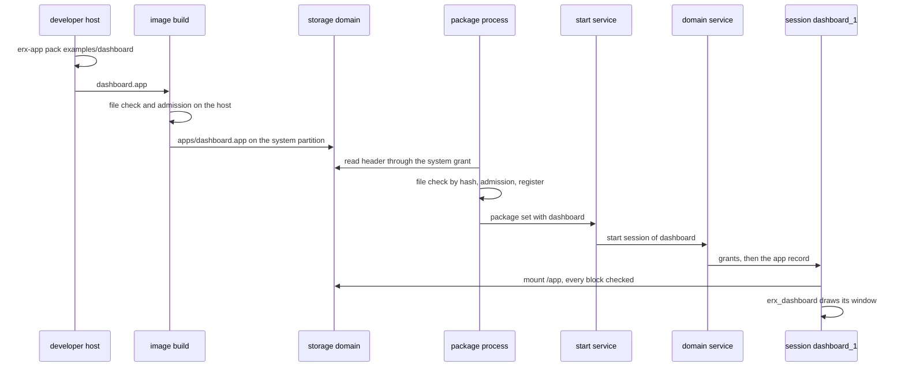

# Chapter 23. Apps and Packages

> **Status.** **Built:** the start table and `service`, with the
> settings in `/data/etc/rc.conf`. `erx-app pack`, which makes one
> signed `.app` file of a header, an EROFS image and its hash tree.
> The SDK and its public-function check. The image builder's packages:
> placed in the system partition, then checked, admitted and started
> at boot, as the kiosk QEMU suite shows. The decoder, file check,
> admission and recovery, with host tests. An app's session holding
> only the `packages` and `system` grants and the services its app
> names. `erx_ui_host`.
> **Designed:** installing, updating and removing through `/apps`,
> `mount` of a package, `service NAME purge`, `/proc/packages`, the
> app's budget as a wall carved at each session's start, the `flags`
> field, the SDK's host tools, `erx-app test`, and `/svc/NAME`.

**Background needed.** [Chapter 8](08-kernel-interface.md) (the
kernel interface), [chapter 11](11-security.md) (facets, file grants,
principals), [chapter 14](14-files.md) (namespaces and mounts),
[chapter 16](16-storage.md) (EROFS images and their hash trees), and
[chapter 22](22-display.md)
(windows and the widget toolkit).

A shop wants a screen by its door that shows the time and a few
prices. Someone writes the dashboard in Erlang, on a laptop, with no
copy of erXos's source tree, for a Raspberry Pi that someone else set
up. How does the dashboard reach that machine, and what may it do
there? The author should not have to edit the board's configuration
or rebuild the system. The machine's builder should not have to trust
the author: the dashboard must not read the shop's files or take
memory the system's own services were promised.

erXos makes an app a principal of its own. A package is one file,
`NAME.app`, that declares the app's name, its code and the services it
needs, beside a read-only image of its files that the reader checks
block by block. The board's manifest has one `apps` row that says
which services any app may ask for and how much memory all apps
share, and the build proves the machine can afford that row with every
app present. Admitting a package is then a subset test, and the app's
authority follows from its declaration with no rule of its own.

Section 23.1 shows the parts erXos already had and the one row that
bounds every app. Sections 23.2 and 23.3 describe the package and how
the machine judges it. Section 23.4 follows one package from the
packer to a running session, section 23.5 the designed path for
installing at run time, and section 23.6 the SDK. Failure and the
alternatives close the chapter.

> **Background: package managers and manifests.** A **package
> manager** installs, upgrades and removes software as units. Each
> unit carries a **manifest**: a small document that names the
> package, its version, the files it holds and what it depends on.
> Debian's `dpkg`, FreeBSD's `pkg` and macOS's installer all work this
> way. Two questions separate their designs. Where do the files go:
> unpacked into shared directories such as `/usr/local`, or kept
> together per package? And what does installing run: many formats
> carry scripts that run with full privileges during an install, so
> trusting a package's author means trusting them with the machine.
> erXos keeps each package as one file that is never unpacked, and an
> install runs nothing from it. To keep the two senses of "manifest"
> apart, this chapter calls a package's declaration by its file name,
> `app.txt`, and keeps "manifest" for the system manifest of chapter 7.

> **Background: declared permissions, as on a phone.** A phone runs
> apps from strangers, so it cannot give each one everything its user
> may do. Android gives each app a user id of its own, so the walls
> between users become the walls between apps. An app lists the
> permissions it wants in its manifest, such as the camera or the
> network, and the system grants each one at install or asks the user
> at run time (Android Open Source Project, "Application Sandbox";
> Android Developers, "Permissions on Android"). Two lessons carry over to erXos:
> one identity per app, and authority named in advance, in a list the
> system can check without running the app. erXos leaves out the
> prompt: no person approves a grant one at a time. The machine's
> builder decides once, in the `apps` row, what any app may have.

## 23.1 An app is a principal

An app needs nothing new from the system: it needs a way in. erXos
already has principals, session templates and facets (chapter 5,
section [5.1.7](05-overview.md#517-principal)). An **app** is code
that runs for no person, such as a kiosk's screen, a network daemon
or a developer's experiment, and it is a principal with a session
template ([design-apps.md, An app](../design-apps.md#an-app)).

### 23.1.1 An app of the manifest

The Raspberry Pi's manifest runs the time daemon this way: a principal
`ntpd` that pays for the app's sessions, a session template whose
release holds `ntpd`'s applications, and facet rows that grant the
template the network and the clock. Those rows are the app's whole authority. What
the system keeps apart per principal it keeps apart per app, with no
rule of its own: the app's directory, what its inspector facet shows,
its sessions' names (`ntpd_1`). This is built: `ntpd` runs so on the Raspberry Pi 4
(`config/manifest/raspi4b-development.txt`).

Such an app is part of the board: adding one means editing
the manifest, rebuilding the image and growing every sum the manifest
check makes. That is right for a service the board needs and wrong for
the shop's dashboard.

> **Background: how FreeBSD starts daemons.** Each daemon FreeBSD can
> start at boot has an **`rc.d` script**, a short shell script in
> `/etc/rc.d` (or `/usr/local/etc/rc.d` for one a package added) that
> knows how to start, stop and query it. Whether it runs at boot is a
> shell variable: `/etc/defaults/rc.conf` sets each daemon's defaults,
> such as `ntpd_enable="NO"`, and the machine's own `/etc/rc.conf`
> overrides them, `ntpd_enable="YES"`. The `service` command runs a
> script by name: `service ntpd start` starts the daemon now, but only
> if its variable says `YES`; `service ntpd onestart` starts it once
> whatever the variable says; and `service ntpd enable` writes the
> variable into `rc.conf` so that the next boot starts it.

### 23.1.2 What starts without a person

Something must start an app's session, since no one logs in as an
app. The **start table** is the one place that says which principals'
sessions exist without a person. Each row names a principal, whether
it is enabled, optionally a display it takes over, and a restart
intensity: more than `restarts` ends within `period` seconds leave
the row down ([design-apps.md, The start table](../design-apps.md#the-start-table)).
The table keys on a principal and on nothing about where the principal
came from, so a package's app joins it as `ntpd` does.

The table takes its surface from FreeBSD's `rc.d`. The manifest
declares each row and its defaults, the period spelled
`restart_period_s`. A file of shell-style assignments holds the
machine's own settings, `ntpd_enable="YES"`, and `service ntpd
enable`, `start`, `stop` and `onestart` act on the row. The file is
read, never run: a line that is not an assignment to a declared row is
skipped, so a local setting can enable or disable a declared row, or
change its display or intensity, and never add one. Because it runs
nothing, the design names the file `/etc/start.conf` rather than
`rc.conf`. The start service as built reads and writes it as
`/data/etc/rc.conf`, in the data partition's `etc/` directory
(`erlang/apps/erx_starter/src/erx_starter_rc.erl`).

Each kept row has an OTP supervisor of its own, `one_for_one` with the
row's intensity, whose one child is a **session keeper**, a process
that asks the domain service for a session and links to it
(`erlang/apps/erx_starter/src/erx_starter_row.erl`, where it is the
keeper; it is unrelated to chapter 14's keepers of stream files). When the session ends, the supervisor starts the
session keeper again, and one row's failure touches no other row. The
table and `service` are built; chapter
[20](20-shell.md#205-starting-services)
covers `service` as a command. The built `enable` also starts the row,
where the design has it start nothing until the next boot or the
row's own `start`.

### 23.1.3 One row bounds every app

How does a machine admit apps its builder never saw without giving up
what the build proved? With one row of the board's manifest. The
Raspberry Pi's reads:

```text
apps
  memory 69206016
  max 1
  services display net
```

It says that all apps together share 66 MiB, that one boot holds at
most one app, and that an app may ask for the display and the network,
nothing else ([design-packaging.md, The `apps` row](../design-packaging.md#the-apps-row)).
QEMU `virt`'s development manifest has a row with four apps and the
same two services (`config/manifest/qemu-virt-development.txt`). A board
that lets apps handle Bluetooth services adds `ble` to `services` and a
`gatt` line naming the services it offers; the Raspberry Pi 4's development
row is designed to offer `nus` alone.

From the row the build derives the **app template**, one session
template every app's sessions use. Its release boots the system's
`app` script, which holds what any session needs and `erx_app`, the
application that starts the app's code (section 23.3.3). The build
also derives one facet row
granted to the template for each service the row names, and two
read-only file grants every app holds: `packages`, the installed
packages, and `system`, the image's packages (chapter 16, section
[16.2.3](16-storage.md#1623-the-system-tree-and-every-reader-checks-for-itself)).

The manifest check of chapter 7
([section 7.7.1](07-one-source.md#771-the-check)) then counts the app
template as `max` principals in every per-principal sum, each holding
every service of the row. The row may never offer `start`, `apps`,
`etc` or `machine`, which would let an app command the start table,
install packages, rewrite the start settings or end the machine. So
the build proves, before any app exists, that the machine affords its
worst case, and whatever apps arrive, the board's own domains keep
what the build proved for them.

Part of this check is built: the build derives the template and its
rows, refuses the forbidden services, adds the row's memory once, and
counts `max` apps against the machine's domain limit
(`tools/lib/erx/manifest.rb`). Counting them in the principal table,
the atoms of session names and each server's connections, and the
enabled packages' budgets within the row's memory, is designed and
not built.

## 23.2 One file per app

What does an app author write? Three lines are a whole declaration,
and the packer makes one file of them and the app's code.

### 23.2.1 The declaration

The dashboard's `examples/dashboard/app.txt` reads:

```text
app dashboard
  needs display net
  applications erx_dashboard
  license "BSD-2-Clause"
```

The app is named `dashboard`; it wants the display and the network;
its code is the OTP application `erx_dashboard`. A native app names a
program in place of applications, such as the SDK's test fixture
`test/fixtures/sdk_hello/app.txt`, whose code is `program "bin/hello"`.
Every other field has a default, as Table 23.1 shows
([design-packaging.md, The declaration](../design-packaging.md#the-declaration)).

| Field | Says | Default |
| --- | --- | --- |
| `app NAME` | the app's name, which is its principal's | required |
| `applications` | the OTP applications to start | one of these two |
| `program` | a path under `bin/` and its arguments | one of these two |
| `needs` | services of the `apps` row it takes | none |
| `gatt` | the GATT services it handles through its own `ble` grant | none |
| `memory` | what its session's own budget holds | 64 MiB, at least 4 MiB |
| `version` | a number the inspector shows | 1 |
| `license` | an SPDX license expression | none |

*Table 23.1. The fields of `app.txt`.*

The design adds one more field, `flags`, the default start flags of
the app's start row; it is designed and not built, and the packer
refuses it as an unknown field. The `gatt` field in Table 23.1 is
designed too: an app that handles a phone's serial line names the
Bluetooth services it handles, the `apps` row's own `gatt` field lists
the ones the board offers, and install refuses a name the row does not
offer or another app already holds. That, not `needs`, is how an app
takes `ble`: its sessions hold the Bluetooth grant narrowed to the
services its package names
([chapter 19, section 19.6](19-bluetooth.md#196-the-design-above-the-controller)).

What the table lacks is the point. A declaration names no facet
parameter, quota, CPU share, environment variable or grant, and there
is no field through which it could. An app cannot ask for "the
network, but with a larger queue" or "the display, full screen". The
illegal declaration is one the grammar cannot write, the construction
of [chapter 6](06-construction.md) applied to a file. The `version`
decides nothing: the inspector shows it, and no check compares it,
since a version an install refused to lower would hold nothing against
a storage domain that puts back an older file.

The packer parses `app.txt` on the developer's host and writes it into
the package's header as a packed record laid out by
`abi/formats/package.txt`. The machine never parses the text: it reads
the record through the reader generated from that file, which checks
every count, length and offset first, as chapter 7 describes
([section 7.2](07-one-source.md#72-the-abi-file)).

### 23.2.2 Three parts in one file

A package is one file, `NAME.app`, of three parts, each starting at a
4 KiB boundary, as Figure 23.1 shows
([design-packaging.md, The package](../design-packaging.md#the-package)).

```text
 offset 0                                       NAME.app
 +--------------------------------------------+
 | header (at most 64 KiB)                     |
 |   magic ERXPKG, format version, length      |
 |   ABI version, architecture                 |
 |   the packed declaration                    |
 |   image length, tree length                 |
 |   salt and root hash of the tree    --------+---- names the tree's root
 |   seal: signer's Ed25519 key, signature     |
 +--------------------------------------------+ 4 KiB boundary, zeros before it
 | EROFS image, 4 KiB blocks                   |
 |   lib/APP/ebin, lib/APP/priv                |
 |   bin/  (native programs)                   |
 |   share/ (data, read at /app/share)         |
 +--------------------------------------------+
 | dm-verity hash tree over the image's blocks |
 +--------------------------------------------+ end of file, exactly
```

*Figure 23.1. A package's layout. The header is the only part anyone
authenticates directly; it names the root of the hash tree, and the
tree vouches for every block of the image.*

The **image** is an uncompressed EROFS image, the read-only file
system of chapter 16, section
[16.2.1](16-storage.md#1621-erofs-and-its-tree). The **hash tree** is
the image's dm-verity tree, the same structure that protects the
system partition (section
[16.2.2](16-storage.md#1622-every-block-checked-before-it-is-parsed)).
The **header** holds the declaration, where the other two parts lie,
the tree's salt and root hash, and a **seal**: the signer's Ed25519
public key and a signature over every byte of the header before it.

A package holds no links: the packer writes none, and on a package
mount the reader answers a symbolic link with `enotsup`, so no path
beneath `/app` leads out of the package. Every entry carries a fixed
owner, mode and time, so the same inputs give the same bytes and
nothing of the developer's host leaks into the file.

Why one file and not a directory of files? A file
is copied, checked and replaced in one step, and its integrity rests
on one header. A directory's would rest on every file in it, and on
the storage domain's honesty about all of them.

### 23.2.3 The decoder and the file check

One function parses a package file's structure, whatever its origin:
the decoder, `erx_pkg_header:decode/2`. It takes the file's length and
its first bytes, at most 64 KiB, and checks, the first failure
answering: the length is at most 1 GiB; the header passes the
generated reader; the padding after it is zeros; and the image and
tree lie end to end, the tree as long as the image's block count
requires, the file ending exactly where the tree does. So no two parts
overlap and none reaches past the file.

The **file check**, `erx_pkg_header:check_file/2`, is the one entry
that judges a package file. It runs the decoder, checks that the file
is named for the app the header declares, and then authenticates the
header in one of two ways:

* **by hash**, for a package of the image: the header's SHA-256 must
  equal the one the image's manifest records in the package's
  `package` row. The seal is not read, so a builder can put a stranger's
  package into an image without the machine trusting the stranger's
  key. The app's signer is then `image`.
* **by signer**, for a package installed at run time: the seal's key
  must be one of the keys the boot image trusts, the manifest's
  `signer` rows and, in a development image, its builder's development
  key (section 23.6), and the signature valid.

Trust in signers changes only with a system update: the keys lie in
the boot image, and no record a storage domain could rewrite adds
one. The decoder and the file check are built, with a fuzz target over
the header (`test/erlang/erx_pkg_header_fuzz.erl`) and host tests of
short, long, oversized and misnamed files.

The file check never looks at the image, and the system domain never
mounts one: a package's image is parsed only in a session, the app's
own or that of a person who mounted it. The reason is the trusted base
of chapter 11
([section 11.2.2](11-security.md#1122-the-trusted-base)). A bug in
the EROFS reader, reached by a crafted image, ends the session that
read it. The system domain, whose fault resets the machine, reads at
most 64 KiB of fixed layout through a generated reader.

## 23.3 Admission

The file check says a package is well formed and that someone the
machine trusts made it. It does not say the app may run. That is
admission's question: does what the app declares fit the `apps` row?

### 23.3.1 A subset test

`erx_app_admit:admit/4` is a pure function of the file check's answer,
the manifest, the boot's registry of app principals and the GATT
services the apps admitted before it hold
([design-packaging.md, Admission](../design-packaging.md#admission)).
It answers with the facet rows the app keeps, or with the first of
these questions that fails, as an error naming it:

1. Does the manifest have an `apps` row?
2. Are the header's ABI version and architecture the image's?
3. Is the name a valid app name that nothing else takes: not `root`,
   not a principal, configured domain, service or facet row of the
   manifest, and, for an installed package, not a package of the
   image?
4. Does a name the registry holds keep its signer, and does a new name
   find a free entry among the `max`?
5. Is the memory a whole number of pages, at least 4 MiB and at most
   the `apps` row's?
6. Is each need a service of the `apps` row other than `ble`, which
   only the declaration's `gatt` takes?
7. Is each GATT service the declaration names one the row's `gatt`
   offers?
8. Is none of them held by another app's admitted package? The
   app's own is left out, so an update keeps its services.

Follow the dashboard through it on the Raspberry Pi. Its header was
built against the image's ABI for the same architecture. Its name,
`dashboard`, names nothing in the manifest. The registry is empty, so
it takes the one entry. It declares no memory, so it takes 64 MiB,
which fits within the row's 66 MiB. It needs `display` and `net`, both
of the row. Admission keeps the `packages` and `system` rows and the
two it needs, and records the signer, `image`.

Suppose the author adds `data` to `needs`, hoping for a directory
on the data partition. Question 6 fails with `{not_offered, data}`, since
the Pi's row does not offer it, and the app never starts. Nothing else
needs judging. A declaration can only name what the row offers, so
the build's proof over the row is the proof over every app it admits.

Admission does not ask whether the app's memory fits beside the other
apps that run. Which apps run at once depends on what is enabled and
started, not on what is installed, so that question belongs to the
moment a session starts, when the domain library carves its budget or
refuses with `no_memory` (chapter 12, section
[12.1.1](12-memory.md#1211-a-budget-is-an-account)).

The packer runs the same file check and admission on the host under
stock OTP, so the build and the machine cannot disagree. Admission is
built, with host tests
(`test/erlang/erx_app_admit_tests.erl`). One rule of the design is
not built: the start settings' variable for an app's name, such as
`my_app_enable` for `my-app`, must be one no other row uses.

### 23.3.2 The app's principal

Once a package is admitted and committed, the package process
registers the app as a principal, `erx_principal:register_app/1`, in
one of the `max` entries the domain library keeps for apps. The record
holds the app's name, its signer, its declared memory and the rows
admission kept. An app's principal has no credentials, so no one logs
in as one and no login starts its sessions: the start table's session
keepers are its only starters.

An app's principal is never unregistered within a boot: a removed
app's entry keeps its name until the machine reboots. So however many
packages come and go, the system domain's atoms and tables stay within
the `max` entries the build counted.

In the design, the app's budget is a wall, a budget whose cap is its
guarantee (chapter 12), carved from the `apps` budget as each of its
sessions starts and destroyed once the session has retired. Memory is
held only while the app runs, and once a session runs its memory
depends on nothing outside it
([design-packaging.md, An app's principal](../design-packaging.md#an-apps-principal)).
As built, the domain library makes one budget for each app entry at
boot, below the `apps` budget, with no guarantee of its own
(`liberx/system/dom_boot.c`); chapter 12 describes how far budget
records refuse anything on Fiasco
([section 12.1.1](12-memory.md#1211-a-budget-is-an-account)). The
wall carved at each start is designed and not built.

### 23.3.3 The app's session

The domain service makes an app's session as it makes any session,
from the app template, under the app's principal, named from the app's
own pool: `dashboard_1`. Its facets are the template's `packages` and
`system` grants and the rows admission kept, and no other, each
minted for the app's principal: an app that names only `display`
holds no `net`. The build's proof still counts every app as holding
every service of the row, so the subset only narrows what the proof
allows. This is built: the session's plan, `erx_domain_core:app_session/4`,
keeps only the kept rows, and its host tests
(`test/erlang/erx_app_session_tests.erl`) catch seeded faults such as
a plan that grants every row of the template. Two things around it are open: the pixel area of an app
session's display connections is still sized for the template, and
the domain service's own test of an app session's start is written
and not yet run.

Once the session's grants have settled, the domain service sends it
the **app's record**: where the package lies, the image's layout and
root hash from the file check, and the applications or program to
start. `erx_app`, started by the template, waits for that record and
then mounts the image:

```erlang
erx_ns:mount({erofs, app}, "/app", [rx])
```

The call names no file, root hash or layout: the namespace's process
takes all three from the record, which the domain service filled only
from a header the file check accepted, so nothing the session's code
passes chooses what `/app` holds. Every block is checked against that
root hash before it is parsed, in the session's own memory, so a
changed byte causes a read error, never a different program
([design-packaging.md, An app's session](../design-packaging.md#an-apps-session)).

For an Erlang app, `erx_app` puts each `/app/lib/*/ebin` at the end of
the code path and starts the declared applications, permanent, so the
end of one ends the session and the start row's session keeper
starts it again. The app's paths come after the release's, so a module that
shares a name with one of the system's is never the one loaded: a
clash breaks only the app that brought it. For a native app, `erx_app`
starts the program from `/app/bin` through the program handler of
chapter 13
([section 13.2.2](13-native-programs.md#1322-the-handler)), with a
window on the session's default display if it has one, so the program
draws through `/dev/draw` and reads `/dev/kbd`. The program's end ends
the session. Both paths are built in `erlang/apps/erx_app/src/erx_app.erl`
and tested on the host; a QEMU suite runs the Erlang path.

## 23.4 From the packer to the screen

The pieces meet in one trace, which the kiosk QEMU suite runs
(`tools/lib/erx/kiosk.rb`). Figure 23.2 shows it.



*Figure 23.2. From `erx-app pack` to a running app's session.*

1. **Packing.** `erx-app pack examples/dashboard` compiles the
   sources with stock OTP's `erlc` against the SDK's public
   applications, writes the image, its hash tree and the header, signs
   it, and runs the file check on what it wrote.
2. **Adding to an image.** `tools/erx pack --app examples/dashboard
   --enable dashboard` checks the package against the board's `apps`
   row on the host, writes it to `apps/dashboard.app` of the slot's
   system partition, and adds an enabled `package` row binding the
   header's SHA-256. The package lies outside the boot image, which
   stays in memory for the whole boot, and is read on demand.
3. **At boot.** The storage domain serves the partition's `apps/` as
   the `system` tree. The package process, `erx_pkg`, reads the header
   through its `system` grant, runs the file check by hash and
   admission, registers the principal and logs `packages: admitted
   dashboard`. It hands the start service the package set, and the
   enabled row's session keeper asks for a session.
4. **The session.** The domain service starts `dashboard_1` and sends
   the record. `erx_app` logs `erx_app: mounted /app` and starts
   `erx_dashboard`, which opens its window through `erx_ui`.
5. **The screen.** The suite reads the screen through QEMU and
   compares it with the dashboard as the host's renderer draws it.

The suite's seeded fault flips one bit of the header's root hash and
binds the `package` row to the altered header, so admission takes it
as genuine. The `/app` mount then refuses the first block and the
dashboard never shows. That is the chapter's central property, checked
on a guest: the bytes a session runs are the bytes its header names.
All of this is built, and the same package, sealed by the published
package key, is the kiosk on the Raspberry Pi 4's card.

## 23.5 Installing, updating and removing

The image builder's path needs a new image for every new app. A shop
that wants a second app should copy a file. That path is designed and
not built: the `apps` tree that would serve `/apps` is not built, so
`/apps` is a mount point with nothing behind it. The package process's
recovery, its single executor of file operations and the publication
of the package set that it relies on are built, with host tests.

### 23.5.1 A package is a file

In the design, `/apps` holds every app as a plain file, `NAME.app`,
the package itself, so `cp`, `rm`, `ls` and `cat` treat it as any
file ([design-packaging.md, /apps](../design-packaging.md#apps)):

```text
cp clock.app /apps/          install it
service clock enable         start it at every boot
service clock start          start it now
cp clock.app /apps/          update it
service clock restart        run the new version
mount /apps/clock.app /mnt   look inside it, read-only
rm /apps/clock.app           remove it; its data stays
service clock purge          remove its data as well
```

Where FreeBSD has `pkg add`, `pkg delete` and `pkg info`, erXos has
`cp`, `rm` and `ls` on `/apps`. An install starts no service. The image's
packages appear in `/apps` too, read-only: a copy over one answers
`EROFS`, so an installed app never takes an image app's name. A
package stays one file, so `ls /apps` is the list of installed
software and no database beside it can disagree.

### 23.5.2 One copy, end to end

`cp clock.app /apps/` reaches the `apps` tree, which the system
domain serves, as a truncating create of `clock.app`
([design-packaging.md, Installing, updating and removing](../design-packaging.md#installing-updating-and-removing)):

1. The tree opens a fresh temporary file in the data partition's
   `packages/new/`, and `cp` writes the bytes into it. The file has no
   name in `/apps`, so no other open can write it, and no app's grant
   reaches `new/`, so no app runs a byte the file check has not
   accepted.
2. When `cp` closes the file, the close waits while the package
   process runs the file check by signer and admission and makes the
   file durable, so the bytes checked are the bytes published.
3. If the name already holds an admitted package, the package process
   publishes a package set without the app, and the start service
   answers only once every session of the app has ended.
4. It renames `new/tmp.K` to `installed/clock.app`, over the old
   package if there is one, in one atomic rename, makes the directory
   durable, and publishes a set with the app. Only then does `cp`
   succeed.

The rename is the one commit point: a power cut at any step leaves the
name holding the old package or the new one, whole, or none for a new
install. The old package runs until the new one has passed every
check; then the app stays stopped until `service clock restart` or the
next boot, since publishing applies nothing of the start settings.
The old session ends before the rename because it reads its code
through an open of its package: a session keeper that restarted it
across the rename would start the old layout over the new bytes.

A removal publishes a set without the app and then deletes the file.
The app's data stays; `service NAME purge` removes it on purpose.

### 23.5.3 Whose data is it?

An app's files lie in the data partition under `apps/NAME/SIGNER/`:
the app's name and its signer together, `image` for a package of the
image and otherwise a prefix of the hash of the signer's key
([design-packaging.md, Where an app's files lie](../design-packaging.md#where-an-apps-files-lie)).
A package of the same name signed by another key finds an empty
directory of its own: to the machine it is another app. No record keeps the signer beside the data: the path
makes the separation. That apps get such a directory is
designed and not built: the storage service cannot yet root a grant
there, so the build refuses a files service on the `apps` row, and
apps hold no files grant but the two read-only package grants.

### 23.5.4 The package lifetime

What if the package process crashes halfway through an install? A
**lifetime** is one run of the package process. Its file operations
on `packages` all pass through one process, `erx_pkg_io`, and its
package sets through the start service; each request names its
lifetime, and both refuse a request whose lifetime has ended. So
nothing a crashed run asked for can still land after it, and the next
run starts with a **recovery**: it judges the image's packages again,
deletes every temporary file in `new/`, judges each installed package
again, and publishes the set of those admitted.

Say the process crashes after step 2 of section 23.5.2: `new/tmp.K` is
durable, and the old `clock.app` is still installed and running. The
recovery deletes `tmp.K`, admits the old package and publishes a set
holding it, so the old version runs on as if the copy had never
begun. A failed rename or deletion ends the
lifetime on purpose, so the recovery reconciles what the failure
left.

`erx_pkg_io` itself is never restarted, since a restarted one could
not know whether a request of its predecessor was still on its way to
the storage domain; its end resets the machine, on purpose. `erx_pkg`
has a supervisor of its own, `erx_pkg_sup`, which restarts it within
its intensity and past it leaves it down, while the start service runs
on with the last set it was given. On a trial boot of an update (chapter 16,
section [16.6.3](16-storage.md#1663-a-trial-writes-nothing-but-the-record))
the recovery writes nothing, and every install, removal and purge
answers `erofs`. The lifetime, its takers and the recovery are built
with host tests; the trial boot is designed.

## 23.6 The SDK

An app author needs a way to build against erXos without its tree, and
to test the app without a board. `tools/erx sdk export DIR` writes the
SDK from a built tree ([design-packaging.md, The SDK](../design-packaging.md#the-sdk)):

| Part | Holds |
| --- | --- |
| `SDK.txt` | the erXos commit, ABI version, architecture, OTP release |
| `sysroot/` | musl's headers and `libc.a`, the program layer, the draw protocol's header |
| `share/erxos/sdk.mk` | the compiler flags and link line erXos's own programs use |
| `erlang/` | the public Erlang applications and `public.txt` |
| `host/erlang/ebin` | the modules the packer's file check calls under stock OTP |

*Table 23.2. What the built SDK export writes (`tools/lib/erx/sdk.rb`).*

The design adds the host tools to the SDK, `erx-app`, `fsimg` and
`erx-lvgl` built for the host, with `erx_ui_host`; that part is
designed and not built, and the tree's own tests take them from the
tree.

**What is public.** For a native program: the POSIX-lite personality
of chapter 13 ([section 13.7](13-native-programs.md#137-the-posix-lite-personality)),
`main` and its standard descriptors, and `/dev/draw` with its
protocol, `/dev/kbd`, `/dev/mouse` and `/dev/wctl`. For Erlang: the
widget toolkit's `erx_ui:open/1`, `tree/2` and `close/1` with the
widget schema, `erx_win` and `erx_draw` for an app that draws itself,
`erx_prog_handler:start/1`, and stock OTP. Not public: `liberx`'s
kernel calls, every other `erx_*` function, the boot image and the
manifest. `public.txt` lists the public functions, and a check refuses
an example whose calls into erXos leave that list
(`test/erlang/erx_sdk_boundary.erl`). An app asks for the LVGL
renderer with `erx_ui:open(#{renderer => lvgl})`, and `erx-lvgl`, the
program that renders it, ships in every image whose release holds
the toolkit. An app that wants another renderer ships its own program
and draws pixels itself; nothing of the display domain's own drawing
is offered to apps (chapter
[22](22-display.md#224-lvgl-inside-apps)).

The header's ABI version covers the native side (the kernel
interface, the C library seam, the draw protocol and the package
format), and admission refuses a mismatch. It does not cover the
Erlang calls: a package built against an SDK whose calls have changed
is admitted, its session ends with the reason, such as `undef`, and
its row goes down within its intensity.

**Testing on the host.** `erx_ui_host` stands in for a display under
stock OTP: while it runs, `erx_ui:open/1` opens its window there,
`erx_ui_host:frame/1` answers the last frame's pixels and
`erx_ui_host:input/2` delivers a key or pointer event. The widget
server, schema and renderer are those a session runs; only the window
is a buffer in memory, so a frame drawn on the host is the frame drawn
on the board. The dashboard's host test compares its frame with a
reference picture (`test/display/reference/dashboard.ppm.gz`).
`erx_ui_host` is built, in the tree's `sdk/`. `erx-app test DIR`, which runs an app's EUnit and Common Test
suites with the SDK on the path, is designed and not built.

**The development package key.** No private key enters an SDK. The
packer makes its own Ed25519 key the first time it signs without
`--key`, one per user and host, in `~/.erxos/package-key/`, and a
development image trusts the public half of its builder's key, so a
third party's packages are trusted only by images that party builds.
Every package is signed: signing costs a developer nothing, and one
mode keeps the header and the file check simple.

**The examples.** `examples/` holds app directories that are not part
of erXos: no release, application list or test list of the system
names them. `examples/dashboard`, the kiosk, is packed through the SDK
as a third party would pack it: the landing gate compiles and packs
it against an SDK exported from the tree and runs its host tests
([design-packaging.md, Examples](../design-packaging.md#examples)).
Doom, the other example, is not a package: the Raspberry Pi 4's card
and the published QEMU image carry it as `/bin/doom`, a program of the
system's release that root's shell starts. The SDK's native path is checked instead by
`test/fixtures/sdk_hello`, a program built with the SDK alone, packed,
and planned as the loader plans it (`test/host/sdk_test.rb`).

## 23.7 What fails, and what it reaches

| Failure | What happens | Who sees it |
| --- | --- | --- |
| a malformed or oversized package | the decoder refuses it; nothing is admitted | the log names the reason |
| a package the machine does not trust | the file check refuses it | the copy's close fails, in the design |
| a need the row does not offer | admission refuses the package | the log; the app never starts |
| a changed block of an image | the reader refuses the block; a refused `/app` mount ends the session | the session's death record |
| the app's code crashes | its session ends; the row's supervisor starts it again | `/proc/apps` |
| too many ends in the period | the row is down until `service NAME start` | `/proc/apps` shows `down` |
| `erx_pkg` crashes | it restarts and recovers; past its intensity it stays down and the last set keeps running | the log |
| `erx_pkg_io` ends | the system domain ends and the machine resets | the crash record |
| a power cut during an install | the name holds the old package, the new one, or none, whole | the next boot's recovery |

*Table 23.3. Failures of the package path.*

A changed block, whether the storage domain's doing or the medium's,
costs only a read error in the session that met it: the storage domain
can withhold a package, or put back an older one from the same signer,
but never change one.

The system as built runs only trusted code (chapter 11, section
[11.13](11-security.md#1113-trusted-code-only-and-what-a-hostile-app-can-do)),
and that section's list of what a hostile app could do applies to an
app's session as to any domain's. An app's memory is held by budget
records, not by a wall.

## 23.8 Design choices

**One row, not rows per app.** Each package could bring a principal,
template and facet rows of its own into the manifest, with the sums
grown to match. That grows the board's proof with each app and makes
a second path beside run-time install. The `apps` row makes one path,
which the build proves once.

**Packages on the slot, not in the boot image.** The boot image stays
in memory for the whole boot, so a package inside it would hold its
whole size of memory, data files included, from power-on to shutdown.
On the system partition, packages are read on demand and still change
only with a system update.

**An image under a hash tree, not files unpacked.** Unpacked files
would rest on the storage domain's honesty. A read-only image checked
by its reader rests on the header alone.

**Signers in the boot image.** Trusting a signer on first install, or
adding one at run time, would put the list of trusted keys where the
storage domain can rewrite it.

**Data kept on removal; purge on purpose.** Removing the data with the
package would destroy what the app wrote, and a removal of two things
needs a durable marker and a recovery to finish it. A purge is a
separate act through `remove_app`, a storage request that reaches only
the app directories.

**No parameters in the declaration.** Letting an app choose facet
parameters within the row's bounds saves the machine nothing, since
the build counts every row at its defaults, and adds a rule per
parameter to admission.

**No release in the package.** A package that carried an OTP release
with its own boot script would pin the versions of every application
in it, so every system update would break every package. `erx_app`
starts the app's applications over the system's `app` release.

## Summary

An app is a principal with a session template, so the system keeps
apps apart with the rules it already has for principals. One `apps`
row names the services any app may take and the memory all apps
share, and the build proves the machine affords it with every app
present and holding all it could. A package is one file: a header
whose declaration has no field for a parameter or a grant, an EROFS
image, and the image's hash tree. The system domain reads only the
header; only a session reads the image, checking every block against
the root hash the header names. Admission is a pure subset test, the
same code on the build host and the machine. The image builder's
packages work end to end, and a changed image is refused at its
mount. Installing by `cp`, updating by copying over and removing by
`rm` are designed, with one atomic rename as the commit point and no
session running across it.

## Where to read next

* [design-apps.md](../design-apps.md): the start table, keepers,
  `service` and how a command is judged.
* [design-packaging.md](../design-packaging.md): the `apps` row,
  the package format, admission, `/apps`, the lifetime and recovery,
  the SDK, and every invariant with its test.
* [design-app-trees.md](../design-app-trees.md): an app's own tree at
  `/svc/NAME`, described in chapter 14, section
  [14.5.2](14-files.md#1452-an-apps-own-tree-svcname).
* [design-storage.md, Reading EROFS images](../design-storage.md#reading-erofs-images):
  the reader and the hash check every package mount goes through.
* [examples/dashboard/README.md](../../examples/dashboard/README.md):
  the kiosk app, its host test and its QEMU cells.
* FreeBSD Project, rc(8), rc.conf(5) and service(8) manual pages: the
  start settings the start table's surface follows.
