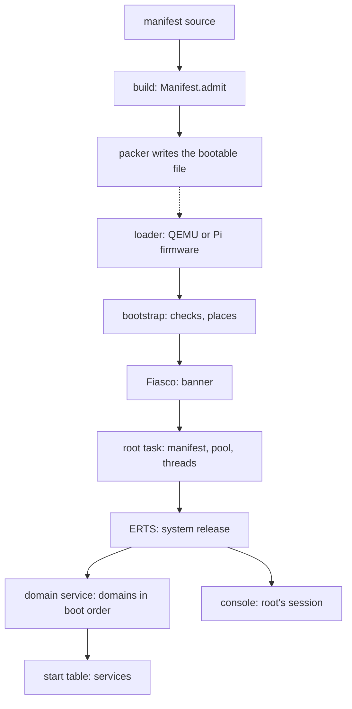
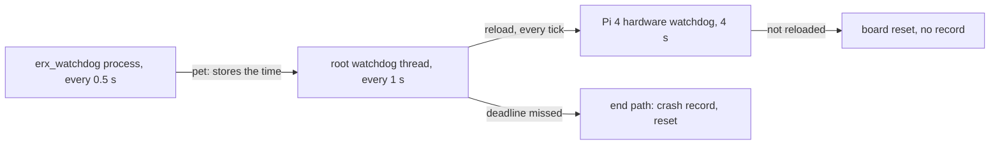

# Chapter 24. Startup, Configuration and Shutdown

> **Status.** **Built:** booting on QEMU `virt` (1 to 8 CPUs, under
> HVF and TCG) and on the Raspberry Pi 4 (QEMU's `raspi4b` model and a
> real 4 GB board); the bootable file in both forms, with every check
> on the boot image made before a byte moves; the root task's first
> steps and ERTS booting the system release; the domain service
> starting the manifest's domains in boot order and restarting them
> within their intensity; root's automatic session at the console in
> a development build; the root service's watchdog, petted by
> `erx_watchdog`, and on the Pi 4 the code that arms the board's
> hardware watchdog; one end path with a crash record on the console;
> `reboot` and `halt`; seeding from the Pi 4's hardware random
> generator; reproducible images.
> **Designed:** a typed login at the console; the manifest's partial
> boot; a watchdog pet that waits on the services' answers; the
> ordered end's deadline, the vault's quiesce and the storage freeze;
> the reset count and the rescue configuration; the trial request; a
> release that refuses to boot on a weak seed; signed slots; the
> Raspberry Pi 5.

**Background needed.** [Chapter 1](01-operating-systems.md#18-from-power-on-to-the-first-program)
(booting), [chapter 2](02-microkernels.md#253-the-root-task) (the root
task), [chapter 7](07-one-source.md#77-the-system-manifest-the-machines-configuration-checked)
(the system manifest and its check), [chapter 8](08-kernel-interface.md)
(Fiasco and the root service), [chapter 15](15-devices.md#1521-units-and-holders)
(units and holders) and [chapter 16](16-storage.md#166-updates-through-two-slots)
(slots and trials).

A loose SD card cuts short the write of a new image. A mistaken edit
gives the storage domain the network card. A third machine's storage
domain hangs every time it starts. The first machine must not run
half a kernel, the second must not boot at all, and the third must
boot everything else and say which part is stuck. A machine told to
`reboot` must go down in order; one that hangs with nobody there must
come back by itself.

A UNIX system spreads this over many programs, a loader, `init`, rc
scripts and a watchdog daemon, each reading its own configuration at
its own moment, so none can say before boot whether the whole is
consistent.

erXos boots one file that carries everything the machine starts with,
checked by hash before anything in it runs. One system manifest,
proved at build time, says which domains start, in which order, with
which devices, and the system domain reads nothing else. A watchdog
in the root service resets the machine when the system domain's
runtime stops answering. Every end of the machine, asked for or not,
goes through one end path that says why.

Sections 24.1 to 24.3 follow a boot from the file the loader reads to
the console's prompt. Section 24.4 compares the two platforms. The
rest go down again: the watchdog (24.5), the machine's end (24.6) and
what the boot can and cannot trust (24.7).

> **Background: what stays behind after boot.** On an Arm board, not
> everything that runs before the kernel goes away. AArch64 has four
> privilege levels, the exception levels
> ([chapter 1](01-operating-systems.md#18-from-power-on-to-the-first-program)):
> EL0 for user mode, EL1 for the kernel, EL2 for a hypervisor and EL3
> for **secure firmware**, the most privileged code on the chip. Arm's
> reference firmware, Trusted Firmware-A (TF-A), leaves a small
> program called BL31 at EL3 for the machine's whole life. The kernel
> asks it to start a CPU, reset the board or power it off through
> **PSCI**, the Power State Coordination Interface: a call into EL3
> with a function number in a register. So resetting the machine is a
> request to firmware, not a register the kernel writes.

## 24.1 The bootable file and the boot image

If one byte of the kernel in the boot image is wrong, the machine
stops before Fiasco prints its first line, and says which check
refused it.

> **Background: initial images.** A kernel needs files before it has
> a file system: its modules, the first program, its configuration.
> Linux receives an **initial RAM disk** (an `initrd`), an archive the
> boot loader places in memory beside the kernel, passing on its
> address. FreeBSD's `loader` reads modules from the root file system
> and hands their addresses to the kernel. In both, the kernel gets
> whatever the loader found; checking it is the kernel's problem, or
> nobody's.

### 24.1.1 One file with the archive inside

An erXos machine boots one **bootable file**
([chapter 5](05-overview.md#531-power-on-to-the-first-erlang-process)
introduced it). It starts with the **first stage**, the code the
loader enters, which is Fiasco's `bootstrap`. On the next page
boundary comes the **boot image**, an archive of every file the
machine starts with. It holds Fiasco's kernel, `sigma0` (Fiasco's
first memory server), the root task, ERTS, the system manifest, and
the Erlang releases of the system domain and the configured domains
([design-kernel.md, The bootable file](../design-kernel.md#the-bootable-file)).

How does `bootstrap` find an archive the loader does not know about?
The packer, `tools/erx pack`, writes exactly two things into the first
stage's bytes. One is the image size in the boot protocol's header,
set to the whole file's length, so a loader that honors it keeps the
archive clear of everything it places. The other is the **boot
locator**, 32 bytes at a fixed offset: a magic word, a version, and
the archive's offset and size within the file. `erx_boot_locate`, a
pure function in `kernel/core/pack.c`, reads the locator and decides
where the archive is. A bad magic or version stops the boot, and so
does an archive inside the first stage's own code or data, or past
the size the header declares. If the loader also passed an initrd,
the boot stops with `two_boot_images`, so the machine never boots an
archive other than the one it was packed with.

For debugging under QEMU there is also a **two-file form**: the first
stage as built, given to `-kernel`, and the same archive as `-initrd`.
Both forms are built; the `boot_image` QEMU suite boots the one-file
form at 1 and 4 CPUs and the two-file form at 1
(`tools/lib/erx/qemu_suites/boot_image.rb`).

### 24.1.2 The archive's layout

The archive is erXos's own format, `ERXPACK` version 2, laid out as in
Figure 24.1 ([design-kernel.md, The boot image](../design-kernel.md#the-boot-image)).

```text
offset 0      +----------------------------+  -.
              | header, 96 bytes           |   |
              |  magic, version, flags     |   |
              |  total size (whole pages)  |   |  index run:
              |  root_entry, build id      |   |  hashed into
              |  index_hash                |   |  index_hash
              +----------------------------+   |
              | entry table, 64 bytes each |   |
              |  path, kind, marks, offset |   |
              |  size, file-run hash       |   |
              +----------------------------+   |
              | string table (paths)       |   |
              | zeros to a page boundary   |   |
page boundary +----------------------------+  -'
              | boot/kernel                |  file run: hashed
              | zeros to a page boundary   |  into its entry
              +----------------------------+
              | boot/sigma0  ...           |
              +----------------------------+
              | ... the manifest, ERTS,    |
              | the releases, one file per |
              | run of whole pages         |
              +----------------------------+
```

*Figure 24.1. The boot image's layout. Every byte belongs to exactly
one run, so the header's one hash commits to the whole archive: to
the index run directly, and to each file run through the hash its
entry records.*

Each file starts on a page of its own, so a run of files can be
mapped into a domain as whole pages, with no copy and nothing of a
neighbor visible.

The hashing has two levels. Each entry records the BLAKE3 hash of its
**file run**: the file and the zeros up to the next page. The header
records the hash of the **index run**, the header, entries and paths,
computed with the hash field itself read as zeros. Since the entries
hold the files' hashes, the header's **index hash** commits to every
byte of the archive. It is the image's one identity: Fiasco's banner
prints it, and the host tool compares it with the image it packed.
The format version names the hash algorithm, so a new algorithm is a
new version.

The manifest is packed among the files of the system release, which
only the system domain slices, so no other domain can read the
machine's configuration
([design-system.md, The manifest](../design-system.md#the-manifest)).

### 24.1.3 Checked before a byte moves

None of `bootstrap`'s inherited code reads an executable or a
module. `startup()` calls
`erx_image_load` in `fiasco/bootstrap/server/src/erx_image.cc`, which
applies one pure plan, `erx_boot_load_plan` in
`kernel/core/boot_place.c`
([design-fiasco.md, Boot handoff](../design-fiasco.md#boot-handoff)).
The plan checks the index hash, finds the kernel, `sigma0` and the
root task at the paths the ABI file names, checks each file's hash and
reads each executable's headers. Then it decides where each image
goes. The root task runs at the physical addresses it is linked at.
If it would land on the archive, the plan moves the archive, whole,
behind it.

Every check and every reservation of memory comes before any byte is
copied, so a refusal prints one line and stops with nothing moved.
Here is one, traced. The `boot_image` suite flips one byte inside the
kernel's file in a copy of the bootable file, and boots the copy:

1. QEMU loads the file and enters `bootstrap`.
2. The locator is untouched, so the archive is where it says. The
   index hash matches too, since the flipped byte lies in a file run,
   which the index run covers only through the hash its entry records.
3. The kernel's entry is found. The hash of its file run differs from
   the hash the entry records.
4. `bootstrap` prints `erXos image: boot/kernel: file_hash` and stops.
   Fiasco never runs.

The suite's other damages, from a bad locator to a version 3 header
with its hash recomputed, must each stop the boot with its own reason
before the kernel prints a line (`tools/lib/erx/boot_image_check.rb`).
All of this is built.

These hashes give integrity, not authenticity. They catch a
damaged card, a write cut short and a loader that placed too little.
They do not catch someone who changed the image on purpose, since
whoever can write the medium can write matching hashes. Section 24.7
says where authenticity comes from.

## 24.2 From Fiasco to ERTS

Between Fiasco's first line and the first Erlang process, one thread
runs alone: the root task's first thread, which holds every
capability in the system.

### 24.2.1 What Fiasco hands over

Before it starts the kernel, `bootstrap` writes a **handoff record**
into a page reserved read-only for the root task. It holds the
archive's address and size, the index hash, and the kernel command
line from the device tree's `/chosen/bootargs`. It also holds the
console's device-tree path from `/chosen/stdout-path`, the boot
value with its slot, which say what the firmware booted and from
which slot
([chapter 16](16-storage.md#1662-the-slot-writer-decides-from-facts-it-reads)),
and the boot CPU's identification registers, which user mode cannot
read. Its layout comes from the ABI file
([chapter 7](07-one-source.md#72-the-abi-file)).

One of Fiasco's few changes for erXos,
`fiasco/kernel/src/erx/erx_handoff.cpp`, accepts the record and prints
the banner. A development build's banner reads, in part:

```text
development build: trusted code only
erx: boot image build <8 bytes> index <32 bytes> flags 0x.. archive ...
erx: boot value unknown slot none
```

Then Fiasco starts `sigma0` and the root task, with capabilities to
its own task, a factory, its pager and Fiasco's platform control
object, among others
([chapter 8](08-kernel-interface.md#83-the-root-service-who-holds-what)).

A kernel panic stops every CPU, prints a crash record and resets the
machine through PSCI; in a development boot that asked for it, the
stopped kernel first holds, so that the host's debugger can read its
memory ([chapter 21](21-live-machine.md#2154-reading-a-stopped-machine)).
That stop is **Built** in part, without the hold: every kernel, development
or release, stops its CPUs, prints the reason and the crash record, and
resets. No kernel carries JDB, Fiasco's kernel debugger, in which a panic
would wait for the operator.

### 24.2.2 The root task's first steps

Fiasco gives the root task one thread and no stack. Until the root
service starts, that thread does everything itself, in this order
([design-fiasco.md, Boot handoff](../design-fiasco.md#boot-handoff)):

1. It sets its stack inside its own image, and maps its image and the
   archive through page faults that `sigma0` answers, the archive
   read and execute, never write.
2. It reads the handoff record and checks it, the device tree's range
   among the rest.
3. It finds the manifest in the archive, checks its file hash, and
   reads it through the reader generated from `abi/manifest.txt`,
   which allocates nothing. It reads the kernel command line, and
   accepts the device tree.
4. It builds the pool of contiguous memory the manifest's devices
   need. If the pool and its image hold less than the manifest's
   `root_memory`, it refuses the boot.
5. It seeds its random generator (section 24.7.2) and prints where the
   seed came from, makes its object tables, and creates the root
   service's thread and the watchdog's thread (section 24.5).
6. It starts both threads. From here on, the root service alone
   touches the root's tables.
7. It checks that the manifest's `console` names the device that the
   firmware's `stdout-path` names, and otherwise refuses the boot with
   both paths.
8. It fills the system domain's boot information page
   ([chapter 8](08-kernel-interface.md#834-one-request-end-to-end-a-domains-crash-area))
   and enters musl's start path, whose `main` calls ERTS.

A failure in steps 1 to 5, or at the console check, prints its reason
on the console and ends the machine, with no crash record, since
nothing has run yet to record. The whole sequence is built.

The console check exists because the firmware chooses a UART too: on
the Raspberry Pi 4 the firmware, BL31 and the device tree each have a
say in which UART is `serial0`
([design-platforms.md, Raspberry Pi 4 Model B](../design-platforms.md#raspberry-pi-4-model-b)).
Without it, a disagreement would look like a silent hang.

### 24.2.3 ERTS boots the system release

ERTS reads its boot information page, not the manifest. The page
carries its budget, its runtime group, the slice of the archive that
holds its release, and the arguments of the manifest's `system_args`.
In the QEMU development manifest they include
`-boot /bin/start -user erx_console`: boot the system release's boot
script, with `erx_console` as the console. From there ERTS boots as
any OTP system does. `init` reads the boot script, loads the modules
and starts each application of the release in order
([chapter 3](03-erlang.md#343-supervisor-application-and-release)).

The system release starts the system services, from the domain
service and the device service to the console and the watchdog
process
([design-system.md, System services](../design-system.md#system-services)).
A crashed service restarts alone, with one exception. The domain
service is a `temporary`, `significant` child of a `one_for_one`
supervisor with
`auto_shutdown => any_significant`
(`erlang/apps/erx_domain/src/erx_domain_sup.erl`), and so is
`erx_machine`, the process that coordinates the machine's end
(section 24.6.2). The end of either, however it comes, shuts down the
application, the runtime and the machine. The same supervisor allows
within 5 s as many restarts, shared among them, as it has permanent
children (the login service, `/dev`'s tree, the PCIe process and the
machine tree's grants), so two of them crashing together each restart,
and only a crash loop ends it. The domain service keeps
the record of every domain and connection in its own heap, and a
clean reset is safer than a successor guessing at them.

Figure 24.2 puts the whole sequence in one picture, with the build's
manifest check beside it.



*Figure 24.2. The boot sequence. The manifest is checked once, on the
build host, before the packer writes it into an image. At boot nothing
checks its properties again: every step reads the bytes that passed.*

## 24.3 The system manifest at boot

The manifest decides what starts, and the boot only carries it out:
no step takes configuration from anywhere else.

### 24.3.1 The machine's record

[Chapter 7](07-one-source.md#77-the-system-manifest-the-machines-configuration-checked)
showed a domain and a unit. The manifest also has one `machine`
record, which says what the system domain itself needs. Part of QEMU
`virt`'s development manifest
(`config/manifest/qemu-virt-development.txt`):

```text
machine
  flags development
  host "erxos"
  console "/pl011@9000000"
  hostlink "/pl011@9040000"
  platform "qemu-virt"
  root_memory 443977728
  max_domains 9
  max_connections 30
  sealing none
  system_args "-- -root / ... -boot /bin/start -user erx_console ..."
```

The console is named by device-tree path, which is what the root task
compares with the firmware's `stdout-path`. Step 4 of section 24.2.2
refuses a machine with less than `root_memory`, and `max_domains`
sizes the domain library's tables. Beside the system domain, this
manifest and the part it shares with the other development manifests,
`config/manifest/development.txt`, configure four domains: storage,
network, web and display.

### 24.3.2 Boot order and the boot timeout

The domain service creates the configured domains in the manifest's
**boot order**, servers before their clients. Nobody writes that
order down. The packer derives it as a topological order of the
domains' dependencies, breaks ties by the bytes of the domain names
so one manifest always gives one order, and refuses a cycle
([design-abi.md, Ordering and partial boots](../design-abi.md#ordering-and-partial-boots)).
The order is derived once, at build time, so a cycle is a build error
and never a boot that stops half way.

Before a domain's first thread runs, the device service gives it the
units the manifest names, so a driver never starts without its device
or races another for it
([chapter 15](15-devices.md#1521-units-and-holders)). The domain's
runtime boots its own release and reports ready to its domain pid,
the process in the system domain that stands for it
([chapter 10](10-domains.md#1082-creating-a-domain)). A domain that
does not report within its **boot timeout**, 60 seconds unless the
manifest sets another, is stopped. All of this is built
(`erlang/apps/erx_domain/src/erx_domain_srv.erl`).

### 24.3.3 Restarts, and a row left down

What happens to the machine whose storage domain hangs at every boot?
A domain that fails to start, or ends later, is restarted by the
domain service within the restart intensity of its manifest row,
the domain's record in the manifest.
That is at most `restarts` restarts in `restart_period_s` seconds, as an OTP
supervisor counts ([chapter 3](03-erlang.md#334-supervisors)). The
development manifests give their domains 5 restarts in 600 seconds.

A boot that hangs needs a different count. It is stopped only at each
boot timeout, so its restarts come a boot timeout apart. At the
default 60 seconds five of them fit in 600 seconds, but a manifest may
set the timeout as high as an hour, and past 120 seconds (600 divided
by 5) no five restarts share one period. Counted by time, such a hang
would restart for ever. So a restart after a boot timeout keeps
counting until a boot of that row that reached ready ends, however
long that takes (`erx_domain_core:intensity/4`). A domain that hangs
at every boot is left down after five restarts, whatever its boot
timeout, and the machine runs on without it. This
is built, with host tests of the pure decision.

The machine does not reset for it: a configured domain is one node
among several, and its absence is a fact the inspector shows
([chapter 21](21-live-machine.md#211-the-machine-is-an-object)).

### 24.3.4 The console and the start table

Once the system release runs, the console serves its lines
([chapter 20](20-shell.md#2043-the-console)). In a development build
it logs `root` in at the UART at boot. It asks the domain service for
root's session, built from the system principal's session template
([chapter 11](11-security.md#119-principals-sessions-and-quotas)), and
the session takes the line once its tty names itself. So the first
prompt a person sees is root's session's, and when that session ends
the console logs `root` in again. This is built (`erx_console`'s
login, in `erlang/apps/erx/src/erx_console.erl`).

In the design, a release build asks for a login on each line instead.
Only a login at a line the manifest marks `secure` opens the
system shell, as UNIX's `/etc/ttys` marks where root may log in. The
typed login is designed and not built.

Then the start service reads the start table, the manifest's
`start` rows with the machine's `/data/etc/rc.conf` settings over
them, and starts each enabled row's session with no login
([chapter 23](23-apps.md#2312-what-starts-without-a-person)).
The start table is built.

### 24.3.5 Partial boots

A developer bringing up a new board wants the kernel and the root
task without five domains in the way. The design gives a development
manifest a **partial boot**: a flag that replaces the configured
domains with a list of native programs, run under the system
principal with no connections. The header, the principals and the
console are still checked, and a release manifest refuses the flag.
The manifest check refuses a partial boot's program records, so a
partial boot is designed and not built. The native QEMU suites boot a
test root task in place of the system domain instead.

## 24.4 Platforms

erXos boots on two platforms, and the differences between them are a
table, not a fork of the code.

| | QEMU `virt` | Raspberry Pi 4 |
| --- | --- | --- |
| Loader | QEMU's `-kernel` (and `-initrd` in the two-file form) | the Raspberry Pi firmware, the file as `kernel8.img` |
| PSCI from | QEMU | TF-A's BL31, the boot partition's armstub |
| Console | a PL011 UART | the mini UART on GPIO 14 and 15 |
| Host link | a second PL011 | UART3, a PL011 on GPIO 4 and 5 |
| Boot entropy | 32 bytes in `/chosen/rng-seed` | the firmware's seeds, or the RNG200 |
| Hardware watchdog | none | the power-management watchdog |
| Crash record | the console, which the harness logs | the console |
| Trial request (section 24.7.3) | the harness (designed) | the firmware's mailbox (designed) |

*Table 24.1. The two built platforms, from
[design-platforms.md, Overview](../design-platforms.md#overview) and
the code.*

### 24.4.1 QEMU `virt`

QEMU `virt` boots to the command shell on 1 to 8 CPUs, under HVF
(Apple's hypervisor, which runs the guest's code natively) and under
TCG (QEMU's instruction translator). The harness,
`tools/lib/erx/qemu.rb`, passes the bootable file with `-kernel`,
sends the serial console to a log, and passes `-no-reboot`, so any end
of the machine exits QEMU instead of booting again
([design-platforms.md, QEMU virt](../design-platforms.md#qemu-virt)).
QEMU has no watchdog device and no firmware that keeps state across a
reset, so the harness plays the firmware's part.

### 24.4.2 The Raspberry Pi 4

The Pi 4's firmware, Broadcom's binary, reads `config.txt` from the
booted slot's partition, loads TF-A's BL31 as the armstub and the
bootable file as `kernel8.img`, and enters BL31, which enters
`bootstrap`. The packer writes `config.txt` itself, setting by setting
(`tools/lib/erx/boot_partition.rb`). Among its settings are a 64-bit
kernel at the address `bootstrap` is linked for, the armstub,
the mini UART with
its clock pinned so its divisor holds, and, in what is built, a
`gpio=` line for each of the header's bus pins. The pins the board
wires to its own chips are set later, before any configured domain
starts, by the root in what is built; in the design the system
domain's pin driver sets those and the bus pins, and no `gpio=` line
is written
([chapter 15](15-devices.md#1581-one-table-of-pins)). The firmware stays resident
with access to all memory, and BL31 stays at EL3
([design-platforms.md, Firmware](../design-platforms.md#firmware));
erXos trusts both, having no choice.

The board boots on QEMU's `raspi4b` model, under TCG, and on a real
4 GB board from the SD card `make pack PLATFORM=raspi4b` builds. It needs
a bootloader dated 2022-12-01 or later, which can read the
boot-selection record
([chapter 16](16-storage.md#1661-the-boot-selection-record)).

### 24.4.3 What a port changes

A platform is a record, `config/platforms/qemu-virt.json` or
`config/platforms/raspi4b.json`, with the board's memory, UARTs,
units, watchdog and firmware windows; a board part of the manifest;
and the device tree its firmware passes. Fiasco runs on both with one
kernel configuration, `config/fiasco/kernel.defconfig`, taking PSCI
from the firmware and its devices from the device tree. A new board
is a new record, a board manifest, and Erlang drivers for devices no
board had before. A build check, `make check-arch-terms`, keeps one
architecture's terms, such as EL1, out of the general design
documents.

The Raspberry Pi 5 has a design of its own: a BCM2712 with RP1 behind
PCIe, BL31 inside its firmware, and a debug PL011 as the console
([design-platforms.md, Raspberry Pi 5](../design-platforms.md#raspberry-pi-5)).
The Pi 5 is designed and not built.

## 24.5 The watchdog

A system that hangs without crashing writes no crash record, takes no
end path and never comes back, unless something outside it notices.

> **Background: watchdog timers.** A **watchdog** is a timer that
> resets the machine unless software restarts it, or **pets** it,
> before it runs out. Healthy software pets it on a schedule; hung
> software stops, and the timer fires. A hardware watchdog is a
> counter on the chip that resets the board by itself. A software
> watchdog is a thread or a kernel timer that checks a deadline. A pet
> proves only what the code that pets has checked: a pet from an
> interrupt handler proves the interrupts work, not that any program
> makes progress.

### 24.5.1 Three links in a chain

erXos's watchdog is a chain of three links, drawn in Figure 24.3
([design-fiasco.md, The watchdog](../design-fiasco.md#the-watchdog)).



*Figure 24.3. The watchdog's chain of answers. Each link watches the
one before it: the root's thread watches ERTS, and on the Pi 4 the
board watches the root's thread. A hang anywhere above the hardware
ends in a reset.*

**The pet.** `erx_watchdog`, a process at priority `max` started among
OTP `kernel`'s first children, calls its NIF every half second from a
normal scheduler (`erlang/apps/erx/src/erx_watchdog.erl`). The NIF
stores the current time in one word of the root task, through
`erx_watchdog_pet`. Only the root task links that function, so no
other domain can call it.

**The root's thread.** A thread of the root task at priority 255 (in
Fiasco a higher number is more urgent), above every other thread, wakes
once a second and feeds
a pure state machine, `erx_watchdog_step` in `kernel/core/watchdog.c`.
The machine has three events. `START` arms the deadline `B` seconds
ahead. Each `PET` moves it `D` seconds past the pet. Each `TICK`
either finds the deadline passed and returns the end, with the cause
`ERX_CRASH_CAUSE_WATCHDOG`, or returns "reload the hardware". The
thread performs what the step returns
(`liberx/backend/fiasco/watchdog_thread.c`). The numbers come from the
kernel command line, `erx.watchdog=P,D,B`, with defaults of 1, 5 and
60 seconds; the QEMU suites' boots under the slower TCG use
`1,30,600` (`tools/lib/erx/production_image.rb`). In
deterministic mode (`erx.det=1`) the watchdog is off.

**The board's watchdog.** On the Raspberry Pi 4 the same thread arms
the BCM2711's power-management watchdog with a 4 s timeout before its
first tick. It reloads the watchdog at every tick, through a register
window only the root task maps. If Fiasco, or the watchdog thread
itself, stops, the ticks stop and the board resets within 4 s. A hang
of ERTS, which stops the pets, is the software deadline's to catch.
Nothing stops the hardware watchdog once it is armed, so a board halted on request also resets
when it fires. The code is built; no recorded run shows it resetting
a hung real board.

The chain has a hole at its start. A hang before the root's thread
starts, in the firmware or in Fiasco's own boot, is watched by
nothing and needs a power cycle.

### 24.5.2 What a pet means

`erx_watchdog` pets unconditionally. A pet says that ERTS's
schedulers run and its timers fire, and nothing more. It says nothing
about the storage domain, because a configured domain that hangs is
the domain service's to restart (section 24.3.3), not the machine's
to reset. Until the first pet, the boot races `B` alone, from the
watchdog thread's start through ERTS's start, `init` and OTP `kernel`
up to the watchdog process.

The design gives the manifest a list of services whose liveness the
watchdog process asks for before each pet, so that a deadlocked
domain service would stop the pets too
([design-system.md, System services](../design-system.md#system-services)).
The check refuses `liveness` records, so that is designed and not
built.

### 24.5.3 A missed pet, traced

The `production_image` QEMU suite stops the pets of a real boot under
HVF, with `erx.watchdog=1,5,60`
(`tools/lib/erx/production_image.rb`, `prove_pet`):

1. The machine boots as usual. `erx_watchdog` pets every half second,
   and each tick of the root's thread steps `PET` and then `TICK`,
   which reloads.
2. An expression passed to `init`'s `-eval` calls
   `erlang:suspend_process(whereis(erx_watchdog))` and prints
   `pet_stopped`. ERTS runs on, but the watchdog process is never
   scheduled again.
3. The pets stop. Each tick finds the stored time unchanged and steps
   only `TICK`, until the first tick more than `D`, 5 seconds, past
   the last pet returns the end with `ERX_CRASH_CAUSE_WATCHDOG`.
4. The thread calls the watchdog's entry to the end path (section
   24.6.1). It writes the crash record, with the time since the last
   pet, to the console, then `erx: end reset`.
5. The reset exits QEMU under `-no-reboot`. The suite reads the
   record's cause from the serial log, and checks that the end came
   within `D` plus one period, with a margin, of `pet_stopped`.

An earlier boot of the same suite lets the machine run well past `B`
and `D` with its pets going, so a watchdog that fires early fails one
boot and a watchdog that never fires fails the other. A second suite,
`native_watchdog`, boots a native test root task in place of the
system domain, which pets for a while and then stops. The watchdog
is built.

## 24.6 Ending the machine

Every way the machine can end, from a typed `reboot` to a missed pet,
reaches the same end path, and that path always says which end it
took.

### 24.6.1 One end path

The end path lives in `liberx/backend/fiasco/end.c`. Fiasco's call
that shuts the machine down is private to that file, and a build
check, `fiasco-machine-end`, refuses it anywhere else, so nothing ends
the machine without a cause
([design-fiasco.md, The end path](../design-fiasco.md#the-end-path)).
The path has two entries. `erx_fiasco_end` takes a named cause, and
a fault's details when there was one; `erx_fiasco_end_watchdog` is the
watchdog thread's. Both share their first and last steps:

1. **One caller.** An atomic exchange of one word picks one caller;
   any other sleeps for ever.
2. **The log.** In `erx_fiasco_end`, on the thread that owns the log
   ring, it writes the lines no reader has taken yet. Any other thread
   skips the ring, since its owner may be mid-write, and the
   watchdog's entry always skips it.
3. **The record.** After a fault or a missed pet, it writes the crash
   record to the console
   ([chapter 21](21-live-machine.md#2153-the-crash-record)).
4. **The end.** A last line names the end taken, `erx: end off` or
   `erx: end reset`, so a test can read it. Then it asks Fiasco's
   platform control to power off or reset, which on both platforms
   becomes PSCI's `SYSTEM_OFF` or `SYSTEM_RESET`.

Which end each cause takes is a pure function over the closed set of
causes, `erx_fiasco_end_how` in `liberx/backend/fiasco/end_how.c`,
with host tests. Only a power-off somebody asked for ends with off.
Every end nobody ordered resets: a fault of the system domain, ERTS
stopping on a failed boot, a missed pet, a refused step the root
cannot go on without. A reset suits an unattended machine and an
update's trial, which must fall back to the other slot
([chapter 16](16-storage.md#1664-hangs-faults-and-the-reset-count)).
It also means a fault that repeats on every boot repeats the reset.

No memory region survives the reset, so the crash record
lives only in the console's output: the harness's log on QEMU, and
whatever is wired to the Pi's UART. A board with nothing on its serial
pins keeps no record of why it reset.

### 24.6.2 `reboot`, traced

`reboot` resets the machine, `-p` powers it off instead, and `halt`
is the same program under another name
(`erlang/apps/erx_shell/src/erx_cmd_reboot.erl`). `halt` powers off, since
every end of the machine powers it off or resets it. The flags for a
power cycle, a kernel dump, the next boot's kernel, a reroot and a
sync are usage errors.

Here is `reboot` at root's session, end to end:

1. The command needs the `machine` facet, which the system principal's
   session template grants; a session without it refuses `reboot`
   before it starts.
2. It writes `reset\n` to `/svc/machine/ctl`, a file of the domain
   service's `machine` tree, reached through the session's grant
   ([chapter 14](14-files.md)): control is a file to write.
3. The tree's server hands the request to `erx_machine:request/2`, the
   coordinator of the machine's end, with the user the grant was made
   for, `root`.
4. The coordinator accepts the first request it gets, logs
   `rebooted by root`, answers `ok`, and calls `init:reboot/0`. It
   answers any later request `busy`.
5. The session's `reboot` exits 0 once the end has begun.
6. OTP's `init` stops every application of the system release, in the
   reverse of the order they started, as on any OTP node.
7. An erXos edit to `init` (edit 68 in
   `otp/erts/preloaded/src/init.erl`) then calls
   `erx_domain_lib:end_commit(reset)`. The domain library calls
   `erx_machine_end`, and the root service runs the end path above,
   with no crash record: `erx: end reset`.
8. PSCI resets the machine. On QEMU, `-no-reboot` ends the run.

The `session_domain` QEMU suite runs both commands: root's session's
`reboot` resets the machine through the machine tree, and the system
shell's `halt` powers it off
(`tools/lib/erx/qemu_suites/session_domain.rb`). Both are built.

### 24.6.3 The ordered end the design adds

Step 6 above is stock OTP's shutdown, which waits on each application
as long as it takes. The design's **ordered end** is stricter
([design-system.md, Shutting down](../design-system.md#shutting-down)).
The coordinator first has the domain library install an **ending
record**: the requested end and a deadline 10 seconds away, past
which the library's fault thread, which runs no Erlang, resets the
machine, so no hung service holds it up. No domain is created or
restarted after that. Then the vault stops its sealing backend
within 2 seconds, and every storage service freezes within 5,
writing a checkpoint of every write it acknowledged and refusing
later ones. A requested trial goes ahead only when both succeed,
and otherwise resets into the committed slot; `off` and `reset` go
ahead regardless, logging that durability is
incomplete.

The ending record, its deadline, the vault's quiesce and the storage
freeze are designed and not built; the coordinator keeps the accepted
request in its own state. The reset count, whose passing
three boots the rescue configuration, is designed and not built too
([chapter 16](16-storage.md#1664-hangs-faults-and-the-reset-count)).

## 24.7 Trust in the boot

A boot can be trusted only as far as something checks the bootable
file before Fiasco runs. On the built platforms, nothing does.

### 24.7.1 Who checks the image

On QEMU the host chooses the kernel, the image and the medium, so the
host is the trust root. On a Raspberry Pi 4 with secure boot off,
nothing checks the image, and the hashes catch damage, not intent
(section 24.1.3). Whoever can write the SD card controls the machine,
the console's prompts included
([design-platforms.md, Trust in the boot](../design-platforms.md#trust-in-the-boot)).

The design's answer is the board's own. The BCM2711's later steppings
offer secure boot. The bootloader then checks each slot's
`boot.img`, a FAT image holding the firmware, `config.txt`, the device
tree, BL31 and the bootable file, against an RSA-2048 signature. The
hash of the signing key is burned into the chip, so turning secure
boot on cannot be undone. The signature covers the index hash with
everything else. The packer signs each slot with a key it is given
and never keeps. The firmware offers no rollback protection: an older
signed image still boots. Signed slots are designed and not built.

### 24.7.2 Entropy at boot

A machine that makes keys at boot needs randomness before any network
or disk is up. QEMU passes 32 bytes in the device tree's
`/chosen/rng-seed`. The Pi 4's firmware may pass seeds there too; when
it passes none, the root task reads 32 bytes from the board's RNG200
hardware generator
([design-platforms.md, Entropy sources](../design-platforms.md#entropy-sources)).
Either way the root task seeds its generator in step 5 of section
24.2.2, prints a line naming the source, and erases its copy of the
seeds once its threads run. The RNG200 path is built.

What if the counter is the only source? A development build prints
`erx: entropy: quality: low, from the counter alone` and goes on. In
the design a release build refuses that boot and powers off before
any domain starts, so no domain makes a key from a guessable seed.
The refusal is designed and not built: every build goes on. The Pi 4
also reads its RNG200 only when the firmware gives no seed at all,
not when it gives too few bytes.

### 24.7.3 What a board does not give

The system reads no secret held by the board apart from its card, so
nothing is sealed to the board: whoever copies the card has all it
holds, and the manifests say `sealing none`. The design lets an update ask
the firmware for a one-shot trial boot of the spare slot. It asks
through the Pi's mailbox, or on QEMU through a last line, `erx: end trial`,
that the harness reads. Fiasco's backend refuses that end, so no trial
is ever asked for. The trial request is designed and not built.

## 24.8 What fails, and what it reaches

| What fails | What happens | What the operator sees |
| --- | --- | --- |
| A damaged boot image | `bootstrap` refuses before moving a byte | `erXos image: <where>: <reason>` |
| Bad handoff, manifest, device tree or pool | the root task refuses before ERTS | its reason, then the end |
| Console path differs from the firmware's | the root task refuses | both paths |
| A configured domain fails or hangs at boot | restarted within its intensity, then left down | the domain's end lines; the inspector |
| A system service other than the domain service | restarted alone by its supervisor | a crash report |
| The domain service, or the system runtime | the machine resets | crash record, `erx: end reset` |
| ERTS stops petting | the root's thread resets the machine | crash record with the watchdog cause |
| Fiasco or the watchdog thread stops (Pi 4) | the hardware watchdog resets the board | nothing; the board reboots |
| A hang before the root's watchdog thread | nothing | a hung machine; power cycle |

## 24.9 Design choices

**One file, not a loader and a file system.** A loader that reads
the kernel and modules from the root file system lets a user swap a
module by copying a file. erXos packs everything into one
archive under one hash: the boot needs no file system, the image the
host packed is provably the image that runs, and a slot is one file
to write and to sign. The cost: changing any boot file means packing
a new image.

**One manifest, proved before boot.** Start-up scripts can start
anything, in whatever order their dependency lines produce, and a mistake shows
only at boot. A manifest is a description, not a program: the build
derives the boot order, checks every holder and facet, and refuses a
cycle. The cost is that the configuration changes by building a new
image, except for what `rc.conf` sets over the start table.

**A pet that proves little.** A pet that waited on every service would
reset the machine for a hung storage domain that a restart fixes.
erXos keeps two levels: the domain service restarts domains, and the
watchdog watches only the runtime that runs the domain service. The
designed liveness list adds a few system services, so a deadlock
inside the system domain is caught too.

**A hardware watchdog on every unattended boot.** The firmware does not
start the board's watchdog, and nothing before the root's watchdog
thread would reload it, so the root task arms it from that thread, and a
hung board comes back by itself. A boot whose command line asks the
kernel to hold after a stop is attended: a held machine has every CPU
parked and reloads nothing, so the root leaves the watchdog unarmed, and
the developer's host is what watches the board. That exception is
**Designed**. As built, the root arms the watchdog on every boot, and a
board stopped in Fiasco's debugger resets within 4 seconds.

## Summary

An erXos machine boots one file: `bootstrap` followed by an archive
whose header hash commits to every byte, checked whole before anything
is copied, so a damaged image stops with a one-line reason. The root
task reads the handoff record and the manifest, builds its pool,
starts the root service and the watchdog, checks that its console is
the firmware's, and starts ERTS, which boots the system release. The
domain service creates the configured domains in a boot order the
build derived and gives each its units first. It stops a boot that
misses its timeout, and leaves a row down when its restarts run out. The
watchdog is a chain: an Erlang process pets the root's thread, which
on the Pi 4 reloads the board's watchdog. Every end of the machine
goes through one end path that names the end, and every unordered end
resets. The image's hashes give integrity; authenticity needs signed
slots, which are designed.

## Where to read next

* [design-fiasco.md, Boot handoff](../design-fiasco.md#boot-handoff):
  every step of `bootstrap` and the root task, with each refusal.
* [design-kernel.md, The boot image](../design-kernel.md#the-boot-image)
  and [The bootable file](../design-kernel.md#the-bootable-file): the
  archive format, the locator and the two forms.
* [design-system.md, Boot](../design-system.md#boot) and
  [Shutting down](../design-system.md#shutting-down): the system
  release's start, restarts, the rescue configuration and the ordered
  end.
* [design-fiasco.md, The watchdog](../design-fiasco.md#the-watchdog)
  and [The end path](../design-fiasco.md#the-end-path): the chain of
  pets and the one way down.
* [design-platforms.md](../design-platforms.md): each platform's
  loader, console, firmware, watchdog, entropy and trust root.
* [design-abi.md, Ordering and partial boots](../design-abi.md#ordering-and-partial-boots):
  how the boot order is derived.
* FreeBSD Project, loader(8), rc(8), rcorder(8), init(8), reboot(8)
  and watchdogd(8) manual pages: the conventional boot and shutdown
  this chapter's design choices weigh.
* Arm, *Power State Coordination Interface*, document DEN 0022,
  <https://developer.arm.com/documentation/den0022>: the firmware
  interface the PSCI box in section 24.1 describes.
