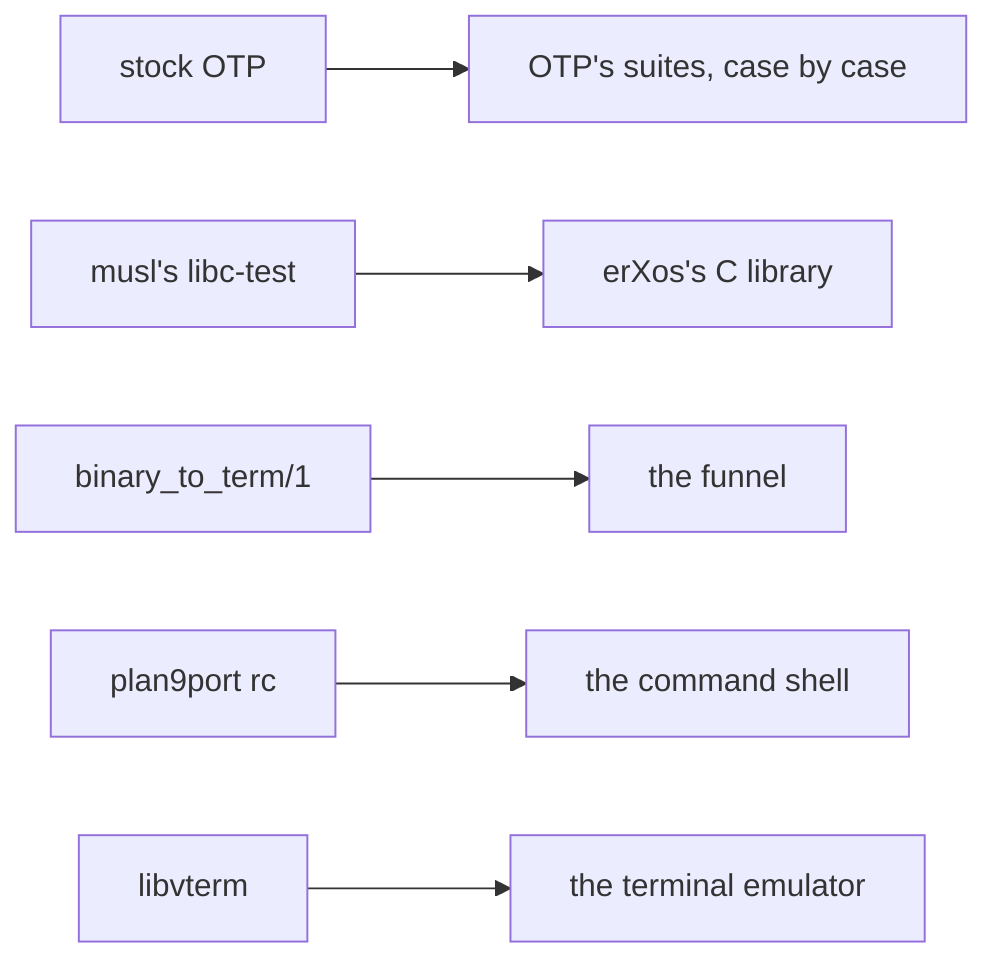
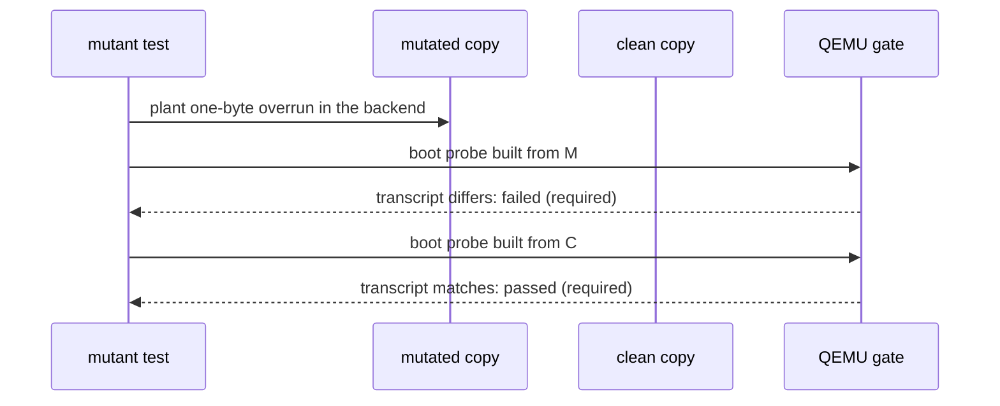
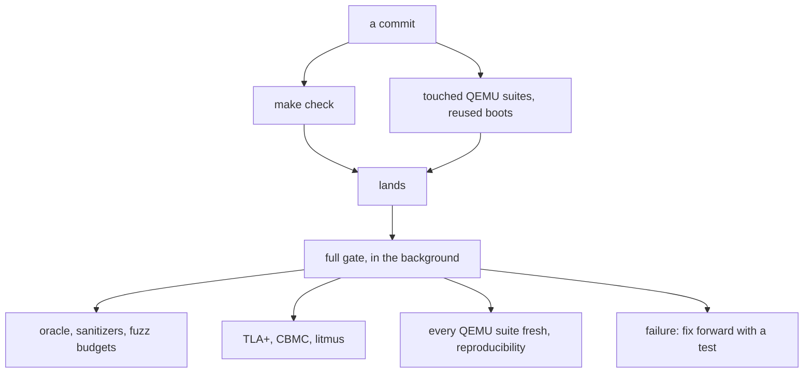

# Chapter 25. Checking the System

> **Status.** **Built:** the oracles: `make check-oracle`, which runs
> OTP's emulator, kernel, stdlib and compiler suites on erXos
> and on stock OTP and compares them case by case, then runs musl's
> `libc-test`; the funnel's differential test against
> `binary_to_term/1`; and the command shell against plan9port's `rc`
> and the terminal emulator against libvterm. Also built are the fuzz
> targets and their budgets, the sanitizer runs, the chokepoint checks
> and the stack proof. The models and bounded proofs are built: the
> TLA+ models of the lane, connections and links, the herd7 litmus
> tests and the CBMC harnesses. So are the exhaustive explorations of
> the TCP core, the USB hub machine, the pipe server and the host
> link's 9P bridge; reproducible boot images and the deterministic-mode
> transcript; the QEMU suites; the seeded faults of each of these; and
> the benchmarks of stock OTP, the guest's runtime and the boot.
> **Designed:** the TLA+ models of the update protocol and of the host
> link's sessions; the kernel interface's conformance cases (the
> harness is built, its roster holds one pending case); the full
> suites of hostile programs; the fuzz campaign against Fiasco's
> system calls; the further oracles section 25.1.4 lists; and the
> benchmark records, comparisons and limits of section 25.9.

**Background needed.** The whole book, chapters
[6](06-construction.md) and [7](07-one-source.md) most: the
functional core, chokepoint checks, seeded violations and the stack
proof are defined there.

A test written by the person who wrote the code shares that person's
picture of what the code should do. If the picture is wrong, the code
and the test are wrong together, and the test passes. Think of a
runtime that prints a pid differently, a C library whose
`pthread_cancel` cannot wake a blocked thread, or a decoder that
accepts one malformed term. Each is invisible to a test that asks only
what its author expected.

Most tests anywhere state their expected answers by hand. erXos asks for answers that do not come from its own code. Where an
independent implementation of the same contract exists, such as stock
OTP or musl's own tests, the two run side by side and every difference
must be explained. Where none exists, a model checker or a bounded
proof supplies the answer from a separate description. And every
check must first be seen to fail on a fault planted for it.

Section 25.1 covers the oracles and 25.2 the seeded faults. Sections
25.3 to 25.5 cover fuzzing and sanitizers, models and bounded proofs,
and exhaustive tests of state machines. Section 25.6 covers
determinism, 25.7 the QEMU suites, 25.8 how the checks are split
between every commit and the slower runs, and 25.9 how the system is
measured.

## 25.1 Answers from outside the code

How does erXos know that `lists:sort/1` behaves as it should, in a
runtime it has taken apart and rebuilt? It runs OTP's own tests of
`lists:sort/1` on erXos and on stock OTP, and compares the results
case by case ([design.md, Testing and the
oracle](../design.md#testing-and-the-oracle)). The rule behind every
check in this section is the project's: behavior that disagrees with
an independent oracle is a bug until it is explained and pinned by a
test.

> **Background: test oracles and differential testing.** A test needs
> a way to tell a right answer from a wrong one; that judge is its
> **oracle**. Most tests carry a hand-written oracle: an expected
> value. A **differential test** instead uses a second implementation
> of the same contract as the oracle. It feeds both the same input and
> reports any difference. Neither needs to be known correct: where
> they disagree, at least one is wrong, and the difference says where
> to look. The method finds the bugs a hand-written expectation shares
> with the code. A bug both implementations share stays hidden.

Figure 25.1 shows the oracles erXos uses and what each judges.



*Figure 25.1. The oracles and what each judges. Each oracle on the
left is an implementation erXos did not write. A difference from it
fails the check unless a checked-in row explains it.*

### 25.1.1 Stock OTP

The same `.beam` files run on both sides. OTP's suites for the
emulator, kernel, stdlib and compiler groups are compiled once, by
stock OTP's compiler, and run under Common Test, OTP's test framework.
On one side they run in erXos's system domain, booted under QEMU on
one CPU with HVF, Apple's hypervisor framework. On the other they run
on stock OTP of the same release, built on the development host
([README.md, Guest and stock oracle](../../README.md#guest-and-stock-oracle)).
A Ruby tool compares the two case by case
(`tools/lib/erx/oracle_suites.rb`). The README estimates the full run
at six to seven hours.

A difference is allowed only when a row of
`test/oracle/hosted_known_differences/` explains it. Two rows of the
emulator group's table, abridged (the spacing is narrowed and the
second reason cut short):

```text
a_SUITE  -  long_timers    failed  cannot run: no distribution; the case starts a peer node
a_SUITE  -  pollset_size   failed  ERTS has no poll set: liberx event sources replace erts_check_io, ...
```

The first case cannot run in a test domain, because it starts a second
Erlang node. The second is a difference the design states: erXos's
ERTS has no poll set.
Every row names one of four causes: a difference a design document
states, a case that cannot run, a bug that `TODO.md` names, or a bug
in stock OTP.

The comparison fails on any difference no row explains. It also fails
on a row that explains nothing, because its case agrees with stock.
Without that second rule a table of excuses could only grow: a fixed
bug would leave its row behind, to hide the next bug in that case.
The hosted runtime, a macOS process, reads the same tables
(`make check-oracle-hosted` runs a fast subset on it), so a case that
differs there and not under QEMU is a bug in one of the two.

Stock OTP's emulator, kernel and stdlib suites, in full, also run
alone in an offline Linux container
with no route out (`make check-oracle-host`,
[design-host-oracle.md](../design-host-oracle.md#oracle-behavior-and-verification)).
Both runs are **Built**.

### 25.1.2 musl's own tests

erXos's C library is musl, modified to call `liberx` instead of a
UNIX kernel
([chapter 13](13-native-programs.md#137-the-posix-lite-personality)).
musl's maintainers publish `libc-test`, small C programs that each
print an error line for every contract they find broken.
`make check-oracle` runs them under QEMU, each test as a small program
of its own, on four CPUs, after OTP's suites.

The verdicts live in `test/conformance/libc-test-verdicts.txt`. A test
not listed there must pass. Each listed test names the result it must
have, the kind of cause and the reason, and a failure also names the
source lines of libc-test that its error lines cite. One line, its
spacing narrowed:

```text
functional/pthread_cancel  timed_out  fiasco  a thread blocked in a call is not interrupted by pthread_cancel: design-fiasco.md
```

The kind `fiasco` marks a difference that follows from running on
Fiasco, documented in [design-fiasco.md](../design-fiasco.md); the
other kinds are `bug`, `upstream` and `cannot-run`. The check holds
each of the file's 55 lines exactly. A listed test that starts to pass
fails the run. So does one that fails at a source line its row does
not list, since that is a new failure hiding behind an old excuse. The
run is **Built**.

### 25.1.3 The funnel against `binary_to_term/1`

The **funnel**, the one C function that decodes and judges every
frame from another domain
([chapter 10, section 10.3](10-domains.md#103-the-funnel)), is erXos's
own code facing a hostile writer. Section
[10.3.4](10-domains.md#1034-how-the-funnel-is-checked) introduced its
differential test, `test/integration/erx_funnel_oracle_test.rb`. The
test generates random control terms, the same terms mutated, and
random payloads. For
every control term the funnel accepts, stock ERTS's `binary_to_term/1` must
decode the same tuple, element by element. For every payload it
accepts, the funnel must charge exactly the heap words that ERTS's own
size pass charges. That matters because the funnel reserves heap
before decoding, so an undercount would let a frame overrun its
reservation. The test is **Built** and runs in `make check`.

### 25.1.4 Further oracles

Two more oracles are **Built**:

* **plan9port's `rc`** for the command shell
  ([chapter 20](20-shell.md#202-rc-in-erlang)): `make check-rc-oracle`
  builds `rc` from a pinned source and runs the shell's corpus of
  scripts under both.
* **libvterm** for the terminal emulator
  ([chapter 22](22-display.md#222-input-routing-and-the-terminal)):
  `tools/lib/erx/vt_oracle.rb` builds libvterm with a small
  harness, and the emulator's screens are compared with its, against
  the differences listed in `test/vt/differences.txt`.

The network stack's model, FreeBSD's TCP/IP stack
([chapter 17](17-network.md#171-why-freebsds-stack)), supplies the
rules that the TCP core's exploration of section 25.5 checks.

The design names more oracles, each designed and not built: the Open
POSIX Test Suite for the POSIX-lite personality, toybox's own tests,
FreeBSD's utilities for the commands that share their names, FreeBSD's
TCP test scripts for `erx_net`, and Linux's F2FS for erXos's
([design.md, Testing and the oracle](../design.md#testing-and-the-oracle)).

## 25.2 Seeded faults

A check that has never failed may not be running at all. It may read
the wrong file, match nothing, or report success on a timeout. So
erXos requires each subtle check to be seen failing on the fault it
exists for: a removed bound, an off-by-one comparison, a dropped
fence. Chapter 6 followed a chokepoint rule's seed from end to end
([section 6.6.3](06-construction.md#663-a-seeded-fault-from-end-to-end));
the other checks follow the same discipline.

**A TLA+ model** carries its seeds as configurations. The links model,
`specs/tla/Links.tla`, has a constant `Fault`, and each value changes
one rule of the protocol. `LinksAnswerFirst.cfg` sets one:

```text
\* The target's runtime puts noproc ahead of what is queued on the lane.
\* An answer overtakes a message sent before it.
CONSTANTS
    Budget = 3
    Exported <- Exports
    Fault = "answer_first"
SPECIFICATION Spec
INVARIANTS AnswersAfterSends
```

With this fault, a runtime answers "no such process" before it
delivers the messages that process sent first. The property
`AnswersAfterSends` says every answer about a process arrives after
everything the process sent. The roster expects this configuration to
fail on exactly that property. The runner matches the property's name
and TLC's exit status, not a substring of its output, so a parser
error, a timeout or another property fails the run.

**A litmus test** has a twin with its fences, or its acquire and
release orderings, removed; the twin must reach the bad outcome the
original never reaches (section 25.4.2).

**A CBMC harness** has seeded defects in `test/cbmc/roster.json`. Each
is one edit of the C core the harness checks, applied to a copy of the
core in a scratch directory, and the harness must fail on a property
matching a stated pattern. `make check` confirms that each edit still applies to
the tree's code, so a seed cannot silently stop matching.

**A fuzz target** can carry seeds too. The shell parser's target,
`tools/fuzz/erx_shell_parse.rb`, runs the parser as it is and then
seven broken copies of it. One allows 257 levels of nesting instead of
256, one does not count `$` as a level, and five get the bound on a
command's length wrong. Each copy must be caught by the property aimed
at it.

**The QEMU gate**, which boots the system and judges its console
(section 25.7), is seeded by mutating `liberx` itself.
`test/integration/qemu_gate_mutant_test.rb` builds a probe guest from
a copy of the sources in which the Fiasco backend's message call asks
for one byte more than a full message holds. The guest must fail its
transcript under QEMU. A control run of an unmutated copy must pass,
so the failure is the mutation's and not the harness's. Figure 25.2
shows that run, which `make check-qemu-mutant` starts.



*Figure 25.2. A seeded fault and the check that catches it. The
control run matters as much as the mutant: without it, a gate that
always failed would pass the test.*

`make check-native-seeds` does the same for the native threads,
watchdog, task and interrupt suites. All of these seeds are **Built**.

One more seed guards the gates themselves. Gates find what they run
from files in the tree (section 25.8), so deleting a fuzz target or a
rule would make a gate quietly run less. `test/host/gate_baseline_test.rb`
holds a floor under what each gate runs: the sanitizer tests, the
QEMU suites, and each chokepoint rule's and C fuzz target's least
number of seeds. Adding to a gate never touches that file; taking
something away must, so every removal is a visible edit.

## 25.3 Fuzzing every parser of untrusted input

What does a parser do with input no test author imagined? In erXos
every parser of untrusted input lands with a fuzz target that tries to
find out. The boot image and its manifests, executable headers, the
funnel, the 9P codec, the shell's parser, device rings, packets and
file system images all have one
([design.md, Testing and the oracle](../design.md#testing-and-the-oracle)).
The tree holds over a hundred targets, in `tools/fuzz/` and as
`test/erlang/*_fuzz.erl`, and `TODO.md` lists the parsers still
without one.

> **Background: coverage-guided fuzzing.** Random bytes rarely get
> past a parser's first check. A **coverage-guided fuzzer** such as
> LLVM's libFuzzer compiles the parser with probes that record which
> branches each input reached. It starts from a few valid **seed**
> inputs, mutates them, and keeps any mutant that reaches a branch no
> earlier input reached. Over millions of runs it works its way deep
> into the format. It reports an input that crashes the parser, hangs
> it, or trips a sanitizer
> ([chapter 6, section 6.5](06-construction.md#65-what-construction-cannot-say)).

### 25.3.1 C targets

A C target is two files. `tools/fuzz/KIND_fuzz.c` is the entry point
libFuzzer calls with each input, and `tools/fuzz/KIND_target.rb`
declares the sources it compiles and the seeds that start it. The
target for executable headers, `elf_target.rb`, compiles
`liberx/elf_plan.c` and `liberx/exec/load_plan.c`, the files the
system links. Its seeds, built in Ruby, include valid executables,
every prefix of each, and one with an unlisted dynamic tag. It checks
more than the absence of a crash. Every position-independent plan the
parser accepts is laid out as the loader lays it out, and each step
must stay inside its span and never write code.

`make check-fuzz` compiles each target with
`-fsanitize=fuzzer,address,undefined` and runs it for a fixed number
of executions with a recorded random seed, so a failure can be
reproduced. The gate refuses a `_fuzz.c` without its `_target.rb`, and
the reverse.

### 25.3.2 Erlang targets

Most of erXos's parsers are Erlang. Their targets are Erlang modules,
run on stock OTP's emulator, that generate inputs and check
properties. They do not measure coverage; they make up for it with
generators that know the format. The shell parser's target,
`test/erlang/erx_shell_parse_fuzz.erl`, draws from soups of `rc`'s
token fragments and random bytes, mutations of valid scripts,
nestings near the 256-level limit, and commands at and over the
4,096-byte bound. Its properties include these:

* every input parses or fails with a diagnostic, and never raises;
* a diagnostic names a line and column inside the source, in printable
  ASCII;
* a tree has at most 256 levels, counted by a walker of the target's
  own;
* a tree printed back to `rc`'s syntax, by a printer of the target's
  own, parses to itself.

The last two show the method: a property computed with the parser's
own helpers would share its bugs. Host tools that read untrusted bytes,
such as the host link's frame reader and the QEMU harness's
screenshot decoder, have Ruby targets run the same way. All three
kinds are **Built**.

### 25.3.3 Sanitizers

A buffer overrun by one byte rarely crashes a program, so a fuzzer
alone would pass it by; a sanitizer makes the damage visible. erXos's
host tests of C code declare themselves with a comment,
`# erx-gate: sanitizers`, and `make check-sanitizers` runs every
declaring test with AddressSanitizer and UndefinedBehaviorSanitizer.
88 test files carry the line. The gate fails when a C core or a
`liberx` source is named by no declaring test, so new C code cannot
escape it. The concurrency tests of the budget, capability, lane and
log cores also build under ThreadSanitizer, which reports data races
([README.md, Correctness and testing](../../README.md#correctness-and-testing)).

macOS has no LeakSanitizer, and the gate says so rather than report
leaks as checked. All of this is **Built**.

## 25.4 Models and bounded proofs

Some bugs need a rare order of events, such as a wake lost because two
CPUs each read before the other wrote. Tests seldom hit such an order.
For these, erXos checks a description of the protocol
against every order of events, within stated bounds.

> **Background: model checking and bounded proofs.** A **model
> checker** takes a small description of a system, its states and the
> steps between them, and visits every state reachable within the
> model's bounds, checking a property in each. If the property fails,
> it prints the shortest sequence of steps that breaks it, a
> *counterexample*. TLA+ is a language for such descriptions, and TLC
> its checker. A **bounded proof** applies the idea to real code: CBMC
> turns a C function into a logical formula and asks a solver whether
> any input, up to stated sizes and loop counts, can break an
> assertion. Both answer "for every case within these bounds": far
> stronger than a test, far weaker than a proof for all sizes.

### 25.4.1 TLA+ models

Three protocol models are **Built**, in `specs/tla/`
([design-verification.md, Model suite and
runner](../design-verification.md#model-suite-and-runner)):

* `Lane.tla`, the shared ring between two domains
  ([chapter 10](10-domains.md#1021-a-lane)): no record is overwritten
  before it is read, records are read whole, and no wake is lost.
* `Connection.tla`, connections between domains: a connection's end
  is handled after every frame it published, and a name is reused only
  after the earlier connection went down.
* `Links.tla`, links, monitors and exits across domains
  ([chapter 10](10-domains.md#107-links-monitors-exits-and-spawns-across-a-wall)):
  an answer about a process arrives after everything it sent, and a
  link two processes make towards each other is never left half made.

Each configuration has one expectation in a roster: `pass`, a
`counterexample` of one named property, or a `deadlock`. Besides the
seeded faults, **reachability** configurations claim that some
important state is never reached, and expect TLC to refute the claim.
They prove the model reaches the paths that matter; a model too
constrained to reach them would pass every property vacuously.
`specs/tla/MAPPING.md` maps each property to the design section that
owns it and the functions that implement it.

`make check-tla` runs the suite, and a timeout or tool error fails it.
TLC checks the model and nothing more. The mapping is reviewed and tested, not proved: the model says
the protocol is right, and the host tests and QEMU suites say the code
follows it.

Two further models are designed and not built: the update protocol of
[chapter 16](16-storage.md#166-updates-through-two-slots), with its
slots, trials, torn records and resets, and the host link's sessions
([chapter 21](21-live-machine.md#214-how-code-gets-into-a-domain)).

### 25.4.2 Litmus tests under herd7

TLC treats memory as one store every CPU sees at once. Real CPUs do
not: an Arm core may let a later load overtake an earlier store.
Whether the lane's fences are enough is a question about the
processor's memory model. erXos asks it with **herd7**, a simulator
that enumerates every outcome a memory model allows for a small
program. Here is the lane's wake handshake, from
`test/litmus/lane-wake-fenced.litmus`:

```text
AArch64 lane-wake-fenced
"the producer stores wpos (a), fences, loads wake (b); the consumer stores wake, fences, loads wpos: one load sees the other store"
{
0:X1=a; 0:X3=b;
1:X1=a; 1:X3=b;
}
 P0           | P1 ;
 MOV W0,#16   | MOV W0,#17 ;
 STLR W0,[X1] | STLR W0,[X3] ;
 DMB ISH      | DMB ISH ;
 LDR W2,[X3]  | LDAR W2,[X1] ;
exists (0:X2=0 /\ 1:X2=0)
```

P0, the producer, stores its write position (`a`), fences, and loads
the consumer's wake flag (`b`). P1, the consumer, does the mirror
image: it sets the wake flag to ask to be woken, fences, and loads
the write position. The `exists` line is the lost wake. Both loads
read 0: the producer sees no request to wake anyone, the consumer
thinks nothing was
written, and both wait. herd7 must report that the outcome never
happens under Arm's model. The twin, `lane-wake-unfenced.litmus`, is
the same program without the two `DMB ISH` lines, and must reach it.
The twin proves that the fences, not the shape of the test, prevent
the bad outcome.

`test/litmus/` holds sixteen such files, for the lane's wake and ring
positions and the pipe's lock
([chapter 13](13-native-programs.md#1345-doorbells-and-lost-wakeups)).
Five of the eight pairs test acquire and release orderings rather
than fences: a release store keeps every earlier access before it,
and an acquire load keeps every later access after it
([section 1.7.3](01-operating-systems.md#173-memory-ordering)), and
the twin uses relaxed accesses, which order nothing. One pair is
written in C11's atomics rather than Arm instructions; herd7 runs it
under RC11, a repaired model of C11's atomics.
`make check-litmus` is **Built**. It checks the litmus programs, not
the compiled lane, so a compiler that dropped a fence would go unseen.

### 25.4.3 CBMC harnesses

CBMC checks C code itself. Each harness, one file in `test/cbmc/`,
includes the core's `.c` file whole, so it reaches the core's static
helpers. It takes its inputs from functions it declares and never
defines, which CBMC treats as "any value"
([design-verification.md, CBMC harnesses and
runner](../design-verification.md#cbmc-harnesses-and-runner)). The
harnesses cover four C17 cores that Fiasco links
([chapter 6, section 6.7.1](06-construction.md#671-the-stack-proof)):
the budget arithmetic; the capability table's lookup, rights and
slot-closing; the grace tracker; and the page funnel. The **grace
tracker** decides when memory that another CPU might still be reading
may be reused. A retired item is stamped with a period. The period
completes once every CPU has reported passing a point where it holds
no such reference. The **page funnel** moves pages between a budget's
reserve and the lists of free and released pages, keeping each
reserve's count equal to the pages it holds. A released page goes on
its list, stamped by the grace tracker, before the budget it was
charged to is refunded, and it is reused only once its period has
completed.

A harness computes its expected answer from the contract in the
design and the core's header, never from the core's own helpers.
`test/cbmc/roster.json` pins CBMC's version and states each harness's
loop bounds, assumptions and the constructs it cannot check. Every
harness runs with unwinding
assertions, so a loop that could run past its bound fails the check
instead of being cut short in silence. A core's `__builtin_trap`, its
response to an impossible state, counts as a failed property.

CBMC models one thread, with every memory access indivisible and in
program order. A harness over atomic fields therefore lists their
ordering as unchecked; litmus tests and ThreadSanitizer cover that
ground. `make check-cbmc` is **Built**.

### 25.4.4 What each covers

| Check | Covers | Does not cover |
| --- | --- | --- |
| TLC | every order of a protocol's steps, within bounds | the code, memory order |
| herd7 | every outcome Arm's model allows for a litmus program | the compiled code |
| CBMC | every input to a C core, within bounds | concurrency, memory order |
| ThreadSanitizer | data races in runs that happen | whether a protocol is right |
| chokepoint checks | where an operation may appear | whether it is used rightly |
| stack proof | worst-case stack of the C17 cores | Fiasco's own C++ |

The last two rows are the static checks of chapter 6
([section 6.6](06-construction.md#66-only-x-may-do-y-chokepoints-as-build-checks)
and [section 6.7](06-construction.md#67-bounded-stacks)), which run in
every `make check`. No row replaces another, and each report states
its bounds and assumptions with its result.

## 25.5 Exhaustive tests of protocol state machines

A model checker checks a model; erXos can also explore the real code.
Chapter 6's functional core makes this possible
([section 6.3](06-construction.md#63-functional-core-effects-at-the-edge)).
A protocol's decisions are a pure function from a state and an event
to the next state and a list of actions. A pure function can be called
on every event in every state, on the host, with no machine to boot.
The project's rule is that every protocol state machine is tested this
way. Four explorations are **Built**:

* **The TCP core.** `test/erlang/erx_tcp_explore.erl` applies every
  kind of segment, at every class of sequence and acknowledgement
  number, and every user request, in every state, breadth first. On
  every step it checks, among other properties, that no byte is
  delivered twice or out of order and that every state change is one
  RFC 9293 allows
  ([chapter 17, section 17.4.5](17-network.md#1745-how-the-core-is-checked)).
  It runs again with sequence numbers near 2^32, to cross the wrap.
* **The USB hub machine.** `test/erlang/erx_usb_hub_core_tests.erl`
  explores the hub's port machine to a fixed point, where no new state
  appears, for hubs of 1, 2, 7, 8 and 15 ports.
* **The pipe server.** `test/erlang/erx_pipe_explore.erl` drives the
  pipe server's decisions with three holders through every order of
  their events, including notices forged by the wrong holder and
  repeated after an end is gone
  ([chapter 13, section 13.4](13-native-programs.md#134-pipes-in-user-space)).
* **The host link's 9P bridge.**
  `test/erlang/erx_hostlink_9p_exhaustive.erl` enumerates every
  interleaving of a host and one file grant within a small bound:
  reads, flushes of requests in flight, and replies in any order, well
  formed or not.

The TCP exploration carries seeds too. Its host test,
`test/host/erx_tcp_explore_test.rb`, replaces one line of the core at a
time, such as a reset accepted at `rcv_nxt` instead of at
`last_ack_sent`. The property named for that fault must catch it, and
because the search is breadth first, the trace it reports is a
shortest one.

## 25.6 Determinism and reproducibility

Can someone else check that an erXos image was built from the source
it names? Only if building the same source twice gives the same bytes.
erXos holds itself to that, and to a second property: a boot in a
special mode writes the same console transcript every time.

> **Background: reproducible builds.** A **reproducible build** gives
> byte-identical output from the same source, tools and settings,
> whoever runs it and whenever. Compilers and packers often break this
> by accident: they record the time, the build directory, a random
> seed, or files in the order a directory listed them. A reproducible
> build removes each such input. Its payoff is verification: anyone
> can rebuild an image and compare hashes, instead of trusting the
> machine that built it.

**Reproducible images.** `make check-reproducible` builds the
production boot image and its medium twice from clean, for QEMU's disk
image and for the Raspberry Pi 4's SD card image, and requires the
results to be identical byte for byte. Both builds pack one build of
the kernel, so the check covers erXos's own code and packing, not a
second build of Fiasco
([README.md, Correctness and testing](../../README.md#correctness-and-testing)).
It is **Built**.

**Deterministic mode.** A multi-CPU boot is never the same twice:
timer interrupts land at different instructions, and threads race. The
kernel command-line word `erx.det=1` removes those sources
([design-fiasco.md, Deterministic mode](../design-fiasco.md#deterministic-mode)).
The harness runs QEMU on one CPU under TCG, QEMU's instruction
translator, with instruction counting, so the virtual clock advances
with instructions executed rather than with real time. The real-time
clock starts at a fixed date, and the device tree carries no random
seeds. Every domain runs ERTS's interpreter on one scheduler, so no
code depends on where BeamAsm placed it, and the watchdog is off.

`tools/lib/erx/deterministic_transcript.rb` compares two such boots
from erXos's banner to the command shell's banner. The span must
include the kernel's report of its timer; without it, two boots would
compare equal whether or not the clock counted instructions. The check
runs in the QEMU gate and is **Built**.

## 25.7 The running system under QEMU

Host tests check pieces; only a boot checks the system. A **QEMU
suite** builds an image, boots it in QEMU and judges what the guest
writes on its serial console. Each suite is one file in
`tools/lib/erx/qemu_suites/`, 29 in all, from native threads and the
watchdog to the system domain, block devices, the display, the kiosk
and the Raspberry Pi 4's board model.

A suite declares the **cells** it expects, each a configuration such
as one CPU or four, or a declared case. It reports every cell as
`passed`, `failed`, `timed_out`, `partial`, `not_run` or `pending`
([design-build.md, What the gates run](../design-build.md#what-the-gates-run)).
An expected cell the suite did not report becomes `not_run`, never
`passed`: the inspector's never-fabricate rule
([chapter 21, section 21.2](21-live-machine.md#212-never-fabricate)),
applied to tests.

Suites run under HVF, except that the landing gate of section 25.8
may move a suite's multi-CPU cells to a second host, which runs them
under TCG. TCG also runs the deterministic transcript, one boot
to the shell on one CPU, and the Raspberry Pi 4 suite, whose board
model starts its CPUs at a privilege level HVF cannot host. A host
whose QEMU lacks either accelerator fails the gate before anything is
built, and the gate never falls back from one to the other. A test
that passes under one accelerator and fails under the other is a bug
until explained.

The gate does not boot a guest again when it already passed on the
same inputs
([design-build.md, Reusing passing boots](../design-build.md#reusing-passing-boots)).
The key is the SHA-256 of everything the guest's output depends on,
from the image and QEMU's arguments to QEMU itself and the build
tools' code. On a hit, the stored serial log is judged again by the
suite's current checks. A boot with a disk, a network device or a host
link talks to the host, so it always runs fresh.

The kernel interface has a conformance harness, `tools/erx
conformance`, which boots one guest per configuration, TCG and HVF at
one CPU and four, and reads each case's verdict from the serial line.
The harness is **Built**. Its roster, `test/conformance/roster.txt`,
holds one pending case, since each case lands with the kernel call
whose contract it tests. The conformance suite is designed and not
built.

Some hostile cases run in the system domain's suite: a configured
domain asks for services it was not given, and sends atoms the system
domain lacks. The full suites of hostile programs, which fill lanes,
forge pids and ignore kills, are designed and not built. So is a fuzz campaign against Fiasco's system calls
([design-fiasco.md](../design-fiasco.md)). Without it, that nothing a
domain does can panic Fiasco rests on Fiasco's own code.

## 25.8 Fast checks and slow checks

The checks in this chapter take from seconds to hours. Running them
all on every commit would make each change wait most of a day, and
developers who wait that long batch their changes, which makes
failures harder to trace. So erXos splits the checks into two tiers.

The **landing gate**, for every commit, is `make check` and the QEMU
suites the change touches. `make check` runs offline. It runs each
host test file as its own process, with its own log and deadline,
including the funnel's differential test and the explorations of
section 25.5. It also runs the chokepoint checks, the stack proof, the
generated tree's tests, and the TLA+ and CBMC runners' own tests with
stand-in tools. A touched suite runs through
`tools/erx check-qemu --suite NAME`, which reuses passing boots.

The **full gate** runs before a large body of work merges, and in the
background on a spare machine; design-build.md and `tools/erx` call
this tier the milestone gate. It is `make check-oracle`, the
sanitizer runs, the fuzz budgets of `make check-fuzz`,
`make check-reproducible`, `make check-cbmc`, `make check-tla`,
`make check-litmus`, and `make check-qemu`, which boots every suite
fresh, one after another. A failure there is fixed forward with a
regression test. It does not undo work that passed the landing gate,
unless it breaks that gate too. Figure 25.3 shows the two tiers.



*Figure 25.3. The fast and the slow checks. Every commit waits only
for the landing gate; the slow checks run on what has landed, and a
failure they find gets a regression test rather than a revert.*

The gates run what the tree declares. A chokepoint rule is a file in
`tools/lib/erx/chokepoint_rules/`, a sanitizer test carries its comment
line, a QEMU suite is a file in `tools/lib/erx/qemu_suites/`, and a
fuzz target is its pair of files. Adding a chokepoint rule, a
sanitizer test, a suite or a fuzz target means adding a file, so
parallel work never edits a shared list for them. The litmus tests,
the TLA+ configurations and the CBMC harnesses are the exception:
each kind is listed in one central file. The baseline of
section 25.2 makes removal visible. Every command runs under one
runner with a log and a hard deadline, and a check that cannot run,
for a missing tool or a timeout, fails; none is reported as skipped
and green
([design-build.md, Processes and evidence](../design-build.md#processes-and-evidence)).

## 25.9 Measuring the system

A check says whether the system gives the right answer; a measurement
says how long the answer took. The checks of this chapter could not
have seen the console on the Raspberry Pi 4 lose pasted bytes: every
byte that arrived was right, but the driver's process sometimes ran
milliseconds after the interrupt, and the UART holds less than a
millisecond of input
([chapter 9, section 9.2.4](09-processes.md#924-urgent-work)). Built
are the benchmarks `tools/erx bench` runs today: stock OTP's message,
spawn and switch costs, the same workloads in a guest against stock
OTP, boot time, and a few subsystem workloads. Designed is the system
that measures below the runtime
([design-bench.md](../design-bench.md)).

> **Background: microbenchmarks and tails.** A **microbenchmark**
> times one small operation many times: a call that asks the system
> for nothing, a wake of a sleeping thread, a page committed. Its
> average hides what users feel. A **tail** is the slow end of the
> distribution, such as the 99th percentile, the time that one
> operation in a hundred exceeds. A lost interrupt or a dropped byte
> lives in the tail, so a benchmark that reports only a mean cannot
> see it.

In the designed system, each run of a benchmark leaves one
**benchmark record (designed)** in the project's history repository,
never in the source tree. The record separates where the run happened, its environment (QEMU under HVF,
deterministic mode, or the board, with the system that ran), from what
ran: the revision, the image, the compiler and its flags. Every
interval in it is two readings of one clock. Inside a guest that clock
is the processor's system counter, which the kernel interface's clock,
ERTS's time and the trace ring all read; at the board's pins it is a
logic analyser's. A guest sends a histogram of its samples rather than
the samples themselves, since the board's console carries about 11 KiB
a second. A cell that measures how a processor is shared sends
instead, for each of a few fixed windows, each spinning thread's count
of passes, its longest gap between them and the turns it lost, from
which its share of the processor follows.

Two records are compared only when their environments are equal, so a
number taken under TCG can never be set against a native one. The
comparison is a rule, not a judgement. The **noise band (designed)** of
a number is its range over at least three boots of the baseline. A
candidate inside the band is the same; one outside it is slower or
faster only in a **paired run (designed)**, where the two images boot
alternately on one host in one session, so that the host's own drift
falls on both. Anything else is inconclusive, and inconclusive is not
a pass.

Thresholds inform; they do not fail a commit. Exactly three limits do,
each once three recorded runs have calibrated it: no lost wake, anywhere;
and on the Raspberry Pi 4, the console's interrupt handled within 0.7 ms
with no byte lost, and the SD controller's within 1 ms, both timed from
the kernel's entry, which until the kernel stamps that entry leaves them
partial rather than passed. The landing gate runs a fixed set of cells
from five benchmarks as one more QEMU suite, with a target of about a
minute: `wake`, how late a waiting thread runs; `sched`, how a processor
is shared; `nullcall`, the round trip of a request the root service
refuses at its decoder; `vm`, what memory costs; and `xdomain`, a small
message from one domain to another. A passing suite says the benchmarks
ran and answered correctly; whether a change made the system slower is
the comparison's question, and an inconclusive comparison leaves it open.

Other systems are measured beside erXos in two places. Under HVF on the
development host, L4Re and Linux boot in the same QEMU machine as
erXos's bench images, with the same processors and memory, each in turn
over several rounds of one session. Genode's own kernel boots there
only under QEMU's emulation, always on four processors, so a session
that includes it runs every system emulated at four processors, and
its numbers are set beside erXos's emulated runs and never beside a
number from HVF or the board. The system is part of where a run
happened, so no comparison can turn one system's number into a verdict
on another's; the systems meet only in side-by-side tables, one for each
layer. The kernel table sets the kernels' own paths beside each other: a
system call, a round trip between two threads and between two address
spaces, a wake, memory calls and a shared CPU. Its erXos side is the
root task calling the kernel and the root service directly, so it is
kernel against kernel, and says nothing of what a program pays. There Linux is a
distribution's stock kernel with erXos's small benchmark program as its
only user program, and L4Re is built by its own build system from the
revision erXos's kernel came from, running its own IPC benchmark, whose
cycle counts stay cycles and are never converted. The Erlang table sets
erXos's message between two domains beside stock OTP on the same Linux:
two nodes, two operating-system processes, exchanging the same 64-byte
message over Erlang distribution, and two processes within one node
beside erXos's exchange within one domain, and Erlang's own spawns,
tables, file reads and loopback sockets beside stock's.

The program table answers the question the kernel table cannot: what a
program such as Doom pays for its calls. One small C program, built by
the same compiler with the same flags against musl on both erXos and
Linux, times ordinary UNIX calls and UNIX IPC: `getpid` and
`clock_gettime`, opening, reading and writing files, pipes and sockets
between two processes, threads, sleeps, starting a program and waiting
for it, memory, and whole small workloads such as a pipeline of
toybox's commands. On Linux each call goes to its kernel; on erXos it
goes from musl through `liberx`'s program layer to the service that
owns it, mostly Erlang in the program's own session, so a file read
pays the program's handler and the file server and a `getpid` pays no
kernel at all. Genode, a microkernel system whose programs also reach
their services in user mode, runs the same program on its own kernel;
its C library cannot place a thread on a processor, so its rows are
marked unpinned, and every row that times two threads, on one
processor or across two, is unsupported.
L4Re has no row there. Each call is tried once before it
is timed, and one that answers that it is not implemented makes its row
unsupported, so the table shows by itself which calls erXos's programs
do not have yet.

The same Raspberry Pi 4 also boots stock L4Re and Linux, with
the same firmware settings, and each runs the counterpart of an
operation where one exists; the side-by-side table says where none does.
L4Re runs its own IPC benchmark, and its published numbers for this
board are a diagnostic of the setup, not a condition for the
comparison. Linux runs one small C program of erXos's own, compiled on
the board, and serves as the best-case comparison there.

Nobody needs to stand at the board while erXos's own benchmarks run on
it. A benchmark image has no shell, so it cannot be told to reboot;
instead every boot of it ends by resetting the machine, and the board
then boots what the development host serves it next over the network.
The host's boot server hands out a **queue of signed boot
images (designed)**: the first download takes the first image, the next
download the next, and every download after the last benchmark image
takes the image the board was found with, so the last benchmark boot's
reset brings the board back on it. The host changes nothing while the
board walks the queue, and the server ties each download's image to the
signature it sent with it, so no boot ever loads half of one image and
half of another. Ten runs are ten images of one build, a paired run
alternates two. Each image carries a name the host drew for it, which
the benchmark prints before and after every result, so a result is
counted for the boot that printed it even when bytes are lost on the
serial line; a lost line costs that line's result, never a wrong one.
Only a hang below the benchmark's own deadline needs the board's power
cycled by hand.

## 25.10 What the checks cannot say

Every check here answers a narrower question than its name suggests.
TLC checks a model, not the machine code. herd7 checks litmus
programs, not the compiled lane. CBMC's answer holds only within its
bounds, for one thread. ThreadSanitizer finds data races but does not
show that a protocol's memory ordering is right. An oracle cannot see a
bug it shares with erXos.

Some parts of the system are checked less than the rest. Fiasco's C++
is outside the stack proof and the chokepoint checks; its thread
stacks are measured, not proven
([chapter 6, section 6.7.1](06-construction.md#671-the-stack-proof)).
What a device does to Fiasco, such as an asynchronous error or a storm
of interrupts, is driven by no erXos test. These are limits of the
system.

## 25.11 Design choices

**Oracles over hand-written expectations.** Writing expected answers
by hand for OTP's thousands of cases would restate OTP's behavior with
every misreading built in. Running the suites OTP's developers wrote,
against the runtime they built, borrows decades of their judgment. The
price is the known-differences tables, which must stay exact; the
stale-row rule keeps them from becoming a place to hide bugs.

**Bounded tools over a full proof.** A microkernel's C code can be
proved correct against its specification, at a cost seL4's authors
put at about 20 person-years in all, of which about 11 went into the
kernel-specific proof (Klein et al., 2009). erXos runs on Fiasco and
checks its own code with tools whose cost grows with what they check. They are models of the
protocols that are hard to get right, bounded proofs of small C cores,
and exhaustive exploration of pure cores. Each says exactly what it
covers.

**Discovery from files over a central list.** A central list of tests
is an enumeration every change must remember to update
([chapter 6, section 6.1](06-construction.md#61-the-list-that-is-never-complete)).
Files remove that duty. The price is that a deleted file goes
unnoticed unless something counts it, which is the baseline's job
(section 25.2), and that removal edits that baseline.

**Slow checks off the commit path.** erXos accepts that a slow check
may find a fault a few commits late, and fixes it forward with a test,
rather than make every commit wait six hours for the oracle.

## Summary

erXos judges its code against answers it did not write: stock OTP's
suites, musl's `libc-test`, ERTS's own term decoder, plan9port's `rc`
and libvterm. Every allowed difference is a checked-in row with a
cause, and a row that no longer explains a difference fails the run.
Every subtle check is first seen to fail on a planted fault. Every
parser of untrusted input has a fuzz target built from the sources the
system links. TLA+ models, herd7 and CBMC answer for every case within
stated bounds, and pure protocol cores are explored state by state on
the host. Boot images build byte for byte the same, and a
deterministic boot writes the same transcript twice. QEMU suites
report every cell's status and never invent a pass. Fast checks guard
every commit; slow ones run on what has landed. In the design,
benchmarks leave records outside the tree, compare only like with
like, and of all their limits, once calibrated, only three fail a
commit: a lost wake and, on the board, a late console or SD interrupt.

## Where to read next

* [design.md, Testing and the oracle](../design.md#testing-and-the-oracle):
  the layers of testing and every oracle, built and designed.
* [design-verification.md](../design-verification.md): how models are
  built, mapped to code and run, and the CBMC harness rules.
* [design-host-oracle.md](../design-host-oracle.md): the offline
  Linux container that runs stock OTP's suites.
* [design-bench.md](../design-bench.md): the benchmarks, their record,
  the comparison rule, the three limits and the other systems on the
  board.
* [design-build.md, What the gates run](../design-build.md#what-the-gates-run)
  and [Reusing passing boots](../design-build.md#reusing-passing-boots):
  gate discovery, cell statuses and boot reuse.
* [design-fiasco.md, Deterministic mode](../design-fiasco.md#deterministic-mode):
  the settings behind a byte-identical transcript.
* [design-network-stack.md, The TCP core: exhaustive exploration](../design-network-stack.md#the-tcp-core-exhaustive-exploration):
  the alphabet, abstraction and properties of the TCP exploration.
* [README.md, Correctness and testing](../../README.md#correctness-and-testing):
  each check's command, in one list.
* Leslie Lamport, *Specifying Systems: The TLA+ Language and Tools for
  Hardware and Software Engineers*, Addison-Wesley, 2002: TLA+ and TLC,
  from the language's author.
* Jade Alglave, Luc Maranget and Michael Tautschnig, "Herding Cats:
  Modelling, Simulation, Testing, and Data Mining for Weak Memory",
  *ACM Transactions on Programming Languages and Systems* 36(2),
  article 7, 2014: the method behind herd7 and its litmus tests.
* Daniel Kroening and Michael Tautschnig, "CBMC: C Bounded Model
  Checker", TACAS 2014, LNCS 8413, pp. 389-391: the tool behind the C
  harnesses.
* Gerwin Klein et al., "seL4: Formal Verification of an OS Kernel",
  *22nd ACM Symposium on Operating Systems Principles (SOSP)*, 2009:
  what a full proof of a microkernel costs and gives.
* William M. McKeeman, "Differential Testing for Software",
  *Digital Technical Journal* 10(1), 1998: the method of section 25.1.
