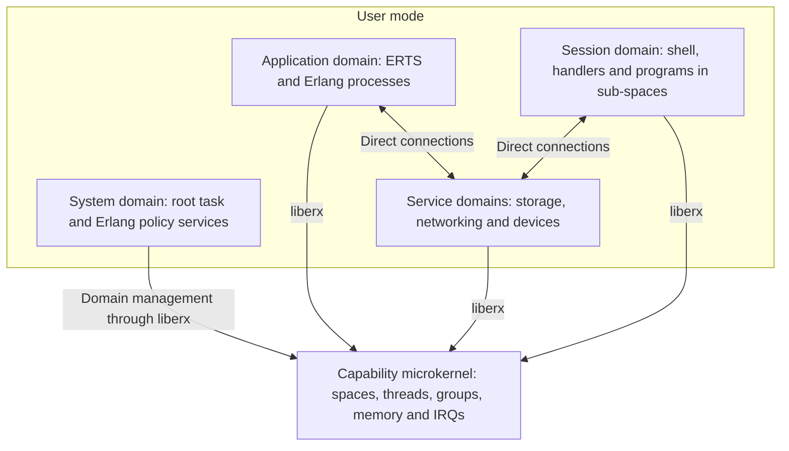

# erXos overview

erXos is an Erlang-native operating system built around a capability
microkernel. Erlang processes, messages, links and supervision provide
the system's common execution and failure model. Hardware protection
separates groups of those processes into domains; the kernel controls
their memory and CPU resources, while each runtime schedules its own
lightweight processes. System services, file systems, the network stack
and drivers are predominantly Erlang.

The aim is a machine that can be programmed, inspected and changed as one
live Erlang system, with explicit authority across protection boundaries.
Native programs fit into that environment through a capability-confined
POSIX personality. AArch64 is the first architecture, QEMU `virt` the
first platform, and the Raspberry Pi 4 and 5 the first boards. Apple
Silicon macOS is the primary development host, followed by Linux.

This is an overview of the target design. [design.md](design.md) owns the
architectural decisions and links to the subsystem specifications;
[plan.md](plan.md) defines the build order and acceptance gates.

## Kernel, domains and runtimes

The kernel is a C17 capability microkernel based on the design and
know-how of L4Re's Fiasco. It knows address spaces, native threads, groups,
memory objects, capabilities and interrupts. Erlang pids, mailboxes,
file names, users and POSIX processes belong above it. All runtimes run
in user mode, including the runtime hosting the trusted system services.

A **domain** is the principal hardware isolation boundary: an address
space containing a runtime, its lightweight processes and its own code,
atom table, ETS tables and registered names. ERTS is the first runtime;
the kernel/runtime contract accommodates other runtimes without teaching
the kernel their process models. A native extension has the authority of
the domain containing it, so code requiring a separate trust boundary
gets a domain or a sub-space of its own.

The **system domain is the root task**. Its C17 domain library in `liberx`
constructs and ends domains; Erlang policy decides what each receives.
One checked system manifest determines the configured domains, devices,
resource limits, facets and initial connections. The root task is a
deliberate availability boundary: its fault or a missed watchdog deadline
records the failure and resets the machine. Other domains can be ended
and restarted without reconstructing the root task.

The system domain runs an interpreter-only ERTS image, keeping BeamAsm,
asmjit and the C++ runtime out of that trusted runtime. Ordinary ERTS
domains use BeamAsm by default; command domains and deterministic mode
also use the interpreter image. `liberx` provides the common kernel
interface and the backends for erXos's kernel, the Fiasco stopgap and
hosted development. See [the kernel](design-kernel.md),
[runtimes](design-runtime.md) and [system services](design-system.md).

## Two schedulers, one resource authority

The kernel allocates CPU time to **groups** of threads through grants:
quotas per period, allowed CPUs and scheduling parameters. Grants form
a hierarchy bounded by their parents. A runtime schedules its processes
on the group's **executors**, ordinary preemptible native threads, so an
Erlang spawn or process switch requires no kernel operation.

The boundary avoids arbitrary upcalls into a runtime scheduler. Wakeups
and capacity advice are consumed at runtime safe points; executors do
not block on external work, which uses separate workers. The kernel
enforces the grant regardless of what a runtime reports. Native threads
and Erlang executors therefore compete under the same CPU authority.

There is **no CPU donation** along a service request. Shared services
run on their own capped grants and admit bounded control work through
per-client facets and lanes. Bulk computation stays with clients or
explicitly provisioned work. A busy service can slow its clients, but a
request cannot silently make the server inherit an unlimited obligation
to spend CPU. More elaborate scheduling cooperation must outperform the
plain configuration in matched measurements before earning its place.

Memory has a corresponding hierarchy of **budgets**, modelled as space
banks. Every kernel allocation is charged, and deleting a budget deletes
the objects and child budgets charged to it. Objects that must survive
a domain are charged to a longer-lived owner: connection memory has
system-managed lifetime budgets, for example, so a domain's exit cannot
delete a ring under a surviving peer. Memory commitments reserve the
resources their faults can need, keeping another service out of the
kernel's fault path. See [scheduling](design-scheduler.md) and
[budgets](design-kernel.md#budgets).

## One process world, explicit authority

Every Erlang domain is an Erlang node with its own name. Its domain id
is the node creation, so a pid identifies its owning domain without a
central pid allocator. Within a domain, retained Erlang behaviour is
checked against stock OTP. Across domains, distribution is carried over direct
connections consisting of bounded shared-memory lanes and IRQ doorbells.
No central router forwards every message.

Each receiver owns its **funnel**: it copies and validates incoming frames
and checks authority against an export table written only by its own
runtime. The lane identifies the sender's domain. A pid carried as data
grants nothing by itself. When an owner hands out a pid, it exports
permission to send and monitor; a cross-domain spawn gives the parent
the child's rights, while linking or killing an otherwise unrelated
process requires an explicit export. Missing authority has dead-process
semantics, preventing an unprivileged caller from probing for a target.

Kernel capabilities are a separate mechanism: generation-checked entries
in per-space tables, with rights that only shrink and transfer at an IPC
rendezvous into receiver-reserved slots within a domain's sub-space tree.
Interdomain signals use connections and exports/facets; the domain library
installs each new domain's initial kernel capabilities. Kernel calls access bulk data
through memory objects and offsets in the kernel's own mapping, rather
than dereferencing caller-supplied pointers. Mappings cannot be writable
and executable together; JIT code is made only by user-mode runtimes in
images explicitly permitted to do so. Privileged services use
**facets**, processes bound to one grantee and a scope. Their admission
paths authenticate origin and mint scoped handles before a handler can
perform an authority-consuming effect. Names remain useful for discovery
and debugging without becoming ambient authority.

This common process world has explicit compatibility boundaries.
Cross-domain traffic has bounds and export checks; registered-name
operations and `global`/`pg` registries stay within a domain. A runtime is
trusted for its own processes, not to enforce another domain's isolation.
See [domains and messaging](design-domains.md).

## Files, programs and devices

Each domain has its own namespace of paths rooted in file grants. File
servers hold the roots and rights, so resolving a path cannot escape
the authority the domain already holds. The protocol is standard
**9P2000.L**: Erlang terms on internal connections, its standard byte
encoding at the host and network edges. Inspection is also available as
a scoped `/proc` tree, and device services expose `/dev`.

A **native program is a port of its session**, executing in a protected
sub-space rather than acquiring a full Erlang domain. Its Erlang handler
mediates requests with the authority its starter supplied. It has no
domain identity, export table or direct service connections. Pipe ends
are installed by the session, and bulk file bytes use session-provided
data areas rather than per-byte Erlang messages. A program's descendants
end with their parent; long-lived services belong under supervision.
Shared file mappings use one object per file within a session; different
sessions observe one another through write-back, without a kernel pager
waiting on a remote file server.

The POSIX personality uses musl and grows from spawn, descriptors, pipes
and signals toward `fork`, `exec`, shared libraries, file mappings and
terminals. It targets recompiled Unix software at roughly QNX's level,
with documented differences, rather than Linux binary compatibility.
The shell implements Plan 9's rc language in Erlang and combines Erlang
commands with native programs such as toybox's applets. Erlang command
pipelines can carry structured records with status and provenance.

Drivers are supervised Erlang processes over thin C device shims. C
handles register access, DMA address construction and per-byte primitives;
Erlang handles descriptor processing and policy. Native driver code needs
a measured justification recorded in the driver table. Device assignment
is explicit in the manifest. An IOMMU is used where the platform provides
the required confinement; an unconfined DMA device and its driver remain
in the trusted base, with release configurations separating them from
hostile-input parsers. CPU address-space isolation alone cannot confine
such a device.

Storage keeps established formats: EROFS under a verified hash tree for
immutable releases, erXos's Erlang F2FS for writable storage, and FAT for
exchange. Littlefs supplies the initial writable store; lwIP supplies the
initial network stack before its Erlang replacement. Signed A/B updates
use a healthy trial before committing a slot. Private keys live in a
separate vault domain, reached through purpose-scoped operations rather
than exported key bytes. Details are in [files](design-files.md),
[programs](design-programs.md), [the shell](design-shell.md),
[storage](design-storage.md) and [drivers](design-system.md#drivers).

## A live machine that can explain itself

The console and host tools expose the same inspection schema over kernel
objects, domains, processes, programs and services. Every value carries
its reporter and an explicit status: an unanswered query stays a timeout,
and unavailable data stays unknown or unsupported. Kernel scheduling and
runtime scheduling appear on one trace timeline. Source locations and
content-addressed module versions connect activity to code.

Live code loading, supervision and the host's compile/upload loop make
development part of the running environment. A module's hash identifies
its bytes; it does not authorize them or undo application state when an
older version is loaded. Release consoles authenticate into scoped user
sessions, and evaluating code in the system domain requires its own
privileged facet. Text from another domain or device passes through a
terminal escaper before reaching the operator. See
[the live-machine design](design-live.md).

## Influences and how they fit

| Influence | What erXos takes from it |
| --- | --- |
| L4/Fiasco | The capability microkernel, kernel threads and IPC gates, helping locks and an established engineering lineage. erXos records each departure from that model. |
| EROS's space banks | Hierarchical allocation budgets whose destruction revokes and reclaims the objects they own. |
| Erlang/OTP | Lightweight processes, preemptive runtime scheduling, links, monitors, supervision and live code as the ordinary system model. |
| Scheduler activations and runtime-oriented scheduling research | The two-level scheduling problem and its failure lessons: retain runtime scheduling while avoiding arbitrary re-entry, blocking executors and unenforced hints. |
| Genode | Components with explicit resources, memory accounted at service boundaries and CPU supplied through component grants. |
| Plan 9 and Inferno | Private namespaces, file services, rc, a runtime-centred environment and factotum's separation of key use from key possession. |
| Genera | The whole machine as an inspectable, modifiable programming environment, with useful structure preserved in its tools. |
| LionsOS and sDDF | Small driver mechanisms, explicit ownership and bounded queue/notification interfaces, used as design references and driver oracles. |
| Singularity and capability-system research | Language/runtime-oriented structure and explicit communication contracts, while erXos keeps hardware protection between mutually distrusting domains. |

The [context and decision ledger](design.md#context),
[kernel's L4 lineage](design-kernel.md#l4-lineage) and
[research records](design.md#references) explain these connections and
the alternatives considered.

## Construction and development path

The implementation rules support the architecture: pure decisions with
effects at the edge; one-source generated ABI, service and inspection
bindings; build checks for exclusive access paths; and bounded kernel
stacks. Independent TLA+/TLC models check protocol designs, while host
exploration and concrete failure tests check the actual C/Erlang cores.
Stock OTP, musl and external file-system implementations supply behavioural
oracles. Fuzzing, sanitizers, weak-memory tests and QEMU/board conformance
address properties the protocol models do not establish.

The development path reaches a usable vertical slice with modified
Fiasco, OTP and musl before replacing the stopgap kernel with erXos's C17
kernel behind the same interface. Replacements are gated on conformance
and measured behaviour. Hosted mode shortens iteration; QEMU suites under
TCG and HVF check the virtual target, with board-specific conformance
tested on hardware. Development builds
run trusted code only until security closure on erXos's own kernel.

The main tradeoffs are deliberate: a runtime per isolation domain has a
footprint; bounded shared services can be bottlenecks; the root task is a
machine-wide availability dependency; hardware determines DMA protection;
and resource quotas do not eliminate timing or cache side channels.
Compatibility and performance are tested against named workloads rather
than assumed from the architecture. [The roadmap](plan.md),
[generation design](design-generation.md),
[verification design](design-verification.md) and
[open work](../TODO.md) carry the details.
